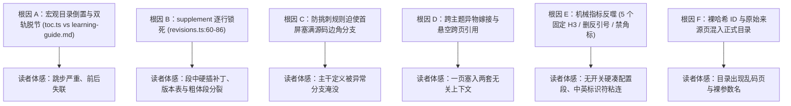
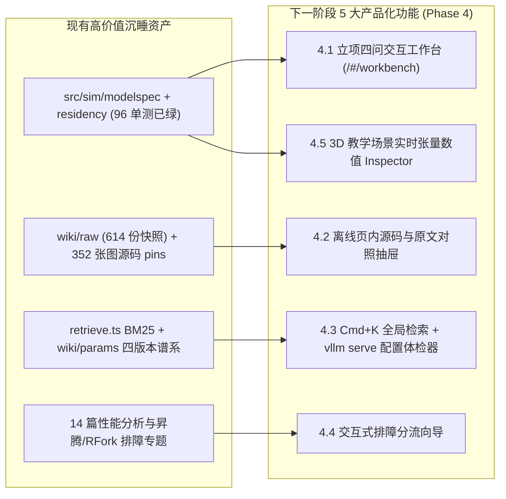

# 全站深度审查、循序渐进重构、全栈缺陷根治与功能演进总方案

> **状态与单一真相源说明**：本文件制定并合并于 2026-11-14/15，整合了两轮独立全量只读审查（知识库教学循序渐进诊断 + 全栈代码/静态构建/仿真引擎深度审查 + 下一阶段高价值产品规划）的全部实证结论与分步方案。遵循 [docs/plans/README.md](README.md) 约定——本文件是本次审查与规划在仓库内的**唯一持久化真相源**；计划落盘不代表整改已完成，不在本文件中维护动态完成率，所有执行均须经用户拍板后按阶段推进。

---

## 一、 愿景对齐总评、历史背景与两轮联合实测基线

### 1.1 历史脉络与前序结论纠偏

在 [2026-11-03 整改方案](2026-11-03-wiki-remediation.md) 与 [2026-11-10 接续计划](2026-11-10-wiki-continuation-plan.md) 中，项目重点攻坚了“官方资料漏讲、双机多节点参数缺失、6,400+ 来源出现项逐条核验”。这批工作夯实了 164+ 篇知识页与 352 张规格图的事实底座，但在**增量逐行锁（`revisions.ts`）与机械审计指标（`standard.ts` / `lint.ts`）**的共同挤压下，产生了明显的教学副作用——**“事实越来越密，正文越来越乱，初学者无法循序渐进读下去”**；同时在工程侧积累了门禁耦合、静态构建断链、混合模型参数漏算等断层。

针对此前外部中断会话遗留的部分过期判断，经两轮代码实证核对纠偏如下：

1. **纠偏：“主阅读页不载入 3D”不属实（实为顶层文档失步）**：[WikiPage.tsx](../../src/app/pages/WikiPage.tsx#L504-L510) 已将 `wiki-scene` 围栏完整接入 `<WikiScene>`，当前共有 **19 篇正式概念页（23 处场景锚点）** 在正文中直接渲染三维教学场景；真正的问题是 [README.md](../../README.md#L3)、[PLAN.md](../../PLAN.md#L13)、[App.tsx](../../src/app/App.tsx#L37) 与 [HANDOFF.md](../../HANDOFF.md#L551-L631) 仍保留已废止的“主阅读入口不加载 3D”旧表述，且 [CLAUDE.md](../../CLAUDE.md) 漏掉了 [AGENTS.md](../../AGENTS.md#L5) 的三维教学标准引用。
2. **纠偏：“版心宽度与 `DESIGN.md:74` 冲突”半真半假**：[DESIGN.md](../../DESIGN.md#L74) 已更新为 `1200px`，与 [wiki.css](../../src/design/wiki.css#L254)（`--wiki-measure: 1200px`）一致；残余冲突位于 [DESIGN.md](../../DESIGN.md#L130-L161) 未清理的旧行（`740px` / `760px` / `1034px`）与 [HANDBOOK.md](../../wiki/HANDBOOK.md#L178)（`980`）。
3. **进展核实：前序工作树中的两处局部补丁仍留有深层漏洞**：问答取消虽已接入 `AbortSignal`，但点击停止会清空多轮 `sessionId` 并可能把共享预算账本锁死为 `paused = true`（后续全员 `503`）；Drop 自动修订虽加了 `MAX_DROP_REPAIR_ROUNDS = 3`，但内部 `exchange()` 仍为无上限 `for (;;)` 循环，且重试时漏传了 `previousOutput`。

### 1.2 愿景达成度与联合实测基线（2026-11-14/15 实跑确认）

| 评估维度 | 当前状态 | 本轮实际运行验证证据 |
| --- | --- | --- |
| **静态类型、依赖与构建** | **通过** | `pnpm typecheck`、`pnpm check:deps`、`pnpm check:content`（`registry` 164 页 / 11 章）、`pnpm wiki:diagrams --check`（352 张图一致，附 91 条非阻塞提醒）、`pnpm build` 退出码均为 `0`；`pnpm lint` 退出码 `0`（0 error，27 条 CSS/配置 warning，[biome.json](../../biome.json#L2) `$schema` 仍为 `2.0.0`）。 |
| **仿真底座（`src/sim`）** | **单测通过但未接 UI，且混合 MoE 漏算（P2）** | `pnpm exec vitest run src/sim --pool=forks --configLoader=runner` **7 文件 / 96 项单测全绿**（4.28s）；但整套引擎目前无任何前端页面消费，不支持主线 GLM-5.3-Flash 架构，且 [analyze.ts](../../src/sim/modelspec/analyze.ts#L119-L136) 在首层 Dense + 后续层 MoE 时漏计 **70.4%** 参数明细。 |
| **源码审计与质量总闸门** | **阻断失败（P1）** | ① `pnpm wiki:lint` 退出码 `1`（报 **313 处** `[diagram-symbol]` 读不出 `vllm-ascend@db701c1f` blob），且违背无外部仓库亦可运行的设计契约； ② `pnpm wiki:audit` 退出码 `1`（共 **2,057 处**：1,744 条正文 `invalid-commit` + 313 条图 `pins`）； ③ `toc.test.ts` 退出码 `1`（`chunked-prefill-v2` 滞留 `"新增教学页（待编排）"`）； ④ Windows 默认 `pnpm test` 因未设 `pool: "forks"` 偶发原生访问冲突 `3221225477`。 |
| **零后端静态阅读闭环** | **83.6% 页面原文链接断链（P2）** | 实测磁盘 **165 页中有 138 页（164 处引用）** 依赖 `raw:sha256-...`（仓库 `wiki/raw/` 下已有 614 份快照），但 [schema.ts](../../src/content/wiki/schema.ts#L64-L67) 硬编码 `/api/wiki/raw?ref=...`，导致纯前端 `pnpm dev`、`pnpm preview` 及静态部署下点击角标全部失效。 |
| **单一真相源与工作区卫生** | **存在双源漂移与积压（P1/P2）** | 网页/服务端扫描磁盘读到 **165 页**（含新增样板 [chunked-prefill-v3.md](../../wiki/concepts/chunked-prefill-v3.md)），而 `registry.json`（供 `wiki:find`、`wiki:mcp`、`check:content` 使用）停留在 **164 页**；工作树距上次提交逾 37 天，`git status -uall` 积压 **100,506 条**（`.tmp/` 2.08 GB、`tmp/` 720 MB、`wiki/_jobs/` 运行产物未忽略）。 |
| **“从浅入深、零跳步”教学体验** | **严重偏离（P0）** | 入口前 4 页前置依赖倒置、双目录脱节、`supplement` 逐行锁死导致 58.9% 概念页版本段分裂、100% 参数页首句被劫持。 |
| **建站核心“立项四问”产品化** | **静态完成 3/4，交互工作台 0/4** | 前三问仅在双机主线文中静态手算，第四问（双机目标硬件理论延迟屋顶）缺席；规划中的“粘入 `config.json` 即时算四问”工作台尚未落地页面。 |

---

## 二、 深度诊断：为什么正文“很乱、不够循序渐进”？（6 大系统根因）

抽样深读前中后段共 **58 篇正式页**（导读与主线概念 25 篇、系统/并行/图模式概念 20 篇、参数页与自动生成页 13 篇）并对照生成与校验脚本后，“正文乱”是由**目录编排、增量修订锁、机械审计指标与防挑刺规则**共同制造的系统性现象：

### 2.1 【P0】根因 A：宏观阅读路径倒置 & 导读页与真实目录脱节
1. **前 4 页认知负荷悬崖**：[learning-guide.md](../../wiki/concepts/learning-guide.md#L55) 承诺“前四页只要会矩阵乘就能读”，但 [toc.ts](../../src/content/wiki/toc.ts#L55-L58) 第 2–4 页（[glm-5-3-flash.md](../../wiki/concepts/glm-5-3-flash.md)、[one-request.md](../../wiki/concepts/one-request.md)、[concurrent-requests.md](../../wiki/concepts/concurrent-requests.md)）在未讲词元、嵌入、注意力、预填充、键值缓存之前，直接堆入 **7 套高阶机制与 5 组异构缓存块换算**。
2. **双目录脱节导致“上一页”悬空**：`learning-guide.md:45-54` 推荐的第 2 站 `glm-5-3-flash-two-node.md` 在 `toc.ts:161` 被排到第 6 章；读者顺点“下一节”进入 [one-request.md](../../wiki/concepts/one-request.md#L174)，却看到“沿用上一页的官方双机部署前提”（实际相隔 60 余页）。
3. **导读首屏被 55 行高阶外部专题表劫持**：[learning-guide.md](../../wiki/concepts/learning-guide.md#L63-L118) 在介绍全站章节前先塞入高阶外部专题对照表与内部黑话。
4. **`buildToc` 尾插造成章内先后颠倒**：[toc.ts](../../src/content/wiki/toc.ts#L212-L220) 尾插机制叠加手工排序失误，导致 `quantization` 早于基础 `low-precision-formats`、`layers-and-hidden`（60% 篇幅讲 mHC 多流双随机矩阵）早于基础残差 `mlp-residual-norm`、`sparse-attention` 早于前置 `mla`、`kv-cache-spec` 早于基础 `block-table`、并行章首篇出现自动缺口页 `gap-a5164fe10fa9184412f8`。

### 2.2 【P0】根因 B：流水线头号病根 `assertSupplementPreserves` 逐行锁死旧文
[revisions.ts](../../scripts/wiki/revisions.ts#L60-L67) 与 [L86](../../scripts/wiki/revisions.ts#L86) 要求 `supplement` 更新必须按原顺序逐行保留旧文全部非空行，连给既有三列表格扩一列或调整衔接句都会抛错：
- **58.9% 概念页（73 / 124 篇）版本段分裂**：无法在旧三列表内新增版本列，只能在表上方硬贴粗体 `**v0.30.0rc2 ...**` 补丁段（典型见 [chunked-prefill.md](../../wiki/concepts/chunked-prefill.md#L334-L355)）。
- **100% 参数页（33 / 33 篇）首句被版本对照劫持**：`## 一句话` 下第一句全是 `**v0.30.0rc2 对照：**`，甚至造成 [enable-super-kernel-ce990e186bfa.md](../../wiki/params/enable-super-kernel-ce990e186bfa.md#L120) 与同页 [L175](../../wiki/params/enable-super-kernel-ce990e186bfa.md#L175) 对同一版本开关有无自相矛盾。
- **引子与算式被劈断**：如 [chunked-prefill.md](../../wiki/concepts/chunked-prefill.md#L166-L171) 在 `C 的三步是：` 与对应 `calc` 块之间被强插无关边界说明。

### 2.3 【P1】根因 C：“防挑刺”导向迫使首屏塞满边角分支 + 内部提示词残留
- 入门定义段密集括号免责：[token.md](../../wiki/concepts/token.md#L155-L257) 首屏塞入字节回退/MTP/多模态占位符/结构化掩码；[attention-qkv.md](../../wiki/concepts/attention-qkv.md#L269) 刚算完 3 位置因果掩码就插入双层上下文并行裁剪分支；`one-request.md` 与 `concurrent-requests.md` 首屏穿插大量序列化与内核回退分支。
- 提示词残留：[chunked-prefill.md](../../wiki/concepts/chunked-prefill.md#L212)（及 `L284, L317`）残留“给定材料中的…补丁”“材料还提到”等内部作业措辞。

### 2.4 【P1】根因 D：异物嫁接、悬空跨页引用与同题重复建页
- **悬空跨页粘贴**：[prefill.md](../../wiki/concepts/prefill.md#L221) 引用“前文六词示意的原始分布…约 0.233”，而本页前文是 4 词元算例，“六词分布”实为 [sampling.md](../../wiki/concepts/sampling.md) 的内容。
- **异物嫁接**：[attention-qkv.md](../../wiki/concepts/attention-qkv.md#L201-L205) 单卡入门突变为 8 位置双卡 3D 场景；[mlp-residual-norm.md](../../wiki/concepts/mlp-residual-norm.md#L191-L207) 提前塞入 QK Norm 与 RoPE；[device-memory.md](../../wiki/concepts/device-memory.md#L137-L162) 大段讲宿主机 cgroup 与退出码 `137`；[async-scheduling.md](../../wiki/concepts/async-scheduling.md#L301-L328) 与 [pd-disaggregation.md](../../wiki/concepts/pd-disaggregation.md#L343-L416) 展开目标硬件禁用的异构平台机制；[structured-output.md](../../wiki/concepts/structured-output.md#L329-L673) 膨胀至 810 行；[request-call-chain.md](../../wiki/concepts/request-call-chain.md#L364-L395) 尾部嫁接离线 Sleep 接口与充数算式 `3 + 2 = 5`。
- **同题高度重叠**：[graph-mode-layer.md](../../wiki/concepts/graph-mode-layer.md) 与 [acl-graph.md](../../wiki/concepts/acl-graph.md) 重叠达 40%–50%。
- **双重写样板未收口**：库内同时存在两份高质量重写样板——带完整 26 条源码针脚的 [chunked-prefill-v2.md](../../wiki/concepts/chunked-prefill-v2.md) 与极简直觉优先的 [chunked-prefill-v3.md](../../wiki/concepts/chunked-prefill-v3.md)，两者均挂在 `"新增教学页（待编排）"`，尚未合流替换旧版 `chunked-prefill.md`。

### 2.5 【P1】根因 E：机械审计指标（`standard.ts` / `lint.ts`）反噬可读性
1. **强制全等匹配 5 个 H3**：[standard.ts](../../scripts/wiki/standard.ts#L165-L170) 将写作标准的“按需选用”写死为 `h3.join("/") !== want.join("/")`，逼出 [matmul-and-weights.md](../../wiki/concepts/matmul-and-weights.md#L394) “没有独立的开启矩阵乘开关”等充数小节。
2. **行内代码密度卡死导致剥离反引号**：为压低 `code-density <= 13/千字`（`standard.ts:148`），16 篇新页反引号密度被砍至 `0.00`，英文函数名与中文裸粘连（如 `ops-and-kernels.md`、`structured-output.md`）。
3. **角标上限催生 64 篇纯文本死角标**：规避 [lint.ts](../../scripts/wiki/lint.ts#L380-L399) 角标上限后，51.6% 概念页在源码表里写纯文本 `来源 85–90`，丧失点击跳转能力。
4. **一刀切禁用“可能”**（`standard.ts:152-156`）催生全库“不能单凭 X 推出 Y”双重否定公文腔；且 [standard-pages.json](../../scripts/wiki/standard-pages.json) 漏纳 60 篇正式页。

### 2.6 【P1】根因 F：机器哈希 ID 与原始来源页泄漏至读者目录
`gap-a5164fe10fa9184412f8`、`answer-fbdf83...`、24 篇 `-<12位哈希>` 参数页（如裸标题 `size`）及 `sources/rfork-official-guide.md` 直接暴露在读者目录与 URL 中。

### 2.7 代表性页面“循序渐进度”抽样评分基线（满分 10 分）

| 页面 | 得分 | 核心诊断摘要 |
| --- | --- | --- |
| [chunked-prefill-v3.md](../../wiki/concepts/chunked-prefill-v3.md) / [chunked-prefill-v2.md](../../wiki/concepts/chunked-prefill-v2.md) | **9.0 / 8.5** | **正面重构标杆**：`v3` 首屏直觉与对比表极佳，`v2` 源码证据链完整；两者合并即可直接作为全库双层解剖样板，但目前均滞留在待编排区且 `v3` 未入 `registry.json`。 |
| [embedding.md](../../wiki/concepts/embedding.md) / [kv-cache.md](../../wiki/concepts/kv-cache.md) / [sampling.md](../../wiki/concepts/sampling.md) | **7.5–7.8** | 主线推进自然、算例闭环；扣分在尾部固定 5 小节模板化及版本补丁段轻微割裂。 |
| [acl-graph.md](../../wiki/concepts/acl-graph.md) / [graph-mode-layer.md](../../wiki/concepts/graph-mode-layer.md) | **6.0** | 单篇内部尚清晰，但两篇存在 40%–50% 重复。 |
| [token.md](../../wiki/concepts/token.md) / [attention-qkv.md](../../wiki/concepts/attention-qkv.md) | **5.0–5.5** | 入门页首屏混入多模态/MTP/双层 CP 裁剪分支；`attention-qkv` 单卡例子突变为 8 位置双卡 3D 场景。 |
| [prefill.md](../../wiki/concepts/prefill.md) / [chunked-prefill.md](../../wiki/concepts/chunked-prefill.md) | **4.5–4.8** | `prefill:221` 跨页悬空引用“六词分布”；旧 `chunked-prefill` 劈断算式、残留“给定材料”提示词。 |
| [one-request.md](../../wiki/concepts/one-request.md) / [layers-and-hidden.md](../../wiki/concepts/layers-and-hidden.md) | **4.0–4.2** | `one-request:174` 指向相隔 60 页的“上一页”；`layers-and-hidden` 用 60% 篇幅展开高阶多流矩阵迭代。 |
| [learning-guide.md](../../wiki/concepts/learning-guide.md) / [structured-output.md](../../wiki/concepts/structured-output.md) / [enable-super-kernel-ce990e186bfa.md](../../wiki/params/enable-super-kernel-ce990e186bfa.md) | **3.5–3.8** | 导读与真实目录脱节；`structured-output` 810 行反引号剥离；`enable-super-kernel` 首句劫持且同页前后矛盾。 |

---

## 三、 全栈代码、静态闭环、仿真引擎与流水线完整 Bug 台账（共 16 项）

以下合并去重了两轮独立审查定位到的全部可复现工程缺陷，按严重级别分层：

### 3.1 P1 级问题（阻断门禁、单测失败、服务进程崩溃、无限循环）

1. **[P1-1] `wiki:lint` 越界调用 Git Blob 校验破坏干净检出契约 + 基准仓缺失 `db701c1f` 致 `wiki:lint`（313 处）/ `wiki:audit`（2,057 处）全挂**
   - **位置**：[lint.ts](../../scripts/wiki/lint.ts#L761-L767)、[diagram-audit.ts](../../scripts/wiki/diagram-audit.ts#L87-L95)、[wiki-audit.ts](../../scripts/wiki-audit.ts#L58)、[vllm-ascend.yaml](../../wiki/seeds/vllm-ascend.yaml)、[package.json](../../package.json#L22)
   - **双重根因与影响**：
     - **架构越界**：[README.md](../../README.md#L11-L45) 与 [audit.ts](../../scripts/wiki/audit.ts#L1-L5) 约定 `wiki:lint`（含总闸门 `pnpm check`）不依赖 `tools/repos/` 外部仓库，源码行号与符号核对归属 `wiki:audit`。但 `lint.ts:763` 无条件执行 `auditDiagram()` 调 `git cat-file`，导致任何干净克隆或 CI 必挂；且 `auditDiagram` 未按图去重，共享图被重复报错。
     - **缺失镜像提交**：本地 `tools/repos/vllm-ascend` 未拉取 GLM-5.3-Flash 专用镜像提交 `db701c1f`，`seeds` 也未登记该 `ref`，导致 `wiki:lint` 报 313 错、`wiki:audit` 报 2,057 错。
2. **[P1-2] 目录编排单测 `toc.test.ts` 稳定失败 + 磁盘与 `registry.json` 双真相源漂移**
   - **位置**：[toc.test.ts](../../src/content/wiki/toc.test.ts#L258)、[agent-access.ts](../../scripts/wiki/agent-access.ts#L91-L97)、[check-content.ts](../../scripts/check-content.ts#L10)、[reader-plugin.ts](../../scripts/wiki/reader-plugin.ts#L45-L60)
   - **影响与复现**：`vitest run src/content/wiki/toc.test.ts` 因 `chunked-prefill-v2` 落在 `"新增教学页（待编排）"` 稳定失败；同时磁盘已有 **165 页**（多出 `chunked-prefill-v3.md`），网页实时扫描可见，但读取静态 `registry.json`（164 页）的 `wiki:find`、`wiki:mcp` 与 `check:content` 处于失步盲区。
3. **[P1-3] 畸形请求路径可致后端 Node 服务未捕获异常直接崩溃退出**
   - **位置**：[server/index.ts](../../server/index.ts#L16-L34) 及子路由 `new URL(req.url ?? "/", "http://localhost")`
   - **影响与复现**：`new URL` 位于 `try/catch` 之外，发送 `GET //%` 即抛未捕获 `TypeError [ERR_INVALID_URL]` 终止整个 `:8790` 进程。
4. **[P1-4] Drop 投喂流水线存在无上限 `for (;;)` 循环、原地 `push` 拆分与重试漏传 `previousOutput`**
   - **位置**：[drop-integration.ts](../../scripts/wiki/drop-integration.ts#L219-L311)（及 `L374, 542, 581`）、[drop-run.ts](../../scripts/wiki/drop-run.ts#L185) 与 [L248-L283](../../scripts/wiki/drop-run.ts#L248-L283)
   - **影响**：`DropSession.exchange()` 无轮次上限且设了 `accountingOnly: true`；`notes` 遍历中原地 `push` 缺深度上限；`drop-run.ts:271` 存了 `previousOutput` 却在 `L185` 漏传给模型，`repairRounds` 仅驻留内存重启归零。
5. **[P1-5] 检索分词器 `retrieve.ts` 对驼峰/混排词失明 + 前端左侧搜索仅匹配标题/别名**
   - **位置**：[retrieve.ts](../../src/content/wiki/retrieve.ts#L167-L184)（及 `L199, 243, 259`）、[WikiPage.tsx](../../src/app/pages/WikiPage.tsx#L149-L154)
   - **影响**：`RoPE`→`["ro","pe"]`、`W8A8`→`["w8","a8"]`、`AllReduce`→`["all","reduce"]`、`"FP8量化"`→`["fp","p8","8量","量化"]`，小写查询 `rope`/`w8a8`/`allreduce`/`fp8` 在正文与摘要 BM25 召回为 **0**；`L243` 跳过 `--flag` 参数别名，`L259` 正则误含空格；且左侧目录搜索未接入 `retrieve()`。

### 3.2 P2 级问题（静态产物断链、仿真算错、账本熔断、渲染/视角异常、资源泄漏）

6. **[P2-1] 静态构建与纯前端阅读模式下，全库 83.6% 页面（138 / 165 页）的 `raw:` 来源链接全部失效**
   - **位置**：[schema.ts](../../src/content/wiki/schema.ts#L64-L67)、[WikiPage.tsx](../../src/app/pages/WikiPage.tsx#L603-L615)、[vite.config.ts](../../vite.config.ts#L11)
   - **影响与复现**：`rawSourceHref()` 硬编码 `/api/wiki/raw?ref=...`（依赖 `:8790` 后端且忽略 `base: "./"`）。在默认零后端 `pnpm dev`、`pnpm build && pnpm preview` 或静态托管下，点击 138 页中的 164 处 `raw:` 角标或文末来源全部报错/404。
7. **[P2-2] 仿真底座 `analyzeParams` 在混合 Dense+MoE 模型中漏计超 70% 参数明细**
   - **位置**：[analyze.ts](../../src/sim/modelspec/analyze.ts#L119-L136)（对比 [parseHfConfig.ts](../../src/sim/modelspec/parseHfConfig.ts#L105-L133)）
   - **影响与复现**：`analyzeParams` 仅遍历第 0 层的 `layerParams(spec.layers[0], ...)` 生成 `items`。实测 4 层 `qwen3_moe`（`mlp_only_layers: [0]`，`num_experts: 64`）总参数 `bd.total = 2,360,232,960`，但 `bd.items` 求和仅 `698,895,360`，**漏掉 1,661,337,600（70.4%）的专家与路由参数**。
8. **[P2-3] 问答点击“停止”清空多轮上下文，并可触发全局预算账本 `paused = true` 锁死（全员 503）**
   - **位置**：[ChatDrawer.tsx](../../src/app/wiki/ChatDrawer.tsx#L333)、[claude-cli.ts](../../scripts/wiki/claude-cli.ts#L189-L194)、[budget.ts](../../scripts/wiki/budget.ts#L238-L250)、[chat-session.ts](../../server/chat-session.ts#L84-L112)
   - **影响**：取消流会重置 `sessionId.current = undefined`；后端子进程被杀未返回 `total_cost_usd` 时把共享账本置为 `paused = true`，后续全部请求 503；且会话锁无超时回收。
9. **[P2-4] 首页 3D 城市在任何视口尺寸变化时强制重置用户旋转/缩放后的相机机位**
   - **位置**：[cityScene.ts](../../src/app/intro/cityScene.ts#L110-L128)
   - **影响与复现**：`ResizeObserver` 回调 `resize()` 在第 122–123 行无条件执行 `camera.position.copy(homePosition); controls.target.copy(homeTarget);`。用户拖拽观察城市后，只要缩放窗口、开关 DevTools 或手机滑动伸缩地址栏，视角瞬间被弹回初始位置。
10. **[P2-5] 多处 Three.js 渲染器销毁未调用 `forceContextLoss()` 且单页多场景不回收离屏上下文**
    - **位置**：[WikiScene.tsx](../../src/app/wiki/WikiScene.tsx#L170-L174)、`inference-scene-kit.ts:390-405`、`wiki-parallel-mechanism-renderer.ts:2264-2275`、`wiki-residual-renderer.ts:700-713`、[cityScene.ts](../../src/app/intro/cityScene.ts#L236-L252)
    - **影响**：连续浏览含 3D 的页面易耗尽浏览器 8–16 个活跃 WebGL 上下文上限。
11. **[P2-6] 图注 `<figcaption>` 未解码 XML 实体，页面直接显示 `&lt;think&gt;` / `TP&gt;1`**
    - **位置**：[WikiDiagram.tsx](../../src/content/wiki/WikiDiagram.tsx#L136-L138) 与 [L209](../../src/content/wiki/WikiDiagram.tsx#L209)
12. **[P2-7] 问答抽屉、消息渲染与审阅面板的 4 处导航/预览缺陷**
    - **位置**：[ChatDrawer.tsx](../../src/app/wiki/ChatDrawer.tsx#L503)、[ChatMarkdown.tsx](../../src/app/wiki/ChatMarkdown.tsx#L48-L52)、[ReviewPane.tsx](../../src/app/wiki/ReviewPane.tsx#L114-L117)
    - **影响**：① `ChatDrawer` 推荐阅读用原生 `<a href="#/wiki/...">`，跳转后不滚回页顶；② `ChatMarkdown` 外链缺 `target="_blank" rel="noreferrer"` 导致跳出应用，纯 `#锚点` 跳根路由 404；③ `ReviewPane` 新增页「阅读」预览未挂载 `WIKI_REMARK_PLUGINS`、`WikiFence` 与 `rewriteRelativeLink`，图表退化为代码块且相对链接 404。
13. **[P2-8] 侧栏拖拽手柄 `onKeyUp` 无过滤误写 `localStorage` & 窄屏 `directoryOpen` 跨视口残留**
    - **位置**：[ReaderResizeHandle.tsx](../../src/app/wiki/ReaderResizeHandle.tsx#L100)、[WikiPage.tsx](../../src/app/pages/WikiPage.tsx#L124)
14. **[P2-9] 服务端 `413` 未排空流 & Drop 切片行号归零与未知二进制崩溃**
    - **位置**：[server/http.ts](../../server/http.ts#L49-L56)、[drop-assets.ts](../../scripts/wiki/drop-assets.ts#L66)、[wiki-drop.ts](../../scripts/wiki-drop.ts#L45)

### 3.3 P3 级问题（Windows 默认测试池崩溃、工具链与图规格警告积压）

15. **[P3-1] Windows 下默认 `pnpm test` 未固定 `forks` 池偶发原生崩溃（`3221225477`）**：[vite.config.ts](../../vite.config.ts) 未显式配置 `test.pool = "forks"`（历史记录见 [wiki-final-acceptance.md](wiki-final-acceptance.md#L73)）。
16. **[P3-2] Biome 配置滞后与 91 条图规格提醒积压**：[biome.json](../../biome.json#L2) schema 为 `2.0.0`（CLI 为 `2.5.12`），`wiki:diagrams --check` 存在 91 条长句/代码标识符提醒。

---

## 四、 下一阶段高价值演进功能蓝图（把硬核底座转化为工程决策工具）

在修完缺陷与理顺正文后，项目最大的产品跃迁机会在于**唤醒仓库内已建好但尚未接通 UI 的硬核资产**（`src/sim/` 确定性张量/硬件仿真引擎、`wiki/raw/` 614 份快照、`wiki/params/` 多版本谱系、14 篇排障体系）：

### 4.1 方向一（最高优）：「立项四问」交互式模型与昇腾部署工作台（`/#/workbench` + 页内算账卡）
- **解决痛点**：彻底兑现 [PLAN.md](../../PLAN.md) 核心承诺，唤醒沉睡的 `src/sim/modelspec/`，把“静态阅读别人算好的 GLM 双机账”升级为“粘贴任意 `config.json` 或选预设即可实时推演四问”。
- **功能闭环**：
  - **Q1 & Q2（混合架构参数与异构状态显存计算）**：扩展 `parseHfConfig` 与 `analyzeKvPerToken`，支持 **GLM-5.3-Flash**（MLA 512 维无 RoPE 潜向量 + KDA 固定状态 + MoE 128 选 8 + mHC + MTP）与 DeepSeek-V3，支持切换 BF16 / W8A8 / C8 精度与 `block_size` 对齐损耗；
  - **Q3（昇腾单机/双机切分与并发容量求解器）**：给定 Atlas 800 A2 64GB × N，调节 TP / DP / EP / PP 与 `gpu_memory_utilization`，实时校验整除与架构约束（如 KDA 的 `PCP > 1` 限制），拆解「权重 + 运行时缓冲 + HCCL 通信域 + 剩余 KV 池 → 最大并发序列数」；
  - **Q4（Prefill / Decode Roofline 延迟与瓶颈定位）**：结合输入/输出长度对比 910B Cube 算力、HBM 带宽、机内 HCCS 与跨机 RoCE 带宽，直观标出 compute-bound / memory-bound / comm-bound 切换点，每个结果附带 `[D]`/`[A]` 证据徽章与对应知识页跳转。

### 4.2 方向二（高优）：离线自包含的「页内证据与源码对照抽屉」（Static-First Inline Evidence Drawer）
- **解决痛点**：一举根治 `[P2-1]` 静态构建下 138 页 `raw:` 断链问题，同时避免读者频繁跳去外网 GitHub 打断心流。
- **功能闭环**：构建期将每页引用的 `raw:` 对应行段及图 spec `pins` 代码片段生成按页懒加载静态索引；点击正文 `[C1]`、`[S2]` 或图下「对照源码」时，无需 `:8790` 后端直接在页面右侧滑出带行号高亮、版本 Tag、复制引用路径与外链兜底的对照抽屉。

### 4.3 方向三（高优）：零后端 `Cmd/Ctrl + K` 全文检索弹窗 + `vllm serve` 启动命令体检器（Config Doctor）
- **解决痛点**：把已有的 BM25 引擎与跨版本参数谱系变成一线开发者的日常刚需工具。
- **功能闭环**：
  - **`Cmd+K` 全局检索**：复用修复后的 `retrieve.ts`，纯前端秒搜全库标题、正文段落、函数名、环境变量与报错码，展示命中上下文摘要；
  - **`vllm serve` 配置体检器**：粘贴启动命令或 `--additional-config '{...}'` 并选定目标分支（`v0.23.0` / `v0.26.0rc` / `v0.30.0rc2` / `main` / `rfork`），纯前端对照参数谱系标出**已废弃/改名参数**（如 `layer_sharding`、`prefetch_ratio`）、**已知互斥组合**（如 `fuse_allreduce_rms` 与 SP 冲突）及对应参数页链接。

### 4.4 方向四（中优）：交互式排障分流向导（Interactive Troubleshooting Triage）
- **功能闭环**：在 `inference-troubleshooting`、`rfork-troubleshooting` 等排障入口页顶部嵌入轻量分流卡片（选择故障阶段：启动报错 / Prefill 慢 / Decode 抖动 / 双机 HCCL 超时 / 精度首差 → 选择观测指标 → 输出最小取证命令清单 + 排除顺序，支持一键把报错栈带入右侧 GitHub 溯源问答抽屉）。

### 4.5 方向五（中优）：`src/sim` 张量仿真与 3D 教学场景「真实数值步进 Inspector」
- **功能闭环**：优先在 `ai-core` / `op-to-ai-core` 或第 03 章试点，将 `buildLayerTimeline` + `mapResidency` + `PlaybackStore` 接入 `WikiScene` 时间轴——拖动 3D 步骤不仅看方块搬运，还能在侧边 Inspector 实时查看 HBM / L1 / L0A / L0B / UB 各级驻留张量的真实 Float32 数值、shape 与字节占比。

---

## 五、 目标、终态契约与防分类器中断规程（Straight-Line Check）

### 5.1 核心定义与终点线
- **Goal**：在不丢失已核验源码事实与证据链的前提下，解开制造“补丁乱文”的流水线锁，根治全部 16 项全栈缺陷，重构“零跳步、先主干后边界”的循序渐进教学体系，并落地离线证据抽屉、全局检索与立项四问工作台。
- **终点线**：
  1. `pnpm typecheck`、`pnpm lint`、`pnpm test`、`pnpm check:deps`、`pnpm check:content`、`pnpm wiki:diagrams --check`、`pnpm wiki:lint`（无外部仓亦可绿）、`pnpm wiki:audit`（含 `db701c1f` 全绿）、`pnpm build` **九项门禁全绿**；
  2. 全库消除分裂版本补丁段、首句版本劫持、纯文本死角标、裸哈希目录项、跨页悬空引用与内部提示词残留；`registry.json` 与磁盘页面严格同源同步；
  3. 静态构建 `dist/` 下 100% 页面的 `raw:` 来源与全文检索离线可用；
  4. 读者从 `/wiki` 第 1 页顺点“下一节”读完前 20 篇主线页零前置黑话跳步；桌面与移动端浏览器实测（含 3D 场景按 [3d-teaching-standard.md](../3d-teaching-standard.md) 实播）全部通过。
- **不做什么（Non-Goals）**：
  1. 不推倒重写全部 164 页，不丢弃既有官方覆盖与引文核验记录；
  2. 不新建第二套 CMS、数据库或另起一套前端壳；
  3. 不在未修复 `revisions.ts` / `standard.ts` 前手工硬改 Markdown；
  4. 不触发未经授权的批量付费模型重编译任务。

### 5.2 五条终态核心契约（End-State Contracts）
1. **门禁分层契约（`wiki:lint` vs `wiki:audit`）**：`wiki:lint` 严格保持纯工作树静态校验（格式、目录、跨页链接、图 spec 与页面 `sources` 声明对齐，不读外部 `tools/repos` git blob），确保干净检出与 CI 零外部依赖通过；源码行号与图 `pins` blob 存在性统一归口 `wiki:audit`（按图 ID 去重后校验）。
2. **单一内容索引契约**：消除“网页扫磁盘 vs CLI/MCP 读旧 `registry.json`”漂移——构建与校验脚本统一保证磁盘变更即时反映或由 `check:content` 强校验磁盘文件集合与 `registry.json` 100% 一致（零孤儿正式页）。
3. **修订守恒与标准校验契约**：`revisions.ts` 的 `supplement` 改为校验 `oldSources ⊆ newSources` 及核心算式/结论守恒，允许扩充现有表格列与重排过渡段；`standard.ts` 允许 `## 对照源码` 按需选用标准五项有序子集（必含 `源码入口`），豁免标识符反引号与对照表可点击 `[Cn]` 角标惩罚。
4. **页面双层解剖契约（以 `chunked-prefill-v3` + `v2` 合流版为样板）**：
   - **前 70% 主干区**：一句话白话直觉 → 为什么需要它（痛点时间线对比）→ **唯一一套最小玩具数字从头算到尾**（禁止穿插版本分支与异常免责）；
   - **后 30% 边界与源码区**：`### 边界条件与特殊分支` + `## 对照源码`（统一四列版本矩阵：`v0.23.0 | v0.26.0rc | v0.30.0rc2 | main`）。
5. **路由兼容契约**：所有重命名的裸哈希页与合并页（含 `chunked-prefill-v2` / `v3`）均在 `aliases` 或路由表中保留原 ID 无缝跳转，历史链接零 404。

### 5.3 防分类器中断的安全执行规程（必守）
1. **机械结构债一律写本地 TypeScript AST 脚本批处理**：合并 33 篇参数页与 73 篇概念页版本补丁段、还原 64 篇纯文本来源号、重命名裸哈希页并更新跨页引用，全部用确定性本地脚本执行，不把几十篇正文塞进大模型上下文。
2. **单页教学精修严格“单页单上下文隔离”**：核心主线页精修每次只读取 1 篇目标 Markdown 与其引用的局部源码片段，禁止同上下文拼接多篇高阶架构长文。
3. **子代理汇报采用“路径 + 行号 + 结构摘要 + 测试结果”协议**：不回传大段原始正文词簇。

---

## 六、 分阶段实施任务清单（Phase 0 → Phase 4，Red → Green）

| 阶段 | 核心目标 | 完成后立即可验证的结果 |
| --- | --- | --- |
| **Phase 0：工程止血与门禁恢复** | 工作树可控、解耦门禁、收口样板页、同步顶层文档 | 九项基础门禁（含 `wiki:lint`、`wiki:audit`、`toc.test.ts`、Windows `pnpm test`）全绿 |
| **Phase 1：流水线病根解除与全栈修 Bug** | 解除逐行锁与指标反噬，修完服务端/Drop/检索/仿真/3D/静态 `raw:` 全部缺陷 | 新增回归单测全部红转绿；静态构建 `raw:` 可读；混合 MoE 算账 100% 闭合 |
| **Phase 2：目录重排与正文循序渐进重构** | 导读与目录同源、基础积木先行、AST 批量去补丁、核心前 20 页单页精修 | 全库零分裂版本表/裸哈希名/悬空引用；主线前 20 页阅读评分 ≥ 8.0/10 |
| **Phase 3：阅读器体验升级与浏览器实测** | 散文 `72ch` + 图表宽栏、前置导览条、三条路线卡、全视口与 3D 实播验收 | 桌面 + 移动端实测截图与 WebGL 多场景切换零报错 |
| **Phase 4：高价值决策工具落地（可选分批）** | 立项四问交互工作台、`vllm serve` 配置体检器、交互式排障分流、3D 数值联动 | `/#/workbench` 与页内交互工具上线并通过端到端测试 |

### Phase 0：工程止血与门禁恢复

- **Task 0.1：工作区止血、`.gitignore` 补齐与 Vitest Windows 池固定**
  - 修改 [.gitignore](../../.gitignore) 忽略 `/.tmp/`、`/tmp/`、`/wiki/_jobs/*`（保留 `!/wiki/_jobs/budget/` 与 `!/wiki/_jobs/sync/`），`git rm --cached` 移除误跟踪运行产物（根目录个人文件先列清单确认，不擅删）；
  - 在 [vite.config.ts](../../vite.config.ts) 显式设置 `test: { pool: "forks" }` 并同步 [biome.json](../../biome.json#L2) schema 版本；
  - **验证**：`git status -uall --porcelain` 回归真实业务变更规模；`pnpm test` 在 Windows 下直接稳定运行不再原生崩溃。
- **Task 0.2：解耦 `wiki:lint` 与 `wiki:audit` 职责边界 + 补齐 `vllm-ascend@db701c1f` 基准提交**
  - 在 [lint.ts](../../scripts/wiki/lint.ts#L761-L767) 移除对外部 Git 仓库 `readBlob` 的强依赖（仅校验图 spec 存在性及页面 `sources` 包含性），在 [diagram-audit.ts](../../scripts/wiki/diagram-audit.ts) 按图 ID 去重避免重复报错；
  - 在 `tools/repos/vllm-ascend` 获取 `db701c1f` 并在 [vllm-ascend.yaml](../../wiki/seeds/vllm-ascend.yaml) 与 [vllm-ascend-code.yaml](../../wiki/seeds/vllm-ascend-code.yaml) 的 `refs` 中正式登记；
  - **验证**：无 `tools/repos` 时 `pnpm wiki:lint` 退出码 `0`；有 `tools/repos` 时 `pnpm wiki:audit` 退出码 `0`（2,057 处报错清零）。
- **Task 0.3：合流 `chunked-prefill-v3` + `v2` 扶正接替旧版，对齐磁盘与 `registry.json`**
  - 将 [chunked-prefill-v3.md](../../wiki/concepts/chunked-prefill-v3.md) 的零黑话直觉主干与 [chunked-prefill-v2.md](../../wiki/concepts/chunked-prefill-v2.md) 的完整 26 条源码证据及边界小节合流，正式写入 [chunked-prefill.md](../../wiki/concepts/chunked-prefill.md)（`aliases` 保留 `chunked-prefill-v2` / `v3`，清理待编排冗余文件）；
  - 在 [check-content.ts](../../scripts/check-content.ts) 增加“磁盘 `loadPages("wiki")` ID 集合与内容指纹必须与 `registry.json` 完全一致”的门禁断言，消除 `wiki:find` / `wiki:mcp` 失步；
  - **验证**：`pnpm wiki:build && pnpm check:content && pnpm exec vitest run src/content/wiki/toc.test.ts` 全绿。
- **Task 0.4：同步顶层架构与交接文档**
  - 统一 [README.md](../../README.md#L3)、[PLAN.md](../../PLAN.md#L13)、[App.tsx](../../src/app/App.tsx#L37)、[DESIGN.md](../../DESIGN.md#L130-L161)、[HANDBOOK.md](../../wiki/HANDBOOK.md#L178)、[CLAUDE.md](../../CLAUDE.md) 与 [HANDOFF.md](../../HANDOFF.md) 口径。

### Phase 1：流水线病根解除与全栈 P1/P2 代码修复（均遵循先写失败单测 → 修复 → 全绿）

- **Task 1.1：重写 `revisions.ts` 补充修订校验（解除逐行锁死）** — 改为来源集合守恒 + 关键结论/算式守恒，放行表格扩列与段落重组。
- **Task 1.2：校准 `standard.ts` 与 `lint.ts` 并补齐 164 页标准覆盖** — `sourceSubsections` 改为保序子集（必含 `源码入口`）；豁免标识符反引号与对照表 `[Cn]` 角标计数；收窄 `hedgeWords`；分批补齐 [standard-pages.json](../../scripts/wiki/standard-pages.json)。
- **Task 1.3：修复后端畸形 URL 崩溃、413 流排空与问答“停止”锁死账本故障** — 封装 `safeParseUrl(req)` 返回 `400`；`413` 排空/关闭连接；取消生成保留已建 `sessionId`，在 [budget.ts](../../scripts/wiki/budget.ts#L238-L250) 区分用户 `AbortSignal` 取消与异常未知费用，为 `chat-session.ts` 加锁 TTL。
- **Task 1.4：封堵 Drop 流水线无上限循环、补传 `previousOutput` 并持久化 `repairRounds`** — 为 `DropSession.exchange()` 与笔记拆分设显式上限；修复 `drop-run.ts:185` 漏传 `previousOutput`；修正 `drop-assets.ts:66` 真实起始行偏移与 `wiki-drop.ts:45` 二进制文件检测。
- **Task 1.5：修复 `retrieve.ts` 驼峰/混排分词失明 + 落地 `Cmd+K` 客户端全文检索** — 同时保留复合词与拆分词（`AllReduce` → `allreduce`, `all`, `reduce`；`"FP8量化"` 先切中英边界再二元切分；放行 `--flag` 别名；移除 `L259` 空格），并在 [WikiPage.tsx](../../src/app/pages/WikiPage.tsx) 接入 `Ctrl+K / ⌘K` 全文/摘要检索与命中高亮。
- **Task 1.6：修复静态模式 `raw:` 断链并落地离线页内证据抽屉（对应方向二）** — 构建期生成静态 `raw` 摘录映射（兼容 `import.meta.env.BASE_URL`），点击 `[C#]`/`[S#]` 在纯前端/静态构建下直接展开页内源码/原文抽屉，无须依赖 `:8790`。
- **Task 1.7：修复 `analyzeParams` 混合层 MoE 漏算（`[P2-2]`）** — 修改 [analyze.ts](../../src/sim/modelspec/analyze.ts#L119-L136) 聚合所有层出现的参数组件并标注实际出现层数（如 `experts_active × 3 层`、`gate_proj × 1 层`），确保 `sum(items.count) === total` 恒成立。
- **Task 1.8：修复 3D 城市 Resize 视角重置、WebGL 上下文释放、图注解码与面板导航预览**
  - [cityScene.ts](../../src/app/intro/cityScene.ts#L110-L128)：仅在首次初始化与显式 `reset()` 时将相机置为 `homePosition`，`resize()` 时保持用户当前观察姿态仅更新 `aspect` 与像素比；
  - 所有 Three.js 渲染器 `dispose()` 补齐 `renderer.forceContextLoss()`，多场景页滚出视口阈值后回收离屏上下文；
  - [WikiDiagram.tsx](../../src/content/wiki/WikiDiagram.tsx#L136-L138) 用 `DOMParser` 解码 `<title>` 实体；
  - 修复 `ChatDrawer`（改用 `<Link>`）、`ChatMarkdown`（外链加 `target="_blank" rel="noreferrer"`，页内锚点拼当前路由）、`ReviewPane`（接入完整 `WIKI_REMARK_PLUGINS` + `WikiFence` + `rewriteRelativeLink`）、`ReaderResizeHandle` 与 `directoryOpen` 状态。

### Phase 2：目录重排、AST 批量去补丁与主线正文循序渐进重构

- **Task 2.1：建立“全景直觉钩子 + 基础积木先行”的单一目录真相源**
  - 精简 `learning-guide.md` 首屏并加单测锁死其与 `toc.ts` 顺序一致；
  - 重排前段目录：导读 → 1 篇纯白话全景鸟瞰 → 基础积木（`token` → `embedding` → `matmul-and-weights` → `low-precision-formats` → `quantization` → `mlp-residual-norm` → 基础 `layers-and-hidden` → `attention-qkv` → `prefill` & `decode` → `kv-cache` → `block-table` → `sampling`）→ 进阶架构变体（`mla` → `sparse-attention` → `moe` → `mHC` → `kv-cache-spec`）→ 旗舰双机全景算账与深度调用链；
  - 消除 18 篇 `toc` 尾插逆序，在 `toc.test.ts` 增加 `prerequisite` 拓扑顺序校验。
- **Task 2.2：裸哈希页重命名与嵌套参数标题规范化** — 迁移 `gap-*`、`answer-*` 与 24 篇 `-<12hex>` 参数页为语义化 slug 与 `<parent>.<leaf>` 标题，原 ID 写入 `aliases` 保证零死链，`rfork-official-guide` 移回资料区。
- **Task 2.3：AST 脚本批量清洗“分裂版本段 / 首句版本劫持 / 纯文本死角标”** — 本地脚本统一归并 33 篇参数页与 73 篇概念页的四列版本矩阵，转换 64 篇 `来源 N–M` 为可点击 `[Cn]`，核平 `enable-super-kernel` 等前后矛盾。
- **Task 2.4：核心主线前 20 页与重叠页“单页隔离”教学精修** — 按双层解剖契约下移首屏异常分支、修复 `prefill.md:221` 悬空引用与 `attention-qkv` 双卡 3D 过渡、剥离异物嫁接、消除 `graph-mode-layer` 与 `acl-graph` 40%+ 重复。
- **Task 2.5：静态闭合建站“第四问”（双机目标硬件理论延迟屋顶推导）** — 在 `glm-5-3-flash-two-node.md` 与 `inference-performance-analysis.md` 补齐透明的算力/HBM/HCCS/RoCE 下界算账。

### Phase 3：阅读器排版升级与全链路浏览器视觉实测

- **Task 3.1**：“散文窄栏易读（`72ch`）+ 图表宽栏舒展（`1200px`）” CSS 改造（`wiki.css` / `knowledge-reader.css`）。
- **Task 3.2**：文章页头“前置概念导览条”（基于 `prerequisites`）与 `/wiki` 着陆页三条学习路线卡片。
- **Task 3.3**：桌面（1440×900）与移动端（390×844）全链路浏览器操作与 3D 场景按 [3d-teaching-standard.md](../3d-teaching-standard.md) 实播验收，归档截图至 `docs/reviews/`。

### Phase 4：下一代交互式工程决策功能开发（按优先级迭代）

- **Task 4.1：上线「立项四问交互工作台」（`/#/workbench` + 双机页内嵌算账器）**
  - 扩展 `src/sim/modelspec/` 支持 GLM-5.3-Flash（MLA + KDA + MoE + MTP）与 DeepSeek-V3；实现 Q3 昇腾切分/显存容量求解器与 Q4 Roofline TTFT/TPOT 瓶颈估算器，提供预设切换与自定义 `config.json` 粘贴分析。
- **Task 4.2：上线 `vllm serve` 启动命令与 `additional_config` 跨版本体检器（Config Doctor）**
  - 基于 `wiki/params/` 版本谱系与冲突关系构建纯前端校验器，标出废弃参数、改名映射与互斥组合。
- **Task 4.3：上线交互式排障分流向导与 3D 场景真实张量数值 Inspector 试点**
  - 在 `inference-troubleshooting` 嵌入分流决策卡；在 `ai-core` / 第 03 章打通 `buildLayerTimeline` + `mapResidency` 与 3D 进度条实时数值联动。

---

## 七、 启动实施前待拍板的 4 个决策点

审阅本总方案后，请确认以下 4 项即可立即进入代码与内容实施：

1. **Phase 0 + Phase 1 立即动手授权**：是否同意先启动 **Phase 0 + Phase 1**（工作区止血、解耦 `wiki:lint` 与补齐 `db701c1f`、合流扶正 `chunked-prefill-v3/v2`、解除 `revisions.ts`/`standard.ts` 锁死、按先红后绿修完服务端/Drop/检索/混合 MoE 算账/3D Resize/静态 `raw:` 抽屉共 16 项工程缺陷，让 9 项门禁全绿）？
2. **主线开篇结构（对应 Task 2.1）**：
   - **选项 A（推荐）**：第 1 章最前放导读页 + 1 篇**零未定义公式、纯白话算术**的“一次请求全景鸟瞰”，紧接着讲词元、嵌入、矩阵乘、低精度与量化、注意力、预填充/解码、键值缓存，最后再进入 GLM 双机重型综合算账；
   - **选项 B**：第 1 章直接从词元、嵌入、矩阵乘开始，所有全景请求页全部移到基础积木之后。
3. **裸哈希参数页重命名格式（对应 Task 2.2）**：嵌套同名参数（如不同配置类下的 `size`、`mode`）标题统一改为 `<parent>.<leaf>`（如 `npu_compilation_config.size`）并保留原哈希 URL 自动跳转，是否认可？
4. **Phase 4 新功能首发优先级**：在基础重构与修 Bug 推进后，5 个高价值新功能里你最希望优先落地哪 1–2 个？（默认推荐优先做 **4.1 立项四问交互工作台** + **4.2/4.3 离线页内源码抽屉与 `Cmd+K` 全文检索 / 配置体检器**）。
