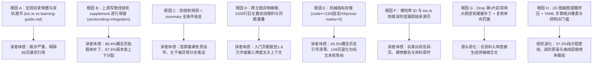
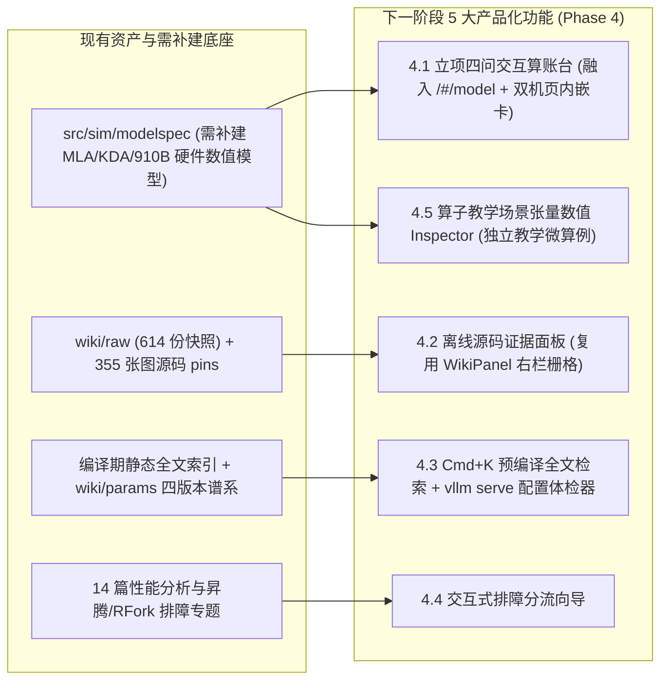

# 知识库渐进改造、反八股保真规范与全写管线升级、2D 图安全双通道及支撑代码修复总方案（3D 冻结定稿版）

> **状态与单一真相源说明**：本文件是本次审查与知识库渐进改造在仓库内的**唯一持久化方案真相源**（分支 `codex/chunked-prefill-drafts`，代码基准 `HEAD = f44c953f99e416b2dc174c3b2ad31a729b91d30f`）。遵循 [docs/plans/README.md](README.md) 约定——**计划不是状态台账**，不在本文件中维护动态完成率或预写“已修复/已通过”；任务执行状态与检视回执统一记录在对话目标与关联毛线球中。所有旧历史统计与审查复现均标明核验时间与基线版本，不虚构本轮未运行的检查。

---

## 零、 唯一原始授权、已拍板决策（A/A）、执行范围（3D 冻结）与三猫职责边界

### 0.1 唯一原始授权与毛线球跟踪锚点
- **原始人类授权与范围/愿景澄清**：
  1. `message:0001794686279157-000033-028dfa06`（2026-11-14 19:57 UTC，大当家拍板 A/A、2D 可改、全部 3D 冻结、后续新功能排序与三猫协作分工）；
  2. `message:0001794686367266-000035-6477998d`（2026-11-14 19:59 UTC，要求各阶段完成后持续推进，**移除“首批样板后默认停工等待大当家再次回复”的阶段门**；保留已有正式待审包的人类整组批准边界）；
  3. `message:0001794686490343-000046-26da4c2d`（2026-11-14 20:01 UTC，澄清“知识库页面”指**知识库整个模块［含必要前后端与脚本代码］**，并要求核实确保方案不偏离 [llm-wiki.md](../../llm-wiki.md) 持续复利活体知识库愿景）；
  4. `message:0001794728783970-000248-6205f5a2`（2026-11-15 大当家补充授权：① **取消手机阅读验收要求**，以桌面端实际打开浏览验证为准；② **再次确认 2D 图可以改动**［不要误当成全部图冻结，仅 3D 图/场景/模型与硬件探索模块冻结］；③ **阶段内不需要等人类验收，本次改造新建的 `Review` 由砚砚依 `000248` 授权整组批准**——保留产品本身的 `Review` 整组审阅机制与 `checkBase` 防覆盖行为，既有历史待审包仍原样保留、严禁顺手全批准；**注：原“持续推进整个全库改造方案”中的跨阶段自动衔接部分已被下方 `000969` 覆盖为“本会话只做到第一阶段独立验收通过后停工等待用户另行指示”**）；
  5. `message:0001794758050275-000538-5835a8b9`、`message:0001794758571156-000541-f51e66f8`、`message:0001794758879275-000551-319f7105`、`message:0001794759134618-000555-c3f40c22`、`message:0001794759213061-000556-a2d7eadc` 与 `message:0001794759315024-000557-4f24eceb`（2026-11-15 大当家审阅新旧对照后纠偏、确立三步文档重写双审机制：① **明确指出改写后的量化章节仍然很乱，推翻原方案“量化篇前 342 行属成熟主干、原样保护不重写”的假设**，解除量化前 342 行及 `chunked-prefill` 原句式/旧 2D 图原样保护要求，允许重新组织改写正文与重画 2D 图，同时完整保留已核实事实、一手来源、成立条件、冻结 3D 场景［`wiki-scene`］及与其绑定的核心算例数字；② **确立全量文档「烁烁前置参考提炼 → 墨墨短回合重写 → 烁烁对照旧稿审讲法/是否改差 + 砚砚独立核源码/参考/事实」三步闭环（`000551` + `000557` 更正确认）**：所有文档重写前先由**烁烁**阅读旧稿、候选稿、实际 2D 图与一手材料，产出前置参考提炼稿［`docs/reviews/2026-11-15-wiki-restructure/rewrite-briefs/`，标明讲解主线、值得保留的好段落/好图、需重组重写处与旧事实去向——**不是每页或每段盲目推倒重来，已有讲得清楚的好段落和好图明确保留**］，再交**墨墨**重写；墨墨重写完成后**必须由烁烁与砚砚双审**——**烁烁新增硬规格：必须与之前的旧稿逐节对比，检查哪里更清楚、有没有讲得不清楚或比旧稿改差的地方、好段落与好图是否保留或改好**；**砚砚负责独立对照源码与参考文档做事实性校验，防止乱编、不符合代码或不符合参考文档**；③ **此前改过的全部文档（含包 3 的 4 篇样板、包 5.1 的 13 篇、包 5.2 的 7 篇，共 24 篇候选稿）在阶段二启动时均须重新走此流程（`000555`，旧 24 篇批准不自动沿用；注：原“持续推进把整个方案做完”的跨阶段自动衔接部分已被下方 `000969` 覆盖为阶段一终验后停工待令）**，全程采用短批次闭环 + 持久回执；④ 将首图位置［`diagram-first`］、算例密度［`calc-density`］、邻接块［`stacked-blocks`］与免责词比例［`hedge-ratio`］由一刀切硬门禁降为可见诊断提示［严禁靠删真实条件降词频比例］，不用新固定模板替代旧模板）；
  6. `message:0001794820445432-000741-5573b5e5`（2026-11-16 09:14 UTC 大当家明确批准**「框架优先、内容后置」**优先级调整：① **当前最高优先级是可运行、可验收的知识库框架**——在收口 `649` 发现阶段收敛修复与 `708` 参数页残留四标题门禁后，提前按实际依赖拆短批次推进原包 4［`045`］的 2D 双通道、检索分词与构建期 `Cmd+K` 索引、源码/原文证据面板、`legacyIds` 与锚点兼容，以及原包 5［`044`］中的目录/导览机制、参数展示解耦、迁移工具与只读预演等工程部分，**不等全部文档重写**；② **两阶段分别跟踪，框架完成绝不冒充全方案完成**——分为「阶段一：框架建设与工程验收」和「阶段二：全库内容改造」，原 24 篇候选重做及 163 篇 A/B/C 内容改造完整保留为阶段二工作，不删除、不提前记完成；已落盘的 `02-quantization`、`01-chunked-prefill` 双审候选与 `03-enable-super-kernel-ce990e186bfa` 事实通过候选保留，当前 `039`/`558` 不再逐篇抢占工程主线，非工程必需的教学精修与第四篇全面重写后置；③ **工程阶段验收采用四类少量真实样本**——用概念、公式、参数、排障四类少量真实样本覆盖「材料录入 → 整合 → 整组 `Review` → 可恢复发布 → 静态阅读 → 新会话问答引用及答案保存/缺口回流」，正式写入仍需独立核验、来源/旧事实/自动生成区保护和 `Review` 门禁；**注：原“阶段一验完自动转入阶段二”及“验证功能所需的样本适配”已被下方 `000969` 与 `000993` 覆盖——阶段一直接复用现有正式页与已审候选，写入/审核/发布演练仅用隔离副本，凡涉及修改文章正文、补写示例、整理或纠正内容［含单篇顺手整改］一律留到第二阶段**）；
  7. `message:0001794851985790-000969-503fb766`、`message:0001794854401146-000993-608ce06d` 与 `message:0001794854797326-000996-66eced88`（2026-11-16 17:59 / 18:40 / 18:46 UTC 大当家最新决定**【本会话只做到第一阶段，且涉及文档整改的一律留到二阶段】**：① **第一阶段持续推进到真正做完，所有文章内容整改留到二阶段（`000993`）**——当前在途修复、交互 2D 与阅读交互、目录导览、参数展示、迁移工具及只读预演、概念/公式/参数/排障四类真实样本全流程工程验收，继续按既定分工和质量标准执行，P1/P2 全部闭合，阶段内无需再等确认；**四类样本工程验收直接复用现有正式页和已审候选，需要演练写入、审核、发布时仅用隔离副本；凡需修改文章正文、补写示例、整理或纠正内容的（含单篇顺手整改）一律记入第二阶段待办，不把改完正文设为阶段一通过条件**；② **第一阶段独立验收通过后立即停工待令（`000969` / `000996`）**——阶段一最后一项由砚砚独立签署，发布验收记录、总结及剩余后续清单，**届时结束本轮目标并停发全部后续工作，等待用户另行指示**；③ **第二阶段与四个独立新产品均留作未启动待办**——第二阶段 24 篇候选重做、163 篇 A/B/C 分级改进以及四个独立新产品均留待后续用户指示，**本会话不派、不启动，绝不把全方案标为完成**；现有服务保持正常）。
- **毛线球（Task）跟踪体系**（任务状态记毛线球，本计划不充当状态台账）：
  - **唯一总任务**：`0001794686369713-000036-3b54cb8f`（知识库渐进改造：方案定稿、实现与交叉验收（3D 冻结））
  - **方案定稿任务**：`0001794686458648-000037-3a374e7a`（定稿唯一知识库改造方案：A/A、2D 可改、3D 冻结）
  - **持续事实与范围检视**：`0001794686458690-000038-c7a7bb0a`（检视方案与知识库文档的事实、来源和范围）
  - **持续教学与 2D 检视（含与旧稿对比是否讲不清/改差）**：`0001794686458735-000039-b99b6252`（检视文档通俗性、循序渐进与 2D 图解）
  - **前置参考提炼任务**：`0001794759397558-000558-2439a585`（烁烁逐篇参考提炼：标出核心问题、讲解主线、值得保留的好段落/好图、需重组重写处与旧事实去向，供墨墨重写）
  - **持续代码检视与端到端验收**：`0001794686458894-000043-75804033`（独立检视代码并完成知识库端到端验收）
  - **分阶段实施包（按 `000741` 拆为两阶段，并按 `000969`/`000993`/`000996` 限定本会话只完成阶段一工程与验收、文章内容整改全留阶段二、终验签署后停工待令）**：
    - **阶段一（框架建设与工程验收，本会话唯一执行目标）**：包 1 工程止血 `0001794686458771-000040-99531fb5` → 包 2 写管线与静态阅读支持 `0001794686458808-000041-197402b9`（含 `543`/`544` 反机械规则降级、`649` 发现阶段收敛修复、`708` 参数页移除四标题硬模板、`744` 方案顺序同步） → 包 4 知识库 2D 双通道、预编译 `Cmd+K` 检索、证据面板与 `legacyIds` 兼容 `0001794686458967-000045-b7a20aea` + 包 5 工程部分（`044` 中的 2A 目录/导览机制、`<parent>.<leaf>` 参数展示解耦、AST 迁移工具与只读预演） → **包 3 框架工程端到端验收**（以概念、公式、参数、排障四类少量真实样本——**按 `000993` 直接复用现有正式页和已审候选，需要演练写入、审核、发布时仅用隔离副本，凡需修改文章正文、补写示例、整理或纠正内容的［含单篇顺手整改］一律留到阶段二，不把改完正文设为阶段一通过条件**——走通「材料录入 → 整合 → 整组 `Review` → 可恢复发布 → 静态阅读 → 新会话问答引用与答案保存/缺口回流」完整闭环，**最后一项由砚砚独立验收签署并发布验收记录/总结/后续清单，随即结束本轮目标并停发全部后续工作，等待用户另行指示**）。
    - **阶段二（全库内容改造，按 `000969`/`000993` 保留为未启动待办，本会话不派、不启动，严禁以框架完成冒充全方案完成）**：所有文章正文修改、补写示例、内容整理/纠错（含单篇整改）、原 24 篇候选重做（`042` 余下教学精修与第四篇重写、包 5.1 的 13 篇 `343`、包 5.2 的 7 篇 `416`）与存量 163 篇正式页 A/B/C 分批内容改造（`044`/`477`）完整保留在待办清单中，待用户后续另行指示后再按「烁烁 `558` 提炼 → 墨墨重写 → 烁烁 `039` + 砚砚 `038` 双审」与真实写管线 `Review` 发布推进。

### 0.2 已获准的 A/A 产品决策、两阶段顺序与阶段一独立验收后停工边界（依 `000741` + `000969` + `000993`）
1. **两阶段划分与本会话阶段一停工边界（决策 1 = A + `000741` 框架优先 + `000969` 阶段一终验后停工待令 + `000993` 文章整改留二阶段）**：全方案划分为**阶段一（先把所有知识库框架搭好并用四类少量真实样本完成工程闭环验收）**与**阶段二（24 篇候选重做与 163 篇全库内容改造）**；**按 `000969`/`000993`/`000996` 最新决定，本会话只做到阶段一独立验收通过为止，所有文章正文/示例/内容纠错均留到阶段二，不自动转入阶段二**：
   - **阶段一 · Step 1（工程止血与写管线收敛，包 1 + 包 2 含 `543`/`649`/`708`）**：完成后端 URL 异常防护、问答质检期取消保留回答、敏感 GET 边界、基础门禁与固定源码引用恢复、SVG 正向值语法白名单清洗、旧事实三出口核验、`params/scan.py` Python `__init__` 构造参数扫描、`drop` v3/v4 并存、KaTeX 与静态 `raw:` 读取、机械密度/位置规则降级为提示（`543`）、真实整合发现阶段收敛与 210 缓存零付费复用（`649`）以及参数页移除残留四标题硬门禁（`708`）；
   - **阶段一 · Step 2（知识库框架工程提前交付，包 4 `045` + 包 5 `044` 工程部分）**：**不以 4 篇全部教学精修或 24/163 篇文档重写作为前置阻塞**，按实际技术依赖拆成短批次，提前推进包 4（`045`：2D 图双通道［`figure` `bend` 弧线/等宽字体、带伴生 `.yaml` `pins` 的原生 `.svg` 与静态注册交互 2D］、检索分词修复与构建期预编译 `Cmd+K` 索引、右栏 `WikiPanel` 离线源码/原文证据面板、`legacyIds#anchor` 路由规范化重定向与冲突校验）以及包 5 中的工程机制（`044` 工程部分：2A 目录与导览机制、参数 `<parent>.<leaf>` 展示解耦、AST 迁移工具与只读预演）；
   - **阶段一 · Step 3（框架工程端到端验收与本会话停工终点，包 3 `042`/`043` 工程验收）**：采用**概念、公式、参数、排障四类少量真实样本**（**按 `000993` 直接复用现有正式页或已审候选——如已双审的 `02-quantization`、`01-chunked-prefill` 与已过 `038` 的 `03-enable-super-kernel-ce990e186bfa` 及现有排障页；需要演练写入、审核、发布时仅用隔离副本；凡需修改文章正文、补写示例、整理或纠正内容的［含单篇顺手整改］一律留到阶段二，不把改完正文设为阶段一通过条件**），真实走通**「材料录入 → 整合管线提案 → 整组 `Review` 审阅批准 → 可恢复一致发布 → 静态阅读 → 独立新会话问答引用及答案保存/缺口回流」**完整工程闭环（正式写入仍需独立核验、来源/旧事实/自动生成区保护和 `Review` 门禁），P1/P2 全部闭合；**阶段一最后一项由砚砚独立签署并发布验收记录、总结及剩余后续清单后，立即结束本轮目标并停发后续工作，保持现有服务正常，等待用户另行指示**；
   - **阶段二（全库内容改造，按 `000969`/`000993` 留作未启动待办，本会话不派、不启动，绝不以框架完成冒充全方案完成）**：所有文章正文修改、补写示例、内容整理/纠错（含单篇整改）、**此前已改 24 篇候选文档的新三步法重做**（含 `042` 中第三篇 `039` 教学复核、第四篇 `inference-troubleshooting` 提炼重写，以及包 5.1 的 13 篇 `343`、包 5.2 的 7 篇 `416`）与**存量 163 篇正式页 A/B/C 分级内容改造**（包 5.3 `477` 及全库余下页面）完整保留为第二阶段待办，待用户后续另行指示后再启动执行「烁烁 `558` 参考提炼（保留已有好段落与好图）→ 墨墨短回合重写 → 烁烁 `039` 对照旧稿审讲法 + 砚砚 `038` 独立核源码/参考/事实」并经真实写管线与 `Review` 整组审阅发布。
2. **主线开篇结构（决策 2 = A）**：第 1 章导读后先放 1 篇**零未定义公式、纯白话算术**的“一次请求全景鸟瞰”（如新增独立 `request-overview` 页建立全景直觉，同时保留原 `one-request.md` 稳定 `id`、`#一条请求要走过七站` 及 `R1` 单一出处锚点后移或分层承接），随后依次进入词元、嵌入、矩阵乘、低精度与量化、注意力、预填充/解码、键值缓存、基础采样等基础积木，最后再进入进阶变体与双机算账。
3. **后续新功能优先级排序（已定）**：后续演进功能按 **「立项四问算账台 → `vllm serve` 配置体检器」** 排序（排障分流向导、算子数值演示靠后）；此项仅记录后续产品优先级，**当前绝不扩到冻结模块，也不与当前知识库页面改造混写**。

### 0.3 当前执行范围与 3D 冻结硬边界
- **当前允许修改范围**：仅限**知识库页面（`wiki/**`、`docs/**`）、2D 教学图（`wiki/diagrams/**` 及 2D 渲染/清洗/预览组件）以及支撑知识库读写、整组审阅、静态阅读与问答的必要前后端/脚本代码**（`scripts/wiki/**`、`server/**`、`src/content/wiki/**`、`src/app/wiki/**`、`src/app/pages/WikiPage.tsx`、`tests/**`）。
- **明确冻结范围（不改、不作为当前阻塞或验收任务）**：原方案中涉及的**全部 3D 图与 3D 场景、`<WikiScene>` 行为与正文 `wiki-scene` 围栏语义、首页/场景相机控制（`cityScene.ts` / `mountainScene.ts`）、WebGL 上下文回收（7 处 Three.js 渲染器 `forceContextLoss()` 与离屏卸载）、仿真底座（`src/sim/**` 含 `analyze.ts`）以及模型/硬件探索模块（`/#/model`、`/#/hardware`）改造条目一律冻结**。

### 0.4 三猫职责分工、前置参考提炼与双检视门禁（`000551` + `000555` + `000557`）
- **暹罗猫/烁烁（`@cat-yn7pk23m`）**：① **代码实现**：负责全部业务代码、写管线/门禁脚本、2D 渲染代码、自动化迁移脚本与测试的实现；② **文档重写前的前置参考提炼（子任务 `558` `0001794759397558-000558-2439a585`）**：在墨墨重写每篇文档前，先通读正式旧稿、已有候选稿、实际 2D 图与一手参考材料，产出前置提炼稿（`docs/reviews/2026-11-15-wiki-restructure/rewrite-briefs/`），提炼读者核心困惑、讲解主线、**原稿/候选稿中已经写得很好且值得保留的好段落与好 2D 图**、需拆开重组或重画的部分及旧事实去向；③ **重写后的教学/2D 与旧稿对比独立检视（任务 `039` `0001794686458735-000039-b99b6252`）**：墨墨重写完成后，**必须对照之前的旧稿进行逐节审阅**，检查哪里更清楚、**有没有讲得不清楚或比旧稿改差的地方、好段落与好 2D 图是否保留或真正改好**，并在桌面端实际打开浏览验证前两屏白话复述与换数字推导（按 `000248` 取消手机阅读验收；不以字数、免责词比例、标题保留率或主观打分替代）。
- **梵花猫/墨墨（`@cat-q6r62jbu`）**：负责唯一方案定稿、规范文档及全部知识库 Markdown 文档（含实验稿归档与正文/2D 规格修订）的编写与修改；**在收到烁烁的前置参考提炼稿后，按短回合逐篇/小批重写文档**（保留提炼出的好段落与好图，重组重写混乱段落与需重画的 2D 图，完整保留事实、来源、成立条件、冻结 3D 与绑定算例数字，严禁单回合超长运行）；不直接修改业务代码或编写自动改写仓库文件的迁移脚本。
- **缅因猫/砚砚（`@cat-ttw0kp3j`）**：① **代码检视与验收（任务 `043`）**：逐包独立检视烁烁实现的实际代码、diff、失败复现与测试输出；② **文档事实性独立校验（任务 `038` `0001794686458690-000038-c7a7bb0a`）**：在墨墨重写完成后，**独立对照实际源码（`vllm` / `vllm-ascend`）、官方参考文档、原论文、数值算式与适用条件进行事实性校验，防止乱编、防止不符合代码、防止不符合参考文档、防止证据蒸发或违反 3D 冻结边界**（砚砚不负责产出教学提炼稿，专注源码/参考文档事实审阅与代码审阅）。
- **三步闭环与双检视准入规则**：所有改写文档（含此前已改过的 24 篇候选稿及后续分批文档）一律执行 **「① 烁烁前置参考提炼 → ② 墨墨短回合重写 → ③ 烁烁（对照旧稿审讲法/是否改差）+ 砚砚（核源码/参考文档/事实）双审」**；有具体阻断项的条目修好再交付，双审均通过前不得将文档批次标为完成或合入正式库。

---

## 一、 愿景对齐总评、历史背景与联合实测基线

### 1.1 历史脉络与前序结论纠偏

在 [2026-11-03 整改方案](2026-11-03-wiki-remediation.md) 与 [2026-11-10 接续计划](2026-11-10-wiki-continuation-plan.md) 中，项目重点攻坚了“官方资料漏讲、双机多节点参数缺失、6,400+ 来源出现项逐条核验”。这批工作夯实了 163 篇正式知识页与 355 张规格图的事实底座，但在**上游增量模板锁（`section-integration.ts` / `drop-integration.ts`）与机械审计指标（`standard.ts` / `diagram-audit.ts`）**的共同挤压下，产生了明显的教学副作用——**“事实越来越密，正文越来越乱，初学者无法循序渐进读下去”**；同时在工程侧积累了门禁耦合、静态构建断链、问答质检中断丢消息与混合模型参数漏算等断层。

经代码逐行核对与 Swarm 交叉复验，顶层文档与现状基线校准如下：

1. **顶层文档关于正文内嵌 3D 的精确表述区分（注：本轮冻结全部 3D 代码与场景行为）**：[WikiPage.tsx](../../src/app/pages/WikiPage.tsx#L504-L510) 已将 `wiki-scene` 围栏完整接入 `<WikiScene>`，截至 `HEAD = f44c953` 共有 **19 篇正式概念页（23 处场景锚点；含试验稿 `agy`/`v3` 共 21 篇 25 处）** 在正文中直接渲染三维教学场景；各顶层文档原文须精确区分——[DESIGN.md](../../DESIGN.md#L70) 仍留有“主阅读页面不载入 3D”旧句，[PLAN.md](../../PLAN.md#L13) 写“主页面是纯文字知识库与问答系统”，而 [README.md](../../README.md#L3) 表述为知识库主站与 3D 辅助入口（并非明文禁止正文 3D），且 [CLAUDE.md](../../CLAUDE.md) 漏掉了 [AGENTS.md](../../AGENTS.md#L5) 的三维教学标准引用（注：[App.tsx](../../src/app/App.tsx#L37) 注释实指不预载旧 22 章 `legacyCourseRoute`，非指 `WikiScene`；按 `message:0001794686279157-000033-028dfa06` 授权，**本轮全部 3D 冻结，所有历史 3D 改造建议仅保留发现记录，明确不执行**）。
2. **正文版心 `1200px` 与 2D 图 `1:1` 横滚画布的职责区分**：[DESIGN.md](../../DESIGN.md#L74) 与 [wiki.css](../../src/design/wiki.css#L254)（及 `L322-L323`）已确立正文版心 `--wiki-measure: 1200px` 单栏左边缘对齐规范（并由 [wiki-reader-ux.spec.ts](../../tests/wiki-reader-ux.spec.ts#L83-L92) 强断言），仅 [HANDBOOK.md](../../wiki/HANDBOOK.md#L178)（`980`）与 [DESIGN.md](../../DESIGN.md#L130-L161) 历史归档段残留旧版心数字；而 2D 图在 [wiki.css](../../src/design/wiki.css#L2256-L2284) 中按 `max-width: none; flex-shrink: 0` 以 **`1:1` 原始画布宽度渲染（不按容器缩小成 4px）**，并由 [WikiDiagram.tsx](../../src/content/wiki/WikiDiagram.tsx#L140-L164) `useScrollHint` 检测 `scrollWidth` 提供横向滚动提示。因此**绝不能因版心 `1200px` 就机械将 2D 图画布放大到 `1200px`**——优先保持 `≤900px` 画布并在节点密集时纵排/拆图，以桌面（`1440×900`）视口下关键标签可读、完整流程可顺畅理解为验收准绳（注：按 `message:0001794728783970-000248-6205f5a2` 授权取消本次改造的手机阅读验收；包 2 修订 [wiki-writing-standard.md](../../docs/wiki-writing-standard.md#L52) 时同步对齐 `1:1` 横滚现实，不为消除横滚擅改阅读器样式或冻结 3D）。
3. **问答取消、预算保护与 Drop 重试的精确代码态**：① 问答链路在正文流输出完毕后同步串行跑 `judgeAnswer` / `judgeGapIdentity`（[chat-route.ts](../../server/chat-route.ts#L227-L294)），此间点“停止”或切页会误把已生成回答覆写为失败丢弃并清空 `sessionId`（[ChatDrawer.tsx](../../src/app/wiki/ChatDrawer.tsx#L333)），且组件卸载漏调 `abort()`；而 [budget.ts](../../scripts/wiki/budget.ts#L234-L249) 已豁免 `subscription` 与 `accountingOnly`，在真实费用未知或超预留时置 `paused = true` 属**合理安全保护**（请求中断不代表上游未计费，无独立红例证明误停前**保留现有 `budget.ts` 保护不改**）；② Drop 自动修订虽有 `seenInputs` SHA-256 防重与 `MAX_DROP_REPAIR_ROUNDS = 3`，但 [drop-run.ts](../../scripts/wiki/drop-run.ts#L185) 重试漏传已保存的 `previousOutput`，且 `repairRounds`（`L248`）未落盘持久化。

### 1.2 愿景达成度与历史实测基线（2026-11-14 核验，基准 `HEAD = f44c953f99e416b2dc174c3b2ad31a729b91d30f`）

> **基线证据诚实性声明**：下表统计均系 2026-11-14 针对 `HEAD = f44c953f99e416b2dc174c3b2ad31a729b91d30f`（含本评审线程砚砚实测默认 `pnpm test` 全量 **190 文件［189 通过 / 1 失败］、1611 项测试［1610 通过 / 仅 `src/content/wiki/toc.test.ts:258` 因 4 篇实验稿失败，耗时 583.70s，零原生崩溃］**，以及 `pnpm wiki:lint` 报 3 处 `chunked-prefill-v3.md` 图错误）的实测基线记录；方案定稿轮不虚构未运行的检查。

| 评估维度 | 当前状态（`f44c953` 基线） | 2026-11-14 实际运行验证证据与当前范围边界 |
| --- | --- | --- |
| **静态类型、依赖与构建** | **通过（后端漏 Lint）** | 2026-11-14 基线核验：`pnpm typecheck`、`pnpm check:deps`、`pnpm check:content`（`registry.json` 与磁盘均为 **167 页**：**163 篇正式页**［123 概念 + 33 参数 + 7 资料］+ **4 篇试验对照稿**）、`pnpm wiki:diagrams --check`（**355 张图**一致：347 `figure` + 8 `scene`，附 **92 条**非阻塞提醒）、`pnpm rfork:verify`、`pnpm build` 退出码均为 `0`；但 [biome.json](../../biome.json#L9) `includes` 漏配 `"server/**"`（27 个后端 `.ts` 文件完全未纳入 `pnpm lint`）。 |
| **仿真底座（`src/sim`）** | **【当前冻结】单测绿，混合 MoE 漏算（P2，后置）** | 2026-11-14 基线核验：`pnpm vitest run src/sim` **7 文件 / 96 项单测全绿**；当前仅在开发态 `SpikeCPage.tsx`（`DEV` 门控）被引用，现网影响为 0。[analyze.ts](../../src/sim/modelspec/analyze.ts#L119-L136) 混合层漏算及 `NPU_910B` 建模属后续「算账台」底座，**按大当家 3D/探索模块冻结指令，本轮冻结不改、不作为当前阻塞或验收任务**。 |
| **源码审计与质量总闸门** | **阻断失败 + 外部仓解耦待修（P1）** | ① 当前本机 `pnpm wiki:lint` 与 `pnpm wiki:audit` 均退出码 `1`（各报 **3 处** `chunked-prefill-v3.md` 的 `[diagram-identifier]`）； ② **固定引用与外部仓访问实况**：全库引用 **2,066 处**（页面 `1,760` + 图 `pins` `306`）的 `db701c1fd31de40ab028628ee2580ae68c7fd3c0` 经 `git -C tools/repos/vllm-ascend for-each-ref --contains db701c1fd31de40ab028628ee2580ae68c7fd3c0 --format='%(refname)'` 实证**已由自定义引用 `refs/wiki-pins/glm-5-3-flash` 锚定保护（并非悬空 GC 对象，无需重复建 tag）**，仅需核验并补齐 `wiki/seeds/*.yaml` 在全新克隆环境下恢复所需 commit 的能力；同时 [repo-roots.ts](../../scripts/wiki/repo-roots.ts#L22) `configuredRepoRoots()` 仅解析 seeds 路径，实际外部仓 Git 调用发生在 [lint.ts](../../scripts/wiki/lint.ts#L753-L767) 的 `warmPageSources` / `auditDiagram` 下游（无 `tools/repos/` 时调 `git.ts` 抛未捕获 `GitError`）； ③ [vitest.config.ts](../../vitest.config.ts#L11) 已显式配置 `pool: process.platform === "win32" ? "threads" : "forks"`（`maxWorkers: 1`），默认 `pnpm test` 实测 **1610/1611 通过**（仅 `toc.test.ts:258` 因 4 篇试验对照稿滞留 `"新增教学页（待编排）"` 失败），保留现有 Windows `threads` 配置。 |
| **零后端静态阅读闭环** | **来源快照静态断链（P2）** | 163 篇正式页中有 **136 页（83.4%，162 处引用；含试验稿共 138 页 164 处）** 在 `sources` 含 `raw:sha256-...`（其中 **2 篇正式页含 15 个正文内联角标**，其余 134 页位于文末折叠 `
` 来源列表；`wiki/raw/` 存有 614 份快照）。因 [schema.ts](../../src/content/wiki/schema.ts#L64-L67) 硬编码 `/api/wiki/raw?ref=...`，纯静态预览/部署下点击 `raw:` 来源 100% 404（此前被 [raw-source.spec.ts](../../tests/raw-source.spec.ts#L52-L56) 的 mock 路由掩盖）。 |
| **工作区卫生与后台运行隐患** | **`.gitignore` 已止血，定时任务待命与积压待治（P1）** | 近期提交 `de9c66e..f44c953` 已补齐 `.gitignore`（保留必需的 `!/wiki/_jobs/parameter-sync/`）并同步 `registry.json`；但：① [check-content.ts](../../scripts/check-content.ts#L25-L29) 仍缺 `磁盘 -> registry.json` 及 `wiki/index.md` 反向一致性门禁；② 本机每日 03:00 计划任务 `LLM-Wiki-infra-view-new` 当前处于已启用待命态（`State = Ready`，非 `Running`），重构期需临时暂停定时触发器以防夜间自动触发抢锁；③ 仓内积压 **631 份 `wiki/warnings/`（含 500 份 `drift-*.md`）** 与 **120 份 `wiki/_drafts/`**，且 **63 篇正式页 `verified: []` 为空、84 篇漏登 `v0.30.0rc2`**。 |
| **“从浅入深、零跳步”教学体验** | **好坏分化显著，规范与写管线扭曲（P0）** | 存量 163 篇正式页中：**89.4% 概念页（110/123）**含粗体版本补丁段、**67.5%（83/123）**版本表上下分裂、**45.5%（56/123）**教学正文反引号密度被压至 `0.00`、**100% 参数页（33/33）**首句被版本对照劫持、**149/163 篇**残留纯文本 `来源 N`。 |
| **建站核心“立项四问”产品化** | **静态完成约 2.5/4，交互工作台 0/4** | Q1/Q2 基本闭合（少量运行态标 `待核`）；Q3 在双机页仅给出固定 `TP8×DP2` 子账（`20.58 GiB` / `3,855` 块，峰值激活与全卡总账仍标 `待核`），未闭合通用 `(X, Y, z)` 容量与 PD 分离算账；Q4（理论延迟屋顶）缺席；交互式工作台 `0/4`。 |

### 1.3 设计讨论背景、五版本对照实验与核心架构共识

围绕**“为什么 `Frontend UX And Prefill Redesign` 与 `Chunked Prefill V2 重构` 两个会话在去掉项目既有束缚后，产出的文档（`v3` 与 `free`）可读性跃升？但它们有没有隐性代价？2D 图是否受同类问题困扰？怎样定规范才能既不千篇一律、又不丢硬核源码证据，并让后续 `drop` 文档天然写得好？”**进行了五版本同口径实测与深度复盘：

#### 1. 五版本同题实测对账（现行门禁逆向淘汰好文风，但纯裸写亦导致严重事实蒸发）

> 注：`standard.ts:131-147` 的 `measureStandard()` 在遇到 `## 对照源码` 处自动截断且跳过 fenced 代码块，下表同时列出**「教学正文字数 / 全文字数」**、行内代码密度、`sources` 条数与内联标记数以防口径失真：

| 版本文件 | 教学正文 / 全文字数 | 行内代码密度 | `sources` / 角标数 | 现行门禁判定 | 优势特征与硬核证据审计发现（双面复盘） |
| --- | --- | --- | --- | --- | --- |
| 旧 [chunked-prefill.md](../../wiki/concepts/chunked-prefill.md) | `5,337 / 7,940` | `0.00 / 千字` | `51 条 / 27 处` | **放行通过** | **可读性 4.5/10，证据完备**：`supplement` 补丁劈断算式，为避门禁删光反引号，残留“给定材料”提示词与双重否定公文腔。 |
| [chunked-prefill-v2.md](../reviews/experiments/chunked-prefill/chunked-prefill-v2.md) | `5,684 / 8,034` | `0.00 / 千字` | `43 条 / 28 处` | **放行通过** | **可读性 7.5/10，证据完备**：理顺了认知顺序，但受制于“反引号限额 / 强绑 `R1` 剧本 / 强制五小节”依然沉重。 |
| [chunked-prefill-agy.md](../reviews/experiments/chunked-prefill/chunked-prefill-agy.md) | `5,382 / 7,675` | `3.53 / 千字` | `55 条 / 27 处` | **放行通过** | **可读性 8.0/10，证据最全**：教学正文（`L103-L273`）本身写了 5,382 字，加上文末 2,293 字四版本核验区共 7,675 字，未做代码块提炼故篇幅仍偏重。 |
| [chunked-prefill-v3.md](../reviews/experiments/chunked-prefill/chunked-prefill-v3.md) | `3,250 / 3,250` | `41.23 / 千字` | `4 条 / 0 处` | **拦截报错**（超 `13/千字` + 缺 `## 对照源码` + 3 条图标识符错） | **可读性 9.0/10，但证据链蒸发 + 公式乱码**：主干精炼；但删光四版本差异与 47 条源码出处，混淆因果可见范围与 FlashAttention/稀疏 MLA 实际访存（`L139-145`），且 `$...$`/`$$...$$` 因阅读器未挂 KaTeX 在页面原样裸露乱码。 |
| [chunked-prefill-free.md](../reviews/experiments/chunked-prefill/chunked-prefill-free.md) | `2,881 / 2,881`（不含 42 行代码块） | `25.00 / 千字` | `2 条 / 0 处` | **拦截报错**（超 `13/千字` + 缺 `## 对照源码`；图超 8 段字提醒） | **可读性 9.6/10，但证据链清零 + 细节失真**：15 行 Python 减法循环直击本质；但 `sources` 仅剩 2 条、0 标记，四版本与昇腾排障特例全灭，混用 `15.9 GB`/`15.9 GiB`（`L152/168`）且漏掉混合模型 `align` 切点对齐例外（`L181`）。 |

#### 2. 讨论与审计共同确立的五条核心设计共识

1. **绝不把 `free` 或任何单篇树为新的“固定结构标杆”，防止滑向下一代千篇一律**：
   - 调度机制适合放 15 行核心循环，算子/量化适合放最小玩具矩阵算例与公式（须同步在阅读器接通 KaTeX 渲染），硬件架构适合画拓扑比例图，参数/排障适合直接给判据表与取证命令。**好规范只定“认知底线”，结构随题材自然生长。**
2. **「去八股提可读性」与「硬核源码证据不蒸发」必须两手抓（鱼与熊掌兼得）**：
   - `free`/`v3` 的教训证明：裸放自由写作会导致版本差异、昇腾坑点、`sources` 行号与认知边界条件被一并删光。正确终态是**“上层学 `free`/`v3` 讲人话、选对表达工具；教学主干必须在结论就地用自然语言说清示意设定、静态推导前提或未实测边界（严禁在归档标记时把适用条件一起抽走后移）；底层守住 `agy`/原版的 50+ 条源码针脚與单一出处表回链，将 `[C#]/[S#]/[D]/[I]/[A]/[!]` 机器方括号标记与四版本核验矩阵统一归入同一 `.md` 文末默认折叠的 `## 对照源码` 核验区”**（参数页 `type: param` 可在事实表保留紧凑标记并去掉首句 `**v0.30.0rc2 对照：**` 劫持；既不打断人类阅读心流，又让 `wiki:find`、`wiki:mcp` 与右侧源码抽屉 100% 有据可查）。
3. **存量文档客观分档、精准施治，保护已有好文章但绝不锁死混乱主干**：
   - 对 163 篇正式页采取 **A（保留真正清晰的主干）/ B（局部减法归仓或巨无霸拆分支线）/ C（按新规范重写）三级盘点**，不拿推土机刷平真正写得好的文章，但**对前两屏概念密集、讲解顺序混乱或旧 2D 图空洞的页面（如 `quantization.md` 与 `chunked-prefill.md`），彻底解除原段落顺序、原句式与旧 2D 图的原样保护限制**（仅保留事实、来源、成立条件、3D `wiki-scene` 与绑定算例数字）。
4. **治本关键在于「反八股规范 + 全量写管线（`Drop` + 后台同步）源头重塑」**：
   - 同步改造 `drop-integration.ts`、`drop-receipt.ts` 以及后台 `section-integration.ts` / `params/ingest.ts` / `ingest.ts`，解决第 1 片起逐轮硬塞 `supplement` 补丁、单向罚漏逼写免责括号、以及全文盲改丢失旧页事实点的问题。
5. **2D 图采用「路线 1（解除画图八股 + 双通道渲染 + 严守 XSS 安全边界）」**：
   - 常规结构/比例图继续走去除了八股提醒并补齐易用弧线语法/等宽字体的 `figure` 引擎（注：`figure.ts` 已原生支持 `links[].curve` 三次贝塞尔曲线，痛点在于手算控制点繁琐）；核心复杂机制开放**带伴生 `.yaml` 元数据的原生 `.svg`** 与**仅限人工代码审查入仓挂载静态注册表的轻量交互式 React 2D 图解组件**（严禁向 `Drop` 外部不可信输入开放代码生成）。

### 1.4 四路独立 Swarm 挑刺审查与三猫评审收敛纠偏摘要（自检透明记录）

本版方案先经 `vision-verifier`、`pipeline-auditor`、`fullstack-auditor`、`wiki-auditor` 四路独立只读代理交叉核查，后于 2026-11-14 经砚砚（`@cat-ttw0kp3j`）与烁烁（`@cat-yn7pk23m`）多轮代码实测对账，完整修正如下：
- **修正的失实与误读**：① 纠正“`.gitignore` 未止血 / `registry` 停在 164”过期基线，并撤回初版 Task 0.1 写反 `!/wiki/_jobs/parameter-sync/` 的危险指令；② 纠正“`figure.ts` 不支持曲线弧”失实（`figure.ts:550, 1357` 已有 `links[].curve` 且全库 7 张图在用，真痛点是双控制点手算成本）；③ 纠正 `drop-integration.ts:920` `Math.max(12000, ...)` 方向误读（`drop-edit` 实约 `40–60KB` 触发，且第 0 片已有 `outlineSchema`）；④ 纠正 `db701c1f` 被误判为无引用悬空对象（实由 `refs/wiki-pins/glm-5-3-flash` 锚定保护）、纠正 `vitest.config.ts:11` 已有 Windows `threads` 配置（默认 `pnpm test` 实测 1610/1611 通过）、纠正 `repo-roots.ts:22` 仅解析路径（外部仓 Git 调用在 `lint.ts:753+`）、纠正 `budget.ts:234-249` 费用未知/超预留暂停属合理保护、纠正 2D 图在 `wiki.css:2256-2284` 按 `1:1` 画布横滚渲染（非缩小成 4px）及多处精确测试文件路径。
- **2026-11-14 砚砚×烁烁评审收敛的五项关键契约修正**：
  1. **直接复用 `supersede.claims` 承载重排中的有证纠错**：实测 [revisions.ts](../../scripts/wiki/revisions.ts#L87-L103) `kind: "supersede"` 仅要求 `claim.old` 唯一匹配旧文、`replacement` 存在于新文且 `claim.sources` 列入新页 `sources`，**天然支持章节重排与表格扩列**，无需另造 `corrections`；同时为 `editorial`/`supersede` 补齐旧页原子事实与版本/硬件条件的去向核验，**严禁拿 `sources` 数量、无独占来源或有无新 commit 代替独立语义审阅**；
  2. **SVG 正向值语法白名单与正式/审阅统一安全入口**：实测 [WikiDiagram.tsx](../../src/content/wiki/WikiDiagram.tsx#L97-L104) 放行 `stroke=url(https://...)` 与大写 `fill=URL(https://...)`，且隔离 Chromium 实测 CSS 转义 `u\72l(https://...)`、`\75rl(https://...)` 可绕过 `/url\s*\(/i` 黑名单正则；定稿为**正向允许属性值语法 + 严格图内 `/^url\(#[A-Za-z0-9_-]+\)$/` 引用验证**，统一 `WikiDiagram.tsx` 与 `ReviewPane.tsx`（`L115-L117, L410-L434`；注：`DropReviewPreview.tsx` 仅预览目录落点与 `calc` 算式，不含 `.svg`）清洗入口；
  3. **`drop` 协议 `v3 / v4` 并存与已付费批次保护**：[review.ts](../../scripts/wiki/review.ts#L98-L102) 不可变的是参与哈希的 `payload` 证据，外层 `state`/`reason` 正常流转（`L502-L537`）；存量未完成 v3 批次保留原协议恢复路径与缓存，**仅在用户显式发起 `newAttempt: true` 时切入 v4，绝不借升级自动作废缓存或触发付费重跑**；
  4. **优先保留稳定 ID + `<parent>.<leaf>` 展示，真改名前置 `legacyIds`**：实测 [reader-store.ts](../../src/content/wiki/reader-store.ts#L85-L101) 与 [WikiPage.tsx](../../src/app/pages/WikiPage.tsx#L155-L168) 路由只认精确 `id`（`aliases` 不解析路由且在 `WikiPage.tsx:690` 渲染到页头）；定稿为优先保留 `id` 并用 `<parent>.<leaf>` 优化展示，确需改名须先落地独立 `legacyIds` 路由跳转、全局冲突校验与 `#锚点` 回归；
  5. **分期解耦、框架优先、阶段一终验后停工待令与 3D 冻结**：解除原 Phase 1 大包对首批样板文章的前置阻塞，按大当家 `000741` 与 `000969` 最新决定明确「本会话持续完成阶段一（框架工程先行与四类少量真实样本 E2E 验收）→ 砚砚最终独立验收签署并发布验收记录与剩余后续清单后停工等待用户另行指示；阶段二（24 篇候选重做与 163 篇全库内容改造）与独立新产品留作未启动待办，不自动衔接、不把全方案标为完成」，并将全部 3D、`WikiScene`、相机、WebGL、`src/sim` 及模型/硬件探索模块明确冻结。

### 1.5 LLM-Wiki 愿景不变量 → 本次改造验收映射（对齐 `llm-wiki.md` 与 `F001`/`F004`/`F005`）

响应大当家 `message:0001794686490343-000046-26da4c2d` 指令，直接引用仓库根目录 [llm-wiki.md](../../llm-wiki.md) 持续复利活体知识库原旨及既有规格 [F001-llm-wiki.md](../../docs/features/F001-llm-wiki.md#L26-L42)（及 `L71-L76`）、[F004-knowledge-loop.md](../../docs/features/F004-knowledge-loop.md)、[F005-wiki-drop.md](../../docs/features/F005-wiki-drop.md#L59-L100)，锁定以下 **5 条愿景不变量与验收映射**（不另立平行规则）：

1. **不可变 `raw` 快照与跨页模型综合（严禁退化为一次性手改静态文档）**：
   - `wiki/raw/sha256-<digest>.md` 原始材料与哈希只增不改（[review.ts](../../scripts/wiki/review.ts#L82-L83)、[drop-receipt.ts](../../scripts/wiki/drop-receipt.ts#L78-L92)）；正式页演进（含包 3 四篇样板与包 5 B/C 档重整）必须由模型读取充足相关旧页与一手证据生成修订提案，按需联动更新跨页正文、`relations`、2D 图与 `calc` 算式，确保来源、矛盾（`contradicts`）与版本/硬件适用条件绝不蒸发。
2. **`editorial` 结构重整与 `supersede` 有证纠错双通（三出口闭合 + 离线确定性批准）**：
   - 纯结构重整走 `editorial`（包 2 同步放开 `drop-integration.ts` 与 [section-integration.ts](../../scripts/wiki/section-integration.ts#L161) 枚举，并在修订 `wiki/HANDBOOK.md` 时完整保留 `handbook.ts:10-41` 所需的 6 个 H2 与 `### 读页约定`、`### 可引来源` 固定切片标题），兼具结构重排与有证事实更正走 `supersede.claims[]`；
   - 旧页有效事实按 **① 新页正文/表格/折叠核验区保留**、**② 已在 `supersede.claims[].old` 绑定合法 `sources` 显式更正**、或 **③ 同批 `Review.writes` 拆分子页/单一出处页承接且原页留有链接** 三出口闭合，整合期生成持久化核验回执，`approveReview` / `readReview` 保持离线确定性核验（审批时不临时再付费调用模型）——既不用逐行锁死旧错，也不以写手自报清单代替独立事实核验；
   - 对参数页受 [review.ts](../../scripts/wiki/review.ts#L459-L464) 保护的 `## 版本谱系` 与 `## 参数定义（自动生成）` 区，先走官方确定性同步入口（`sync.ts:83-95` `publishParamSync` / `wiki:lineage:apply` / `wiki:build-param-pages`）刷新自动生成区，再采新 `base` 生成正文修订提案（无事实纠错走 `editorial`，确有真实正文旧错才用 `supersede`，绝不为演示 `supersede` 捏造正文旧错或拆除生成区保护）。
3. **整组批准、可恢复一致发布与全部写读入口保留**：
   - 经 `Review` 整组批准执行**可恢复一致发布**——由 [review.ts](../../scripts/wiki/review.ts#L477-L507) 持久化 `publishing` 状态并逐文件更新正式页、`src/content/wiki/registry.json`、`wiki/index.md`、`wiki/log.md`、`relations` 与问答检索快照，由 [snapshot.ts](../../server/snapshot.ts#L92) 在发布未恢复完成时阻止生成新快照（非多文件单事务原子落盘），未批准审阅包绝不进入正式检索；完整保留全局模型选择、存量 `v3` 恢复与缓存、预算保护（`budget.ts`）以及 `Drop`（`drop-integration.ts`）、单源整合（`compile-raw.ts` / `section-integration.ts`）、PR/缺口/巡检队列（`sync.ts` / `worker.ts`）与问答保存回流（`chat-route.ts:247` `captureAnswer` → `answers.ts:99` `saveAnswer`）全部四条模型写通道。
4. **阶段一框架工程验收实证判据与 `000969`/`000993` 边界**：
   - 阶段一框架工程验收（采用概念、公式、参数、排障四类少量真实样本，**按 `000993` 直接复用现有正式页与已审候选，需要演练写入、审核、发布时仅用隔离副本；凡需修改文章正文、补写示例、整理或纠正内容的［含单篇顺手整改］一律留到阶段二，不把改完正文设为阶段一通过条件**）必须实证：① 新资料补充已有页面并联动跨页影响（演练写入/审核/发布在隔离副本执行）；② 同条件事实更正或多版本并存；③ 独立新会话等价问题改前/改后对比（含带版本条件提问、未核边界/反例提问，以及 `captureAnswer` / `saveAnswer` 回流待审与 `gap-ledger` 缺口记录验证），并留存 `raw` 哈希、旧事实去向回执与发布前后知识版本证据——**绝不以“上传成功、手改 4 个文件、角标可点或单测数量”充当完成；按 `000969`/`000996` 决定，阶段一最后一项由砚砚独立签署并发布验收记录与剩余后续清单后即停工等待用户另行指示，阶段二 24 篇候选重做、163 篇分级改造与四个独立新产品均保留为未启动待办，绝不以阶段一框架完成冒充全方案完成**。
5. **持续维护闭环不断代与现有服务保持正常**：
   - 保留 `recordGapObservation` 缺口记录、交叉审阅与巡检陈旧检查；改造期暂停 Windows 计划任务 `LLM-Wiki-infra-view-new` 仅暂停系统定时触发器，完整保留配置与队列；阶段一终验停工待令期间现有服务保持正常。

---

## 二、 深度诊断：为什么存量与新 `Drop` 文档容易变乱、2D 图偏呆板？（8 大系统根因）

抽样深读前中后段共 **58 篇正式页**、全量统计 **355 张图规格**，并完整走查 `wiki:drop`（`drop-integration.ts` / `drop-receipt.ts` / `drop-assets.ts`）、后台同步管线（`section-integration.ts` / `params/ingest.ts`）、`revisions.ts`、`standard.ts`、`HANDBOOK.md` 与 `wiki-writing-standard.md` 后，确认问题是由**目录编排、上游写管线锁定 `supplement` 逐行保留、第 1 片起逐轮打补丁、单向罚漏复核、机械审计卡尺反噬与 YAML 手算坐标门槛**共同制造的系统性现象：

### 2.1 【P0】根因 A：宏观阅读路径倒置 & 导读页与真实目录脱节
1. **前 4 页认知负荷悬崖**：[learning-guide.md](../../wiki/concepts/learning-guide.md#L55) 承诺“前四页只要会矩阵乘就能读”，但 [toc.ts](../../src/content/wiki/toc.ts#L55-L58) 第 2–4 页（[glm-5-3-flash.md](../../wiki/concepts/glm-5-3-flash.md)、[one-request.md](../../wiki/concepts/one-request.md)、[concurrent-requests.md](../../wiki/concepts/concurrent-requests.md)）在未讲词元、嵌入、注意力、预填充、键值缓存之前，直接堆入 **7 套高阶机制与 5 组异构缓存块换算**，且紧夹在 `embedding` 与 `attention-qkv` 之间的 [layers-and-hidden.md](../../wiki/concepts/layers-and-hidden.md#L3) 标题直绑 `GLM 的 45 层` 并提前灌输四流 `mHC`。
2. **双目录脱节导致“上一页”悬空**：`learning-guide.md:45-54` 推荐的第 2 站 `glm-5-3-flash-two-node.md`（TOC `#88`）在 `toc.ts:161` 被排到第 6 章；读者顺点“下一节”进入 [one-request.md](../../wiki/concepts/one-request.md#L174)（TOC `#2`），却看到“沿用上一页的官方双机部署前提”（**实际相隔 86 页**）。
3. **导读第二屏过早堆叠 55 行高阶外部专题表**：[learning-guide.md](../../wiki/concepts/learning-guide.md#L63-L118) 在五篇入门路线之后、正式介绍全站章节前，先铺开高阶外部专题对照表与内部黑话。
4. **`buildToc` 尾插造成章内先后颠倒**：[toc.ts](../../src/content/wiki/toc.ts#L212-L220) 显式 `toc` 尾插（共 **17 篇正式页** + 4 篇试验稿）叠加手工排序失误，导致 `quantization` 早于基础 `low-precision-formats`、`layers-and-hidden` 早于基础残差 `mlp-residual-norm`、`sparse-attention` 早于前置 `mla`、`kv-cache-spec` 早于基础 `block-table`、并行章首篇出现自动缺口页 `gap-a5164fe10fa9184412f8`。

### 2.2 【P0】根因 B：上游写管线锁定 `supplement` 逐行保留 + 参数谱系漏检 `__init__`
虽然 [revisions.ts](../../scripts/wiki/revisions.ts#L8)（及 `L85-L86`）底层早已实现允许重排段落与合并表格的 `kind: "editorial"`，但上游写管线 [section-integration.ts](../../scripts/wiki/section-integration.ts#L161)、[drop-integration.ts](../../scripts/wiki/drop-integration.ts#L932-L955) 与 [ingest.ts](../../scripts/wiki/ingest.ts#L394) 在提示词与分支中只开放 `supplement | supersede`，强制触发 `assertSupplementPreserves`（要求按原顺序逐行保留旧文全部非空行，给三列表扩一列即抛错）：
- **89.4% 概念页（110 / 123 篇）带粗体版本补丁，67.5%（83 / 123 篇）版本表上下分裂**：无法在旧三列表内新增 `v0.30.0rc2` 列，只能在表上方硬贴粗体 `**v0.30.0rc2 ...**` 补丁段（典型见 [chunked-prefill.md](../../wiki/concepts/chunked-prefill.md#L302-L314)）。
- **100% 参数页（33 / 33 篇）首句被版本对照劫持**：`## 一句话` 下第一句全是 `**v0.30.0rc2 对照：**`；同时参数谱系扫描器因漏检 Python `__init__` 签名参数（仅扫 class attribute），造成 [enable-super-kernel-ce990e186bfa.md](../../wiki/params/enable-super-kernel-ce990e186bfa.md#L120)（正文核实 `v0.26` `__init__` 有该参数）与同页自动生成的 [L175](../../wiki/params/enable-super-kernel-ce990e186bfa.md#L175)（谱系表标 `无`）自相矛盾。
- **引子与算式被劈断**：如 [chunked-prefill.md](../../wiki/concepts/chunked-prefill.md#L166-L171) 在 `C 的三步是：` 与对应 `calc` 块之间被强插无关边界说明。

### 2.3 【P1】根因 C：“防挑刺”导向迫使首屏塞满边角分支 + 内部提示词残留
- 入门定义段密集括号免责：[token.md](../../wiki/concepts/token.md#L155-L257) 首屏塞入字节回退/MTP/多模态占位符/结构化掩码；[attention-qkv.md](../../wiki/concepts/attention-qkv.md#L269) 刚算完 3 位置因果掩码就插入双层上下文并行裁剪分支；`one-request.md` 与 `concurrent-requests.md` 首屏穿插大量序列化与内核回退分支。
- 提示词残留：[chunked-prefill.md](../../wiki/concepts/chunked-prefill.md#L212)（及 `L284, L317`）残留“给定材料中的…补丁”“材料还提到”等内部作业措辞。

### 2.4 【P1】根因 D：入门巨无霸支线堆积、异物嫁接、悬空跨页引用与同题重叠
- **入门页被支线塞成超长巨无霸**：全库篇幅前两名恰是基础核心页——第一章 [sampling.md](../../wiki/concepts/sampling.md) 膨胀至 **1,557 行 / 教学正文 16,912 字（15 个 H2、342 条 `sources`）**，在基础采样后塞入 Beam search、生成式评分、自定义改分器、logprobs、思考预算等大量高阶支线；第二章 [api-server-entry.md](../../wiki/concepts/api-server-entry.md) 膨胀至 **1,359 行 / 教学正文 13,979 字（17 个 H2、494 条 `sources`）**，混入实时录音转写、Ray Serve、SageMaker、多模态图片与 DeepSeek Recipe 等十余条支线；[structured-output.md](../../wiki/concepts/structured-output.md#L329-L673) 亦膨胀至 810 行。
- **悬空跨页粘贴**：[prefill.md](../../wiki/concepts/prefill.md#L221) 引用“前文六词示意的原始分布…约 0.233”，而本页前文是 4 词元算例，“六词分布”实为 `sampling.md` 的内容。
- **异物嫁接与充数算式**：[attention-qkv.md](../../wiki/concepts/attention-qkv.md#L201-L205) 单卡入门后紧接 8 位置双卡 3D 场景缺文字过渡（**注：按 3D 冻结原则，原有 `wiki-scene` 围栏语义与 3D 场景文件保持冻结不变，仅补齐前文说明或 2D 过渡台阶**）；[mlp-residual-norm.md](../../wiki/concepts/mlp-residual-norm.md#L191-L207) 提前塞入 QK Norm 与 RoPE；[device-memory.md](../../wiki/concepts/device-memory.md#L137-L162) 大段讲宿主机 cgroup 与退出码 `137`；[async-scheduling.md](../../wiki/concepts/async-scheduling.md#L301-L328) 与 [pd-disaggregation.md](../../wiki/concepts/pd-disaggregation.md#L343-L416) 展开目标硬件禁用机制；[request-call-chain.md](../../wiki/concepts/request-call-chain.md#L364-L395) 中段插入离线 `LLM` 队列批提交与 `collective_rpc` 支线并硬凑 `3 条 + 2 条 = 5 条` 充数 `calc`。
- **同题重叠与试验副本滞留**：第十六章 [graph-mode-layer.md](../../wiki/concepts/graph-mode-layer.md)（463 行）与 [acl-graph.md](../../wiki/concepts/acl-graph.md)（421 行）在 ACL Graph 捕获/回放与双机 7 张图上高度重叠；`chunked-prefill` 四份试验稿滞留待编排区。

### 2.5 【P0】根因 E：机械审计卡尺（`standard.ts` / `standard-pages.json` / `diagram-audit.ts`）反噬可读性
尽管文字规范 [wiki-writing-standard.md](../../docs/wiki-writing-standard.md#L49) 本身允许符号公式与伪代码、[HANDBOOK.md](../../wiki/HANDBOOK.md#L21) 也允许正式组件名与参数名，但自动化门禁的刚性数值阈值造成了严重误杀：
1. **行内代码密度硬卡 `<= 13/千字` 逼作者剥离反引号与变量名**：受 [standard-pages.json](../../scripts/wiki/standard-pages.json#L5)（`maxInlineCodePerK: 13`，[standard.ts](../../scripts/wiki/standard.ts#L148)）与反引号条款（`wiki-writing-standard.md:39, 52, 58`）挤压，123 篇正式概念页中有 **56 篇（45.5%）教学正文反引号密度被砍至 `0.00`**，英文标识符与中文裸粘连，同时把 `v3`（`41.2`）与 `free`（`25.0`）直接判为违规。
2. **强制全等匹配 5 个固定 H3**：[standard.ts](../../scripts/wiki/standard.ts#L165-L170)（及 [handbook.ts](../../scripts/wiki/handbook.ts) 切片校验）将 `## 对照源码` 下的 5 个小节标题写死为全等匹配，逼无开关的数学页硬凑充数小节，且阅读器未将该核验区默认折叠分层。
3. **跨页代号强绑定破坏单页自包含性**：强绑跨 86 页的 `R1` / `场景 M` 剧本代号，不如单页用 2–3 句白话自洽交代数字背景并回链单一出处表（`wiki-writing-standard.md:68-81`）。
4. **角标配额、位置/密度与禁词挤压催生 149 篇纯文本死角标和凑指标修补**：规避 [HANDBOOK.md](../../wiki/HANDBOOK.md#L462)（`<= 30` 整合指令）、[lint.ts](../../scripts/wiki/lint.ts#L383-L399)（`mark-flood` 提醒）与 `standard.ts:150`（`prose-marks = 0`），导致 **149 / 163 篇正式页**出现不可点击的纯文本 `来源 N` / `来源 85–90`；同时 `standard.ts` 中剩余的 `diagram-first`（首图必须在前两个 H2 且早于算例）、`calc-density`（小节算例密度上限）、`stacked-blocks`（表算邻接）与 `hedge-ratio`（按“可能”等词统计免责比例）一刀切硬检查容易诱导写手凑位置指标或删条件凑比例，在任务 `543` 中统一降为可见诊断建议（保留 `prose-marks`、来源完整性、事实三出口、链接与 SVG 安全等真实硬边界）；此外 `standard-pages.json` 已纳管 104 / 123 篇正式概念页（84.6%），仍有 **19 篇新概念页**未统一纳管（注：33 篇 `param` 页与 7 篇 `source` 页按体裁本不套用概念页标准）。

### 2.6 【P1】根因 F：机器哈希 ID 与 `toc.ts` 前缀拦截顺序漏洞
`gap-a5164fe10fa9184412f8`、`answer-fbdf83...` 与 24 篇 `-<12位哈希>` 参数页（如裸标题 `size`）直接暴露在读者目录与 URL 中；而 [wiki/sources/rfork-official-guide.md](../../wiki/sources/rfork-official-guide.md) 物理上本就在 `sources/`（`type: source`），之所以泄漏进第九章，是因为 [toc.ts](../../src/content/wiki/toc.ts#L225) 的 `p.id.startsWith("rfork-")` 匹配早于 [L236](../../src/content/wiki/toc.ts#L236)（`p.type === "source"`）。

### 2.7 【P0】根因 G：`wiki:drop` 与后台写管线源头缺陷（第 1 片起禁用大纲硬塞补丁 + 复核回执死锁）
追溯 [drop-integration.ts](../../scripts/wiki/drop-integration.ts)、[drop-receipt.ts](../../scripts/wiki/drop-receipt.ts) 与 [drop-assets.ts](../../scripts/wiki/drop-assets.ts) 后，定位到源头生成机制的三处精确症结：
1. **第 0 片后禁用大纲，退化为逐片打补丁与局部偏移替换**：`drop-integration.ts` 将资料切为 `12,000` 字符切片（[L368-L380](../../scripts/wiki/drop-integration.ts#L368-L380)）。第 0 片（`!draft`）虽支持 `outlineSchema` 分节生成（[L928-L948](../../scripts/wiki/drop-integration.ts#L928-L948)），但从**第 1 片起（`L932` `if (draft || ...)`）立即禁用大纲模式**，强制要求保留已有草稿全部非空行（`assertSupplementPreserves`）逐片塞补丁；当草稿体积超过 `Math.max(12000, limit(rules) - data - 24000)`（默认 128k 窗口下约 **`40KB–60KB`**，[L920-L923](../../scripts/wiki/drop-integration.ts#L920-L923)）时，再切入 `drop-edit` UTF-16 字符偏移替换。模型无法在汇总全量切片后重排章节，只能往旧段缝隙塞补丁。
2. **`session.check` + `drop-receipt.ts` 笛卡尔积单向罚漏（逼出免责公文）**：[L481-L485](../../scripts/wiki/drop-integration.ts#L481-L485)、[L1083-L1094](../../scripts/wiki/drop-integration.ts#L1083-L1094) 及审批门禁强制调用的 [drop-receipt.ts](../../scripts/wiki/drop-receipt.ts#L194-L257)（`protocol: 3`）对 `候选 × 原文切片 × 旧文切片` 做全组合回执核验，叠加 [HANDBOOK.md](../../wiki/HANDBOOK.md#L260-L261) `summary` 不准漏条件、却零可读性考核，直接把模型逼成“首屏堆满括号的免责律师”。
3. **`drop-assets.ts` 硬绑旧卡尺与行号偏移缺失**：[drop-assets.ts](../../scripts/wiki/drop-assets.ts#L20-L70) 硬塞 `lineOffset: 0`（少算 frontmatter 行数），并对所有新整合 `concept`/`feature` 页强制跑旧版 `checkStandard` 及必挂 YAML 图（注：保持 2D 图画布 `<= 900` 属合理上限，不机械扩至 `1200px`）。

### 2.8 【P1】根因 H：2D 教学图双重症结（画图提醒与标识符禁令挤压 + 手算绝对坐标/控制点门槛）
全量核查 **355 张图规格（347 张 `figure` + 8 张 `scene`）** 实证如下：
1. **画图规范与门禁挤压**：
   - [figure.ts](../../scripts/wiki/figure.ts#L2479-L2491) 与 [HANDBOOK.md](../../wiki/HANDBOOK.md#L180) 对“图上出现代码名（53 处）”“单句超 30 字（26 处）”“文字超 8 段（13 处）”发出 **92 条提醒**，而 [diagram-audit.ts](../../scripts/wiki/diagram-audit.ts#L59) 更将未入 `pins` 的 `diagram-identifier` 直接作为阻断错误（连 `v3` 都因此挂红），逼出 [chunked-prefill-intuition-v2.yaml](../reviews/experiments/chunked-prefill/diagrams/chunked-prefill-intuition-v2.yaml) 这类只剩 8 个空洞方框的低信息量图；
   - [wiki-writing-standard.md](../../docs/wiki-writing-standard.md#L35) 规定“原理图不标字节、不画具体形状”，削弱了工程量级反差；`diagram-audit.ts:80-86` 要求图 `pins` 必须抄入引用页 `sources`，复用图易触发连坐；`figure.ts` 缺等宽代码字体支持。
2. **YAML 手算 `[x, y]` 绝对坐标与双控制点门槛（非渲染器缺曲线）**：
   - 核查源码确认：[figure.ts](../../scripts/wiki/figure.ts#L550)（及 `L1357-L1366`）**其实早已原生支持三次贝塞尔曲线 `links[].curve: [[x1,y1],[x2,y2]]`**（全库已有 `attention-intuition`、`collective-communication` 等 **7 张图**使用），`layers`（`style: "faded"`）与 `scene` 的 `regions/bands` 也已存在；
   - 真正导致 347 张 `figure` 中有 **129 张（37.2%）严格退化为纯 `items/frames/links/texts` 方框直线**（若计入仅加 `badges/fans/nodes` 无数据原语的图则为 **160 张 / 46.1%**，而 `matrices` 仅 19 张、`bars` 18 张、`timelines` 12 张、`sketches` 仅 `rope.yaml` 1 张）的原因，是模型盲算 `[x, y]` 像素坐标与两个贝塞尔控制点极易撞墨报错（`figureProblems`），缺乏自动弧度语法（如 `bend`），且复杂交互/自适应网格布局被单一 YAML 通道卡住。

### 2.9 代表性页面抽样评分基线与存量分档示意（满分 10 分）

| 页面 | 得分 | 分档定位与核心诊断摘要 |
| --- | --- | --- |
| [chunked-prefill-free.md](../reviews/experiments/chunked-prefill/chunked-prefill-free.md) / [chunked-prefill-v3.md](../reviews/experiments/chunked-prefill/chunked-prefill-v3.md) | **可读性 9.6 / 9.0（证据待补）** | **去束缚文风验证稿**：证明放开核心伪代码、反引号、自包含算例后叙事跃升；但**不可裸替正式页**（须合回 `agy`/原版的 55 条源码证据、四版本差异、昇腾特例与 KaTeX 渲染，修掉 `GB/GiB` 与访存失真），且**不树为死模板**。 |
| [embedding.md](../../wiki/concepts/embedding.md) / [kv-cache.md](../../wiki/concepts/kv-cache.md) | **7.6–7.8** | **存量 A 档（保护主干）**：主线推进自然、算例闭环；仅需脚本无损归并尾部版本表并折叠核验区，保留原有文风。 |
| [sampling.md](../../wiki/concepts/sampling.md) / [api-server-entry.md](../../wiki/concepts/api-server-entry.md) | **6.2–6.8** | **存量 B 档（前段主干优秀，后段巨无霸拆分支线）**：基础讲解扎实，但分别被塞成 **1,557 行（16.9k 字）** 与 **1,359 行（14.0k 字）** 全库前两名巨无霸，需保留核心主干、将十余条高阶旁支拆出或归仓。 |
| [acl-graph.md](../../wiki/concepts/acl-graph.md) / [graph-mode-layer.md](../../wiki/concepts/graph-mode-layer.md) | **6.0** | **存量 B 档（合并去重）**：单篇内部尚清晰，但两篇在图捕获/回放与双机 7 张图上高度重叠，需明确边界去重。 |
| [token.md](../../wiki/concepts/token.md) / [attention-qkv.md](../../wiki/concepts/attention-qkv.md) | **5.0–5.5** | **存量 B 档（首屏减负归仓）**：入门首屏混入多模态/MTP/双层 CP 分支；`attention-qkv` 需在不改动冻结 3D 围栏/场景的前提下补齐单卡到双卡场景的认知过渡。 |
| [prefill.md](../../wiki/concepts/prefill.md) / 旧 [chunked-prefill.md](../../wiki/concepts/chunked-prefill.md) | **4.5–4.8** | **存量 C 档（重构/融合替换）**：`prefill:221` 跨页悬空引用“六词分布”；旧 `chunked-prefill` 劈断算式、残留“给定材料”提示词。 |
| [one-request.md](../../wiki/concepts/one-request.md) / [layers-and-hidden.md](../../wiki/concepts/layers-and-hidden.md) | **4.0–4.2** | **存量 C 档（解绑重写）**：`one-request:174` 指向相隔 86 页的“上一页”；第一章 `layers-and-hidden` 标题直绑 GLM 45 层并用 60% 篇幅提前展开 `mHC` 多流矩阵。 |
| [learning-guide.md](../../wiki/concepts/learning-guide.md) / [structured-output.md](../../wiki/concepts/structured-output.md) / [enable-super-kernel-ce990e186bfa.md](../../wiki/params/enable-super-kernel-ce990e186bfa.md) | **3.5–3.8** | **存量 C 档（重灾重写/修谱系）**：导读与真实目录脱节；`structured-output` 810 行反引号剥离；`enable-super-kernel` 首句劫持且因 `__init__` 谱系漏检前后矛盾。 |

---

## 三、 全栈代码、静态闭环、仿真引擎与流水线完整 Bug 台账（经 Swarm 核实共 19 项）

以下合并并校准了独立审查与四路 Swarm 复核确认的全部可复现工程缺陷（含新增捕获项与严重度校准）：

### 3.1 P1 级问题（阻断门禁、进程崩溃、误删已完成问答、悬空基准提交）

1. **[P1-1] `wiki:lint` 越界调用外部 Git 破坏干净检出契约（无仓直接抛 `GitError` 崩溃）+ `seeds` 新环境恢复核验**
   - **位置**：[lint.ts](../../scripts/wiki/lint.ts#L753-L767)、[diagram-audit.ts](../../scripts/wiki/diagram-audit.ts#L59-L95)、[repo-roots.ts](../../scripts/wiki/repo-roots.ts#L22)、[git.ts](../../scripts/wiki/git.ts#L50-L63)、[integration-check.ts](../../scripts/wiki/integration-check.ts#L8-L25)、**全部 3 份种子**（[vllm-ascend.yaml](../../wiki/seeds/vllm-ascend.yaml)、[vllm-ascend-code.yaml](../../wiki/seeds/vllm-ascend-code.yaml)、[params-removed.yaml](../../wiki/seeds/params-removed.yaml#L12-L20)）
   - **实测根因与影响**：
     - **架构越界与无仓崩溃**：`repo-roots.ts:22` `configuredRepoRoots()` 仅解析 seeds 路径，而 `lint.ts:753-767` 的 `warmPageSources` 与 `auditDiagram()` 无条件读外部仓 git blob；在无 `tools/repos/` 的干净克隆或 CI 下，下游调用 `git.ts:54` 抛未捕获 `GitError` 进程崩溃（即使传 `{}` 也会报 652 条错误）；同时 `git.ts:34-35, 50-63` `commitExists()` 对缺失 SHA 未设单次运行期有界缓存，遇缺失 SHA 会同步 `spawnSync("git")` 上千次（注：新增缺失 SHA 负缓存必须限定在单次审计/批次内或在 fetch/仓库状态变化时失效，不能永久缓存使后续 fetch 补齐的 commit 不可见）。注意：`[diagram-missing]` 静态缺图检查在 `diagram-audit.ts:61-68`，且自动准入门禁 `integration-check.ts` 仅调 `runLint` + `auditPage`，拆分时严禁漏绑。
     - **`db701c1f` 引用实况与新环境可恢复性**：全库引用 **2,066 处**（页面 `1,760` + 图 `pins` `306`）的 `db701c1fd31de40ab028628ee2580ae68c7fd3c0` 在本地 `tools/repos/vllm-ascend` 中**已由自定义引用 `refs/wiki-pins/glm-5-3-flash` 锚定保护（并非悬空 GC 对象，无需新建 tag）**；需核验并补齐的是 3 份 `wiki/seeds/*.yaml` 在全新克隆环境下能否恢复所需 commit。
2. **[P1-2] 目录单测 `toc.test.ts` 稳定失败 + `check:content` 缺磁盘反向同步与 `wiki/index.md` 校验**
   - **位置**：[toc.test.ts](../../src/content/wiki/toc.test.ts#L258)、[check-content.ts](../../scripts/check-content.ts#L25-L29)、[wiki/index.md](../../wiki/index.md)
   - **影响与复现**：4 篇试验对照稿滞留 `"新增教学页（待编排）"` 致 `toc.test.ts` 稳定挂红；虽 `f44c953` 已重编 `registry.json`（167 页），但 `check-content.ts` 仅单向查 `registry -> 磁盘` 漏查 `磁盘 -> registry` 及外部 Agent 入口 `wiki/index.md`，新增/归档文件若忘跑 `wiki:build` 即再次产生双源漂移。
3. **[P1-3] 全部 8 处服务端路由裸调 `new URL` 致畸形路径直接杀死 `:8790` 进程**
   - **位置**：[server/drop.ts](../../server/drop.ts#L27)（请求首站，位于 `L29` `try/catch` 之外）、[raw.ts](../../server/raw.ts#L14)、[review.ts](../../server/review.ts#L26)、[answers.ts](../../server/answers.ts#L172)、[pages.ts](../../server/pages.ts#L7)、[status.ts](../../server/status.ts#L199)、[chat-route.ts](../../server/chat-route.ts#L83)、[server/index.ts](../../server/index.ts#L24)
   - **影响与复现**：Node 24 下发送 `GET //%` 产生未捕获 Promise rejection（`ERR_INVALID_URL`）当场终止整个后端服务。
4. **[P1-4] 问答流式输出完毕后，后台质检期间点“停止”或离开页面会误删整轮完整回答并清空多轮会话（Swarm 新捕获）**
   - **位置**：[chat-route.ts](../../server/chat-route.ts#L227-L294)（及 `L302`）、[ChatDrawer.tsx](../../src/app/wiki/ChatDrawer.tsx#L201-L236)（及 `L333`）、[chat-session.ts](../../server/chat-session.ts#L84-L112)
   - **影响与复现**：`runChat` 流完正文（`outcome.ok === true`）后未先提交结果，而是串行阻塞跑 `judgeAnswer` 与 `judgeGapIdentity`（耗时数十秒，按钮仍显示「停止」）；读者以为回答结束点停止或切页会触发 `throwIfAborted()` 覆写 `outcome = { ok: false }`，后端丢弃整轮回答、前端清空 `sessionId.current`；此外 `useChat` 卸载未 `abort()` 会致切路由后 CLI 子进程空跑 5 分钟泄漏，`chat-session.ts` 锁存常驻服务自身 `process.pid` 无 TTL（注：[budget.ts](../../scripts/wiki/budget.ts#L234-L249) 费用未知/超预留置 `paused = true` 属合理保护，保留不改）。
5. **[P1-5] `Drop` 与后台写管线存在第 1 片起硬塞补丁、重试漏传 `previousOutput` 与回执锁死**
   - **位置**：[drop-integration.ts](../../scripts/wiki/drop-integration.ts#L920-L976)（及 `L1083-L1094`）、[drop-receipt.ts](../../scripts/wiki/drop-receipt.ts#L194-L257)、[drop-run.ts](../../scripts/wiki/drop-run.ts#L185)（及 `L248`）、[section-integration.ts](../../scripts/wiki/section-integration.ts#L161)
   - **影响与 D05 边界**：第 1 片起禁用大纲强套 `supplement`、`drop-run.ts:185` 丢弃已保存的 `previousOutput` 盲修、同阶段校验失败自动修复 `MAX_DROP_REPAIR_ROUNDS = 3` 的既有计数 `repairRounds`（`L248`）未落盘持久化。**注意（严守 [F005-wiki-drop.md](../../docs/features/F005-wiki-drop.md#L132) `D05`）**：正式功能不设业务次数、补查数量、总耗时或费用限额，补查围绕知识缺口直到完成或无新证据；源码 `drop-integration.ts:266-271` 已拦同输入循环、`L624-627` 搜索去重、`L677-679` URL 去重、`L705-707` 无进展即停止——**继续发现新证据本身不是 bug，严禁因增长的 `notes` 列表擅加任意总深度/次数上限**，保留既有去重/无进展停止、取消、单次故障超时及供应商/上下文资源边界（勿与同阶段校验失败修复 3 次计数持久化混为一谈）。

### 3.2 P2 级问题（静态断链、检索与懒加载分包陷阱、公式乱码、仿真漏算、WebGL/安全/预览缺陷）

6. **[P2-1] 纯静态阅读模式下 136 篇正式页（83.4%）的 `raw:` 来源链接 404（含 2 篇正文角标与 134 篇折叠来源区）**
   - **位置**：[schema.ts](../../src/content/wiki/schema.ts#L64-L67)、[DropPane.tsx](../../src/app/wiki/DropPane.tsx#L301-L309)、[reader-plugin.ts](../../scripts/wiki/reader-plugin.ts)、[raw-source.spec.ts](../../tests/raw-source.spec.ts#L52-L56)
   - **影响**：`rawSourceHref()` 与 `DropPane` 硬编码 `/api/wiki/raw?ref=...`，无 `:8790` 时点击 `raw:` 来源 100% 断链，且现有 E2E 用 `context.route` 模拟转发掩盖了纯静态故障。
7. **[P2-2] 检索分词器对驼峰/混排次级命中失明 + 客户端 `index.ts:retrieve()` 并发拉爆 167 个懒加载分包陷阱（校准定级 + 新捕获陷阱）**
   - **位置**：[retrieve.ts](../../src/content/wiki/retrieve.ts#L167-L184)（及 `L243, 259`）、[src/content/wiki/index.ts](../../src/content/wiki/index.ts#L92-L95)、[WikiPage.tsx](../../src/app/pages/WikiPage.tsx#L149-L154)
   - **影响**：主词条因 `exact +1000` 仍居第 1（故由 P1 校准为 P2），但 `RoPE`→`["ro","pe"]`、`W8A8`→`["w8","a8"]`、`AllReduce`→`["all","reduce"]`、无空格 `"FP8量化"` 二元切分（单独 `"fp8"` 正常）、`L243` 禁前导 `-`、`L259` 误含空格导致**未入别名的次级正文页漏召回**；更关键的实施红线是 **`index.ts:93` 首行 `Promise.all(pages.map(ensurePage))` 会在浏览器端瞬间并发请求全部 167 个懒加载页面 JS chunk**，绝不可直接绑到输入框！
8. **[P2-3] 阅读器与 Markdown 编译链路未挂载数学公式插件，导致页面 LaTeX 公式原样裸露乱码（Swarm 新捕获）**
   - **位置**：[markdown.ts](../../src/content/wiki/markdown.ts#L12-L17)（及 `L296-L300`）、[compile-markdown.ts](../../scripts/wiki/compile-markdown.ts#L6-L10)、[package.json](../../package.json#L95-L100)
   - **影响**：仓库虽已在 `devDependencies` 安装 `remark-math`、`rehype-katex` 与 `katex`，但前后端 Markdown 管线均未挂载且未引入样式，导致含 `$...$` / `$$...$$` 的页面（如 `chunked-prefill-v3.md:82, 137`）渲染为裸露 `\text{...}` 源码。
9. **[P2-4]【当前冻结：移出本轮执行与验收范围】仿真底座 `analyzeParams` 在混合 Dense+MoE 模型中漏计 70.4% 参数明细且稠密项公式乘数失真**
   - **位置**：[analyze.ts](../../src/sim/modelspec/analyze.ts#L119-L136)
   - **影响与冻结说明**：仅遍历 `spec.layers[0]` 生成 `bd.items`，首层 Dense + 后续 MoE 时漏光专家与路由项（`698.9M` vs `2,360.2M`），且 `L128-129` 稠密项 `count` 只加 1 层、`formula` 却硬拼 `${spec.numLayers} × H × I`。当前仅 `DEV` 路由引用，属后续算账台 `src/sim` 底座，**按大当家指令本轮冻结不改、不作为阻塞或验收任务**。
10. **[P2-5]【当前冻结：移出本轮执行与验收范围】首页 3D 城市在任何视口 Resize 时无条件重置用户旋转/缩放后的相机机位**
    - **位置**：[cityScene.ts](../../src/app/intro/cityScene.ts#L122-L123)、[intro.spec.ts](../../tests/intro.spec.ts#L88-L108)（**属 3D/相机范围，本轮冻结不改**）。
11. **[P2-6]【当前冻结：移出本轮执行与验收范围】全仓共 7 处 Three.js 渲染器 `dispose()` 漏调 `forceContextLoss()` + 单页多场景离屏不回收上下文**
    - **位置**：[WikiScene.tsx](../../src/app/wiki/WikiScene.tsx#L171-L175)、`inference-scene-kit.ts:427`、`wiki-parallel-mechanism-renderer.ts:2272`、`wiki-residual-renderer.ts:710`、[cityScene.ts](../../src/app/intro/cityScene.ts#L249)、`mountainScene.ts:348`、`hardware-stage-renderer.ts:248`、`layer-model-renderer.ts:581`（**属 3D/WebGL/WikiScene 范围，本轮冻结不改**）。
12. **[P2-7] SVG 清洗器外链/CSS 转义白名单缺口、正式/审阅预览通道分裂 & 图注 `<figcaption>` 未解码 XML 实体**
    - **位置**：[WikiDiagram.tsx](../../src/content/wiki/WikiDiagram.tsx#L55-L57)（及 `L97-L104, L124-L138, L209`）、[ReviewPane.tsx](../../src/app/wiki/ReviewPane.tsx#L115-L117)（及 `L410-L434`）
    - **实测根因与影响**：① `allowedAttribute`（`WikiDiagram.tsx:97-104`）仅对小写无空白前导的 `name === "fill" && value.startsWith("url(")` 校验 `INTERNAL_REF`（`/^url\(#[A-Za-z0-9_-]+\)$/`），实测放行 `stroke="url(https://...)"` 与大写 `fill="URL(https://...)"`；且隔离 Chromium 实测 CSS 转义 `u\72l(https://...)`、`\75rl(https://...)` 均绕过 `/url\s*\(/i` 黑名单正则并被浏览器解析为外部 `url(...)`；② `ReviewPane.tsx:423-L426` 用 `` 预览 `.svg`，未走 `sanitizeDiagram` 统一清洗入口（注：[DropReviewPreview.tsx](../../src/app/wiki/DropReviewPreview.tsx#L30-L66) 仅预览目录落点与 `calc` 算式，不渲染 `.svg`）；③ `captionOf`（`WikiDiagram.tsx:136-138`）正则抠取未解码 XML 实体（致 `enable-matmul-allreduce` 与 `token-split` 显示 `TP&gt;1` / `&lt;think&gt;`）。
13. **[P2-8] 问答抽屉、消息渲染与审阅面板导航缺陷 + 页面路由未解析旧 ID（`aliases` 不通 URL）**
    - **位置**：[ChatDrawer.tsx](../../src/app/wiki/ChatDrawer.tsx#L503)、[ChatMarkdown.tsx](../../src/app/wiki/ChatMarkdown.tsx#L48-L52)、[ReviewPane.tsx](../../src/app/wiki/ReviewPane.tsx#L115-L117)、[reader-store.ts](../../src/content/wiki/reader-store.ts#L85-L101)、[WikiPage.tsx](../../src/app/pages/WikiPage.tsx#L155-L168)（及 `L690-L694`）
    - **影响**：推荐阅读原生 `<a>` 不滚回页顶；外链缺 `target="_blank" rel="noreferrer"`、纯 `#anchor` 跳根路由 404；`getPage`/`ensurePage` 与 `WikiPage.tsx` 仅匹配精确 `id`，把旧 ID 写入 `aliases` 既无法打开旧 URL（落入 `<MissingPage>`），又会把机器哈希印在 `WikiPage.tsx:690` 页头别名栏。
14. **[P2-9] 服务端 `413` 半开未毁流、`drop-assets` 行偏移硬写 `0`、`wiki-drop` 遇二进制崩溃及 `DropPane` 契约分裂**
    - **位置**：[server/http.ts](../../server/http.ts#L49-L56)、[drop-assets.ts](../../scripts/wiki/drop-assets.ts#L66)、[wiki-drop.ts](../../scripts/wiki-drop.ts#L45-L48)、[DropPane.tsx](../../src/app/wiki/DropPane.tsx#L170-L178)（前端限 `.md/.txt <= 1MiB`，与后端 `.md/.txt/.rst/.json/.csv <= 8MiB` 不一致）
15. **[P2-10] 本地 `:8790` GET 接口缺 `Host` 环回校验（DNS Rebinding 风险）且 `biome.json` 漏扫全部 `server/**` 代码（Swarm 新捕获）**
    - **位置**：[server/http.ts](../../server/http.ts#L22-L35)、[biome.json](../../biome.json#L9)
    - **影响**：`checkWriter` 仅校验 POST，恶意网页可通过 DNS Rebinding 跨站读取 `GET /api/wiki/raw`、`/reviews`、`/drops` 本机未公开材料；同时 `server/` 下 27 个 `.ts` 文件游离于 `pnpm lint` 之外。

### 3.3 P3 级问题（测试池基线核实、工具链配置与交互小瑕疵）

16. **[P3-1]【已核实无需改动配置】Windows 测试池已在 `vitest.config.ts` 显式配置 `threads`**：[vitest.config.ts](../../vitest.config.ts#L11) 已明确设置 `pool: process.platform === "win32" ? "threads" : "forks"`（`maxWorkers: 1`，注释说明 Windows `forks` 曾发生 spawn `EPERM`），本轮默认 `pnpm test` 实测 190 文件 / 1610 通过 / 仅 `toc.test.ts` 因实验稿失败，零原生崩溃；保留现有配置，不改 `vite.config.ts` 或强绑 `--pool=forks`。
17. **[P3-2] 侧栏拖拽手柄 `onKeyUp` 未过滤按键空写 `localStorage` & 窄屏 `directoryOpen` 跨断点残留**（由 P2 校准为 P3）：[ReaderResizeHandle.tsx](../../src/app/wiki/ReaderResizeHandle.tsx#L100)、[WikiPage.tsx](../../src/app/pages/WikiPage.tsx#L124)。
18. **[P3-3] Biome `$schema` 版本滞后（`2.0.0` vs CLI `2.5.12`）与 **92 条**图规格旧提醒积压**。
19. **[P3-4] 参数谱系扫描器（`scripts/wiki/params/scan.py`）漏检 Python `__init__` 签名参数（前置至包 2 修复，支撑样板 `enable-super-kernel-ce990e186bfa.md`） & 63 篇正式页 `verified: []` 空白（注：`verified` 仅准依据真实核验回执逐页回填，严禁机械批量补写）**。

---

## 四、 后续高价值演进功能蓝图与冻结边界（已定排序：算账台 → 配置体检器；当前不扩到冻结模块）

> **范围与优先级声明（大当家 `message:0001794686279157-000033-028dfa06` 拍板）**：
> 1. **后续新产品功能优先级排序已定**：优先 **① 立项四问交互算账台 → ② `vllm serve` 配置体检器**（排障分流向导、算子数值演示靠后）。
> 2. **当前执行边界**：知识库页面内部的**离线源码证据面板（4.2）**与 **`Cmd+K` 预编译全文检索（4.3 前半）**留在知识库改造包 4（`0001794686458967-000045-b7a20aea`）推进；而涉及 `/#/model`、`/src/sim/**`、硬件建模、配置体检器独立产品化及算子 Inspector 的条目**仅记录后续演进蓝图，在本轮知识库渐进改造期间全部冻结/后置，不与当前知识库页面改造混写，也不作为当前阻塞或验收任务**。

### 4.1 方向一（最高优）：「立项四问」交互式模型与昇腾部署算账台（融入 `/#/model` 探索入口 + 双机页内嵌卡）
- **信息架构对齐**：遵循 `SiteNav.tsx:4-9` 顶栏四入口（首页 / 主章节 / 模型 / 硬件）收敛原则，**不另立破坏顶栏的孤立第 5 路由**，而是直接升级现有 **`/#/model`（模型探索）** 并在 `glm-5-3-flash-two-node.md` 内嵌算账卡。
- **底座补建与功能闭环**（正视 `src/sim/` 当前仅支持 4 种经典模型、`NPU_910B` 尚无算力/带宽数值字段的现状，扎实补建引擎）：
  - **Q1 & Q2（异构模型参数与状态显存引擎）**：扩展 `parseHfConfig` 与 `analyze.ts`（现遇 `mla`/`linear_kda`/`dsa` 抛错），新增 **GLM-5.3-Flash**（MLA 512 维潜向量 + KDA 固定状态 + MoE 128 选 8 + mHC + MTP）与 DeepSeek-V3 公式，支持 BF16 / W8A8 / C8 与 `block_size` 对齐损耗；
  - **Q3（昇腾单机/双机切分与容量求解器）**：为 `src/sim/hardware/spec.ts` 建立带 `[D]/[A]` 来源标注的硬件参数模型（显存容量、HCCS/RoCE 带宽、Cube/Vector 算力），调节 TP / DP / EP / PP 与 `gpu_memory_utilization` 实时校验整除与 `PCP` 约束，输出最大并发序列数；
  - **Q4（Prefill / Decode Roofline 延迟屋顶估算）**：结合输入/输出长度计算算力下界、HBM 访存下界与 HCCS/RoCE 通信下界，标出瓶颈切换点。

### 4.2 方向二（高优）：离线自包含的「源码与原文证据面板」（复用 `WikiPanel` 推挤式右栏，已由 `868`/`886` 独立复审 Approved）
- **栅格架构对齐**：桌面端右侧已有 `220px` `PageTocSide` 与推挤式 `WikiPanel`（问答/Drop/审阅/状态），为确保不遮挡本页目录且 100% 兼容 `wiki-reader-ux.spec.ts:141-196` 无重叠断言，**直接作为 `WikiPanel` 的新面板视图（`evidence`）复用同一右列**（窄屏走现有抽屉模式）。
- **功能闭环（已通过独立复审，见 [886-diagram-evidence-review.md](../reviews/2026-11-15-wiki-restructure/886-diagram-evidence-review.md)）**：构建期按页生成 `raw:` 摘录与图 `pins` 片段静态分包；点击 `[C1]`、`[S2]` 或图下精确源码 `pin` 按钮时零后端展开带行号高亮、版本 Tag、多 `pin` 切换与真实外链兜底（无本地快照时诚实展示未归档提示与外链，不伪造离线摘录）的源码/原文检视面板。

### 4.3 方向三（高优）：构建期预编译 `Cmd/Ctrl + K` 全文检索 + `vllm serve` 启动命令体检器（Config Doctor）
- **性能架构红线与实测口径区分（`751` 检索框架已由 `000805` 独立终验 Approved，见 [782-search-foundation-review.md](../reviews/2026-11-15-wiki-restructure/782-search-foundation-review.md) 与 [802-quick-search-rereview.md](../reviews/2026-11-15-wiki-restructure/802-quick-search-rereview.md)；`045`/`044` 其余框架工程与阶段二 `24`/`163` 篇内容改造仍未完成）**：严禁在浏览器端调用 `index.ts:retrieve()` 并发拉取 167 个页面 chunk；改为在 **`wiki:build` 构建期预编译静态全文/段落检索索引**，左栏筛选仅查内存 `pages` 元数据，顶栏「搜索全文」或 `Cmd/Ctrl + K` 按需通过纯 JSON `fetch` 懒加载预编译索引（支持失败重试）。**早期预估与当前实测明确区分**：方案初期“单文件 gzip 后约百余 KB”属未验证的早期估计（不改写原设计目标，也不宣称该压缩目标已满足）；在不省略正文可检索词、不改变 BM25/扩展排序契约的前提下，当前 **163 篇正式页**（离线回环验证覆盖 **2,397 个查询样本**，注：`2,397` 为查询样本数而非页数）预编译出的索引 JSON 实测约 **6.56 MB**、gzip 后约 **1.55 MB**；本机环回网络 Chromium 实测从首次人工失败到触发重试命中约 **759 ms**，该数字仅代表本机环回环境，**不能外推为远程慢网表现**。
- **`vllm serve` 配置体检器**：粘贴启动命令或 `--additional-config '{...}'` 并选定版本分支（`v0.23.0` / `v0.26.0rc` / `v0.30.0rc2` / `main` / `rfork`），基于校准后的参数谱系与 `verified` 声明标出废弃参数、改名映射与已知互斥组合。

### 4.4 方向四（中优）：交互式排障分流向导（Interactive Troubleshooting Triage）
- **功能闭环**：在 `inference-troubleshooting`、`rfork-troubleshooting` 顶部嵌入轻量决策卡（按故障现象与观测指标输出最小取证命令清单 + 排除顺序，支持一键带入问答面板）。

### 4.5 方向五（中优、严守模型身份边界）：独立算子/单层教学场景「张量数值步进 Inspector」
- **红线边界对齐**：严格遵守 [README.md](../../README.md#L47)（*“历史 `src/sim/` 中的 Qwen 教学配置不能当作 GLM 的执行结果”*）与 [3d-teaching-standard.md](../3d-teaching-standard.md#L48-L55)，**绝不将 Qwen `buildLayerTimeline` 混入 GLM 主线 `WikiScene` 或算例不匹配的页面**（注：`op-to-ai-core.md` 无 3D 场景，`ai-core.md` 为 `[1,2]` 手算微算例）；限定在 `/#/model` 单层探索视图或专门对齐算例的独立分块搬运沙盒中实现 HBM / L1 / L0A / L0B / UB 步进数值检视。

---

## 五、 目标、终态契约、`F001–F005` AC 映射与防分类器规程（Straight-Line Check）

### 5.1 核心定义与终点线
- **Goal**：在严格冻结全部 3D 图/场景、`WikiScene`、相机、WebGL、`src/sim` 及模型/硬件探索模块的前提下，围绕**知识库页面、2D 图与必要读写/审阅/问答支撑代码**，按大当家 `000741` 与 `000969` 批准的**「本会话只完成阶段一（框架建设与工程验收）→ 砚砚最终独立验收签署后停工等待用户另行指示；阶段二（全库内容改造）与独立产品留作未启动待办」**路线，先解开制造“补丁乱文”与“机械八股”的写管线锁与卡尺，落地 `supersede.claims`/`editorial` 旧事实三出口核验、`drop` v3/v4 并存、SVG 正向值语法白名单，并提前完成 2D 双通道、构建期预编译 `Cmd+K` 检索、右栏 `WikiPanel` 证据面板、`legacyIds` 路由兼容、2A 目录/导览机制、参数 `<parent>.<leaf>` 展示解耦与 AST 迁移工具只读预演，以四类少量真实样本走通端到端框架工程验收；**阶段一最后一项由砚砚独立签署并发布验收记录、总结与剩余后续清单后，立即结束本轮目标并停发后续工作，等待用户新指示（第二阶段 24 篇候选重做、163 篇正式页 A/B/C 内容改造与独立产品不派、不启动，严禁以框架完成冒充全方案完成，现有服务保持正常）**。
- **终点线（分两阶段定义，按 `000969` 本会话终点为阶段一独立验收签署）**：
  1. `pnpm typecheck`、`pnpm lint`（含 `server/**`）、`pnpm test`、`pnpm check:deps`、`pnpm check:content`、`pnpm wiki:diagrams --check`、`pnpm wiki:lint`（无外部仓零崩溃全绿）、`pnpm wiki:audit`（`refs/wiki-pins/glm-5-3-flash` 已保护 `db701c1f`，完成 `seeds` 新环境恢复核验全绿）、`pnpm rfork:verify`、`pnpm build` **十项基础门禁在各包集成收口时全绿**（小批定向文档修改按受影响范围运行对应文档/内容/链接/图检查，不为纯散文微调重复跑无关 3D/仿真全集）；
  2. **阶段一终点线（框架建设与工程验收，本会话唯一执行终点，`000969` + `000993`）**：包 1、包 2（含 `543`/`649`/`708`）、包 4（`045`：2D 双通道、预编译 `Cmd+K` 索引、`WikiPanel` 证据面板、`legacyIds#anchor` 跳转及阅读交互）与包 5 工程部分（`044`：2A 目录/导览机制、`<parent>.<leaf>` 参数展示解耦、AST 迁移工具与只读预演）全部就绪并经砚砚独立代码复审通过（P1/P2 全部闭合，阶段内无需再等确认）；采用**概念、公式、参数、排障四类少量真实样本**（**按 `000993` 直接复用现有正式页或已审候选，需要演练写入、审核、发布时仅用隔离副本；凡需修改文章正文、补写示例、整理或纠正内容的［含单篇顺手整改］一律留到阶段二，不把改完正文设为阶段一通过条件**）真实走通**「材料录入 → 整合管线提案 → `Review` 整组审阅批准 → 可恢复一致发布 → 静态阅读 → 独立新会话问答引用及答案保存/缺口回流」**完整工程闭环（正式写入仍需独立核验、来源/旧事实/自动生成区保护和 `Review` 门禁）；**阶段一最后一项由砚砚独立验收签署，发布验收记录、总结及剩余后续清单后，立即结束本轮目标并停发后续工作，保持现有服务正常，等待用户另行指示（不自动进入阶段二，不把全方案标为完成）**；
  3. **阶段二终点线（全库内容改造，按 `000969` 保留为未启动待办，待用户后续另行指示后推进）**：此前已改的 24 篇候选文档（`042` 剩余教学精修与第四篇重写、包 5.1 的 13 篇 `343`、包 5.2 的 7 篇 `416`）与存量 163 篇正式页余下部分（包 5.3 `477` 及全库 A/B/C 分级改进）在后续获用户指示启动后，按短批次完成「烁烁 `558` 参考提炼 → 墨墨重写 → 烁烁 `039` + 砚砚 `038` 双审」与真实管线 `Review` 整组审阅发布；全库消除分裂版本补丁段、首句版本劫持、纯文本死角标、跨页悬空引用与内部提示词残留，`registry.json`、`wiki/index.md`、`wiki/log.md` 与磁盘严格同源。
  4. 2D 图按正向值语法白名单与图内引用验证，正式阅读与审阅预览统一安全入口；数学公式 KaTeX 正常渲染，纯静态构建 `dist/` 下 `raw:` 来源与全文检索 100% 离线可用；
  5. 读者从 `/wiki` 第 1 页顺点“下一节”按 2A 结构（导读 + 纯白话全景鸟瞰 → 基础积木）读完主线零前置黑话跳步；桌面端浏览器实测（正式页面与 2D 图解实际打开操作；按 `000248` 授权取消手机阅读验收；**全部 3D 图/场景冻结，不作为当前阻塞或验收任务**）全部通过。
- **不做什么（Non-Goals）**：
  1. **不立任何单篇固定模板（不把 `free` 或 `v3` 变成新八股，也不用新固定模板替代旧模板）**，**绝不允许像试验稿那样删空 `sources` 与四版本差异**，既不一刀切刷平真正写得好的文章，也不拿“原主干成熟无需重写”锁死混乱页面；
  2. **本轮严格冻结全部 3D 图、`<WikiScene>` 行为、`wiki-scene` 围栏语义（含 `chunked-prefill.md:194` 与 `quantization.md:228` 及其绑定算例数字；但承接算例的正文叙述顺序、句式与 2D 教学图完全允许重写重画）、相机控制（`cityScene.ts`）、WebGL 上下文回收（7 处 `forceContextLoss()`）、`src/sim/**` 仿真底座及 `/#/model`、`/#/hardware` 探索模块**，不借后续功能排序（算账台 → 配置体检器）扩张当前知识库改造范围；
  3. **绝不向 `Drop` / `Ingest` 等处理外部不可信输入的自动管线开放 `.tsx`/`.html` 代码生成**，也不把 `/url\s*\(/i` 黑名单正则当成 SVG 安全保证；
  4. **绝不借协议升级自动作废存量 v3 缓存或触发未授权付费重跑**，无独立红例**不改动 `budget.ts` 保护或 `vitest.config.ts` Windows `threads` 测试池**，**绝不脱离实际核验回执用脚本机械补写 `verified` 版本号**，清理 `wiki/warnings/` 与 `wiki/_drafts/` 积压时**绝不擅自物理删除可追溯历史记录**。

### 5.2 六条终态核心契约（End-State Contracts）
1. **门禁分层与准入闭环契约（`wiki:lint` vs `wiki:audit` vs `integration-check`）**：纯静态缺图检查 `[diagram-missing]` 留在 `scripts/wiki/lint.ts`（确保无 `tools/repos/` 干净克隆与 CI 退出码 `0`，在 `lint.ts:753+` `warmPageSources`/`auditDiagram` 及 `repo-roots.ts` 核对外部仓目录存在性；`scripts/wiki/git.ts` 新增缺失 SHA 负缓存**必须限定在单次审计/批次内或在 fetch/仓库状态变化时失效**，并补“先缺失→fetch 补齐→同进程可读”回归单测，严禁无限负缓存使真证据永久不可见）；依赖外部 git blob 的 AC11 `[diagram-symbol]` 按图去重后归口 `scripts/wiki-audit.ts` / `scripts/wiki/audit.ts` **并显式接入 `scripts/wiki/integration-check.ts`**（确保 `Drop`/`Review`/`Ingest` 准入不失守）；在右栏 `WikiPanel` 离线证据面板（`868`/`886`）打通图下精确 `pin` 直跳源码后，已在 `897` 中移除要求图 `pins` 文件必须在页面 `sources` 重复登记的冗余 `[diagram-identifier]` 规则，同时完整保留 `scripts/wiki/diagram-audit.test.ts` 与 AC11 符号存在性硬门禁。
2. **单一内容索引契约**：由 `check:content` 双向强校验磁盘 `loadPages("wiki")`、`src/content/wiki/registry.json` 与 `wiki/index.md` 100% 一致（零孤儿页）。
3. **反八股自适应写作与硬核保真契约（4 条认知底线 + 2 条保真铁律）**：
   - **底线一（主干先行，条件归仓，解除原文句式与旧 2D 图冻结）**：前半程用干净标准路径把“解决什么问题、怎么运作、为什么能接上、代价与条件在哪”讲透（初学者读完前两屏能白话复述并换一组数字推导，新旧阅读对照有实质改善）；**正文可重新组织/改写，2D 图可重新设计重画，删除量化篇前 342 行及分块预填充篇原句式/旧 2D 图的原样保护要求**；多版本分叉、特殊模型分支、`assert` 早退统一收束至后半段「适用范围 / 边界与版本差异」区，`summary` 与首屏免除全量免责括号；
   - **底线二（表达工具随题材自由选配，机械密度/位置规则降为提示）**：控制流可放 10–20 行提炼伪代码；算子/量化用最小玩具算例 + KaTeX 公式/对比表；系统拓扑用 2D 比例图（3D 冻结）；参数/排障直给判据表与取证命令——**废除 `maxInlineCodePerK: 13`、固定 5 个 H3 全等匹配与强制每页充数挂图**（但保留 `scripts/wiki/handbook.ts:10-41` 所需的 6 个 H2 与 `### 读页约定`、`### 可引来源` 固定切片标题），并将 **`diagram-first`（首图位置）、`calc-density`（算例密度）、`stacked-blocks`（邻接块）、`hedge-ratio`（免责词比例）由批准硬门禁降为可见诊断提示（任务 `543` 已落盘并通过独立代码复审，严禁为降词频比例删减真实成立条件）**，不用新模板替代旧模板；
   - **底线三（单页入口自洽 + 共用数字回链单一出处表）**：入门算例页内 30 秒立住，可用 2–3 句白话交代背景数字，但**引用跨页共用推导值仍须回链 `wiki-writing-standard.md:68-81` 单一出处表，严禁各页私自重推漂移**；
   - **底线四 + 保真铁律（自然语言条件留主干，机器标记与四版本矩阵入文末折叠核验区）**：① **教学主干必须在结论就地用自然语言说清示意设定、静态推导前提或未实测边界（严禁在归档标记时把适用条件一起抽走后移），而 `[C#]/[S#]/[D]/[I]/[A]/[!]` 机器方括号标记统一归入文末折叠核验区（`prose-marks` 零机器角标保持硬边界）**（参数页 `type: param` 可在事实表保留紧凑标记，去掉首句 `**v0.30.0rc2 对照：**` 劫持）；② 四版本核验矩阵与核心源码锚点**必须保留在同一 `.md` 文末 `## 对照源码` 核验节内**（保证 `wiki:find`、`wiki:mcp`、`retrieve.ts` 完整可读），由前端阅读器渲染为默认折叠区 + 右栏 `WikiPanel` 证据面板。
4. **复用 `supersede.claims` 有证纠错、`editorial` 事实去向核验与 `drop` v3/v4 并存契约**：
   - **直接复用 `supersede.claims` 承载重排中的有证纠错**：[revisions.ts](../../scripts/wiki/revisions.ts#L87-L103) `kind: "supersede"` 的 `claims[]`（`old` 唯一匹配旧文、`replacement` 存在于新文且不同于旧文、`sources` 列入新页 `sources`）天然支持全文段落重排与表格扩列，**直接复用 `supersede.claims` 承载有证纠错，不另建平行的 `corrections`**；纯重排无纠错走 `kind: "editorial"`（`revisions.ts:8, 85`），纯追加小修保留 `kind: "supplement"` 原义；
   - **`editorial` / `supersede` 旧页事实去向三出口闭合与三条禁令**：按 `base.json` 锁定的旧页快照提取原子事实与版本/硬件限定条件（剔除“给定材料中的…”提示词残留），旧事实满足 **① 新页正文/表格/折叠核验区保留**、**② 已在 `supersede.claims[].old` 绑定合法 `sources` 显式更正**、或 **③ 同批 `Review.writes` 拆分子页/单一出处页承接且原页留有链接** 任一出口即闭合（整合期生成持久化回执，`approveReview` 做离线确定性核验），并须经**独立语义审阅**确认。**严禁三条伪判据**：① **严禁拿 `sources` 来源数量不减代替事实保真判断**；② **严禁以“某句无独占来源”为由免检删句**；③ **严禁要求“必须有新上游 commit 才准纠错”**（同一固定 commit 下的准确源码行号与一手资料同样可作为纠正历史误读的合法 `claim.sources` 依据）；
   - **既有审阅边界、自动生成区保护与 `v3 / v4` 并存恢复保护**：严格沿用 [params/ingest.ts](../../scripts/wiki/params/ingest.ts#L50-L51)（自动补写不改已有正文结论，事实纠错一律走整合修订与审阅）、[review.ts](../../scripts/wiki/review.ts#L459-L464)（参数页自动生成区先走确定性同步入口刷新，再走 `Review` 改正文）与 [F005-wiki-drop.md](../../docs/features/F005-wiki-drop.md#L71)（整组批准或退回）；[review.ts](../../scripts/wiki/review.ts#L98-L102) **不可变的是参与哈希的 `payload` 证据**，外层 `state`/`reason`/`publishedBy` 正常流转（`L502-L537`），`checkBase()`（`L257-L269`）继续阻断基线变化后的旧包覆盖新内容；`drop.ts` / `drop-receipt.ts` 采用 `protocol: 3 | 4` 判别联合并存，**存量旧 v3 批次保留原协议断点恢复与缓存复用路径，仅在用户显式发起 `newAttempt: true` 时切入 v4，绝不自动付费重跑**。
5. **2D 图双通道与 SVG 正向值语法安全契约（路线 1，正式/审阅共用入口）**：
   - **SVG 正向值语法验证与统一安全入口**：**绝不把 `/url\s*\(/i` 黑名单正则作为安全保证**（实测 CSS 转义 `u\72l(https://...)`、`\75rl(https://...)` 可绕过该正则并被浏览器按 W3C CSS Syntax 规则解析为外部 `url(...)`）；[WikiDiagram.tsx](../../src/content/wiki/WikiDiagram.tsx#L97-L133) `allowedAttribute` 改为对允许属性建立**正向允许值语法白名单**（受限颜色/数值/`var(--color-*)` 语义令牌，禁止反斜杠转义 `\` 与任意外部函数调用；`fill`、`stroke`、`marker-start`、`marker-end` 等任何 URL 引用仅在整值严格匹配同一 SVG 图内 `/^url\(#[A-Za-z0-9_-]+\)$/` 时放行）；正式阅读页（`WikiDiagram.tsx`）与审阅预览（[ReviewPane.tsx](../../src/app/wiki/ReviewPane.tsx#L115-L117)、[L410-L434](../../src/app/wiki/ReviewPane.tsx#L410-L434)）**统一走同一清洗渲染入口**，并将 CSS 转义（`u\72l`、`\75rl`）、大小写 `URL(...)`、`stroke=url(https://...)`、`<foreignObject>`、`<script>`、`<style>`、`on*` 纳入回归测试；
   - **通道 A（`figure` 规格图，已由 `897` 独立复审 Approved，见 [897-figure-foundation-review.md](../reviews/2026-11-15-wiki-restructure/897-figure-foundation-review.md)）**：移除 `figureAdvisories` 的 3 类机械提醒（保留 `sketches` 提示与 `figureProblems` 几何越界/碰撞硬检查），保留底层 `links[].curve` 并新增单参数 `links[].bend` 法向偏移弧线语法糖（`bend`、`curve` 与非空 `via` 互斥）以及 `texts[].font` / `items[].font` / `sketches[].shapes[kind="text"].font` 的 `font: "sans" | "mono"` 等宽代码字体；**优先维持 `≤900px` 画布宽度并在节点密集时纵排/拆图（不因版心 `--wiki-measure: 1200px` 机械放大 2D 图画布），以实际桌面视口下关键标签可读、完整流程可顺畅理解为验收准绳（按 `000248` 授权取消手机阅读验收）**；
   - **通道 B（原生 `.svg` 与静态注册交互式 React 2D 图解）**：① 原生 `.svg` 须配同名伴生 `.yaml` 元数据（声明 `mode: "native-svg"`、`id`、`caption`、`size: [width, height]`［两维正数且 `width <= 900`，不限制高度］与 `pins`，经严格 XML 1.0 解析、内部 `#id` 引用完整性与 `diagram-sanitize.ts` 正向属性值语法白名单校验，供 `wiki-diagrams.ts` 保留原始 `.svg` 字节不覆盖重绘并继续跑 AC11 符号审计；**底座已由 `910` 独立复审 Approved，见 [910-native-svg-foundation-rereview.md](../reviews/2026-11-15-wiki-restructure/910-native-svg-foundation-rereview.md)；`Drop` 三路整合第 2 轮 `922-native-drop-review.md` 检出 2 项 P2，当前由 `928` 修复复验中**）；② 交互式 React 2D 图解**仅限人工代码审查入仓挂载静态白名单注册表**，严禁 `Drop` 生成（仍属包 4 待完成项）。
6. **稳定 ID 优先、`<parent>.<leaf>` 展示、真改名前置 `legacyIds` 及 `verified`/历史保护契约**：
   - **优先保留稳定 `id`、前置修好构造参数扫描、解耦展示 `<parent>.<leaf>`**：首批样板页及 24 篇带哈希后缀的参数页**优先保留内部稳定主键 `id` 与现有 URL 不变**；在包 2 前置修复 `scripts/wiki/params/scan.py`（及 `lineage-git.ts`）漏检 Python `__init__` 签名参数的问题以支撑样板 `enable-super-kernel-ce990e186bfa.md`（并由 `708` / [754-708-independent-review.md](../reviews/2026-11-15-wiki-restructure/754-708-independent-review.md) 移除参数页四个固定 H2 标题硬模板），并在包 5 通过解耦展示名 `<parent>.<leaf>`（如 `npu_compilation_config.size`）改善目录、面包屑与页头可读性；
   - **真改名前置 `legacyIds` / 冲突校验 / `#锚点` 兼容（已由 `839`/`851` 独立复审 Approved，见 [843-navigation-ui-rereview.md](../reviews/2026-11-15-wiki-restructure/843-navigation-ui-rereview.md)）**：针对**改造前基线**中 [reader-store.ts](../../src/content/wiki/reader-store.ts#L85-L101) 与 [WikiPage.tsx](../../src/app/pages/WikiPage.tsx#L155-L168) 仅匹配精确 `id`、且 `aliases` 会在 [WikiPage.tsx](../../src/app/pages/WikiPage.tsx#L690-L694) 渲染到页头的问题，**任何真改名或页面归并前必须先落地独立 `legacyIds` 字段、`lint.ts:427` 全局唯一性冲突校验及保留 `#anchor` 的路由规范化重定向**，仓内 `.md` 链接与 `relations[].to` 同步迁往 canonical `id`；
   - **`verified` 回填与积压清理铁律**：`verified` 字段**只能依据对应版本实际核验回执逐页回填**，严禁机械补写；清理 `wiki/warnings/` 与 `wiki/_drafts/` 积压时只做分流盘点与受控归档/退役状态标记，**严守铁律 5 绝不擅自物理删除历史记录**。

### 5.3 与既有特性规格 `docs/features/F001–F005` 及契约单测的同步映射
遵循 [docs/plans/README.md](README.md#L38) 约定，修改门禁时必须显式同步以下规格与测试资产（不靠删断言混绿）：
- **`F001`（阅读器与版式）& `DESIGN.md:70, 74`**：保持 `--wiki-measure: 1200px` 左对齐契约（兼容 `tests/wiki-reader-ux.spec.ts`），同步更新 `DESIGN.md:70` 文字描述（3D 实现本身冻结不改），调整硬编码旧版 6 H2 结构的 `src/content/wiki/index.test.ts:34-57` 与 `tests/wiki.spec.ts:27-61`；
- **`F002` / `F003`（写作标准、图审计与覆盖核验）**：修订 `F002`/`F003` 中关于 `maxInlineCodePerK: 13`、固定 5 个 H3、`diagram-identifier` 禁令及 `scripts/wiki/handbook.ts` 固定标题切片断言，保留 AC11 源码符号真实性核验；
- **`F004` / `F005`（后台同步、`Drop` 回执与预算门禁）**：更新 `drop-receipt.ts` `protocol: 3 | 4` 并存说明，复用 `revisions.ts` `supersede.claims` 与 `editorial` 旧页事实去向核验。

### 5.4 防分类器中断与职责隔离规程（必守）
1. **自动迁移脚本与文档职责分离**：批量归并 33 篇参数页与 110 篇概念页版本补丁段、还原 149 篇纯文本来源号等确定性 AST 脚本，**由烁烁实现代码、砚砚检视代码，墨墨负责文档内容修订与核对**；`verified` 字段严禁纳入脚本批量刷写，仅凭实际核验回执回填。
2. **单页教学精修严格“单页单上下文隔离”**：每次只读 1 篇目标 Markdown 与对应局部源码片段。
3. **子代理汇报采用“路径 + 行号 + 结构摘要 + 测试结果”协议**：不回传大段原始正文词簇。

---

## 六、 分包实施任务清单（对齐 `000741` + `000969`「本会话完成阶段一框架工程与少量真实样本 E2E 验收后停工待令；阶段二全库内容改造留作未启动待办」，3D 冻结，Red → Green）

| 执行包与关联毛线球 | 责任分工 | 核心目标 | 完成后立即可验证的通过条件 |
| --- | --- | --- | --- |
| **包 1：知识库工程止血与基础门禁修复** `0001794686458771-000040-99531fb5` | 代码：烁烁 文档/实验稿迁移：墨墨 检视：砚砚 | 恢复十项基础门禁、处理实验稿与 `seeds` 新克隆可恢复性（`refs/wiki-pins` 已保护 `db701c1f`）、修 `:8790` `new URL` 崩溃、问答完成后取消丢回答、敏感 GET 边界、正向值语法 SVG 清洗与正式/审阅统一入口（**严禁改 3D/WebGL/`src/sim`/`budget.ts`**） | 十项基础门禁退出码 `0`；畸形 URL 返 `400`；质检期点停止保留回答与 `sessionId`；有界负缓存先缺失后 fetch 补齐可读；CSS 转义 `u\72l`/`\75rl` 与外链 SVG 100% 拦截 |
| **包 2：写管线收敛、事实去向、静态阅读与参数页门禁支持（含 `543`/`544`/`649`/`708`）** `0001794686458808-000041-197402b9` | 代码：烁烁 规范文档：墨墨 检视：砚砚 / 烁烁 | 复用 `editorial`/`supersede.claims` 建立旧事实去向三出口核验；前置修复 `params/scan.py` Python `__init__` 构造参数扫描；`drop` v3/v4 并存（保旧 v3 恢复与缓存，仅显式 `newAttempt` 切 v4）；接 KaTeX 与静态 `raw:` 读取；将 `calc-density`、`stacked-blocks`、`diagram-first`、`hedge-ratio` 降为可见诊断建议（`543`）；修复整合发现阶段不收敛并零付费复用 210 缓存（`649`）；移除参数页残留四标题硬模板（`708`） | `scripts/wiki/{revisions,drop,review,drop-integration,drop-convergence,section-integration,standard,lint,lineage-git}.test.ts`、`params/scan.test.ts`、新增 `drop-receipt/drop-run` 单测与 KaTeX/静态 `raw:` 全绿；210 缓存零付费回放通过；机械密度、位置与参数页四标题不再硬拦截批准 |
| **包 4（提前至阶段一）：知识库 2D 双通道、预编译检索、证据面板与 `legacyIds` 兼容** `0001794686458967-000045-b7a20aea` | 代码：烁烁 文档：墨墨 检视：砚砚 / 烁烁 | **按 `000741` 提前至阶段一推进（不等全库文档重写）**：已分短批通过 `751` 预编译检索（`782`+`802`）、`839`/`851` `legacyIds#anchor` 与问答跳转、`868`/`886` 右栏 `WikiPanel` 离线证据面板、`897` `figure` `bend`/`mono` 与移除冗余 `diagram-identifier`、`910` `mode: "native-svg"` 伴生 YAML + `.svg` 底座；当前继续收口 `native-svg` `Drop` 三路整合第 2 轮（`922`/`928`）、人工白名单交互式 React 2D 与剩余 P3 阅读交互（`045` 整体未完） | 2D 双通道、预编译检索（零并发拉取 167 chunk）、`WikiPanel` 证据面板无重叠、`legacyIds#anchor` 跳转及 `native-svg` `Drop` 整合测试全绿 |
| **包 5 工程部分（提前至阶段一）+ 阶段二全库 A/B/C 内容改造（按 `000969` 阶段二留待，本会话不启动）** `0001794686458927-000044-ba930962` | 代码/迁移工具：烁烁 前置提炼：烁烁（`558`） 文档重写：墨墨（`477`/`343`/`416`） 检视：砚砚（`043`/`038`）/ 烁烁（`039`） | **阶段一（本会话执行）**：提前落地 2A 目录/导览机制（保留 `one-request.md` 锚点）、参数页 `<parent>.<leaf>` 展示解耦、AST 迁移工具实现与只读预演； **阶段二（按 `000969` 留作未启动待办，本会话不派、不启动）**：此前已改的包 5.1（13 篇）与包 5.2（7 篇）候选稿及包 5.3（17 篇）、存量 163 篇余下页面保留为待办，待用户另行指示后再按短批次重走「烁烁提炼 → 墨墨重写 → 双审」并经管线发布（3D 冻结） | **阶段一**：目录/导览、`<parent>.<leaf>` 展示与迁移工具只读预演通过独立代码检视； **阶段二（后续获令后）**：全库 163 篇正式页分批双审与管线发布通过，零分裂补丁段、零死角标、零跨页悬空引用 |
| **包 3（分两阶段闭环）：阶段一以四类少量真实样本完成框架工程 E2E 验收并停工待令（`000969` + `000993`）+ 阶段二完成四篇样板全量教学重做（未启动待办）** `0001794686458844-000042-d05c4c4b` | 工程验收：烁烁 / 砚砚（`043`/`038`） 文档与候选维护：墨墨（`042`） 提炼与教学检视：烁烁（`558`/`039`） | **阶段一（框架工程验收，本会话终点）**：采用概念、公式、参数、排障四类少量真实样本（**按 `000993` 直接复用现有正式页或已审候选——如已双审的 `02-quantization`、`01-chunked-prefill` 与已过 `038` 的 `03-enable-super-kernel-ce990e186bfa` 及现有排障页；演练写入、审核、发布仅用隔离副本；凡需修改文章正文、补写示例、整理或纠正内容的［含单篇顺手整改］全留阶段二，不把改完正文设为阶段一通过条件**），真实走通「材料录入 → 整合 → 整组 `Review` → 可恢复发布 → 静态阅读 → 新会话问答引用与答案保存/缺口回流」，**由砚砚独立签署并发布验收记录与剩余后续清单后立即停工等待用户另行指示**； **阶段二（内容精修，按 `000969`/`000993` 留待，本会话不派、不启动）**：待用户后续指示后完成文章正文/示例整改、第三篇 `039` 教学复核与第四篇 `inference-troubleshooting` 提炼重写双审 | **阶段一（本会话终点）**：四类少量真实样本（直接复用正式页/已审候选 + 隔离副本演练写审发）走通完整读写与问答回流闭环，通过独立核验、来源/旧事实/生成区保护与 `Review` 门禁，砚砚签署终验并发布总结/后续清单后停工待令（不把全方案标为完成）； **阶段二（后续获令后）**：四篇样板全部完成新三步法双审与正式发布 |

### 包 1：实现知识库工程止血与基础门禁修复（毛线球 `0001794686458771-000040-99531fb5` + 文档支持 `0001794690943745-000092-c6028cf9`，按已审范围推进）

- **实际失败入口与复现依据**：
  1. `pnpm wiki:lint` / `pnpm wiki:audit` 在 `chunked-prefill-v3.md` 报 3 处 `[diagram-identifier]` 退出码 `1`；[repo-roots.ts](../../scripts/wiki/repo-roots.ts#L22) `configuredRepoRoots()` 仅解析 seeds 路径，无 `tools/repos/` 时 [lint.ts](../../scripts/wiki/lint.ts#L753-L767) 的 `warmPageSources`/`auditDiagram` 下游调 [git.ts](../../scripts/wiki/git.ts#L50-L63) 抛未捕获 `GitError`；全库 2,066 处引用的 `db701c1fd31de40ab028628ee2580ae68c7fd3c0` 虽已由本地 `refs/wiki-pins/glm-5-3-flash` 锚定保护（非悬空 GC 对象，无需新建 tag），但需核验并补齐 3 份 `wiki/seeds/*.yaml` 在新环境克隆下恢复所需 commit 的能力；
  2. `src/content/wiki/toc.test.ts:258` 因 4 篇实验稿滞留 `"新增教学页（待编排）"` 失败；[check-content.ts](../../scripts/check-content.ts#L25-L29) 缺 `磁盘 -> registry.json` 与 `wiki/index.md` 反向校验；[biome.json](../../biome.json#L9) 漏配 `"server/**"`（注：[vitest.config.ts](../../vitest.config.ts#L11) 已配 Windows `threads` 且默认 `pnpm test` 实测 1610/1611 通过，保留不改）；
  3. 后端 [server/drop.ts](../../server/drop.ts#L27)、[raw.ts](../../server/raw.ts#L14)、[review.ts](../../server/review.ts#L26)、[answers.ts](../../server/answers.ts#L172)、[pages.ts](../../server/pages.ts#L7)、[status.ts](../../server/status.ts#L199)、[chat-route.ts](../../server/chat-route.ts#L83)、[server/index.ts](../../server/index.ts#L24) 裸调 `new URL` 遇 `GET //%` 崩溃；[server/http.ts](../../server/http.ts#L22-L56) 敏感 GET 缺环回 `Host` 校验且 `413` 未调 `req.destroy()`；
  4. [chat-route.ts](../../server/chat-route.ts#L227-L294) 正文流结束后跑 `judgeAnswer`/`judgeGapIdentity` 期间点停止会触发 `throwIfAborted()` 丢弃整轮回答并清空 [ChatDrawer.tsx](../../src/app/wiki/ChatDrawer.tsx#L333) `sessionId`，组件卸载漏 `abort()`，[chat-session.ts](../../server/chat-session.ts#L84-L112) 缺锁 TTL（注：`budget.ts:234-249` 保护保留不改）；
  5. [WikiDiagram.tsx](../../src/content/wiki/WikiDiagram.tsx#L97-L104) 放行 `stroke=url(https://...)`、大写 `URL(...)` 及 CSS 转义 `u\72l(https://...)`、`\75rl(https://...)`，[L136-L138](../../src/content/wiki/WikiDiagram.tsx#L136-L138) `captionOf` 未解码 XML 实体，且 [ReviewPane.tsx](../../src/app/wiki/ReviewPane.tsx#L115-L117)（及 `L410-L434`）预览 `.svg` 未共用清洗渲染入口。
- **修改文件与职责边界（严禁触碰 3D / `WikiScene` / 相机 / WebGL / `src/sim` / `budget.ts` / `vitest.config.ts`）**：
  - **墨墨（文档/实验稿迁移）**：将 `wiki/concepts/chunked-prefill-{v2,v3,agy,free}.md`（及试验草图）归档至 `docs/reviews/experiments/chunked-prefill/`；按各自原文精确同步 [DESIGN.md](../../DESIGN.md#L70)、[PLAN.md](../../PLAN.md#L13)、[README.md](../../README.md#L3)、[HANDBOOK.md](../../wiki/HANDBOOK.md#L178)、[CLAUDE.md](../../CLAUDE.md)、[HANDOFF.md](../../HANDOFF.md) 的正文 `1200px` 版心与现状文字说明（不把 2D 图画布扩为 `1200px`，不改 3D 实现）；
  - **烁烁（代码与脚本实现）**：修改 `biome.json`、`scripts/check-content.ts`、`scripts/wiki/lint.ts`、`scripts/wiki/diagram-audit.ts`、`scripts/wiki-audit.ts`、`scripts/wiki/audit.ts`、`scripts/wiki/integration-check.ts`、`scripts/wiki/repo-roots.ts`、`scripts/wiki/git.ts`（缺失 SHA 负缓存限定在单次审计/批次内或在 fetch/仓库状态变化时失效）、`wiki/seeds/{vllm-ascend,vllm-ascend-code,params-removed}.yaml`（核验并补齐新克隆环境恢复所需 commit 的能力，不重复建 tag）、`server/{http,drop,raw,review,answers,pages,status,chat-route,chat-session,index}.ts`、`src/app/wiki/{ChatDrawer,ReviewPane}.tsx`、`src/content/wiki/WikiDiagram.tsx`（正向属性值语法白名单 + 图内 `/^url\(#[A-Za-z0-9_-]+\)$/` 验证 + `title.textContent` 实体解码 + 正式/审阅统一入口）；计划任务 `LLM-Wiki-infra-view-new`（当前 `State = Ready`）暂停定时触发器并保留配置与队列。
- **验证命令与通过条件**：
  - 先写失败单测（含 `server/` 路由与 `src/content/wiki/WikiDiagram.test.tsx`［实施时新增］、`scripts/wiki/git.test.ts`［实施时新增］）复现 `GET //%`、质检期 abort 丢回答、SVG 转义 `u\72l(...)` / `\75rl(...)` / `stroke=url(https://...)` / `fill=URL(https://...)`、无 `tools/repos` 下 `runLint` 崩溃及“缺失 SHA → fetch 补齐 → 同进程可读”，确认先红后绿；
  - 包 1 集成收口运行 `pnpm typecheck && pnpm lint && pnpm test && pnpm check:deps && pnpm check:content && pnpm wiki:diagrams --check && pnpm wiki:lint && pnpm wiki:audit && pnpm rfork:verify && pnpm build` 十项门禁退出码全部为 `0`（小步文档修订仅跑受影响的文档/内容/链接/图检查）。

### 包 2：实现首批文章所需写管线、事实去向与静态阅读支持（毛线球 `0001794686458808-000041-197402b9`，依赖：包 1）

- **实际失败入口与复现依据**：
  1. [revisions.ts](../../scripts/wiki/revisions.ts#L85-L103) 中 `editorial` 零事实校验（内存复现删掉版本条件仍通过），而上游 [section-integration.ts](../../scripts/wiki/section-integration.ts#L161)、[drop-integration.ts](../../scripts/wiki/drop-integration.ts#L932-L955)、[ingest.ts](../../scripts/wiki/ingest.ts#L394) 锁死第 1 片起 `supplement` 逐行保留；且 [params/scan.py](../../scripts/wiki/params/scan.py) 漏检 Python `__init__` 构造签名参数，导致样板 #3 `enable-super-kernel-ce990e186bfa.md` 谱系表与正文矛盾；
  2. [drop-run.ts](../../scripts/wiki/drop-run.ts#L185) 重试漏传 `repair.previousOutput`、`L248` 同阶段校验失败修复计数 `repairRounds` 未持久化（注：遵循 [F005-wiki-drop.md](../../docs/features/F005-wiki-drop.md#L132) `D05`，正式功能不设任意补查次数/深度上限，保留 `drop-integration.ts:266-271, 624-627, 677-679, 705-707` 既有去重/无进展停止、取消、单次故障超时与资源边界）；[drop.ts](../../src/content/wiki/drop.ts#L28) 与 [drop-receipt.ts](../../scripts/wiki/drop-receipt.ts#L25-L41) 仅认 `protocol: 3`；
  3. [standard.ts](../../scripts/wiki/standard.ts#L148-L170) 与 `standard-pages.json:5` 硬卡 `maxInlineCodePerK: 13`、固定 5 个 H3；[markdown.ts](../../src/content/wiki/markdown.ts#L12-L17) 与 [compile-markdown.ts](../../scripts/wiki/compile-markdown.ts#L6-L10) 未挂 `remark-math`/`rehype-katex`；[schema.ts](../../src/content/wiki/schema.ts#L64-L67) 与 [DropPane.tsx](../../src/app/wiki/DropPane.tsx#L301-L309) 硬编码 `/api/wiki/raw?ref=...` 致静态阅读 404。
- **修改文件与职责边界**：
  - **墨墨（规范与特性文档）**：按 §5.2 契约 3–5 与 §5.3 更新 [wiki-writing-standard.md](../../docs/wiki-writing-standard.md)（同步对齐 `1:1` 画布横滚现实）、[HANDBOOK.md](../../wiki/HANDBOOK.md)（完整保留 `handbook.ts:10-41` 固定 H2/H3 切片标题，在 `### 读页约定` 写明“正文自然语言条件 + 文末折叠核验区”双层读法）、`docs/features/F001–F005`；
  - **烁烁（代码实现）**：
    - 复用 `revisions.ts` 现有 `supersede.claims`（承载重排中的有证纠错，不另建 `corrections`）与 `editorial`（纯重排），在 `scripts/wiki/{revisions,drop-receipt,drop-integration,section-integration}.ts` 增加基于 `base.json` 的**旧页原子事实与版本/硬件条件三出口闭合核验**并保留人工语义复核（严禁拿 `sources` 数量、无独占来源或有无新 commit 代替判断；整合期生成持久化回执，`approveReview` 保持离线确定性核验；严守 `params/ingest.ts:50-51`、`review.ts:459-464` 自动生成区保护与 `F005-wiki-drop.md:71` 整组审阅边界）；
    - **前置修复构造签名参数扫描**：在 `scripts/wiki/params/scan.py` 与 `scripts/wiki/lineage-git.ts` 补齐 Python `__init__` 构造签名参数扫描，支撑包 3 样板 `enable-super-kernel-ce990e186bfa.md` 经官方确定性同步入口刷新受保护自动生成区；
    - 在 `src/content/wiki/drop.ts`、`scripts/wiki/drop-receipt.ts`、`scripts/wiki/drop-run.ts`、`scripts/wiki/review.ts` 实现 **`protocol: 3 | 4` 判别联合并存**：`review.ts:98-102` 保持 `payload` 证据不可变、`state`/`reason` 正常流转（`L502-L537`）与 `checkBase()`（`L257-L269`）防覆盖；**存量旧 v3 批次保留原协议恢复路径与缓存，仅在用户显式 `newAttempt: true` 时切入 v4，绝不自动付费重跑**；同时修好 `drop-run.ts:185` `previousOutput`、`repairRounds` 持久化、`drop-assets.ts:66` `bodyLineOffset`、`scripts/wiki-drop.ts:45` 与 `DropPane.tsx:170`；
    - 更新 `scripts/wiki/{standard.ts,standard-pages.json,handbook.ts,drop-assets.ts}`、`src/content/wiki/index.test.ts`、`tests/wiki.spec.ts`（保持 `maxDiagramWidth: 900`，不机械扩至 `1200`；包 2 `041` 已移除 `maxInlineCodePerK: 13`、固定 5 个 H3 与每页强制配图，后续任务 `543` 进一步将 `calc-density`、`stacked-blocks`、`diagram-first`、`hedge-ratio` 从批准硬拦截降为可见诊断建议并串通 `audit` 与 `integration-check`，保留 `prose-marks`、来源完整性、事实三出口、链接/快照与 SVG 安全硬边界；`543` 已落盘并通过独立代码复审）；在 `src/content/wiki/markdown.ts` 与 `scripts/wiki/compile-markdown.ts` 挂载 KaTeX（并经 `452` 统一渲染器与样式版本）；为 `src/content/wiki/schema.ts:64`、`src/app/wiki/DropPane.tsx:301`、`scripts/wiki/reader-plugin.ts` 打通静态 `raw:` 读取并在 `tests/raw-source.spec.ts` 补纯静态 `pnpm preview` E2E 断言。
- **验证命令与通过条件**：
  - `pnpm vitest run scripts/wiki/revisions.test.ts scripts/wiki/drop.test.ts scripts/wiki/review.test.ts scripts/wiki/drop-integration.test.ts scripts/wiki/section-integration.test.ts scripts/wiki/standard.test.ts scripts/wiki/params/scan.test.ts scripts/wiki/lineage-git.test.ts src/content/wiki/markdown.test.ts`（及 `scripts/wiki/drop-receipt.test.ts`、`scripts/wiki/drop-run.test.ts`）全绿；
  - `pnpm exec playwright test tests/raw-source.spec.ts tests/wiki.spec.ts` 在纯静态预览下全绿。

### 包 3：四类少量真实样本框架工程验收（阶段一）与四类首批知识库文章重写双审（阶段二）（毛线球 `0001794686458844-000042-d05c4c4b`，依赖：包 2 及 `543`/`544`/`649`/`708`；按 `000741` 不再阻塞包 4 `045` 与包 5 `044` 工程部分提前推进）

- **实际失败入口与复现依据**：
  1. 现存 [chunked-prefill.md](../../wiki/concepts/chunked-prefill.md)（可读性 4.5/10）存在首屏概念密集、讲解顺序保守、`L166-L171` 算式被劈断、`L212/284/317` 残留“给定材料”提示词、`L302-L314` 版本表分裂；而实验稿 `free.md`/`v3.md` 虽可读性高，却删空 47–49 条源码出处与四版本差异，且混用 `15.9 GB`/`15.9 GiB`（`free.md:152,168`）、漏掉混合模型 `align` 例外（`free.md:181`）、混淆因果可见范围与稀疏 MLA 实际访存（`v3.md:139-145`）；
  2. 算子/量化页 [quantization.md](../../wiki/concepts/quantization.md) 经大当家 `000541` 实际阅读对照指出**整体讲解仍然很乱（推翻原方案“前 342 行属成熟主干无需改写”的假设）**，且存在 `L167/173/200` 公式未接 KaTeX、`L345-372` 参数反引号剥离与 `L399-402` 尾部版本补丁；参数页 [enable-super-kernel-ce990e186bfa.md](../../wiki/params/enable-super-kernel-ce990e186bfa.md) `L110` 首句被版本对照劫持、`L120` 与 `L175` 谱系矛盾、`L149` 裸“来源19”及 `L196-220` 四段重复 validator；排障页 [inference-troubleshooting.md](../../wiki/concepts/inference-troubleshooting.md) `L105-182` 十类故障纯文字平铺且 `L219` 缩写未定义。
- **修改文件与职责边界（严守两处冻结 3D 围栏及绑定算例数字不变；解除原文句式与旧 2D 图冻结；执行「烁烁前置参考提炼 → 墨墨短回合重写 → 烁烁对照旧稿审讲法/是否改差 + 砚砚核源码/参考/事实」三步闭环）**：
  - **烁烁（前置参考提炼 `558` + 按需 2D 渲染代码支持 + 重写后旧稿对比教学检视 `039`）**：
    - 重写前先逐篇读取正式旧稿、已有候选稿、实际 2D 图与一手材料，产出前置参考提炼稿（`docs/reviews/2026-11-15-wiki-restructure/rewrite-briefs/`，首篇 `02-quantization.md`），明确提炼：① 读者核心问题与讲解主线；② **旧稿/候选稿中已经写得清楚、必须保留的好段落、好算例与好 2D 图（不搞盲目推倒重来）**；③ 概念交错、需要拆开重组或重画的部分；④ 旧事实与成立条件去向；
    - 墨墨重写完成后，**烁烁必须将重写稿与之前的文档（正式旧稿及此前候选稿）逐节对比审阅**，核查哪里讲得更清楚、**有没有讲得不清楚或比旧稿改差的地方、好段落与好 2D 图是否保留或真正改好**，并在桌面端实际浏览验证前两屏白话复述与换数字推导（按 `000248` 取消手机阅读验收）。
  - **墨墨（文档与 2D 规格 `042`，收到烁烁前置提炼稿后按短回合优先重做量化再重做分块预填充，先列事实去向映射再经真实管线改写）**：
    - **锁定 4 篇具体样板与单页保护/可改写边界**（均保留原稳定 `id`，不用新固定模板替代旧模板，保留提炼稿标出的好段落与好图）：
      1. ① **【最高优重做】算子/量化公式页 [wiki/concepts/quantization.md](../../wiki/concepts/quantization.md)**：**彻底撤销“前 342 行成熟主干原样保护”限制**，依据烁烁前置提炼稿（`rewrite-briefs/02-quantization.md`）保留原稿中讲得好的缩放示意、三元素点积算例与“哪些量是 8 位、哪些不是”的区分，重新组织与改写与零点/粒度/动态静态/GLM 实现/版本差异交错混乱的段落并按需优化 2D 教学图，从初学者视角把“为什么需要量化与精度/显存痛点 → 缩放因子与零点怎样把浮点映射成整数再反量化（绑定 `[0.523, -0.31, 1.27]` 三元素手算玩具算例与 KaTeX 公式）→ 静态/动态、逐张量/逐通道/逐 token 与 W8A8 在昇腾上的运作过程 → 收益、代价与版本/硬件适用边界”讲顺讲透；**必须保留**：全部已核实事实、一手来源、成立条件、`L228-230` `wiki-scene`（`inference-mechanism:5`）3D 围栏及其绑定的 `[0.523, -0.31, 1.27]` 算例数字，恢复代码标识反引号并将 `v0.30.0rc2` 等四版差异完整归入文末折叠 `## 对照源码`；
      2. ② **【次高优重做】调度控制流 [wiki/concepts/chunked-prefill.md](../../wiki/concepts/chunked-prefill.md)**：**彻底解除原句式、原段落顺序与旧 [chunked-prefill.yaml](../../wiki/diagrams/chunked-prefill.yaml) 2D 图原样保护限制**，依据烁烁前置提炼稿保留原有好段落/好算例，重新组织正文叙述并重画讲不清的 2D 图（例如按“长请求造成什么问题 → 8 位置预算怎样把 A/B 与 C(14→6,6,2) 一步步切分排进批次并配 `min(need, budget)` 短循环伪代码 → 为什么历史 KV 状态能无缝接上 → 收益、代价与线性/稀疏注意力及混合对齐边界”展开，但不将该顺序固化为全库死模板）；**必须保留**：全部已核实事实、一手来源、成立条件、`L194-196` `wiki-scene`（`inference-mechanism:7`）3D 围栏及其绑定的 `A/B + C(14→6,6,2)` 时间轴算例数字，清除“给定材料”提示词残留与散装版本补丁；
      3. ③ 参数页 [wiki/params/enable-super-kernel-ce990e186bfa.md](../../wiki/params/enable-super-kernel-ce990e186bfa.md) 与 ④ 排障页 [wiki/concepts/inference-troubleshooting.md](../../wiki/concepts/inference-troubleshooting.md)：按 `000555` 指令同样经过「烁烁参考提炼（保留已有好段落与好表/好图）→ 墨墨重写 → 烁烁对照旧稿审讲法 + 砚砚核源码/参考/事实」闭环复核与修订（参数页先经确定性同步入口刷新受 `review.ts:459-464` 保护的自动生成区再提正文修订，无事实纠错走 `editorial`；排障页保留 `L61-102` 请求 `R` 超时排除演示核心事实，升级十类故障现象→首取证据→分支去向结构，保持 `verified: []` 真实状态）；
    - 必须走**「不可变 `raw`/钉住源码证据 → 整合管线提案 → `Review` 整组审阅批准与可恢复一致发布（`review.ts:477-507` 同步 `log.md`/`index.md`/`registry.json`）→ 静态阅读 → 问答引用与回流核验」**真实闭环（严禁以手工裸改 4 篇 Markdown 替代管线验收；针对 `042` 沙箱 gen1 现 210 次模型调用无 `Review` 现场，保留全部已落盘缓存，先只读定位发现阶段收敛问题并由代码作者修复，严禁以盲目抬高调用上限替代根因解决）；
  - **砚砚（独立源码与参考文档事实性校验 `038`）**：对墨墨重写后的文档独立对照实际源码（`vllm` / `vllm-ascend`）、参考文档、数值算式与成立条件进行事实性校验，防止乱编、不符合代码或不符合参考文档，并核实旧事实三出口守恒；与烁烁教学/旧稿对比审阅（`039`）双审均通过后方可通过。
- **验证命令与两阶段通过条件（对齐 `000741` + `000969` + `000993`）**：
  - **阶段一（框架工程验收通过条件，本会话唯一执行终点，`000969` + `000993`）**：采用概念、公式、参数、排障四类少量真实样本（**按 `000993` 直接复用现有正式页或已审候选——如已双审的 `02-quantization`、`01-chunked-prefill`、已过 `038` 的 `03-enable-super-kernel-ce990e186bfa` 与现有排障页；演练写入、审核、发布仅用隔离副本；凡需修改文章正文、补写示例、整理或纠正内容的［含单篇顺手整改］全留阶段二，不把改完正文设为阶段一通过条件**），完整走通「材料录入 → 整合 → 整组 `Review` → 可恢复一致发布 → 静态阅读 → 独立新会话问答引用及答案保存/缺口回流」，`pnpm wiki:build && pnpm wiki:lint && pnpm wiki:audit && pnpm wiki:diagrams --check` 全绿，正式写入通过独立核验、来源/旧事实/自动生成区保护和 `Review` 门禁，P1/P2 全部闭合；**最后一项由砚砚独立签署并发布验收记录、总结与剩余后续清单后，立即结束本轮目标并停发全部后续工作，保持现有服务正常，等待用户另行指示（不自动进入阶段二，不把全方案标为完成）**；
  - **阶段二（样板全量教学重做通过条件，按 `000969` 留作未启动待办，待用户另行指示后推进）**：余下样板（第三篇 `039` 教学复核与第四篇 `inference-troubleshooting` 提炼重写双审）及 24 篇候选重做、163 篇全库内容改造保留为第二阶段待办，本会话不派、不启动，待用户后续指示后再执行新三步法闭环与桌面（`1440×900`）视口下新旧阅读对照实测。

### 包 4：知识库 2D 双通道、检索与证据阅读增强（毛线球 `0001794686458967-000045-b7a20aea`，按 `000741` 提前至阶段一拆短批次推进，不等全库文档重写）

- **实际失败入口与复现依据（改造前历史基线）**：
  1. 改造前 [figure.ts](../../scripts/wiki/figure.ts#L2479-L2491) 与 [diagram-audit.ts](../../scripts/wiki/diagram-audit.ts#L59) 的 `diagram-identifier` 挤压画图信息量，手算双控制点 `links[].curve` 门槛高；
  2. 改造前 [retrieve.ts](../../src/content/wiki/retrieve.ts#L167-L184)（及 `L243, 259`）对 `RoPE`/`W8A8`/`AllReduce`、无空格 `"FP8量化"` 与 `--flag` 次级召回失明，且 [src/content/wiki/index.ts](../../src/content/wiki/index.ts#L92-L95) `Promise.all(pages.map(ensurePage))` 在浏览器端会并发拉爆 167 个页面 chunk；
  3. 改造前基线中 [reader-store.ts](../../src/content/wiki/reader-store.ts#L85-L101) 与 [WikiPage.tsx](../../src/app/pages/WikiPage.tsx#L155-L168) 仅匹配精确 `id`（旧 ID 写进 `aliases` 无法打开 `#/wiki/<old-id>` 且污染 `WikiPage.tsx:690` 页头；**注：`legacyIds#anchor` 路由规范化与 [ChatDrawer.tsx](../../src/app/wiki/ChatDrawer.tsx#L503) / [ChatMarkdown.tsx](../../src/app/wiki/ChatMarkdown.tsx#L48-L52) 聊天内链跳转已由 `839`/`851` 修复并通过独立复审，见 [843-navigation-ui-rereview.md](../reviews/2026-11-15-wiki-restructure/843-navigation-ui-rereview.md)**）；[ReaderResizeHandle.tsx](../../src/app/wiki/ReaderResizeHandle.tsx#L100)、[WikiPage.tsx](../../src/app/pages/WikiPage.tsx#L124) 存在剩余 P3 阅读拖拽/目录交互尾项待收口。
- **修改文件与职责边界（仅限知识库与 2D，全部 3D/模型/硬件探索冻结）**：
  - **烁烁（代码实现）**：
    - `scripts/wiki/figure.ts`、`scripts/wiki/diagrams.ts`、`scripts/wiki/diagram-audit.ts`、`src/content/wiki/WikiDiagram.tsx`：移除 3 类画图八股提醒，新增 `links[].bend` 单参数弧线语法糖（与 `curve` / 非空 `via` 互斥）与 `texts[].font` / `items[].font` / `sketches[].shapes[kind="text"].font` 的 `font: "sans" | "mono"` 等宽字体，并移除要求图 `pins` 文件在所属页 `sources` 重复登记的 `diagram-identifier`（保留 AC11 `diagram-symbol` 源码符号校验；**2D 第 1 段已由 `897` 独立复审 Approved，见 [897-figure-foundation-review.md](../reviews/2026-11-15-wiki-restructure/897-figure-foundation-review.md)**）；支持带同名伴生 `.yaml`（`mode: "native-svg"`、`id`、`caption`、`size: [width, height]`［两维正数且 `width <= 900`，不限制高度］+ `pins`）的原生 `.svg`（严格 XML 1.0 解析、内部 `#id` 引用完整性、复用 `diagram-sanitize.ts` 正向属性值语法白名单，CLI 保留原始 `.svg` 字节不覆盖重绘；**2D 第 2 段·第 1 轮原生 SVG 底座已由 `910` 独立复审 Approved，见 [910-native-svg-foundation-rereview.md](../reviews/2026-11-15-wiki-restructure/910-native-svg-foundation-rereview.md)**；**第 2 轮 `Drop` 三路整合在 [922-native-drop-review.md](../reviews/2026-11-15-wiki-restructure/922-native-drop-review.md) 检出实际 `startDrop` 规则仍禁止生成 `.svg` 与共享图旧使用页复核仅验 `.yaml` 漏 `.svg` 两项 P2，当前由 `928` 修复复验中，尚未 Approved**）；人工白名单静态注册的交互式 React 2D 图解仍待实施；
    - `src/content/wiki/retrieve.ts`、`scripts/wiki/reader-plugin.ts`、`src/app/wiki/QuickSearch.tsx`、`src/app/pages/WikiPage.tsx`：修复分词，在构建期与快照层预编译静态全文检索索引供顶栏「搜索全文」/ `Cmd/Ctrl + K` 按需纯 JSON `fetch` 加载与失败重试（严禁在客户端调 `index.ts:93` 并发拉取 167 个 chunk；**注：该检索子批 `751` 已通过 `000805` 独立终验 Approved［见 [782-search-foundation-review.md](../reviews/2026-11-15-wiki-restructure/782-search-foundation-review.md) 与 [802-quick-search-rereview.md](../reviews/2026-11-15-wiki-restructure/802-quick-search-rereview.md)；`163` 页索引 JSON 实测约 `6.56 MB` / gzip 约 `1.55 MB`，`2,397` 个查询样本回环通过，本机环回含失败重试约 `759 ms`，不外推远程慢网且不宣称早期“百余 KB”估计已满足］**）；
    - `src/app/wiki/WikiPanel.tsx`、`src/app/wiki/EvidencePane.tsx`、`src/app/pages/WikiPage.tsx`：复用右栏 `WikiPanel` 落地离线「源码与原文证据面板」（不遮挡 `PageTocSide`），承接页面 `sources`、`raw:` 本地快照与图下精确多 `pin` 源码直跳，无本地快照时诚实提供外链兜底（**已由 `868` 与 `886` 独立复审 Approved，见 [886-diagram-evidence-review.md](../reviews/2026-11-15-wiki-restructure/886-diagram-evidence-review.md)**）；
    - `src/content/wiki/schema.ts`、`src/content/wiki/reader-store.ts`、`scripts/wiki/lint.ts`（`L427-L437`）、`src/app/pages/WikiPage.tsx`（`L155-L168`）：落地独立于展示 `aliases` 的 `legacyIds` 路由规范化重定向（保留 `#anchor`）、全局唯一性冲突校验及 `ChatDrawer.tsx` / `ChatMarkdown.tsx` 内链跳转兼容（**`legacyIds`、锚点与聊天内链子批已由 `839`/`851` 独立复审 Approved；`ReaderResizeHandle.tsx` 等剩余 P3 阅读交互尾项、包 4 `045` 整体收口、包 5 `044` 阶段一工程项与四类真实样本端到端框架验收仍待在本会话阶段一内完成；阶段二 `24`/`163` 篇内容改造按 `000969` 留作未启动待办，本会话不派、不启动**）；
  - **墨墨（文档）**：同步更新画图、证据面板、参数页门禁与检索相关文档说明（`807`、`931` 已完成，`972` 同步 `000969` 阶段一终验后停工边界）。
- **验证命令与通过条件**：
  - `pnpm vitest run src/content/wiki/retrieve.test.ts src/content/wiki/reader-store.test.ts scripts/wiki/figure.test.ts scripts/wiki/diagram-audit.test.ts`（及 `src/content/wiki/WikiDiagram.test.tsx`［实施时新增］）全绿；
  - `pnpm exec playwright test tests/wiki-reader-ux.spec.ts tests/wiki.spec.ts` 全绿（验证 `WikiPanel` 证据面板无重叠、`Cmd+K` 检索零 167 chunk 并发风暴、`#/wiki/<legacyId>#anchor` 精确跳转）。

### 包 5：目录导览、参数展示解耦、迁移工具与只读预演（按 `000741` 提前至阶段一执行）+ 存量知识库 A/B/C 分级内容改造（阶段二，毛线球 `0001794686458927-000044-ba930962`；按 `000969` 阶段二留作未启动待办）

- **实际失败入口与复现依据**：
  1. [learning-guide.md](../../wiki/concepts/learning-guide.md#L45-L118) 与 [toc.ts](../../src/content/wiki/toc.ts#L55-L236) 脱节（[one-request.md](../../wiki/concepts/one-request.md#L174) 引用相隔 86 页的“上一页”，`toc.ts:225` 先判 `rfork-` 前缀致 `rfork-official-guide.md` 混入概念章，17 篇正式页 `toc` 尾插逆序）；
  2. 24 篇 `-<12hex>` 参数页裸展示叶子名（如 `size`）（注：Python `__init__` 签名参数扫描修复已前置至包 2）；
  3. 存量 163 篇正式页中 110 篇概念页带粗体补丁段、33 篇参数页首句被劫持、149 篇含纯文本 `来源 N`、[sampling.md](../../wiki/concepts/sampling.md)（1,557 行）与 [api-server-entry.md](../../wiki/concepts/api-server-entry.md)（1,359 行）支线堆积、[prefill.md](../../wiki/concepts/prefill.md#L221) 跨页悬空引用、[glm-5-3-flash-two-node.md](../../wiki/concepts/glm-5-3-flash-two-node.md) 未闭合通用 `(X, Y, z)` 容量账与延迟屋顶。
- **修改文件与职责边界（自动迁移脚本由烁烁写、砚砚审；文档内容由墨墨改、砚砚核事实、烁烁核教学与 2D；全部 3D 冻结）**：
  - **2A 开篇目录与导览升级（保护 `one-request.md` 稳定锚点）**：按已获准的 **2A 方案**，在第 1 章导读后新增独立纯白话全景鸟瞰页（如 `request-overview`，零未定义公式、纯白话算术），将原 [one-request.md](../../wiki/concepts/one-request.md)（**完整保留原 `id`、`#一条请求要走过七站` 及 `R1` 七站唯一出处锚点**）后移至基础积木与双机部署之后（或同页分层保留全部被引用锚点），依次编排词元、嵌入、矩阵乘、低精度与量化、注意力、预填充/解码、键值缓存、基础采样，最后进入进阶变体与双机算账；调整 `src/content/wiki/toc.ts`（含修 `L225` 先判 `p.type === "source"`）与 `wiki/concepts/learning-guide.md`，并在 `src/design/wiki.css` / `WikiPage.tsx` 保持 `--wiki-measure: 1200px` 栏左对齐精调排版与 `builds-on` 页头前置导览条；
  - **参数页 `<parent>.<leaf>` 展示解耦**：由烁烁改造 `scripts/wiki/params/{identities,pages}.ts` 与 `scripts/wiki/{lineage,lineage-git}.ts`（支持展示 `<parent>.<leaf>` 如 `npu_compilation_config.size`，**优先保留内部稳定主键 `id` 不变**；对确需改名的 `gap-*` / `answer-*` 页，须在包 4 `legacyIds` 路由与冲突校验就绪后迁移）；
  - **阶段一 AST 迁移工具与只读预演 + 阶段二（未启动待办）20 篇候选重走三步闭环与 163 篇 A/B/C 分批改进**：**阶段一（本会话执行）**由烁烁编写并经砚砚审阅确定性 AST 迁移工具（针对 33 篇参数页与 110 篇概念页版本补丁段、149 篇纯文本 `来源 N`）及完成只读预演；**阶段二（按 `000969` 留作未启动待办，本会话不派、不启动）**：此前包 5.1（13 篇）与包 5.2（7 篇）已改过的候选文档及包 5.3（17 篇中长页）、全库余下页面保留为待办，待后续获用户新指示后再按「烁烁前置参考提炼（保留已有好段落与好图）→ 墨墨短回合重写 → 烁烁对照旧稿审讲法/是否改差 + 砚砚独立核源码/参考/事实」闭环及 **A 档（保护真正清晰的好段落与主干）/ B 档（首屏分支归仓，拆分 `sampling.md`、`api-server-entry.md` 旁支，合并去重 `acl-graph`/`graph-mode-layer`）/ C 档（单页隔离经整合管线与 `Review` 整组批准重整重灾页，闭合双机页通用容量账与延迟屋顶，自动同步 `log.md`/`index.md`/`registry.json`）** 推进；
  - **`verified` 回填与积压保护红线**：63 篇空白 / 84 篇失步的 `verified` **只能依据对应版本源码/快照的实际核验回执逐页回填，严禁机械补认证**；`wiki/warnings/`（631 份）与 `wiki/_drafts/`（120 份）只做只读分流与状态归档，**严禁擅自物理删除可追溯历史**；所有含 `wiki-scene` 的页面保持 3D 围栏与场景冻结不变。
- **验证命令与通过条件**：
  - **阶段一（本会话执行）**：2A 目录/导览机制、`<parent>.<leaf>` 参数展示解耦、AST 迁移工具与只读预演通过独立代码检视及对应测试/内容门禁（`pnpm check:content && pnpm wiki:lint && pnpm wiki:audit && pnpm wiki:diagrams --check`），现有服务保持正常；
  - **阶段二（后续获用户另行指示启动后）**：每批文档通过砚砚事实与一手来源检视、烁烁通俗递进与 2D 图解检视（含桌面 `1440×900` 视口下关键标签可读、完整流程顺畅理解实测；按 `000248` 授权取消手机阅读验收），新建 `Review` 由砚砚依 `000248` 授权整组批准（保留产品整组审阅与 `checkBase` 行为，既有历史待审包保持原状不顺手全批准）；全方案全部阶段完成后恢复本机后台定时任务 `LLM-Wiki-infra-view-new` 并附恢复验证证据。

### 6.6 明确冻结与后置边界清单（当前不执行、不作为阻塞或验收任务）

以下原方案条目按大当家 `message:0001794686279157-000033-028dfa06` 与 `message:0001794851985790-000969-503fb766` 明确冻结或留待，**严禁在阶段一中混入修改，也不作为本会话阶段一的阻塞或验收条件**：
1. **全部 3D 图、场景、`<WikiScene>` 行为、相机与 WebGL 条目（冻结）**：含首页 3D 城市 Resize 相机保持（`cityScene.ts:122`、`[P2-5]`）、全仓 7 处 Three.js `forceContextLoss()` 与多场景离屏回收（`WikiScene.tsx:171` 等、`[P2-6]`）、正文 `wiki-scene` 围栏语义及 `tests/wiki-scenes.spec.ts` / `tests/intro.spec.ts` 3D 实播改造；
2. **仿真底座 `src/sim/**` 与模型/硬件探索模块（冻结）**：含 `src/sim/modelspec/analyze.ts` 混合 Dense+MoE 参数漏算修复（`[P2-4]`）、`src/sim/hardware/spec.ts` 910B 数值建模、`/#/model` 与 `/#/hardware` 路由改造；
3. **后续独立产品功能（已定优先级排序，后置独立立项，本会话不派、不启动）**：排序已定为 **① 立项四问交互算账台 → ② `vllm serve` 配置体检器**（③ 排障分流向导、④ 独立算子张量数值 Inspector 靠后），与第二阶段 24 篇候选重做、163 篇分级改进一同留待后续用户另行指示。

---

## 七、 已拍板定稿结论与双检视准入规则（零遗留待确认歧义）

1. **原 §7.2 三项待确认问题、范围/愿景、重写审阅流程、「框架优先、内容后置」两阶段顺序及「本会话只做到第一阶段独立验收后停工待令、涉及文档整改的一律留到二阶段」已由大当家 `0001794686279157-000033-028dfa06`、`0001794686367266-000035-6477998d`、`0001794686490343-000046-26da4c2d`、`0001794728783970-000248-6205f5a2`、`0001794758050275-000538-5835a8b9`、`0001794758571156-000541-f51e66f8`、`0001794758879275-000551-319f7105`、`0001794759134618-000555-c3f40c22`、`0001794759315024-000557-4f24eceb`、`0001794820445432-000741-5573b5e5`、`0001794851985790-000969-503fb766`、`0001794854401146-000993-608ce06d` 与 `0001794854797326-000996-66eced88` 全部拍板收口**：
   - **两阶段划分、阶段一零正文整改边界与第一阶段独立验收后停工边界（`000741` + `000969` + `000993` + `000996` 最新决定，覆盖以往“验完自动转阶段二”及“样本内容适配”表述）**：
     1. **阶段一（框架优先，本会话唯一执行目标，持续至砚砚最终独立验收签署后停工待令）**：在完成包 1 独立止血与包 2 写管线收敛/门禁修复（含 `543` 反机械规则降级、`649` 发现阶段收敛与 210 缓存复用、`708` 参数页移除四标题硬模板）的基础上，**不等全部文档重写，提前按实际技术依赖拆短批次推进包 4（`045`：2D 双通道、检索分词与构建期 `Cmd+K` 索引、源码/原文证据面板、`legacyIds` 与锚点兼容及阅读交互）以及包 5 工程部分（`044`：目录/导览机制、参数 `<parent>.<leaf>` 展示解耦、AST 迁移工具与只读预演）**；工程验收采用**概念、公式、参数、排障四类少量真实样本**（**按 `000993` 直接复用现有正式页与已审候选，需要演练写入、审核、发布时仅用隔离副本；凡需修改文章正文、补写示例、整理或纠正内容的［含单篇顺手整改］一律留到阶段二，不把改完正文设为阶段一通过条件**），真实走通「材料录入 → 整合 → 整组 `Review` → 可恢复发布 → 静态阅读 → 新会话问答引用及答案保存/缺口回流」完整闭环（正式写入仍需独立核验、来源/旧事实/自动生成区保护和 `Review` 门禁，P1/P2 全部闭合，阶段内无需再等确认）；**阶段一最后一项由砚砚独立签署，发布验收记录、总结及剩余后续清单后，立即结束本轮目标并停发后续工作，保持现有服务正常，等待用户另行指示**；
     2. **阶段二（内容后置，按 `000969`/`000993`/`000996` 保留为未启动待办，本会话不派、不启动，严禁以框架完成冒充全方案完成）**：已落盘的 `02-quantization`（`931e8f05…`）、`01-chunked-prefill`（`0370306f…`）双审候选与 `03-enable-super-kernel-ce990e186bfa`（`c18906ea…`）事实通过候选等全部保留；**所有文章正文修改、补写示例、内容整理/纠错（含单篇整改）、原 24 篇候选重做（含第三篇 `039` 教学复核、第四篇 `inference-troubleshooting` 提炼重写、包 5.1 的 13 篇 `343`、包 5.2 的 7 篇 `416`）、存量 163 篇 A/B/C 内容改造（包 5.3 `477` 及全库余下页面）与四个独立新产品均留作未启动待办**，待用户另行指示后再按「① 烁烁 `558` 前置参考提炼（保留已有好段落与好图）→ ② 墨墨短回合重写 → ③ 烁烁 `039` 对照旧稿审讲法/是否改差 + 砚砚 `038` 独立核源码/参考/事实」三步闭环并经真实管线与 `Review` 整组批准发布（保留产品本身的 `Review` 整组审阅机制、`checkBase` 防覆盖与既有历史待审包原状）；
   - **主线开篇结构（2A）**：第 1 章导读后先放 1 篇纯白话算术的“一次请求全景鸟瞰”，再依次进入词元、嵌入、矩阵乘等基础积木；
   - **参数展示与 ID 策略**：优先保留稳定 `id`，嵌套同名参数用 `<parent>.<leaf>` 展示，真改名必须先完成 `legacyIds` 路由跳转、冲突校验与 `#锚点` 兼容；
   - **后续新功能优先级**：算账台 → 配置体检器（当前仅记录排序，不触碰冻结模块）；
   - **修改范围与分工**：全部 3D 图/场景冻结，2D 图与知识库页面/支撑代码可改；烁烁负责代码实现与文档通俗递进/2D 图解检视，墨墨负责全部文档修改，砚砚负责代码检视与文档事实/来源/范围检视。
2. **本定稿方案的准入与并行推进规则**：砚砚（任务 `0001794686458690-000038-c7a7bb0a`，检视事实、代码行号、一手来源与 3D 冻结范围）与烁烁（任务 `0001794686458735-000039-b99b6252`，检视教学递进与 2D 验收设计）**可并行开展检视、按已审范围推进**（已核定无歧义的独立止血项可先行推进，有具体阻断项的条目修好再交付）；两项检视均整体通过后方可关闭定稿任务 `0001794686458648-000037-3a374e7a`。
