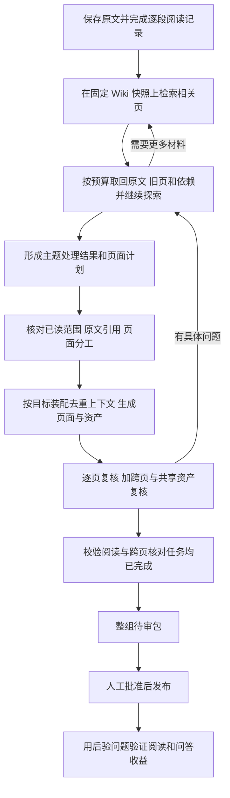

# Drop 相关知识发现与整合决策优化方案

**Feature:** [F005 Drop 资料收录与知识整合](../features/F005-wiki-drop.md)。
**Goal:** 让新资料更充分地进入已有知识体系，减少遗漏相关旧页和无意义的重复，同时通过上下文去重与按需读取控制单次输入，保留原文依据、适用条件和跨页关系，支持有独立价值的新概念、比较、综合与来源页。
**Acceptance Criteria:** 沿用 F005 AC03–AC09、AC11、AC12；规范与完成状态仍由 feature 维护。本文给出这些要求的实现补强与验证路径，不重置既有验收记录。
**Architecture:** 在现有“提取 → 发现 → 逐页生成 → 复核 → 整组审批”流程中，接入本地全文检索、按阶段装配的去重材料、可核对的页面比较记录及跨页复核。完整原文和阶段产物保存在固定快照与检查点中，模型按需取回原文，最终验证知识增益。原文、正式 Wiki、维护规则三层继续分离。
**Tech Stack:** 现有 TypeScript、Zod、Markdown、React、Vitest、Playwright，以及 `buildIndex`、`retrieve` 和关系扩展；无需新增依赖。

本方案已按用户 2026-11-01 的实施指令进入实现与验收。工作目录为 `C:/Users/-/Desktop/infra-view-new`；本次工程与真实模型证据补充到 [验收记录](wiki-drop-acceptance.md)，完成状态只回填 F005。真实模型的发布实验使用隔离副本。

## 目标与设计边界

LLM 负责理解、比较和组织知识，程序负责寻找材料、记录实际提供范围、验证引用与保护发布一致性。检索排名只帮助决定先看什么，不能直接决定更新、新建或丢弃材料。

新页需要说明它解决的问题、独立阅读价值和与现有页的分工。一个由已有事实组成的比较页、综合解释或新联系也可以有价值；不要求证明“无法合入任何旧页”，不以页面越少越好为目标。来源归档与新建来源摘要页分别判断，不能因为已有相同主题就丢掉新来源，也不要求每份来源必建一页。

沿用 F005 D03、D05、D06、D07：常规过程由系统完成，最后整组审阅；关键歧义才询问；调用次数、候选数量和总处理时长不引入业务总额限制；资源与供应商限制如实反馈；图表、公式、目录和正文共同处理。模型用量继续记录。

本轮范围包括 Drop 的相关页发现、整合判断、上下文去重、目录与正文按需读取、必要的分段生成及跨页复核、审阅说明。上下文处理是本轮交付条件，不再另行推迟。允许一次材料处理分成多次模型调用，但不能用截断、仅保留摘要或限制前几个候选来代替完整性要求。

不改问答检索排序，不重构其他入库流程，不引入向量数据库、多模型投票、自动批准或全库自动改写。只在 Drop 内组织材料与检查点；共用工具仅补足所需的预算和原文定位能力，不建设通用的上下文框架。

## 已核对的实现基础

| 现有实现 | 本方案的处理 |
|---|---|
| `scripts/wiki/drop-integration.ts` 每轮携带完整目录与累计材料，由模型请求旧页全文 | 保留全库可发现性，改为目录按需展开、原文可取回、每轮只带实际任务所需的材料 |
| `src/content/wiki/retrieve.ts` 已有标题与别名匹配、正文 BM25F、关系扩展 | 直接复用，不复制另一套打分规则 |
| `scripts/wiki/navigation.ts` 默认只选 30 条目录项，并截取查询前 2000 字符 | 不直接拿它替换 Drop 的目录访问能力；目录分页和检索都保留继续读取入口 |
| 页面计划只有 `path`、`reason`、`toc`、`evidence` | 增加实际比较对象与引文，把页面分工和知识增益写清楚 |
| 旧页须先读全文；已有修订分类、来源检查、图表检查、base 校验、整组发布 | 继续复用这些约束，不另建发布器 |
| 当前 `pages=[]` 会进入“无需变更” | 增加可检查的无需变更依据，不能把失败或未核当成无价值 |
| 审阅界面已有 Drop 报告和完整 diff | 在原位置提供简洁的逐页判断说明和阅读范围，不增加中间审批 |
| `sourceNotes` 分段提取后仍保存全部原文，后续 `packet` 集中发送；生成携带全部已生成正文，复核在 `notes/sources`、`read/old` 中重复装入材料 | 原文和产物保持完整落盘；单次输入只装一份所需内容，其他位置使用材料标识；重新需要时实际取回 |
| `context-window.ts` 已有规则与输出预留、UTF-8 预算和不丢字符的分段；`long-material.ts` 有原文引文校验与检查点 | 复用预算、定位和恢复机制；其选择性证据缩减不直接作为 Drop 的完整覆盖证明 |

2026-11-01 前序核读中，目录首次测得 167 页、213,498 字节；随后工作区测量为 167 页、215,316 字节，正文中位大小 25,926 字节、最大页 111,467 字节，解析问题为 0。这些是对应时点的体量测量，不是实际 Drop 请求用量或产品容量上限。当前 `drop-run.ts` 只对单次材料 JSON 检查 900,000 字节，不能据此推断模型实际可用窗口。前序运行的 Drop 契约、整合和服务测试共 3 文件、16 项通过，使用模拟模型，只证明相应工程行为。

## 目标处理链路



### 检索与继续阅读

索引从本批现有 `base` 对应的正式页构建一次，使用标题、别名、摘要和正文。后续本地检索与全文读取始终基于这份快照，避免在一个判断中混入不同正式版本。

提取步骤在现有原文、摘录、条件之外，输出少量简短主题和检索词。每个主题关联实际来源片段；主题只是整理线索，不替代原文，也不代表原文中的全部知识已经被穷尽。不同主题分别查询，防止长文的前半部分或高频主题覆盖其他内容。

程序通过现有 `retrieve` 合并直接命中与一跳关系候选，返回页面 id、命中方式、关联起点以及排序。分数不作为知识正确性或应当修改的置信度。首批候选作为建议加入发现输入；全库目录继续可访问，但不再要求每次完整装入。目录可先提供章节或主题概览，再分页返回 id、标题、别名、摘要；关系与图规格按任务展开。任何分页都包含总量、已提供范围和继续读取入口。

发现协议新增 `wikiSearch`，与现有 GitHub `search` 分开，并提供目录翻页及原文/页面/图规格读取请求。模型可以改写查询、请求后续结果、按已知 id 读取全文或指定范围；生成和复核阶段也有同样的补读出口，不能只在发现阶段允许查资料。宿主执行检索和取回，模型仍只输出结构化请求，不获得任意工具执行权限。结果分页只限制一次返回的数据量，带 `hasMore` 和绑定查询及快照的游标，不限制整批可以读取的页数。重复获取同一结果不算新进展。

精确名称命中需要在作出新建或无需变更决定前比较正文；这只要求比较，不强制合并。普通候选由模型选择继续阅读，不要求把所有低相关结果都读一遍。模型在计划中引用某旧页的结论、修改旧页或判断其已覆盖材料时，该页全文必须已提供；长页可按固定 hash 分段完成全文阅读，不能仅凭命中片段登记为全文已读。后续作出具体判断的调用还须实际带入相关原文及适用条件，不能假定模型记住前几次调用；原有建链约束继续生效。

新建计划还需以拟建页面的名称和主题检索一次已有库，并核对本批其他目标。检索结果为空只说明本次查询未找到候选，不能记为“全库证明不存在同题页面”。目录分页只改变传输方式，不能删掉某些页的访问路径或把未展示部分当成不存在。

### 上下文去重与原文覆盖

**去重范围是一次模型请求中的重复材料，不是删除知识库内容。** 原文快照、清洗映射、旧页基线和完整候选产物保留在磁盘。通过来源身份、内容 hash 和精确范围定位材料；同内容的不同来源仍保留各自出处、版本和用途。只合并同一版本材料的重复或重叠范围，不因文字相似而合并不同证据。

一次调用用一份 `materials` 表携带实际文字，计划、比较、引用和关系记录通过材料 id 与范围指向它。旧的 `notes/sources`、`read/old` 双份正文不再重复序列化；相同图规格也只装一份。字段中记录 id 并不意味着模型已经看到其内容：所有支持本次修改、比较或关系判断的必要原文都必须由宿主装入本次请求。

阅读记录区分三种状态：历史调用实际提供过的范围、本次调用实际提供的范围、尚未提供的范围。所有“已读”都指宿主确实提供了对应字节，不代表模型已理解或语义已验证。摘要、主题索引和历史结论用于导航，不能替代原文证据，也不能自动把历史已读转换成本次可用。

对本批每份接受的资料，以及实际采纳的外部补证，先生成覆盖完整解析文本的分段清单。每段记录来源 hash、原始字符偏移及行号映射、调用身份和完成情况；没有处理完成的段落进入待继续列表。合并原文范围的并集必须覆盖全文，不能只登记模型选中的摘录。清洗或网页解析未包含的内容仍按原有机制列明，不冒充已经读完附件或原始网页全部信息。

分段不是事实边界。否定词、版本条件、表头与数据、公式定义与推导、反例及其解释可能分处相邻或较远段落。保留上下文标题和定位，模型可请求前后范围或其他段落；需要跨段成立的结论绑定全部相关范围。在必要原文取回并完成比较前，不得写成无条件结论。完整分段阅读仍不能证明语义零遗漏，后续以原文复核和跨段反例验收约束这一边界。

| 阶段 | 本次需要实际带入 | 保持可取回但不全量重复携带 |
|---|---|---|
| 提取 | 当前原文段、来源身份、标题与必要相邻上下文 | 其他原文段；完整分段目录和未完成范围可分页访问 |
| 发现与比较 | 当前主题、有关原文及条件、候选信息；比较时补齐对应旧文 | 全库目录、其他主题、旧页全文和关系邻居 |
| 生成单页 | 目标计划、对应原文、目标旧文、受影响关系与共享资产；相关已生成页的实际内容 | 无关来源、无关旧页和本批其余已生成正文 |
| 逐页复核 | 新旧正文或已绑定范围、支持改动的原文、版本条件、公式与图规格 | 其他页的全文；需要跨页判断时继续取回 |
| 跨页复核 | 被检查的关系两端或共享依赖各方的相关原文、新旧结论及资产 | 本批其余页；按核对任务逐组装入 |

本批完整目标、主题处理结果和关系任务保留可遍历清单，每次只装与当前任务有关的条目并注明剩余范围。不能把尚未生成、未显示或未装入的目标误判为不存在，也不能无限累计此前生成的全文作为每次生成的固定输入。

旧页完整正文放不进单次请求时，先完成分段阅读，再对已绑定 hash 和精确原文范围生成局部修改，由宿主合成候选，未修改部分逐字保留。修改范围重叠或旧原文无法唯一定位时重新整合，不能按生成顺序覆盖。新长页按有稳定身份的章节生成并合成完整正文。两种情况均检查章节边界、表格和代码围栏、来源编号、公式条件与整页一致性，再走原有修订和发布校验。

现有 `section-integration.ts` 可参考原文绑定、局部修改与合成检查；它目前限制图表等编辑，不能直接替代 Drop 的整页和资产流程。`long-material.ts` 的分段检查点和逐字引文校验可复用，但其证据条数限制及选择性缩减不能作为 Drop 的全部证据集合；未带入的证据必须可继续取回，不能因缩减结果为空就判定材料无价值。

### 跨页关系与共享资产复核

按需装配前，宿主建立需要核对的影响清单：目标旧页的正向关系和派生反向关系、正文链接、共享图规格与所有使用页，加上模型发现的语义依赖、冲突和本批新关系。它们分别记录为待核任务，不能只保留排名靠前的邻居。一跳只限制单次发现的展开距离；发现新的受影响页后继续展开，直到当前改动的影响得到处理。没有相关任务不构成“全库不存在语义联系”的证明。

复核分为逐页和跨页两层。逐页核对原文、增量及旧知识保留；跨页按关系或共享依赖分组，实际取回各方内容，同时比较版本、条件、数字、单位与关系方向。分组之间的关系必须另有核对任务；不能因为每组内部通过就漏掉跨组边。共享图或公共公式涉及多页时，每个使用方都要核对，图资产、使用方结论及各方比较记录绑定同一组候选版本。

任一页、原文范围或共享资产修订后，依赖其旧 hash 的复核记录失效并回到待核。只有当前候选下所有必需阅读、页面检查、跨页任务及共享资产检查均完成，才能生成可批准的整组结果；明确记录的事实冲突仍可按 F005 交给人审，未执行的检查不能伪装成这种已识别冲突。最终只汇总报告不算完成复核，实际结论必须由带原文的检查记录支持。

### 单次预算与超量处理

启动批次时固定 provider/model、配置的上下文窗口、输出预留、预算算法和协议版本，重试沿用同一组配置。复用 `context-window.ts` 的计算与不丢字符分段能力，通过显式配置快照避免每次调用读取已变更的全局设置；现有其他调用方保持兼容。字节估算是保守的容量管理方法，不冒充精确 token 计数或供应商容量保证。

装配器在发送前计算完整规则、实际序列化材料、输出及协议开销预留；材料同时满足配置预算和现有 900,000 字节检查。这里的 900 KB 继续作为额外上限，不作为模型可用窗口。超量时依次消除重复、分页目录与非当前材料、拆分正文/生成/复核任务；每次拆分都登记范围与剩余任务，不能静默截掉必需证据。来源提取、生成、复核、自动修订与重试全部经过同一入口。

如果一个必须同时比较的证据单元仍放不下，或供应商拒绝当前输入，保留完整检查点、准确原因和待核范围。能够继续拆分或补读的由系统继续；不能完整完成必要判断时维持失败/未完成状态，不生成可批准结果，也不靠摘要替换原文强行通过。调整模型或窗口需显式重新尝试，不能在阶段之间悄悄切换。

### 整合判断与页面分工

模型为提取出的主题给出处理结果：纳入哪些目标页、已有内容覆盖、超出本次用途，或仍有未解决条件。一个主题可以落到多页，一页也可以承接多个主题；用户明确指定的收录重点必须有对应结果。程序核对主题和来源身份，不把覆盖了所有主题键当成穷尽全文的证明。

| 判断 | 模型需要说明 | 程序能核对的事实 |
|---|---|---|
| 更新已有页 | 增加或改变的解释、条件、结论，以及对应来源 | 目标在固定快照存在且全文已提供；引用实际存在；正文变更遵守现有修订协议 |
| 新建页 | 页面解决的问题、独立价值、与相关旧页及本批新页的分工 | 已执行主题查找；声明比较的旧页已读；id 与别名不冲突；依据可定位 |
| 已有知识覆盖 | 哪些具体旧文支持“无需更新”，新来源是否仍有归档价值 | 覆盖引文确实来自实际提供的旧正文，版本条件可追溯 |
| 无相关旧页候选 | 查过什么、已知范围和仍未核的范围 | 查询与返回结果由宿主记录，不能由模型自报为全库结论 |
| 未解决 | 尚缺哪项证据或条件，下一步应补查什么 | 不得被转换成“无需变更”；能自动继续的继续，关键外部条件才进入现有 needs-input |

模型对比较对象提供短原文引文与解释。宿主核对逐字匹配和快照身份；语义是否真的相同、相容或矛盾仍交给复核及最终审阅。不同版本各自成立时保留条件，不能仅按投喂顺序判新旧优先级。

现有 `reason` 承担页面用途、独立价值和分工说明，不再另设一份语义重复的“新建理由”。新增比较记录只表达比较对象和可定位依据。更新分类继续复用 `revisionSchema` 的 supplement、editorial、supersede，由生成阶段给出并验证，避免计划与生成分别维护相互冲突的分类。

没有生成目标页时，同样保存主题判断和实际读取范围。完全重复材料可以正常结束；“没有搜到”“读取失败”“上下文超限”不能单独支持无需变更。还未核清的证据保留为未解决，不为凑出新页而扩写，也不为减少页数而强行合并。

### 记录与审阅

终态需要以下记录，机器契约统一定义在 `src/content/wiki/drop.ts`：

| 记录 | 必要内容 | 责任方 |
|---|---|---|
| 实际查阅记录 | 协议版本、知识基线身份、查询及返回页、目录分页剩余、每份原文与旧页的 hash/范围覆盖、实际提供该范围的调用、待读范围 | 宿主生成；区分历史已提供和本次实际输入，不能接受模型改写计数或阅读事实 |
| 整合判断 | 主题来源、处理结果、目标路径、现有 reason/evidence/toc、比较对象与短引文、未解决条件 | 模型提出；宿主验证身份和引文，复核内容语义 |
| 调用材料清单 | 固定预算配置、本次任务、实际材料 id/hash/范围、完整输入字节、单份正文占用与去重前后差额、尚未装入的范围 | 宿主从实际序列化输入计算；同一正文不因不同字段重复传输，不把磁盘可访问等同于本次已读 |
| 跨页核对记录 | 关系或共享资产任务、涉及页面、原文范围与候选 hash、检查结果、未解决项、修订后失效情况 | 宿主维护任务身份与有效性，模型提供语义判断；汇总必须覆盖跨组任务及共享资产全部使用方 |

逐次原始输入输出继续保存在现有 runs 目录。最终记录固化原文覆盖与必需任务结果，并关联实际调用记录的 hash；不能只依赖一段模型自报的完成说明。有审阅包时，最终记录存进 `review.payload.drop`，随整组提案内容参与 revision hash；批次通过现有 `reviewId` 引用它，不另存可独立修改的第二份。无需发布时，记录保存在批次中。继续保留现有 `report` 供旧记录展示，新增记录优先通过统一格式生成可读说明，不出现两套不同结论。

审阅页先呈现每页的“新增或更新、解决什么问题、比较了哪些旧页、主要证据”，再展示知识增益与未解决项。查询明细、原文分段覆盖和跨页核对结果可展开，不能用笼统“已压缩”掩盖未提供的范围；无需把内部预算字段放进常规用户流程。完整 diff、图表和公式预览沿用现有界面。全部由系统填写，用户不需要逐项填表或增加一次方向批准。

为防止“比较时正确、批准时过期”，用于整合判断的旧页与资产继续作为发布依赖参与 base 校验。不能只保护最终被修改的页，而漏掉用于判断新建合理性的比较页。

### 复核与恢复

复核使用前述逐页与跨页任务，每次带入当前任务需要的计划、实际原文、新旧内容和比较依据，避免最后重新拼成一个超大请求。重点检查遗漏重要旧页、同义重复、版本差异、旧知识丢失和新页用途；整组收束只核对任务覆盖、有效版本和待处理事项，不让汇总摘要代替内容检查。发现具体问题时回到现有发现或生成修订循环；不另加一套审批状态机，也不把多次模型同意视为事实保证。

协议升级、固定预算配置、任务身份和本次实际装入材料的 hash/范围进入调用缓存身份。新协议不能直接复用缺少查阅记录的旧发现结果；同协议、同输入、同基线、同模型和同预算的成功分段继续复用。断点恢复从未完成范围继续；正文或资产变化只重做受影响读取、生成及跨页核对，不能把旧结论当成新版本已经复核。重试保留原调用用量；重新整合产生新的完整提案。

旧批次和旧审阅包继续可读、可按原有规则审批。新增字段在旧记录缺省时只显示“旧记录无此项”，不补造查阅证据，不写默认值改变旧 payload 的 hash。运行记录格式变化应显式区分协议；运行中的旧进程不被本次文档或后续部署隐式接管。

发布前校验候选依赖 hash、原文范围覆盖和必需核对任务的有效结果；任何缺项、损坏记录或未处理的失效任务阻止批准。历史包按旧契约处理，新协议包不得通过缺省字段退回旧校验路径。协议迁移不改写旧 payload 的 hash，且要有对应兼容与防绕过用例。

## 实施顺序与验收入口

每一步都产生终态保留的能力。实现阶段先加入失败用例，确认因缺少目标行为而失败，再实现并使原断言通过；不得降低原发布和来源断言。

| 步骤 | 主要文件 | 先证明的缺口 | 通过条件与对应 AC |
|---|---|---|---|
| T1 固定质量与体量样例 | 新建 `scripts/wiki/drop-discovery.test.ts`、`scripts/wiki/drop-context.test.ts`；扩充 `scripts/wiki/drop-integration.test.ts` | 当前重复输入、累计正文及分段条件丢失的风险缺少检查；相关页和分工无稳定验证 | 固定原文、页面/关系预期、单次预算和实际输入基线，先证明缺口；工程行为与模型质量分别验收。AC03–AC07、AC11 |
| T2 材料去重与预算 | 新建 `scripts/wiki/drop-context.ts`；修改 `drop-run.ts`、`src/content/wiki/drop.ts`；复用并按需扩展 `context-window.ts` | 同一正文重复传输；900 KB 检查未覆盖配置窗口；历史已读与本次提供未区分 | 每次请求的材料单份装配、原文范围定位、固定预算与剩余任务可校验；所有阶段和修订经过同一检查入口。AC03、AC04、AC12 |
| T3 检索与按需读取 | 新建 `scripts/wiki/drop-discovery.ts`；修改 `drop-integration.ts`；复用 `src/content/wiki/retrieve.ts` | 无本地查询、目录续读和生成/复核补读入口；长材料仍集中传输 | 全库可发现、原文全段有记录、旧页分段阅读可续接；缺失条件能取回，首批候选不限制后续探索。AC03、AC04、AC06 |
| T4 整合判断与分段生成 | `src/content/wiki/drop.ts`、`drop-integration.ts`、`drop-context.ts` 及测试；参考 `section-integration.ts` | 新建/无变更缺比较依据；生成携带全部已有产物，长旧页易被整体覆盖 | 新建用途与页面分工明确；局部修改绑定旧文，未改段逐字保留；新长页合成完整且边界正确。AC05、AC07、AC09 |
| T5 跨页复核 | `drop-integration.ts`、`drop-assets.ts`、`drop-context.ts` 及整合测试 | 单页通过不能证明跨分段条件、跨组关系与共享图一致；最终复核仍有重复材料 | 逐页及跨页任务覆盖完整；跨组边和共享资产所有使用方有带原文的核对；修订使相关记录失效重查。AC04、AC06、AC07、AC09 |
| T6 恢复与发布完整性 | `drop-run.ts`、`drop-batch.ts`、`review.ts`；contract/integration/review 测试 | 新预算/分段/核对记录未绑定缓存及发布版本 | 分段可恢复、旧记录 hash 不变；依赖变化或未完成任务阻止新包批准，删除新字段不能绕过校验。AC03、AC08、AC12 |
| T7 展示判断与覆盖 | `src/app/wiki/ReviewPane.tsx`、`DropPane.tsx`、`server/review.ts`、`tests/wiki-drop.spec.ts` | 无法查看逐页分工、原文覆盖与跨页核对范围 | 桌面和窄屏可追溯并区分完成/未完成，旧记录可展示，整组审批保持可用。AC08、AC09、AC12 |
| T8 验证知识增益与输入规模 | 扩充 `docs/plans/wiki-drop-acceptance.md` 的方法与实际证据；完成状态只回填 F005 | 输入缩小不证明知识保留，模拟测试不证明真实判断正确 | 完整输入对照与长材料样例均核原文、条件和关系；记录峰值及总输入、调用与失败，不以省 token 代替质量。AC03–AC09、AC11、AC12 |

`drop-discovery.ts` 承载本地查找与分页；`drop-context.ts` 只承载 Drop 的材料范围装配、去重、预算检查及覆盖清单；`drop-integration.ts` 保持流程编排职责。原文存储、发布、全局检索打分和既有分段基础能力继续复用。问答检索的默认行为不因 Drop 调用而改变；共用预算接口如需扩展，必须保留其他入库流程的默认行为并覆盖其调用方。

### 工程验证命令

下列为实施后的验证入口，不是本轮已执行结果。先运行对应步骤的相关测试；收尾再进行项目要求的完整检查和浏览器验收。

```powershell
pnpm exec vitest run src/content/wiki/retrieve.test.ts scripts/wiki/drop-discovery.test.ts scripts/wiki/drop-context.test.ts scripts/wiki/context-window.test.ts scripts/wiki/long-material.test.ts scripts/wiki/section-integration.test.ts
pnpm exec vitest run scripts/wiki/drop-contract.test.ts scripts/wiki/drop-integration.test.ts scripts/wiki/drop-assets.test.ts server/drop.test.ts scripts/wiki/review.test.ts server/review.test.ts
pnpm typecheck
pnpm lint
pnpm exec playwright test tests/wiki-drop.spec.ts
pnpm check
pnpm build
```

预期：测试通过、类型/Lint/内容/图表检查通过、构建成功。浏览器实际操作覆盖输入、继续查阅后的报告、原文范围与跨页结果展开、分段恢复、退回重试、整组批准及发布后阅读；记录 1280 和 390 像素视口证据。若现有工作区另有失败，保留具体命令和输出，调查与改动的关联，不能将失败静默归为历史问题。

## 固定样例与真实模型验收

先冻结一份基线 Wiki、原文快照、模型配置和外部来源范围，用当前版本与优化版本处理同一批材料。预期内容由人工核对原文确定，允许多个合理的页面组织方式，不把单一文件名方案当成语义正确性的唯一答案。

| 样例 | 需要观察的结果 |
|---|---|
| 文档用英文缩写，旧页以中文标题和别名出现 | 能发现同一主题并核读，避免同义重复 |
| 关键线索只在旧页正文，标题摘要都没有 | 全文检索补上目录阅读的盲点 |
| 文档后半部分包含另一个主题 | 后半主题不被前半主题挤掉 |
| 正确旧页不在首批结果中 | 模型可以继续查询、读后续结果并调整计划 |
| 一份资料影响多个概念、参数及共享图 | 完整影响范围进入同一待审包，未留下相互矛盾的解释 |
| 同一主题增加使用条件或例外 | 更新恰当旧页，保留原有有效知识 |
| 名称相近但机制或对象不同 | 不因分数高而误合并 |
| 不同版本都正确，以及旧版本资料晚投 | 保留版本边界，不能按接收时间覆盖 |
| 真正的新概念，或基于已有事实的新比较页 | 允许创建有独立价值的新页并正确建链 |
| 完全重复材料或只需归档的新来源 | 无强行增页，有可核对的无需变更理由 |
| 未读旧页被声明为比较依据，或模型编造引文 | 程序阻止进入待审，回到补读或修订 |
| 查找失败、证据不全、上下文超量 | 保留未完成状态，不能算“无新增知识” |
| 一批中两个不同名称指向同一新概念 | 先协调目标分工，再统一生成 |
| 比较页在审批前改变，或旧协议缓存被读取 | 拦住过期判断，重新整合；旧审阅字节保持不变 |
| 同一原文/旧页/图规格被多个字段或任务引用 | 单次输入只携带一份对应范围；所有用途和来源身份仍可定位 |
| 总材料超过 900 KB，单个合理任务可以在配置预算内完成 | 自动分批而不丢原文范围；每次实际请求都通过完整预算检查 |
| 目录或已生成页面很多 | 翻页和按需装配可继续获取全部条目；单次输入不无界累计全文，不把未显示页当不存在 |
| 否定或版本限制在下一段，公式定义在较远段，表头与数据被分开 | 取回条件及相关范围共同判断，输出保留限定；缺条件时不产生无条件结论 |
| 历史调用读过证据，但本次生成或复核未装入 | 自动补读后再判断，不能用“已读”标记代替本次原文 |
| 一份原文包含重复术语、多种条件和边界反例，摘要只保留主结论 | 原文覆盖清单完整，真实语义验收保留反例；摘要不能成为唯一证据 |
| 正文超长、无换行 Unicode、表格或代码围栏跨分段 | 原始字节与定位不丢失，旧文未改范围保持；合成后结构及引用有效 |
| A 与 B 分属不同复核组，存在有条件的依赖或矛盾 | 跨组任务实际提供双方原文并核对条件，不能只凭组内通过结束 |
| 多页共用图或公式，部分使用方不在首批候选中 | 发现并核对全部使用方，图中数值与各页条件一致，整体审批 |
| 某页在分组复核后再次修订，或恢复时缺一份分段记录 | 相关原文绑定和跨页记录失效重查；缺项不能标为完成或批准 |
| 运行期间全局模型/窗口改变，或规则与输出预留挤占输入 | 当前尝试沿用固定预算；显式新尝试重算，所有阶段包含规则与预留成本 |
| 必需证据组合仍超量，或供应商实际窗口不足 | 保留原因与待核任务，不静默删证据、提高上限或生成可批准结果 |

对每个真实案例记录：应涉及的旧页是否被发现、是否误改无关页、是否无意义地重复建页、是否误合并、增量是否有来源、原有知识是否保留、跨段条件及跨页关系是否完整。输入指标分别记录去重前后字节、最大单次输入、整批总输入、实际返回的 token 用量（若供应商提供）、调用次数、延迟和失败；峰值下降不等于总费用下降，字节数不换算成未经验证的 token 数。检索命中率用来定位发现问题，不单独决定整合成功。

上下文优化按以下条件验收：原文及旧页的必需范围无缺口，实际调用材料清单与保存的输入一致，重复材料单次只装一份，每次请求都在固定预算内；已知关系、跨组边、共享资产使用方和模型新增依赖有当前版本的核对记录。较小的固定样例另设完整输入对照：同模型、同原文、同旧页，检查按需方案是否遗漏事实、条件、反例或关系。较大样例使用逐段原文与预先标出的跨页检查项验收，不能因为完整输入基线运行失败就自动判优化版质量通过。

在隔离副本完成实际审批发布，再使用未直接用于编译的等价问题、跨页比较题、版本反例和无证据问题验证复用。固定模型、允许的工具和来源范围，比较发布前后的答案、引用支持和未知边界。重复材料允许答案保持不变；新增知识和纠错样例应体现对应改善。主工作区正式页不作为质量实验的发布目标。

小样本应逐例报告，不外推为全库准确率。关键场景出现漏改、无依据覆盖、版本混淆、误合并或虚假完成时，先定位并修复，再补回归用例。仅测试绿色、页面增加、链接命中或模型自评通过，都不足以完成 AC11。

## 取舍与待决定事项

本轮同时改善发现判断与单次输入组织。去重应直接减少相同材料的重复传输，按需读取和分段可以降低峰值输入，但补读和跨页复核可能增加调用次数；最终同时报告峰值、总输入与知识质量。原文证据和跨页一致性优先于省 token，不能用减少输入为丢失条件或关系辩护。

不预设质量提升百分比、候选总数或新页数量目标，也不以固定模型的单次成功替代适用范围。目录访问、原文补读、生成和复核的上下文处理属于本轮验收；更换检索基础设施或改造其他入库流程仍在范围之外。程序能证明实际提供的材料、范围及版本，语义完整性还需带原文的复核和真实对照样例。

**待决定事项：无阻塞问题。** 本方案沿用已确定的人工整组批准、模型选择及资料范围；实施已获用户授权，正式 Wiki 仍须用户整组批准。

## 依据

- [LLM Wiki 原始构想](../../llm-wiki.md)：持久知识积累、原文与 Wiki 分层、跨页维护、搜索工具和比较分析回写。
- [F005](../features/F005-wiki-drop.md)：AC03–AC09、AC11、AC12 与 D03、D05、D06、D07。
- [原 Drop 实施计划](wiki-drop-plan.md)：来源身份、一致基线、完整影响范围和审批语义。
- [当前发现与生成流程](../../scripts/wiki/drop-integration.ts)、[运行与恢复](../../scripts/wiki/drop-run.ts)。
- [已有检索器](../../src/content/wiki/retrieve.ts)、[目录辅助函数](../../scripts/wiki/navigation.ts)、[上下文预算工具](../../scripts/wiki/context-window.ts)。
- [长材料读取与检查点](../../scripts/wiki/long-material.ts)、[已有局部整合机制](../../scripts/wiki/section-integration.ts)：复用原文定位与恢复思路，明确其现有筛选和编辑范围的限制。
- [发布与旧记录校验](../../scripts/wiki/review.ts)、[整合回归](../../scripts/wiki/drop-integration.test.ts)。
