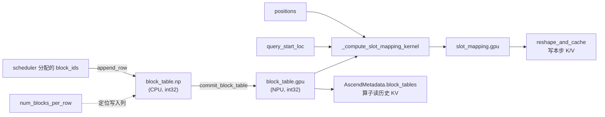

## 一句话

`BlockTable` 维护一张 `(max_num_reqs, max_num_blocks_per_req)` 的 int32 表：第 `i` 行是 batch 里第 `i` 个请求，第 `j` 列填的是这个请求第 `j` 个逻辑块落在显存的哪个物理块上 [C1]。每步推理前，它把这张表的前 `num_reqs` 行拷到 NPU，再用一个 triton kernel 把每个 token 的绝对位置翻译成「物理块号 × block_size + 块内偏移」的槽位号，交给 attention 去读写 KV cache [C6]。

## 为什么需要它

[PagedAttention](paged-attention.md) 允许一个请求的 KV cache 散落在显存各处、不要求连续，代价是算子拿到一个 token 的位置后不再能直接算出地址——中间必须有一层翻译。块表就是这层翻译，官方设计文档对它的定义是「把每个块在序列内的逻辑地址翻译成设备显存里的全局物理地址」[S20]（[线上同页](https://docs.vllm.ai/projects/ascend/en/latest/developer_guide/Design_Documents/ModelRunner_prepare_inputs.html)）。

问题在于这层翻译每步都要做，而且是 token 级的：一个 batch 一步可能有上万个 token，每个都要查表。如果每步在 CPU 上逐 token 算好地址再传给 NPU，H2D 传输量与 CPU 开销都会压在关键路径上。vllm-ascend 的做法是把「查表」拆成两半——**慢变的表**（哪个请求占了哪些块，只在调度器分配/释放块时变）常驻 CPU、按行增量更新、每步只把前 `num_reqs` 行异步拷过去；**快变的槽位**（这一步每个 token 写哪里）完全在 NPU 上用 kernel 算。

翻译出来的东西有两个消费者，不要混淆：`block_tables` 张量给 attention 算子读历史 KV 用，`slot_mapping` 给 `reshape_and_cache` 写本步新 KV 用 [C8]。两者都由这一页的类产出。

## 怎么工作

### 表本身

行数默认等于 `max_num_reqs`；只有开了 DCP 且有投机解码时才会乘上一个 `duplicate_size = 1 + num_speculative_tokens`（main）[C1]。v0.23.0 的触发条件是 `pcp_world_size * dcp_world_size > 1`，即 PCP 单独打开也会扩行 [!][C15]。

列数是 `max_num_blocks_per_req`，由 KV cache spec 按 `max_model_len` 算出、从外面传进来 [C11]；hybrid 模式下（一个物理块被切成多个逻辑块给算子用）列数再乘 `blocks_per_phys_block`，写入时 `_convert_physical_to_logical_blocks` 把一个物理块号展开成一串连续逻辑块号 [C5]。昇腾 GQA 后端的 `get_supported_kernel_block_sizes` 只返回 `[128]`，而平台默认 `block_size` 也是 128 [C7][C12]，所以默认配置下 `blocks_per_phys_block == 1`、hybrid 路径不启用 [D]——这条推广的依据是两者取值相等时 `use_hybrid_blocks` 分支必然走 `False`，但如果用户把 `--block-size` 设成 128 的倍数，拆分就会生效。

`num_blocks_per_row` 是一个 CPU 侧的游标数组，记录每行已经写到第几列。

### 一步推理里的四个动作



1. **追加**：调度器为某请求新分配了块，`append_row(block_ids, row_idx)` 从 `num_blocks_per_row[row_idx]` 指的那一列开始写，然后把游标往前推。decode 每步最多追加一个块，通常一个块都不加——所以这一步几乎不花时间。`add_row` 是游标归零后再 append（新请求上批），`move_row` / `swap_row` 在批次重排时整行搬移：行号是**请求在 batch 里的位置**，不是请求 id [C2]。
2. **提交**：`commit_block_table(num_reqs)` 把前 `num_reqs` 行拷到 NPU。它被放在 `_prepare_inputs` 的第一行，注释写明了理由——让这次 H2D 与后面的 CPU 准备工作重叠 [C9]。main 直接调上游 `CpuGpuBuffer.copy_to_gpu` [C4]；v0.23.0 是手写的 `gpu[:n].copy_(cpu[:n].clone().pin_memory(), non_blocking=True)` [!][C17]。
3. **算槽位**：`compute_slot_mapping(num_reqs, query_start_loc, positions)` 吃的是设备上的 `query_start_loc` 和本步全部 token 的全局 `positions` [C10]，起一个 grid 为 `num_reqs + 1` 的 triton kernel，一个 program 管一个请求，最后那个 program 专门把 `num_tokens` 到 `max_num_tokens` 之间的尾巴填成 `PAD_SLOT_ID` [C3]。核心三行就是官方文档那四步的代码版 [S20]：

   ```
   block_indices = pos // block_size          # 第几个逻辑块
   block_numbers = block_table[row, block_indices]  # 查表得物理块号
   slot_ids = block_numbers * block_size + pos % block_size
   ```

   main 上这个 kernel 是 vllm-ascend 自己的（`vllm_ascend/ops/triton/compute_slot_mapping.py`），按 `TILE_BLOCK_SIZE = 1024` 个 token 一批处理，并且只把行内 `BLOCK_TABLE_WINDOW_SIZE` 个相邻列载入片上再 `tl.gather`，避免整行随机访存 [C6]；v0.23.0 直接从 `vllm.v1.worker.block_table` 导入上游 kernel [C13]，分块大小写死 `BLOCK_SIZE=1024`，没有窗口参数 [!][C16]。
4. **消费**：`slot_mapping` 被切到 `[:num_actual_tokens]` 传给 `reshape_and_cache`，把本步的 K/V 散写进 cache [C8]；`block_table.gpu` 的前若干行进 `AscendMetadata.block_tables`，供算子读历史 KV。

开了 DCP（main）或 PCP/DCP（v0.23.0）时走的是另一条纯 torch 的路径，先把位置折算到「虚拟块」再判断这个 token 属不属于本 rank，不属于就填 -1 [!][C3]。

## 拿真实数字走一遍

Qwen3-0.6B（28 层，n_kv = 8，d_h = 128，bf16），配置：

```bash
vllm serve Qwen/Qwen3-0.6B \
  --max-model-len 4096 \
  --max-num-seqs 256 \
  --max-num-batched-tokens 8192
# --block-size 不给，昇腾平台置为 128
```

**表的形状**：列数 = `cdiv(4096, 128)` = 32，行数 = 256（无 DCP、无投机解码，`duplicate_size = 1`），dtype int32 [C1]。表本身 256 × 32 × 4 B = **32 KiB** [D]。

**一个表项代表多少显存**：KV cache 每层张量是 `(2, num_blocks, block_size, num_kv_heads, head_size)` [C7]，所以每 token 每层 K+V = 2 × 8 × 128 × 2 B = 4 KiB，28 层 = 112 KiB；一个 128 token 的块 = 112 KiB × 128 = **14 MiB** [D]。表里那 4 个字节的整数，指着 14 MiB 显存。

**prefill 一个 token 的槽位**：设某请求排在 batch 第 2 行，已分配物理块 `[5, 9, 17]`，即第 2 行前三列是 `5 | 9 | 17 | 0 | 0 | ...`。position = 300 的 token：

- `block_indices = 300 // 128 = 2`
- `block_numbers = block_table[2][2] = 17`
- `slot_offset = 300 % 128 = 44`
- `slot = 17 × 128 + 44 = 2220`

**decode 追加一个块**：该请求算到第 384 个 token 时，`384 // 128 = 3`，第 4 列还是 0；调度器分配物理块 42，`append_row([42], 2)` 把 42 写进第 3 列（游标此前为 3），游标变 4 [C2]。这一步只改了 4 个字节的 CPU 内存。该 token 的槽位 = 42 × 128 + 0 = 5376。

**kernel 的窗口参数**（仅 main）：`BLOCK_TABLE_WINDOW_SIZE = _next_power_of_2(cdiv(1024, 128) + 1) = _next_power_of_2(9) = 16` [C3]。即一批 1024 个 token 最多跨 9 个块，取 2 的幂后一次载入 16 列。

**slot_mapping 缓冲**：main 为 8192 个 int32 = 32 KiB；v0.23.0 即使不开 PCP 也多留 `2 × 1 × 256` 个元素，共 8704 × 4 B ≈ 34 KiB [!][C15]。

## 事实表

| 项 | v0.23.0 | main | 意味着什么 |
|---|---|---|---|
| 表形状 | `(max_num_reqs × duplicate_size, max_num_blocks_per_req)`，int32 [C15] | 同左 [C1] | 列数只够装满 `max_model_len` 个 token；调长上下文，这张表和整个 KV 池一起变大 |
| 列数来源 | `kv_cache_spec.max_num_blocks_per_req(...)`，再按 `compress_ratio` / Mamba×CP 二次调整 [C14] | 直接用传入值，不再二次调整 [C11] | 想算列数看 spec，不要在 BlockTable 里找 |
| 支持的 kernel block size | `[128]` [C18] | `[128]` [C7] | 昇腾 GQA 后端只有这一个合法值，别指望调小块换更细的显存粒度 |
| 默认 `block_size` | 128 [C19] | 128 [C12] | 不传 `--block-size` 时物理块与逻辑块同尺寸，hybrid 拆分不生效 |
| 单元格含义 | 物理块号；0 表示未使用 [S20] | 同左 | 全 0 的行 = 没有请求；块 0 被当哨兵，别当成一块可用的 KV |
| 槽位公式 | `block_number × block_size + position % block_size` [S20] | 同左 [C6] | 槽位是「全局 token 槽」的编号，不是块内偏移 |
| 行扩展条件 | `pcp × dcp > 1` 时行数 ×`(1 + num_spec_tokens)` [C15] | 仅 `dcp > 1` 时 [C1] | 同样开 PCP + MTP，两版的表行数不同 |
| slot_mapping 长度 | `max_num_batched_tokens + 2×pcp×max_num_reqs + mtp` [C15] | `max_num_batched_tokens + mtp` [C1] | v0.23.0 即使不开 PCP 也多占一小块，不是 bug |
| 提交方式 | 手写 `clone().pin_memory()` 后异步拷 [C17] | `CpuGpuBuffer.copy_to_gpu(num_reqs)` [C4] | 行为等价，但 v0.23.0 每步多一次 clone |
| 表自身开销 | 256 行 × 32 列 × 4 B = 32 KiB [D] | 同左 | 相对它管理的几 GiB KV cache 可以忽略，别为它做优化 |

## 常见误解

- **「块表里存的是显存地址」**——存的是块号，一个 int32。地址要靠 `块号 × block_size + 偏移` 现算，而且算出来的还是槽位号不是字节地址，字节偏移由算子按 `(2, num_blocks, block_size, num_kv_heads, head_size)` 的布局推 [C7]。
- **「decode 每步都要重建/重写这张表」**——每步只做两件事：可能往某一行追加一个块号（4 字节），然后把前 `num_reqs` 行拷到 NPU [C9]。真正每步全量重算的是 `slot_mapping`，而那是在 NPU 上用 kernel 算的。
- **「块 0 是一块正常可用的 KV 块」**——上游设计文档明确用 block_0 标记未使用的块 [S20]，`clear_row` 也是把已用列填 0 [C2]。看到块表里一片 0，那是空位不是都指向第一块。
