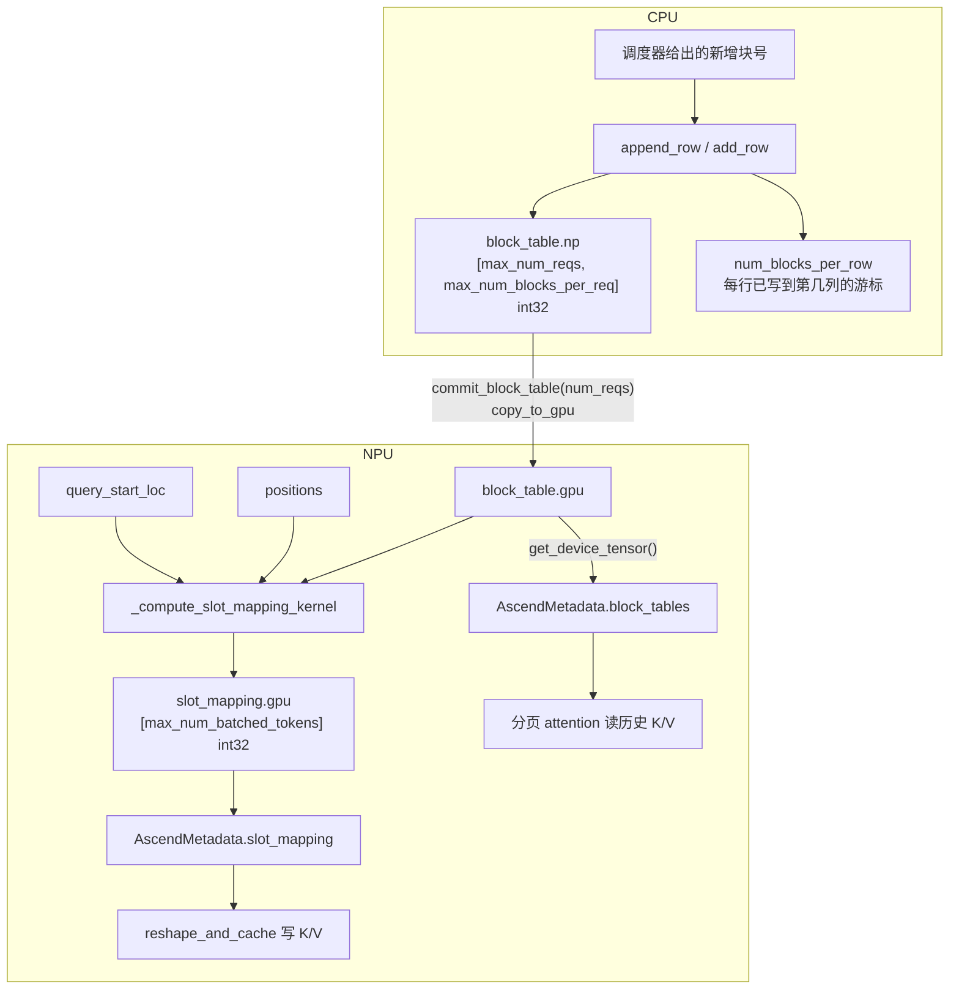
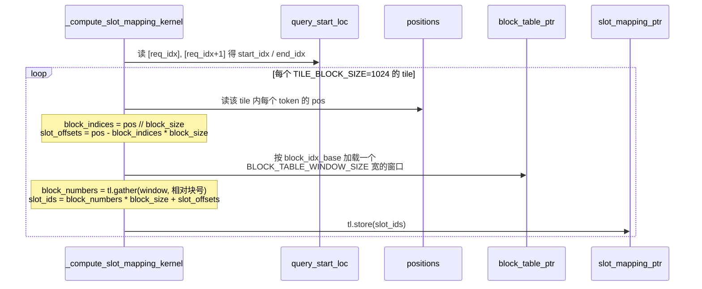

## 一句话

Block Table 是一张 `[max_num_reqs, max_num_blocks_per_req]` 的 int32 表：第 `r` 行是 batch 中第 `r` 个请求槽位，第 `i` 列存的是这条序列第 `i` 个逻辑块落在显存里的**物理块号**。官方设计文档把它定义为「把每个块在序列内的逻辑地址翻译成它在设备显存中的全局物理地址」[S]。每一步推理前，块表先从 CPU 提交到 NPU，再由一个 Triton kernel 把它展开成 token 级的 `slot_mapping`，attention 才知道这一步的 K/V 该写进哪个槽位。

## 为什么需要它

没有块表，KV cache 就只能按序列连续分配：给每条请求预留 `max_model_len` 个 token 的显存。一条请求实际只生成 200 个 token，却按 32768 预留，绝大部分显存空着；而且两条请求的缓存长度一变，就要搬数据来保持连续。PagedAttention 的做法是把 KV cache 切成定长块（Ascend 后端固定 128 token 一块 [C]），谁要用谁去空闲池里拿一块，物理上随便放在哪都行。

代价是：物理上不连续了，attention 算子再也不能用「起始地址 + 偏移」找到第 `p` 个 token 的 K/V。块表就是补上这层间接寻址——它是**序列视角**到**显存视角**之间唯一的翻译表。整个昇腾侧的推理循环里，它承担三件事：

- **写入定位**：`compute_slot_mapping` 把块表按 token 展开成 `slot_mapping`，`reshape_and_cache` 拿着它把当前 step 的 K/V 写进正确的槽位 [C]。
- **读取定位**：块表张量本身（`AscendMetadata.block_tables`，形状 `(batch_size, max_blocks_per_seq)`）直接传给 `npu_fused_infer_attention_score` 一类的分页 attention 算子，让它按块去 gather 历史 K/V [C]。
- **共享的载体**：prefix caching、KV pool 之类的特性之所以能让两条请求共用同一段前缀缓存，靠的就是两行块表里填同一个物理块号——不需要复制任何 KV 数据 [D]。

昇腾侧与上游的主要差别在两处。一是块大小被钉死：`AscendAttentionBackend.get_supported_kernel_block_sizes()` 直接返回 `[128]`，不像 CUDA 后端那样有 16/32 等多种选择 [C]。二是 slot mapping 的计算被搬进了 Triton kernel（`_compute_slot_mapping_kernel`），而不是在 numpy 里做完再拷到设备——因为 `positions` 本来就在设备上，绕回 CPU 会引入同步点 [D]。仓库里随算子附带了一份中文说明文档，明确写出这条主线：读 `pos` → 拆成 `block_indices` 与 `slot_offsets` → 查表得 `block_numbers` → `slot_id = block_numbers * block_size + slot_offsets` [C]。

## 怎么工作

块表有两份：一份是 CPU 上的 pinned numpy 视图（`block_table.np`），由调度结果驱动、可随机改写；一份是 NPU 上的设备张量（`block_table.gpu`），只在每步开头被整体同步一次。这个「CPU 改、设备读」的两份结构是理解全部 API 的钥匙。



### 追加：`append_row` 只动 CPU

`append_row(block_ids, row_idx)` 把新分配的块号写到 `block_table.np[row_idx]` 的**尾部**，起点由 `num_blocks_per_row[row_idx]` 这个 CPU 侧游标给出，写完游标前移 [C]。所以 decode 每步的代价是「往一行的末尾追加 0 个或 1 个整数」——绝大多数 step 连一个块都不新增（128 个 token 才用满一块），块表在 CPU 上根本没变化。`add_row` 是它的重置版本：先把游标清零再追加，用于一个槽位被新请求接管时 [C]。

### 提交：`commit_block_table` 是唯一的 H2D 同步点

`commit_block_table(num_reqs)` 只有一行——`self.block_table.copy_to_gpu(num_reqs)`，把 CPU 缓冲区的前 `num_reqs` 行搬到设备 [C]。`copy_to_gpu(n)` 的具体切片语义在上游 `vllm.v1.utils.CpuGpuBuffer` 里，本地未克隆该仓库；从参数名与「只有 `num_reqs` 行有效」这个调用语境看，它拷的是第 0 维的前 `n` 行 [I]。

调用点排在 `_prepare_inputs` 的最开头，源码注释说明了原因：先把拷贝发出去，好让它与随后的一大段 CPU 计算重叠 [C]。ACL Graph 捕获路径下会改用 `commit_block_table(num_reqs_padded)`，因为后续 metadata 要读 `block_table[:num_reqs_padded]` [C]。

### 计算槽位：`compute_slot_mapping`

非 DCP 路径下走 Triton kernel，启动网格 `(num_reqs + 1,)`：前 `num_reqs` 个 program 各处理一条请求，最后一个 program 专门把 `slot_mapping[num_tokens : max_num_batched_tokens]` 填成 `PAD_SLOT_ID`，以满足图模式对定长张量的要求 [C]。

每个 program 的主体：



这里有一处值得注意的实现取巧：kernel 不逐 token 去 gather 块表，而是先取这一 tile 内最小的块号 `block_idx_base`，一次性把从它开始的 `BLOCK_TABLE_WINDOW_SIZE` 个表项加载进寄存器，再在窗口内做相对索引的 `tl.gather` [C]。窗口宽度取 `_next_power_of_2(cdiv(TILE_BLOCK_SIZE, block_size) + 1)`——一个 tile 最多 1024 个连续位置，跨不过 `1024/128 + 1 = 9` 个块，向上取 2 的幂就是 16 [C]。

DCP（decode context parallel）路径走另一条分支 `_compute_dcp_slot_mapping`，引入「虚拟块 = `block_size × dcp_size`」的概念：只有属于本 rank 的 token 才写真实 slot，其余写 `-1` [C]。官方设计文档给出了同一套公式，并声明当前实现要求 `block_size % cp_kv_cache_interleave_size == 0` [S]。

### 多组与逻辑块拆分

`MultiGroupBlockTable` 为每个 KV cache group 各持有一张 `BlockTable`，所有操作都是逐组转发；Mamba 组在 `compute_slot_mapping` 里被直接 `continue` 跳过，因为状态空间模型不按 token 槽位写缓存 [C]。

当 `kernel_sizes` 给出的 kernel 块比物理块小时（`blocks_per_phys_block > 1`），进入 hybrid 模式：表的列数放大 `blocks_per_phys_block` 倍，`append_row` 调 `_convert_physical_to_logical_blocks` 把物理块 `p` 展开成连续的逻辑块 `[p*n, p*n+1, ..., p*n+n-1]` [C]。在昇腾 attention v1 的默认配置下 `kernel_sizes` 与物理块都是 128，`blocks_per_phys_block == 1`，这条路径不触发 [D]。

## 拿真实数字走一遍

配置：Qwen3-0.6B（28 层，H=1024，n_q=16，n_kv=8，d_h=128），bf16 KV cache，Atlas A2 单卡。

```bash
vllm serve Qwen/Qwen3-0.6B \
    --max-model-len 4096 \
    --max-num-seqs 64 \
    --max-num-batched-tokens 8192 \
    --block-size 128
```

`--block-size 128` 是昇腾后端唯一支持的取值（`get_supported_kernel_block_sizes()` 返回 `[128]`），写出来只是为了让读者看见这个前提；`--max-num-seqs 64` 决定块表的行数，`--max-model-len 4096` 决定列数，`--max-num-batched-tokens 8192` 决定 `slot_mapping` 的长度。

**1. 表的形状。**

- 列数：`max_num_blocks_per_req = cdiv(4096, 128 × 1) = 32`（`dcp_world_size = 1`）[C]
- 行数：`max_num_reqs × duplicate_size = 64 × 1 = 64`（无 DCP 时 `duplicate_size = 1`）[C]
- 于是 `block_table` 形状 `(64, 32)`，int32 → `64 × 32 × 4 = 8192 B = 8 KiB` [D]

八 KiB。这张管着整块 KV cache 去向的表，本身小到可以忽略——CPU 侧和 NPU 侧各存一份也才 16 KiB [D]。

- `num_blocks_per_row` 形状 `(64,)` int32 = 256 B [D]
- `slot_mapping` 形状 `(8192,)` int32 = 32 KiB（无投机解码时 `num_mtp_draft_slots = 0`）[D]

**2. 一个物理块有多大。** KV cache 每层形状 `(2, num_blocks, 128, 8, 128)`[C]：

- 每块每层 = `2 × 128 × 8 × 128 × 2 B = 524288 B = 512 KiB` [D]
- 28 层合计 = `512 KiB × 28 = 14 MiB` 每块 [D]
- 折算到 token：`2 × 8 × 128 × 2 B = 4096 B = 4 KiB` 每 token 每层，28 层共 **112 KiB 每 token** [D]

对照一下：块表里的**一个 int32（4 字节）**，指向的是 **14 MiB** 的显存。这就是间接寻址的杠杆率 [D]。

**3. 一次 decode 的 slot 怎么算出来。** 假设请求落在槽位 0，已算完 300 个 token，本步要写 position = 300 的那个 token。它的块表行前几列是 `[57, 12, 93, 0, ...]`：

| 步骤 | 算式 | 结果 |
|---|---|---|
| 逻辑块号 | `block_indices = 300 // 128` | `2` |
| 块内偏移 | `slot_offsets = 300 - 2 × 128` | `44` |
| 查表 | `block_numbers = block_table[0, 2]` | `93` |
| 槽位 | `slot_id = 93 × 128 + 44` | `11948` |

`reshape_and_cache` 随后把这个 token 的 K 写进 `key_cache` 的第 11948 个槽位。注意 `key_cache` 的形状是 `(num_blocks, 128, 8, 128)`，而 slot id 是 `块号 × 128 + 块内偏移`——它正是把前两维拉平后的下标 [D]。

**4. 一个 prefill batch 的完整 `slot_mapping`。** 两条请求各调度 5 个 prompt token，`query_start_loc = [0, 5, 10]`，`positions = [0,1,2,3,4, 0,1,2,3,4]`，块表第 0 行首项 57、第 1 行首项 12：

- req 0：五个 token 的 `block_indices` 都是 `0 // 128 = 0`，偏移 0..4，块号 57 → slots `7296, 7297, 7298, 7299, 7300`
- req 1：块号 12 → slots `1536, 1537, 1538, 1539, 1540`
- 最后一个 program 把 `slot_mapping[10:8192]` 全部填成 `-1`（`PAD_SLOT_ID`）[C]

kernel 启动网格是 `(2 + 1,) = (3,)`，`BLOCK_TABLE_WINDOW_SIZE = _next_power_of_2(cdiv(1024,128) + 1) = _next_power_of_2(9) = 16` [C]。

## 事实表

| 项 | 值 | 来源 |
|---|---|---|
| `block_table` 缓冲区形状 | `(max_num_reqs × duplicate_size, logical_table_size)`，int32 | `vllm_ascend/worker/block_table.py#L84-L87` |
| `duplicate_size` | `1`；`dcp_world_size > 1` 时为 `1 + num_speculative_tokens` | `vllm_ascend/worker/block_table.py#L84-L86` |
| `logical_table_size` | `max_num_blocks_per_req`；hybrid 时 `× blocks_per_phys_block` | `vllm_ascend/worker/block_table.py#L79-L82` |
| `max_num_blocks_per_req` 默认 | `cdiv(max_model_len, block_size × dcp_world_size)` | `vllm_ascend/worker/block_table.py#L347-L353` |
| attention builder 侧的同名量 | `cdiv(max_model_len, 128)` | `vllm_ascend/attention/attention_v1.py#L250-L253` |
| `num_blocks_per_row` | `(max_num_reqs,)`，np.int32，CPU only | `vllm_ascend/worker/block_table.py#L88` |
| `slot_mapping` 缓冲区形状 | `(max_num_batched_tokens + num_mtp_draft_slots,)`，int32 | `vllm_ascend/worker/block_table.py#L92-L95` |
| `num_mtp_draft_slots` | `max(num_speculative_tokens - 1, 0) × max_num_reqs` | `vllm_ascend/worker/block_table.py#L91` |
| 支持的 kernel block size | `[128]`（唯一值） | `vllm_ascend/attention/attention_v1.py#L151-L153` |
| KV cache 每层形状 | `(2, num_blocks, block_size, num_kv_heads, head_size)` | `vllm_ascend/attention/attention_v1.py#L114-L121` |
| `AscendMetadata.block_tables` | `(batch_size, max_blocks_per_seq)` | `vllm_ascend/attention/attention_v1.py#L200-L203` |
| `AscendMetadata.slot_mapping` | `(num_tokens,)` | `vllm_ascend/attention/attention_v1.py#L205-L210` |
| slot 公式（非 CP） | `slot_id = block_numbers × block_size + pos % block_size` | `vllm_ascend/ops/triton/compute_slot_mapping.py#L53-L54,L81` |
| 无效槽位填充值 | `PAD_SLOT_ID`（`-1`） | `vllm_ascend/ops/triton/compute_slot_mapping.py#L32-L41,L83` |
| kernel 启动网格 | `(num_reqs + 1,)` | `vllm_ascend/worker/block_table.py#L169` |
| `TILE_BLOCK_SIZE` | `1024`（硬编码） | `vllm_ascend/worker/block_table.py#L157` |
| `BLOCK_TABLE_WINDOW_SIZE` | `_next_power_of_2(cdiv(1024, block_size) + 1)`；block_size=128 时为 `16` | `vllm_ascend/worker/block_table.py#L166` |
| 提交动作 | `commit_block_table(n)` → `block_table.copy_to_gpu(n)` | `vllm_ascend/worker/block_table.py#L278-L279` |
| 提交调用点 | `_prepare_inputs` 首行；图模式下用 `num_reqs_padded` | `vllm_ascend/worker/model_runner_v1.py#L1143-L1145`、`#L3562` |
| slot mapping 调用点 | `compute_slot_mapping(num_reqs, query_start_loc.gpu[:num_reqs+1], positions[:total])` | `vllm_ascend/worker/model_runner_v1.py#L1468-L1472` |
| 进 metadata 的切片 | `get_device_tensor()[:num_reqs_padded]`、`slot_mapping.gpu[:num_tokens_padded]` | `vllm_ascend/worker/model_runner_v1.py#L3152-L3158` |
| padding 约定（图模式） | `slot_mapping[num_tokens:]` 填 `-1`，块表尾部行填 `0` | `vllm_ascend/worker/model_runner_v1.py#L3155-L3158` |
| Mamba 组 | `compute_slot_mapping` 中跳过 | `vllm_ascend/worker/block_table.py#L426-L427` |
| hybrid 块拆分 | 物理块 `p` → 逻辑块 `[p·n, p·n+n-1]`，`n = blocks_per_phys_block` | `vllm_ascend/worker/block_table.py#L285-L300` |
| DCP 虚拟块 | `virtual_block_size = block_size × dcp_size`；要求 `block_size % cp_kv_cache_interleave_size == 0` | `docs/source/developer_guide/Design_Documents/context_parallel.md#L13-L20` |
| 持有者 | `InputBatch.block_table`（`MultiGroupBlockTable`） | `vllm_ascend/worker/npu_input_batch.py#L131-L144` |

官方文档对应线上地址：[ModelRunner prepare inputs](https://docs.vllm.ai/projects/ascend/en/latest/developer_guide/Design_Documents/ModelRunner_prepare_inputs.html)、[Context Parallel](https://docs.vllm.ai/projects/ascend/en/latest/developer_guide/Design_Documents/context_parallel.html)。

## 常见误解

- **「块表里存的是显存地址。」** 不是，存的是**物理块号**（一个从 0 开始的整数编号）。地址是算出来的：块号乘块大小得到槽位基址，再乘每槽字节数才是偏移。块表本身对显存布局一无所知 [C]。
- **「块表一行里的块号是连续的。」** 恰恰相反，连续的是**列下标**（逻辑块号），第 `i` 列与第 `i+1` 列的物理块号毫无关系——这正是分页的意义。上面例子里 `[57, 12, 93]` 就是典型形态 [D]。
- **「每步 decode 都要重建并整表上传块表。」** 都不是。CPU 侧是在行尾**追加**（`append_row` 从 `num_blocks_per_row` 处续写，不重建）；上传只发生在 `commit_block_table(num_reqs)`，且只覆盖前 `num_reqs` 行 [C]。而且 128 个 token 才需要新增一块，大多数 step 表内容根本没变 [D]。
- **「`slot_mapping` 的长度等于这一步的 token 数。」** 缓冲区长度是 `max_num_batched_tokens`（加上 MTP 预留），尾部由 kernel 的最后一个 program 填成 `-1`；消费侧再按 `num_actual_tokens` 切片 [C]。

## 接着看

- [PagedAttention](paged-attention.md) —— 块表是它的寻址层，先弄清分页本身再回来看这张表更顺。
- [KV Cache Spec](kv-cache-spec.md) —— 块表的列数、组数、每组块大小都由 KV cache spec 推出来。
- [Prefix Caching](prefix-caching.md) —— 前缀复用的全部动作就发生在块表里：两行填同一个块号。
- [KV Cache 显存预估](kv-cache-memory-profiling.md) —— 算出 `num_blocks` 有多少，也就决定了块表里的块号能取到多大。
- [Recompute CPU Offload](recompute-cpu-offload.md) —— 卸载与回搬都要按块表逐块对齐，是块表语义的一个实战检验。
