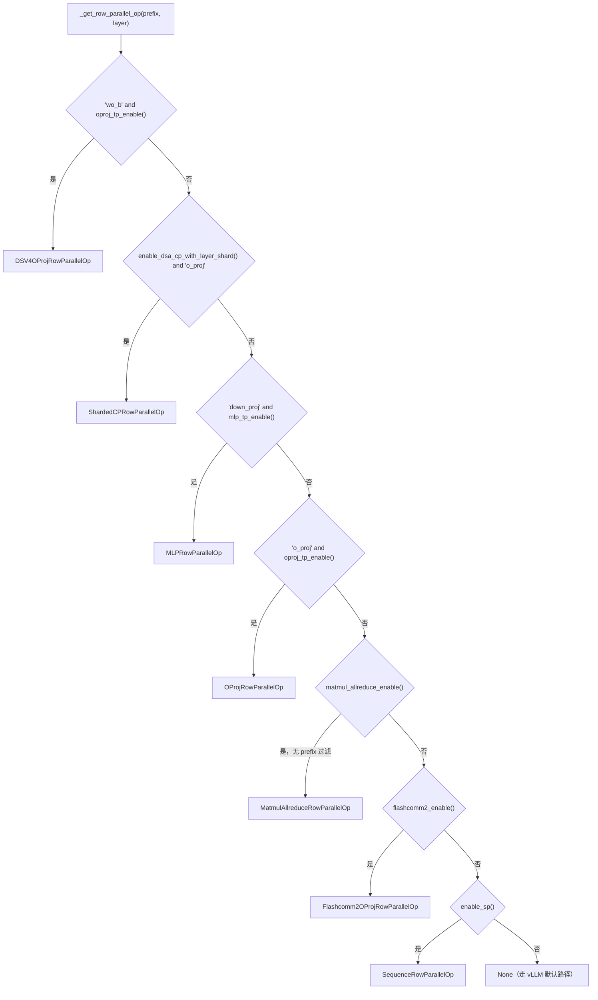

## 一句话

TP>1 时，RowParallelLinear 的默认做法是先把本 rank 的矩阵乘算完、再发起一次 AllReduce，两件事严格串行；打开 `enable_matmul_allreduce` 会把这一对换成昇腾 MC2 通算融合算子 `torch_npu.npu_mm_all_reduce_base`，在算子内部按块流水，让通信藏在计算背后 [C6]。

两个版本行为完全分叉：v0.23.0 上它是官方参数表里的一个 `bool` 开关，默认 `False`，迁移期还能用环境变量 `VLLM_ASCEND_ENABLE_MATMUL_ALLREDUCE` 配 [S9][S8]；**main 上这个开关、它的环境变量、以及背后的 `MatmulAllreduceRowParallelOp` 已被整体删除** [!][C14]，而且因为 main 的 `AscendConfig` 是 `extra="forbid"` 的 pydantic 模型，照抄旧启动命令会直接启动失败 [C15]。

## 事实表

| 项 | v0.23.0 | main | 意味着什么 |
|---|---|---|---|
| 是否存在 | 有，官方参数表在列 [S9] | 无，字段、环境变量、算子实现全删 [C14] | 升级到 main 必须把这个 key 从启动命令里摘掉 |
| 类型 / 默认值 | `bool` / `False` [S9] | — | 默认不启用，是纯粹的加速开关，不影响正确性语义 |
| 环境变量 | `VLLM_ASCEND_ENABLE_MATMUL_ALLREDUCE`，默认 `"0"`，按 `bool(int(...))` 解析 [C1][C3] | 已从 envs.py 与迁移表移除 [S18] | 只认 `0`/`1`；写 `true` 会 `ValueError` |
| 两者优先级 | `additional_config` 命中就直接返回，环境变量只作回落 [C2] | — | 两个都设时环境变量无效，且不会有冲突告警 |
| 落地算子 | `torch_npu.npu_mm_all_reduce_base` [C6] | — | 属昇腾 MC2 通算融合族 [S20] |
| 生效前提 | `reduce_results and tp_size > 1` [C6] | — | TP=1 时开了也等于没开，走回 `quant_method.apply` |
| 作用范围 | 所有未被前面分支认领的 RowParallelLinear，无 prefix 过滤 [C5] | — | 不只是 o_proj，`mlp.down_proj` 一样被换掉 |
| 派发次序 | 排在 `flashcomm2_enable()` / `enable_sp()` **之前** [C5] | — | 开了它就静默关掉 FlashComm2 与 SP 的行并行路径 |
| 硬件范围 | 注释与 release note 写 A2；门禁只在 `Ascend910B` 上跑 [C3][S13][C10] | — | A3/950 上没有任何 CI 覆盖 |
| 强制关闭点 | batch-invariant 模式下被改回 `False` [C7] | — | 要复现逐 batch 一致的输出就用不上它 |

## 为什么存在

TP 把一个 RowParallelLinear 的权重按输入维切开，每个 rank 只算出一份**部分和**，必须做一次 AllReduce 才能拼出完整输出。默认实现里这是两个独立算子：`quant_method.apply` 算完 → HCCL AllReduce 发出去 → 等回来。矩阵乘占着 cube 单元，AllReduce 占着互联带宽，两种资源互不相干，却被时间轴串成了一条线。

昇腾的 MC2 算子族就是为消掉这段串行而做的：把通信与计算的操作过程融合，使二者流水并行，典型成员包括 `AllGatherMatMul`、`MatMulReduceScatter`、`MatMulAllReduce`，官方给的量级是 GPT-3 整网约 10% [S20]。`enable_matmul_allreduce` 就是在 vllm-ascend 里接上这条路的开关：它让 `_get_row_parallel_op` 返回 `MatmulAllreduceRowParallelOp`，其 `apply_impl` 直接调 `torch_npu.npu_mm_all_reduce_base(input_parallel, weight.t(), hcomm_info, bias=bias_)` [C6][C5]。

**省的不是通信量，是通信的暴露时间。** 融合算子内部把 AllReduce 拆成 ReduceScatter + AllGather 两段，按 512 行一块切分 M 维，第 i 块的通信与第 i+1 块的矩阵乘重叠 [C11]。搬运的字节数和原来的 ring allreduce 同量级，只是不再需要干等。

拿 Qwen3-0.6B（H=1024、n_q=16、d_h=128、28 层）在 TP=2 上走一遍 o_proj：权重 `[2048, 1024]` 按输入维切开，每 rank 拿到 `[1024, 1024]`。

- prefill 一个 2048 token 的 chunk：本 rank 矩阵乘 `2 × 2048 × 1024 × 1024 = 4.29 GFLOP`；待规约的部分和是 `2048 × 1024 × 2 B = 4 MiB` [D]。
- 按 512 行一块切，2048 行正好 4 块；理想流水下只有最后一块的通信暴露在外，约 1/4 [D]。这里的 512 是从图模式那条同族路径的常量推广过来的 [C11]，eager 路径上算子内部怎么切分源码里看不到，所以标 D。
- decode 时 M=1：部分和只有 `1 × 1024 × 2 B = 2 KiB`，一个切分块都填不满，没有第二块可以拿来重叠，只剩融合算子自身的固定开销 [D]。这正是官方那句「eager mode will get better performance」的另一面——收益跟着**每步的 token 数**走，不跟着模型大小走 [S13]。
- 一次前向里会被替换掉的调用点是 `28 层 × 2 个行并行线性（o_proj、mlp.down_proj）= 56 处` [D]——因为派发分支没有 prefix 过滤 [C5]。

派发次序是这个开关最容易踩的地方：



`matmul_allreduce_enable()` 这一支一旦为真就无条件返回，后面的 `flashcomm2_enable()` 与 `enable_sp()` 永远到不了 [C5]。反过来，细粒度 TP（`oproj_tensor_parallel_size` / `mlp_tensor_parallel_size`）排在它前面，那些层轮不到它。

## 开了的代价

**怎么开（仅 v0.23.0）。** 推荐用 `additional_config`，环境变量是迁移期的回落写法，命中时会打一条「下个 release 就删」的提示 [C2][S8]：

```bash
export HCCL_BUFFSIZE=500          # 门禁用例与它同时设置，融合算子的通信缓冲更吃内存 [C10]
vllm serve Qwen/Qwen3-0.6B \
  --tensor-parallel-size 2 \
  --enforce-eager \
  --additional-config '{"enable_matmul_allreduce": true}'
```

`--tensor-parallel-size 2` 是下限：算子只在 `reduce_results and tp_size > 1` 时才真正走融合分支 [C6]。`--enforce-eager` 对应官方那句 eager 收益更好 [S13]，也避开与图模式里 `fuse_allreduce_rms` 那条同族路径重复。`HCCL_BUFFSIZE=500` 抄自唯一一个开启此特性的门禁用例 [C10]。官方参数表见本地 `docs/source/user_guide/configuration/additional_config.md` L96 与线上 <https://docs.vllm.ai/projects/ascend/en/v0.23.0/user_guide/configuration/additional_config.html>。

**什么规模下才划算。** 门槛在 token 数上，不在模型大小上。图模式那条同族路径写死了 `compile_range.start > 512` 才启用融合 [C12]，可以拿来当 eager 侧的量级参考 [D]：每步 token 数远小于 512（纯 decode、小并发）时，融合算子没有第二个切分块可供重叠，只会白付一次算子调度开销。长 prefill、大 chunk、高并发的连续批处理才是它的场景。

**会静默吃掉别的特性。** 因为派发分支排在前面且无 prefix 过滤，开了它就等于关掉 FlashComm2 的 o_proj 路径和 SP 的全部行并行路径，而代码里没有任何互斥检查或告警 [C5]。同时配了 `flashcomm2_parallel_size` 却发现毫无效果，多半就是踩到了这里。

**量化模型走不通。** 融合分支直接把 `self.layer.weight.t()` 交给 `npu_mm_all_reduce_base`，完全绕过 `quant_method.apply`；只有 `reduce_results`/`tp_size` 不满足时才落回量化路径 [C6]。因此它实际上只对非量化权重成立——这一条是从「融合分支不接 quant_method」推出来的，源码里没有显式断言，标 [D]。

**别把它当 prefill-only。** v0.23.0 的 release note 写的是 "Implement the fusion of allreduce and matmul in prefill phase" [S13]，但代码里 `matmul_allreduce_enable()` 只读一个布尔，`MatmulAllreduceRowParallelOp` 也不看 forward context，decode 步一样会走融合算子 [!][C4][C6]。文档描述的是它的**受益场景**，不是它的**生效条件**。

**要 batch-invariant 就别指望它。** `override_envs_for_invariance()` 会在配置生效后把 `enable_matmul_allreduce` 强行改回 `False` [C7]——融合算子的分块规约次序随 batch 形状变化，与逐 batch 一致的输出不相容。

**升到 main 会启动失败，不是被忽略。** main 上 `_get_row_parallel_op` 已经没有这个分支 [C14]，`AscendConfig` 也没有这个字段；而 `model_config = ConfigDict(extra="forbid")` 意味着未知 key 在构造时报错 [C15]，`_NON_USER_INPUT_KEYS` 的豁免名单里只放了同批下线的 `enable_flashcomm1`、没有放它 [C17]。所以 `--additional-config '{"enable_matmul_allreduce": true}'` 在 main 上会被当成拼写错误直接拒绝 [D]。对比之下 `enable_flashcomm1` 至少还有一条显式的废弃告警 [C16]，`enable_matmul_allreduce` 连告警都没有——环境变量 `VLLM_ASCEND_ENABLE_MATMUL_ALLREDUCE` 在 main 上无人读取，设了也只会被静默忽略 [D]。迁移表同步从 9 行缩到 6 行 [S18]，线上对应 <https://docs.vllm.ai/projects/ascend/en/latest/user_guide/configuration/additional_config.html>。

**去向：不是搬家，是两条入口一起下线。** 图模式那条同族路径在 main 上同样消失了——`GraphFusionPassManager.configure` 只剩 `AddRMSNormQuantFusionPass`、`QKNormRopeFusionPass`、`MulsAddFusionPass` 三条，`fuse_allreduce_rms` 与 `MatmulAllReduceAddRMSNormPass` 的注册整块删掉，`vllm_ascend/compilation/passes/` 下也没有 `allreduce_rmsnorm_fusion_pass.py` 了 [C19]。也就是说 main 上 vllm-ascend 内已经没有任何 matmul+allreduce 融合入口，`enable_matmul_allreduce` 不是被某个新 key 取代的 [D]。同期 `enable_flashcomm1` 被明确标注为「Use upstream configuration instead」[C16]，这两处一起看，方向是把 TP 通信优化交回上游而不是继续维护昇腾侧的自定义行并行算子 [I]——仓库里没有写明这条理由，是从两次同批下线推断的。另一条路的细节见 [fuse-allreduce-rms](../concepts/fuse-allreduce-rms.md)。

## 版本谱系

<!-- 由 pnpm wiki:lineage 生成，勿手改 -->

| 版本 | 是否存在 |
| --- | --- |
| releases/v0.13.0 | 无 |
| releases/v0.18.0 | 无 |
| releases/v0.20.2rc | 有（3 个文件） |
| releases/v0.21.0rc | 有（3 个文件） |
| releases/v0.22.1rc | 有（3 个文件） |
| releases/v0.23.0 | 有（3 个文件） |
| releases/v0.24.0rc | 有（3 个文件） |
| releases/v0.25.1rc | 无 |
| releases/v0.26.0rc | 无 |
| releases/v0.27.1rc | 无 |
| main | 无 |

**移除**：2026-07-18，PR [#12119](https://github.com/vllm-project/vllm-ascend/pull/12119) —— [Refactor] Remove matmulallreduce and pass optimization techniques (#12119)

影响面（删除行数最多的几个文件）：

- `vllm_ascend/compilation/passes/allreduce_rmsnorm_fusion_pass.py` −159
- `vllm_ascend/ops/linear_op.py` −45
- `vllm_ascend/ascend_config.py` −40
- `vllm_ascend/compilation/graph_fusion_pass_manager.py` −5
- `vllm_ascend/utils.py` −4

**引入**：2026-05-21，PR [#9064](https://github.com/vllm-project/vllm-ascend/pull/9064) —— [Refactor]: migrate env vars to AscendConfig (#9064)
