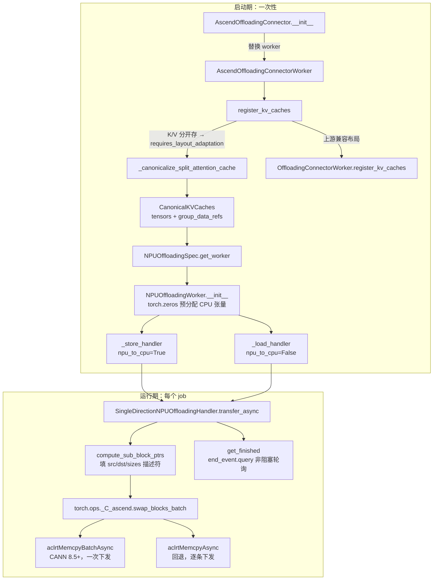
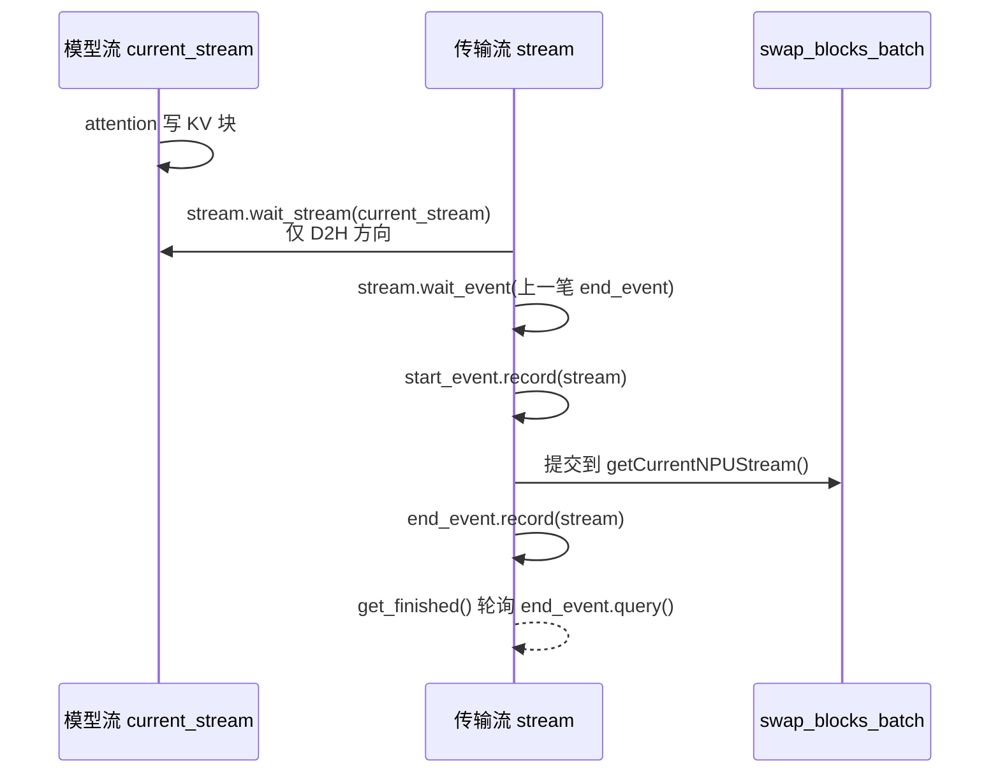

## 一句话

KV Cache CPU Offload 在启动时按字节预算预分配一块 CPU 内存池，把 NPU 上暂时不参与计算的 KV 块成批拷到池里；后续请求若在 NPU 上前缀未命中、但数据还留在 CPU 池里，就异步拷回 NPU，省掉一次 prefill 重算 [S]。昇腾侧的全部改动集中在 worker 一侧：一个替换平台门禁的 `NPUOffloadingSpec`、一个适配「K/V 分开存」布局的 `AscendOffloadingConnectorWorker`、以及用专用 `torch.npu.Stream` 下发 `aclrtMemcpyBatchAsync` 的 `NPUOffloadingWorker` [C]。

## 为什么需要它

没有它，KV 只有两个去处：留在 NPU 显存里，或者被 [prefix-caching](prefix-caching.md) 淘汰后彻底丢弃。显存装不下时被淘汰的那部分，下次再遇到同样的前缀就得整段重新 prefill——这是纯粹的重复计算，且长上下文场景下 prefill 占整条请求延迟的大头。

CPU 内存比 NPU HBM 便宜得多、也大得多。把冷块搬到主机内存，等于在 HBM 和「什么都没有」之间插了一层容量大、带宽低的缓存。官方文档把收益说得很直白：让 vLLM 在 NPU 内存受限时处理更长上下文或更多并发，并在 NPU 前缀未命中但 CPU 有数据时异步载回以「reducing recomputation latency」[S]。

取舍在于它换来的不是免费的容量。DMA 要占 NPU 的搬运带宽，D2H 必须等模型流把 KV 写完才能读，H2D 载回必须在 attention 用到之前完成。所以这条路径只在「重算比搬运贵」时划算——前缀长、命中率高、prefill 重、NPU 块池紧张。官方也明确提示要按真实请求模式压测来定 `cpu_bytes_to_use` 与 `blocks_per_chunk` [S]。

昇腾侧和上游的差异只有一处根因：**上游的 offloading worker 假设注意力 KV 打包在一个 Tensor 里，而昇腾把 K 和 V 存成分开的张量** [C]。所以 vllm-ascend 没有另起炉灶，而是把上游注册表里的 `OffloadingConnector` 直接弹出、换成 `AscendOffloadingConnector`，只替换 worker 侧的 canonicalization 边界，调度器、manager、metrics、传输生命周期全部复用上游 [C]。这也解释了另一处看着奇怪的地方：`NPUOffloadingSpec.get_worker()` 几乎原样复制父类逻辑，唯一目的是绕过上游 `CPUOffloadingSpec.get_worker()` 里拒绝非 CUDA/XPU 平台的那道门禁 [C]。

上游 vLLM 的同名参数与 spec 工厂机制本身不在本仓库内，本页对「上游侧怎么算 `num_blocks`」的描述来自昇腾侧的反解代码与单测，不是直接读上游源码 [D]。

## 怎么工作

整条链路分三段：注册与布局适配（一次性）、传输下发（每次 store/load）、完成回收（轮询）。



**布局适配这一步在做什么。** `register_kv_caches` 先扫一遍 KV cache 组，只要发现某层的 `AttentionSpec` 对应的不是单个 `torch.Tensor`（昇腾的 K/V 分开情形），就把 `requires_layout_adaptation` 置位；否则原样调用上游实现，行为逐字不变 [C]。适配路径把每个分量用 `torch.as_strided` 造成 `[num_blocks, page_size_bytes]` 的 **int8 零拷贝视图**——注意是 `set_(untyped_storage())` 后重新 strided，不复制任何数据，因此不会给模型执行路径加开销 [C]。每个视图登记成一个 `CanonicalKVCacheTensor`，每层再记下它用到哪几个视图（`CanonicalKVCacheRef`）[C]。

**CPU 池是启动时一次性分配的。** `NPUOffloadingWorker.__init__` 对每个 canonical 张量调一次 `torch.zeros((num_cpu_blocks, npu_page_size_bytes * blocks_per_chunk), dtype=torch.int8, device="cpu", pin_memory=...)` [C]。`pin_memory` 取决于 `is_pin_memory_available()`，官方文档说明「Pinned (page-locked) memory is used when available for optimal transfer performance」[S]。这意味着 CPU 内存在服务起来那一刻就已经全部吃掉，不是按需增长——设太大会直接把主机撑爆，这也是官方 Notes 里点名的风险 [S]。

**为什么一个 CPU 块装得下多个 NPU 块。** 两个方向各建一个 `SingleDirectionNPUOffloadingHandler`，`blocks_per_chunk` 只加在 CPU 那一侧：D2H 时 `src_blocks_per_chunk = 1`（NPU）、`dst_blocks_per_chunk = blocks_per_chunk`（CPU），H2D 时反过来 [C]。构造函数里有一条硬断言把这个关系钉死：`cpu_tensor.shape[1] == npu_tensor.shape[1] * blocks_per_chunk` [C]。

**排序才是这条路径的难点。** 拷贝跑在独立的 `torch.npu.Stream` 上，所以需要两道显式同步：



第一道 `stream.wait_stream(torch.npu.current_stream())` **只在 D2H 加**，源码注释写明理由：KV 写在模型流上，D2H 不能在写完成前读走这个块 [C]。H2D 不需要这道等待。第二道 `stream.wait_event(self._transfers[-1].end_event)` 把同一方向的任务串成有序队列——这就是类名里 "ordered" 的含义，也意味着**同方向的传输不会互相重叠**，队列深了就是排队 [C]。

**下发到 ACL 的那一层。** `torch.ops._C_ascend.swap_blocks_batch(src, dst, sizes, direction)` 的三个入参是 int64 的指针/长度数组且必须在 CPU 上，所以算子注册在 `torch::kCPU` 上，内部再取 `c10_npu::getCurrentNPUStream()` 提交异步 memcpy [C]——这解释了 Python 侧为什么必须包在 `with torch.npu.stream(stream)` 里，否则拷贝会落回默认流。方向码 `0=H2D / 1=D2H / 2=D2D` 在 Python 与 C++ 两侧各定义一份、注释互相指认 [C]。C++ 里有两条路径：编出 `CANN_MEMCPY_BATCH_ASYNC` 宏（CANN 8.5+）时把 n 条拷贝合成**一次** `aclrtMemcpyBatchAsync`；否则回退成 n 次 `aclrtMemcpyAsync` 循环 [C]。release notes 把这条批量化列为性能项，并说明「batching is automatic within that path」，无需额外开关 [S]。

**完成不是阻塞等来的。** `get_finished()` 按 FIFO 顺序 `end_event.query()`，只摘走已完成的队头，并把 stream / event / 描述符缓冲区都还进复用池——所以稳态下不会反复新建 NPU 流与 pinned 缓冲 [C]。每笔传输回报 `transfer_size`（字节）与 `transfer_time`（`elapsed_time` 毫秒 × 1e-3，单位秒），这两个数是观测实际带宽代价的唯一出口 [C]。

## 拿真实数字走一遍

用 Qwen3-0.6B：28 层，n_kv = 8，d_h = 128，bf16（2 字节）。昇腾侧 `block_size` 默认 128 token [C]。

**第一步：一个 NPU 块多大。**

- 单层 K 张量一块：`128 token × 8 head × 128 dim × 2 B = 262144 B = 256 KiB`
- V 同样 256 KiB，单层 K+V = 512 KiB
- 28 层：`28 × 512 KiB = 14336 KiB = 14 MiB`

**第二步：canonical 张量有几个。** 昇腾 K/V 分开存，每层注册 2 个视图，`28 × 2 = 56` 个 canonical 张量 [D]（推广依据：`_canonicalize_split_attention_cache` 对传进来的每个分量各建一个视图并 `add_view` 一次；去重键是 `(data_ptr, stride(0), shape[1])`，K 与 V 的 `data_ptr` 不同故不会合并 [C]）。每个视图的 `page_size_bytes = 256 KiB`。

**第三步：CPU 侧怎么分配。** 取官方示例的 `blocks_per_chunk: 8`、`cpu_bytes_to_use: 4294967296`（4 GiB），TP=1 故 `world_size = 1` [S]：

- 每个 canonical 张量的 CPU 页：`256 KiB × 8 = 2 MiB`
- 一个 CPU chunk 总字节：`56 × 2 MiB = 112 MiB`，等价于 `8 × 14 MiB` ✓
- 一个 CPU chunk 装 `8 × 128 = 1024` token
- CPU 块数：`4096 MiB ÷ 112 MiB = 36.57 → 36` 块 [D]
- 实占主机内存：`36 × 112 MiB = 4032 MiB ≈ 3.94 GiB`
- CPU 侧总容量：`36 × 1024 = 36864` token

块数那一步是反解出来的：`_normalize_legacy_num_blocks` 给出 `cpu_bytes_to_use = num_cpu_blocks × round_up(worker_kv_bytes_per_block × world_size × blocks_per_chunk, BLOCK_SIZE_ALIGNMENT)`，单测则用同一公式正反各走一次并断言 `spec.num_blocks == 10` [C]。这里 112 MiB 已是 16 MiB 的整数倍，`round_up` 不改变它；若换成不对齐的配置，实际块数会比上面的除法结果更小 [D]。

**第四步：卸载一个 chunk 的代价。**

- 描述符条数：`num_copy_ops = group_size × len(group_data_refs) = 8 × 56 = 448` 条 [C]
- 传输字节：`num_transfer_bytes = 8 × (56 × 256 KiB) = 112 MiB` [C]
- CANN 8.5+ 下这 448 条合成**一次** `aclrtMemcpyBatchAsync`；回退路径则是 448 次 `aclrtMemcpyAsync` 循环下发 [C]

把带宽代入：112 MiB ≈ 117.4 MB，若 pinned D2H 有效带宽取 20 GB/s，单次约 `117.4 / 20000 ≈ 5.9 ms` [A]（20 GB/s 是假设值，本仓库不含实测带宽；请用 `get_finished()` 回报的 `transfer_size / transfer_time` 在自己的机器上量）。这 5.9 ms 与模型计算重叠，但它占住传输流，且同方向后续任务要排在它后面 [C]。

**完整配置片段**（照官方 Online Serving 示例，变量已按本 ref 展开）：

```bash
vllm serve Qwen/Qwen3-0.6B \
    --gpu-memory-utilization 0.5 \
    --kv-transfer-config '{
        "kv_connector": "OffloadingConnector",
        "kv_role": "kv_both",
        "kv_connector_extra_config": {
            "cpu_bytes_to_use": 4294967296,
            "blocks_per_chunk": 8,
            "spec_name": "NPUOffloadingSpec",
            "spec_module_path": "vllm_ascend.distributed.kv_transfer.kv_pool.kv_offload.native.npu"
        }
    }'
```

每个值的来由：`kv_connector` 写上游名字但会被 vllm-ascend 的注册表替换成 `AscendOffloadingConnector` [C]；`kv_role: kv_both` 表示存和取都开 [S]；`cpu_bytes_to_use` 是**全服务**的 CPU 字节预算，由上游框架切给各 worker [S]；`blocks_per_chunk: 8` 决定上面算出的 1024 token / chunk 粒度 [C]；`spec_name` / `spec_module_path` 指向昇腾的 `NPUOffloadingSpec`，缺一不可 [S]。`--gpu-memory-utilization 0.5` 是故意压低的：NPU 侧 KV 池越小，卸载越活跃 [S]。

## 事实表

| 项 | 值 | 来源 |
|---|---|---|
| `kv_connector` | `"OffloadingConnector"` | `docs/source/user_guide/feature_guide/kv_cache_cpu_offload.md#L66` |
| 实际实例化的类 | `AscendOffloadingConnector` | `vllm_ascend/distributed/kv_transfer/__init__.py#L69-L73` |
| `kv_role` | `"kv_both"` | `docs/source/user_guide/feature_guide/kv_cache_cpu_offload.md#L67` |
| `spec_name` | `"NPUOffloadingSpec"` | `docs/source/user_guide/feature_guide/kv_cache_cpu_offload.md#L70` |
| `spec_module_path` | `vllm_ascend.distributed.kv_transfer.kv_pool.kv_offload.native.npu` | `docs/source/user_guide/feature_guide/kv_cache_cpu_offload.md#L71` |
| `cpu_bytes_to_use` | 全服务 CPU 字节预算，由上游按 worker 切分 | `docs/source/user_guide/feature_guide/kv_cache_cpu_offload.md#L68` |
| `blocks_per_chunk` | 一个 CPU 块装多少个 NPU 块；必须 > 0 | `docs/source/user_guide/feature_guide/kv_cache_cpu_offload.md#L69` |
| `num_cpu_blocks` | legacy，仅在未给 `cpu_bytes_to_use` 时生效；`<= 0` 抛 `ValueError` | `.../native/npu.py#L28-L36` |
| 容量换算 | `cpu_bytes_to_use = num_cpu_blocks × round_up(worker_kv_bytes_per_block × world_size × blocks_per_chunk, BLOCK_SIZE_ALIGNMENT)` | `.../native/npu.py#L38-L55`；`tests/ut/kv_offload/test_native_cpu_offload.py#L80-L101` |
| CPU 侧管理器 | `CPUOffloadingManager`（上游，LRU） | `tests/ut/kv_offload/test_native_cpu_offload.py#L89` |
| NPU canonical 视图 | `[num_blocks, page_size_bytes]`，`dtype=torch.int8`，`ndim == 2`，零拷贝 `as_strided` | `.../native/offloading_connector.py#L243-L253`；`.../native/cpu_npu.py#L284-L295` |
| CPU 张量形状 | `[num_cpu_blocks, npu_page_size_bytes × blocks_per_chunk]`，`dtype=torch.int8` | `.../native/cpu_npu.py#L296-L304` |
| CPU 内存分配时机 | 启动时 `torch.zeros` 一次性预分配，每 canonical 张量一份 | `.../native/cpu_npu.py#L281-L304` |
| pinned 内存 | `is_pin_memory_available()` 为真时使用 | `.../native/cpu_npu.py#L276`、`#L303` |
| 方向码 | `H2D = 0`，`D2H = 1`，`D2D = 2` | `.../native/cpu_npu.py#L29-L30`；`csrc/torch_binding.cpp#L161-L175` |
| 传输算子 | `torch.ops._C_ascend.swap_blocks_batch(src, dst, sizes, direction)` | `.../native/cpu_npu.py#L201-L206` |
| 算子 dispatch backend | `torch::kCPU`（入参是指针/长度数组） | `csrc/torch_binding.cpp#L2119-L2123` |
| 入参约束 | 三个张量都在 CPU、`dtype == torch::kInt64`、长度一致 | `csrc/torch_binding.cpp#L141-L150` |
| 批量路径 | `aclrtMemcpyBatchAsync`，宏 `CANN_MEMCPY_BATCH_ASYNC`（CANN 8.5+），n 条合一次 | `csrc/torch_binding.cpp#L177-L231` |
| 回退路径 | 逐条 `aclrtMemcpyAsync`，n 次下发 | `csrc/torch_binding.cpp#L233-L256` |
| 描述符条数 | `num_copy_ops = Σ(group_size × len(group_data_refs))` | `.../native/cpu_npu.py#L116-L119` |
| 传输字节 | `num_transfer_bytes = Σ(group_size × data_ref.page_size_bytes)` | `.../native/cpu_npu.py#L176-L177` |
| D2H 前置同步 | `stream.wait_stream(torch.npu.current_stream())`，仅 `npu_to_cpu=True` | `.../native/cpu_npu.py#L191-L194` |
| 同方向排序 | `stream.wait_event(self._transfers[-1].end_event)` | `.../native/cpu_npu.py#L195-L196` |
| 完成检测 | `end_event.query()` 非阻塞轮询，FIFO | `.../native/cpu_npu.py#L226-L227` |
| `transfer_time` 单位 | 秒（`elapsed_time` 毫秒 × 1e-3） | `.../native/cpu_npu.py#L228` |
| 复用池 | stream / event / 描述符缓冲区在 `get_finished` 归还 | `.../native/cpu_npu.py#L237-L245` |
| `shutdown` 语义 | 逐笔 `end_event.synchronize()` 后清空所有池与张量引用 | `.../native/cpu_npu.py#L255-L264` |
| 布局适配触发条件 | `AttentionSpec` 对应非单 `Tensor`，或 `MambaSpec` 对应 `list` | `.../native/offloading_connector.py#L171-L185` |
| 引擎要求 | vLLM v1 | `docs/source/user_guide/feature_guide/kv_cache_cpu_offload.md#L106` |
| `block_size` 默认 | 128 | `vllm_ascend/utils.py#L1178-L1179` |

线上文档：<https://docs.vllm.ai/projects/ascend/en/latest/user_guide/feature_guide/kv_cache_cpu_offload.html>（本地 ref `main` 对应 `latest`）。

## 常见误解

- **「配置里写 `OffloadingConnector`，跑的就是上游实现。」** 不是。`register_connector()` 会先把上游注册表里的同名项 `pop` 掉，再注册成 `AscendOffloadingConnector`；名字是上游的，worker 侧的 canonicalization 是昇腾的 [C]。
- **「调大 `blocks_per_chunk` 能省 CPU 内存。」** 不能。总容量由 `cpu_bytes_to_use` 一个数定死，`blocks_per_chunk` 只改变 CPU 块的粒度——调大会让 LRU 淘汰的颗粒变粗、单次传输的字节数成比例变大 [C]。
- **「异步传输 = 零代价。」** D2H 必须先 `wait_stream` 等模型流写完，且同方向任务用 `wait_event` 串成有序队列，不会互相重叠；队列积压时后来的 job 就是在排队 [C]。
- **「卸载之后就能让 attention 直接读 CPU 上的 KV。」** 不能。CPU 池只存非活跃块，命中时必须先 H2D 拷回 NPU 才能参与计算——省的是重算，不是显存里的活跃工作集 [S]。

## 接着看

- [prefix-caching](prefix-caching.md) —— 卸载的触发点就是「NPU 前缀未命中」，先搞清命中判定才知道什么时候会走 CPU 池。
- [kv-cache-memory-profiling](kv-cache-memory-profiling.md) —— `gpu_memory_utilization` 决定 NPU 侧 KV 池多大，也就决定卸载有多活跃。
- [paged-attention](paged-attention.md) —— 这里搬的「块」就是分页注意力的块，块大小直接决定每次传输的字节数。
- [recompute-cpu-offload](recompute-cpu-offload.md) —— 另一条 CPU 卸载路线，对照看能看清「搬运 vs 重算」这对取舍的两个答案。
- [kv-pool](kv-pool.md) —— 想把 KV 放到本机 CPU 之外（远端/SSD）时的去处。
