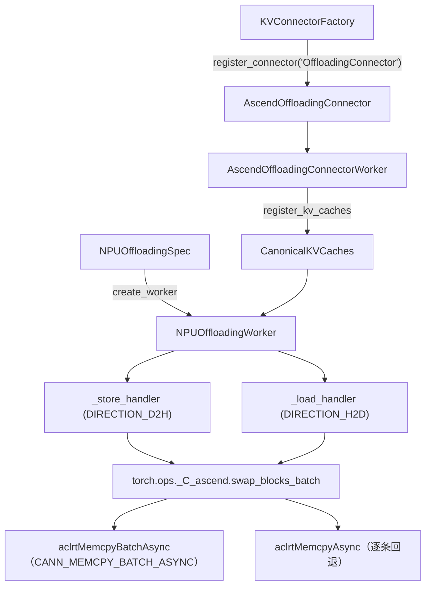
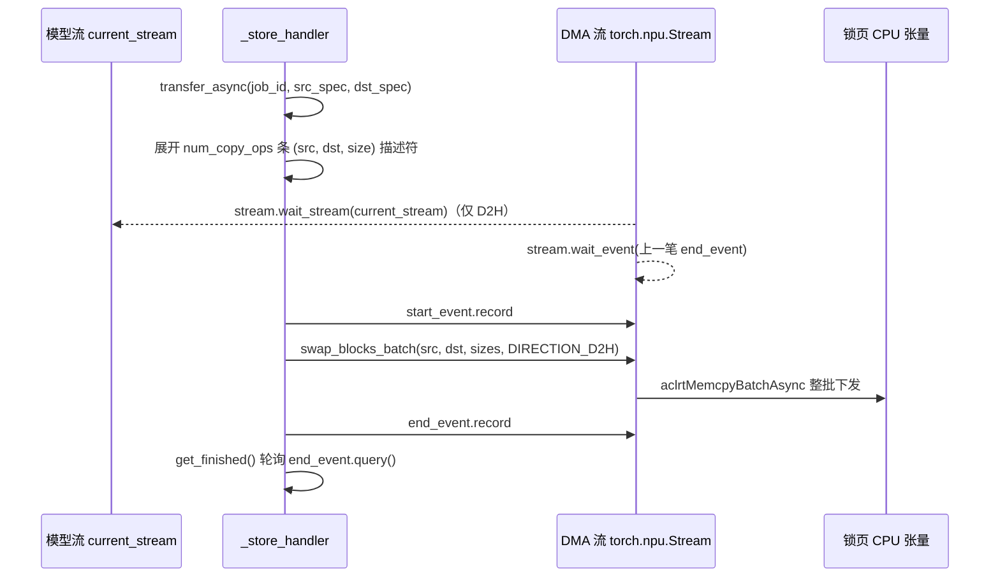

## 一句话

KV Cache CPU Offload 把已经算完的 KV 块成批 DMA 到预分配的锁页 CPU 内存里，等到某个请求的前缀在 NPU 上已经被挤掉、却还在 CPU 里时，再用另一条 NPU 流异步搬回来。它不增加 NPU 侧的 KV 容量，换的是「不用重跑 prefill」——代价是一来一回的主机带宽。

## 为什么需要它

NPU 上能放多少 KV 是启动时就钉死的：显存预算一确定，块数就固定了（见 [KV Cache 显存标定](kv-cache-memory-profiling.md)）。块用完时调度器只能抢占——把某个请求已经算好的块还回去。这些块里的数据会被直接丢弃，下次同一段前缀再来，就得从头 prefill 一遍。对多轮对话、系统提示词重复的场景，这笔重算是纯浪费：数据算过一次，只是没地方放。

主机内存便宜且大得多。既然块内容就是一段连续字节，把它拷到 CPU 上存着、需要时再拷回来，就能把「重算一遍」换成「搬两趟」。值不值取决于两件事：命中率，以及搬运带宽相对算力的比值。仓库里对这笔账的唯一量化承诺来自 e2e 测试——10001 token 的 prompt，清掉 NPU 前缀缓存后从 CPU 命中，要求 10 次里至少 8 次快过冷启动 [C23]。注意它只断言了「快过」，没有给加速比。

昇腾侧和上游的差别只在一处：vLLM 原生的 offloading worker 假定注意力的 KV cache 被打包进一个张量，而昇腾把 K 和 V 保持为两个独立张量 [C5]。所以 vllm-ascend 没有另起炉灶，而是在工厂里把 `OffloadingConnector` 这个名字重新指向 `AscendOffloadingConnector` [C5]，只替换 worker 侧的「张量规范化」边界和搬运实现，调度器、CPU 块管理器、LRU 淘汰、KV 事件全部沿用上游 [C8][C20]。

## 怎么工作

官方文档把它归纳成三件事：预分配（可锁页）的 CPU 块池、双向异步传输、CPU 侧 LRU 淘汰 [S1]（[在线版](https://docs.vllm.ai/projects/ascend/en/latest/user_guide/feature_guide/kv_cache_cpu_offload.html)）。落到代码是三层：上游的连接器与块管理器决定**搬哪些块**，昇腾的 worker 决定**怎么搬**，`swap_blocks_batch` 这个自定义算子决定**用哪条 ACL 接口搬**。



`register_kv_caches` 做的是零拷贝改写：每个注意力层的 K、V 各被 `torch.as_strided` 成一个 `[num_blocks, page_size_bytes]` 的 int8 视图，底下还是原来那块 NPU 显存，模型执行路径上不多一次分配、不多一次拷贝 [C6]。`page_size_bytes` 直接取自该层的 [KV Cache Spec](kv-cache-spec.md)，要搬多少字节则取 `unpadded_page_size_bytes` —— 对齐用的 padding 不搬 [C6]。

CPU 侧内存在 worker 构造时一次性 `torch.zeros` 出来，形状 `[num_cpu_blocks, npu_page_size_bytes × blocks_per_chunk]`，能锁页就锁页 [C9][S4]。注意这意味着 `blocks_per_chunk` 个连续的 NPU 块被并进 CPU 上的一个"大块"，这是 CPU 侧的记账单位。

两个方向各有一个 `SingleDirectionNPUOffloadingHandler`，各自持有独立的流池、事件池和描述符缓冲池 [C10]。一次传输的流序是这样的：



三个细节值得注意：

- **D2H 要等模型流，H2D 不等。** 被搬走的块刚被注意力算子写过，D2H 必须 `wait_stream(current_stream)` 才不会读到半截数据 [C12]。H2D 方向没有这一句——目标块是调度器新分配的、模型流上还没碰过的块，读取时机由上游连接器等待传输完成来保证 [I]。
- **同方向串行，跨方向并行。** 新传输会 `wait_event` 上一笔的 `end_event` [C12]，所以 D2H 内部是一条链；但 store 与 load 分属两个 handler、两组流，互不阻塞。
- **描述符必须留在 CPU。** `swap_blocks_batch` 的三个入参是 int64 的指针/长度数组，算子注册在 `kCPU` 分发键上，内部才把 memcpy 提交到当前 NPU 流 [C17][C14]。所以 Python 侧的 `with torch.npu.stream(stream)` 才是决定它落在哪条流上的东西。

真正的下发有快慢两条路：编译期定义了 `CANN_MEMCPY_BATCH_ASYNC` 且方向不是 D2D 时，整批描述符一次 `aclrtMemcpyBatchAsync` 送下去 [C15]；否则退化成 for 循环逐条 `aclrtMemcpyAsync` [C16]。下面会看到描述符条数是层数 × 块数量级的，这条回退路径上的下发开销不能忽略。

## 拿真实数字走一遍

Qwen3-0.6B，28 层，`n_kv = 8`，`d_h = 128`，bf16，TP=1。昇腾注意力后端只支持 128 token 的块 [C19]，KV cache 形状是 `(2, num_blocks, block_size, num_kv_heads, head_size)` [C18]。

先算一个块有多大（以下推算均为 [D]）：

| 量 | 算式 | 结果 |
|---|---|---|
| 每层每块 K 的字节 | 128 × 8 × 128 × 2 | 262,144 B = 256 KiB |
| 每层每块 K+V | 256 KiB × 2 | 512 KiB |
| `worker_kv_bytes_per_block` | 512 KiB × 28 层 | 14 MiB = 14,680,064 B |
| 每 token 每层 | 8 × 128 × 2 × 2 | 4,096 B = 4 KiB |
| 每 token 全模型 | 4 KiB × 28 | 112 KiB |

取文档示例的配置 `cpu_bytes_to_use = 4 GiB`、`blocks_per_chunk = 8`：

- 一个 CPU chunk 装 8 个 NPU 块 = 14 MiB × 8 = **112 MiB = 117,440,512 B**（world_size = 1）；这个值还要按 `BLOCK_SIZE_ALIGNMENT` 向上取整，112 MiB 是 2 的幂次倍，取整不改变它 [C7]。
- `num_blocks = 4 GiB ÷ 112 MiB = 4,294,967,296 ÷ 117,440,512 = 36`（余 64 MiB 用不上）[C20]。
- CPU 上能缓存 36 × 8 × 128 = **36,864 token** 的 KV。
- 实际分配：28 层 × 2（K、V 各一个 canonical 张量）= 56 个 CPU 张量，每个 `[36, 2 MiB]` = 72 MiB，合计 4,032 MiB ≈ 3.94 GiB [C9]。

再看一次传输的代价。搬一个 chunk（8 块 / 1024 token）：

- 描述符条数 `num_copy_ops` = 8 × 56 = **448** 条，每条 256 KiB [C11]。
- 传输字节 = 448 × 256 KiB = **112 MiB**，`TransferResult.transfer_size` 上报的就是这个数，`transfer_time` 由两个 `npu.Event` 的 `elapsed_time` 得出（秒）[C13]。
- 搬运耗时 = 112 MiB ÷ 实测 H2D 带宽。本页没有可引的昇腾侧带宽实测值，所以不给绝对毫秒数——请用 `TransferResult` 自己量 [A]。
- 若退到逐条 `aclrtMemcpyAsync`，这 448 条就是 448 次下发 [C16]。

完整可复制的配置（值的来由见上）：

```bash
vllm serve Qwen/Qwen3-0.6B \
    --gpu-memory-utilization 0.5 \
    --kv-transfer-config '{
        "kv_connector": "OffloadingConnector",
        "kv_role": "kv_both",
        "kv_connector_extra_config": {
            "cpu_bytes_to_use": 4294967296,
            "blocks_per_chunk": 8,
            "spec_name": "NPUOffloadingSpec",
            "spec_module_path": "vllm_ascend.distributed.kv_transfer.kv_pool.kv_offload.native.npu"
        }
    }'
```

各配置项的语义见官方文档的 Configuration Parameters 一节 [S3]。`kv_connector` 填的是上游的名字，但工厂里这个键已经被换成 `AscendOffloadingConnector` [C5]；`spec_module_path` 必须写全路径，上游 `CPUOffloadingSpec` 会在 `get_worker()` 里拒掉非 CUDA/XPU 平台，`NPUOffloadingSpec` 换掉的正是这道闸门 [C8]。

## 事实表

| 项 | 值 | 来源 |
|---|---|---|
| `kv_connector` | `"OffloadingConnector"`（实际解析到 `AscendOffloadingConnector`） | `vllm_ascend/distributed/kv_transfer/__init__.py#L67-L73` |
| `kv_role` | `"kv_both"` | `docs/source/user_guide/feature_guide/kv_cache_cpu_offload.md#L67` |
| `spec_name` / `spec_module_path` | `"NPUOffloadingSpec"` / `vllm_ascend.distributed.kv_transfer.kv_pool.kv_offload.native.npu` | `docs/source/user_guide/feature_guide/kv_cache_cpu_offload.md#L70-L71` |
| `cpu_bytes_to_use` | 整机口径的 CPU 容量（字节），由上游按 worker 摊分 | `docs/source/user_guide/feature_guide/kv_cache_cpu_offload.md#L68` |
| `blocks_per_chunk` | 一个 CPU 块装多少个 NPU 块，必须 > 0 | `docs/source/user_guide/feature_guide/kv_cache_cpu_offload.md#L69` |
| `num_cpu_blocks` | 遗留项，仅在未设 `cpu_bytes_to_use` 时生效，≤ 0 报错 | `vllm_ascend/distributed/kv_transfer/kv_pool/kv_offload/native/npu.py#L28-L36` |
| CPU 块数换算 | `num_blocks = cpu_bytes_to_use ÷ round_up(worker_kv_bytes_per_block × world_size × blocks_per_chunk, BLOCK_SIZE_ALIGNMENT)` | `tests/ut/kv_offload/test_native_cpu_offload.py#L80-L101` |
| CPU 张量形状 / dtype | `[num_cpu_blocks, npu_page_size_bytes × blocks_per_chunk]`，`int8`，`pin_memory=is_pin_memory_available()` | `vllm_ascend/distributed/kv_transfer/kv_pool/kv_offload/native/cpu_npu.py#L296-L304` |
| NPU 侧张量要求 | 二维 `int8` 视图，`shape[1] == page_size_bytes`，否则 `ValueError` | `vllm_ascend/distributed/kv_transfer/kv_pool/kv_offload/native/cpu_npu.py#L284-L295` |
| 每块搬运字节 | `AttentionSpec.unpadded_page_size_bytes`（padding 不搬） | `vllm_ascend/distributed/kv_transfer/kv_pool/kv_offload/native/offloading_connector.py#L254-L265` |
| 方向码 | `DIRECTION_H2D = 0`、`DIRECTION_D2H = 1`、D2D = 2 | `csrc/torch_binding.cpp#L161-L175` |
| 描述符条数 | `Σ(group_size × len(group_data_refs))` | `vllm_ascend/distributed/kv_transfer/kv_pool/kv_offload/native/cpu_npu.py#L116-L119` |
| 描述符张量位置 | CPU、`int64`，算子注册在 `torch::kCPU` | `csrc/torch_binding.cpp#L2119-L2123` |
| 下发路径 | `aclrtMemcpyBatchAsync`（定义了 `CANN_MEMCPY_BATCH_ASYNC` 且非 D2D）否则逐条 `aclrtMemcpyAsync` | `csrc/torch_binding.cpp#L180-L256` |
| D2H 流序 | `stream.wait_stream(torch.npu.current_stream())` | `vllm_ascend/distributed/kv_transfer/kv_pool/kv_offload/native/cpu_npu.py#L191-L194` |
| 同方向串行 | `stream.wait_event(self._transfers[-1].end_event)` | `vllm_ascend/distributed/kv_transfer/kv_pool/kv_offload/native/cpu_npu.py#L195-L196` |
| 完成检测 | 非阻塞 `end_event.query()`；`wait(job_ids)` 才是阻塞 `synchronize()` | `vllm_ascend/distributed/kv_transfer/kv_pool/kv_offload/native/cpu_npu.py#L226-L228` |
| 上报指标 | `TransferResult(transfer_size=字节, transfer_time=秒)` | `vllm_ascend/distributed/kv_transfer/kv_pool/kv_offload/native/cpu_npu.py#L228-L236` |
| CPU 侧淘汰 | 上游 `CPUOffloadingManager` 的 LRU | `tests/ut/kv_offload/test_native_cpu_offload.py#L88-L89` |
| 引擎要求 | vLLM v1 | `docs/source/user_guide/feature_guide/kv_cache_cpu_offload.md#L106` |

## 常见误解

- **「显存满了才会往 CPU 搬」。** 官方文档的流程图是这么写的 [S2]，但 e2e 用例里 Qwen3-0.6B 配 `gpu_memory_utilization=0.5`，NPU 侧根本没有块压力，生成刚结束就能收到 `BlockStored(medium="CPU")` 事件 [C22][C21]。更准确的说法是：**块算完并且对齐就会被排队存到 CPU**，淘汰压力影响的是 CPU 侧的 LRU，不是是否触发 store [D]。
- **「开了卸载，NPU 能放的 KV 就变多了」。** 不会。NPU 侧块数仍由 `gpu_memory_utilization` 决定 [S4]，CPU 只是多了一层能命中的前缀缓存。前缀命中不了的话，不但一分钱不省，还白付了 D2H 的带宽。
- **「不足一个 chunk 的尾巴也会被存下来」。** 不会。e2e 的精度用例要先往 prompt 前面补 token、把长度补到 CPU 块对齐，才能保证出现 `BlockStored` 事件 [C21]。`blocks_per_chunk` 调大能减少描述符条数，但也把「能被存下」的粒度一起调粗了。
