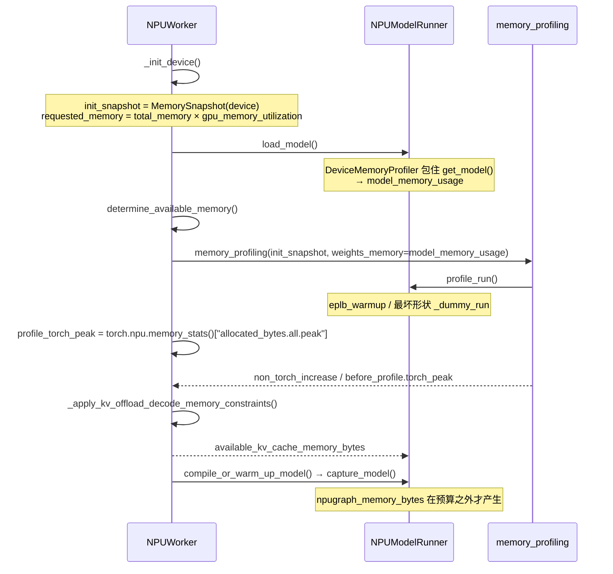
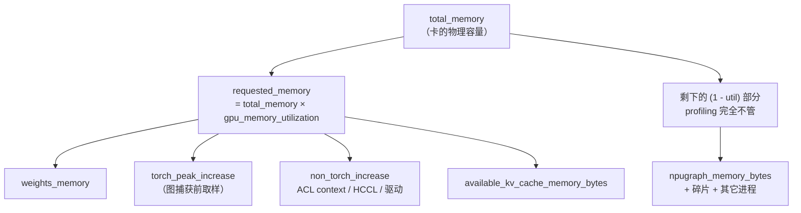

## 一句话

`NPUWorker.determine_available_memory()` 在服务启动时跑一次最坏形状的空转前向，量出权重、激活峰值和非 torch 占用三笔开销，再从 `total_memory × gpu_memory_utilization` 这条预算线里减掉它们，剩下的字节数就是 KV Cache 的全部家当。

## 为什么需要它

KV Cache 必须一次性预分配——[PagedAttention](paged-attention.md) 的块池在引擎启动时就得知道自己有多少块，运行中再扩容就失去了「显存用量恒定、不会因为某条长序列突然 OOM」的意义。于是问题变成：**开服前就要回答「这张卡还能给 KV Cache 多少字节」**。

这个数没法静态算出来。权重大小可以查模型配置，但激活峰值取决于 `max_num_batched_tokens`、算子实现、是否开融合算子；非 torch 的那部分——ACL context、HCCL 通信缓冲、驱动层——更是只有跑起来才知道。唯一可靠的办法就是**真跑一遍再量**。

昇腾侧没有另起炉灶，用的仍是上游 vLLM 的 `MemorySnapshot` / `memory_profiling`。能用得上，靠的是一层 monkey patch：上游把 `current_platform.memory_stats()` 换成了 `torch.accelerator.memory_stats()`，而 `torch.accelerator` 不会路由到 NPU 后端，`get_memory_info()` 更会因为「NPU 的缓存分配器不是 `DeviceAllocator`」直接崩，所以 vllm-ascend 把这几个入口整体重定向到 `torch.npu.*` [C11]。

昇腾侧真正改了公式的地方有两处：一是把激活峰值的取样点挪到图捕获之前，二是 310P 的整条路径另写一套、结果还要再除以 2。这两处都在下面展开。

预算怎么切块、怎么变成块数，交给 [KV Cache Spec](kv-cache-spec.md)；块表怎么寻址，交给 [Block Table](block-table.md)。

## 怎么工作

整条链路横跨 worker 启动的三个阶段，量的东西各不相同：



**第一步，画预算线。** `_init_device()` 里拍下 `init_snapshot`，`requested_memory = total_memory × gpu_memory_utilization`。注意乘的是**卡的物理总容量**，不是当前空闲量。紧接着的校验只是确保「现在的空闲量够得着这条线」，够不着就抛 `ValueError` 让你调小 util。

**第二步，量权重。** 权重内存不在 profiling 阶段量，而是 `load_model()` 里由 `DeviceMemoryProfiler` 单独包住 `get_model()` 量的，结果存进 `model_memory_usage`，再作为 `weights_memory=` 传给 `memory_profiling`。

**第三步，量激活与非 torch 占用。** `profile_run()` 跑一次空转前向。昇腾版在上游基础上加了 EPLB 预热、sparse offload 的 topk buffer 分配，以及 MC2 容量不足时的额外一次 `_dummy_run`，主体仍委托给上游。这一次前向按最坏形状构造——`max_num_reqs` 条请求、合计 `max_num_tokens` 个 token [C16]，这两个值直接来自 `max_num_seqs` 与 `max_num_batched_tokens`。**所以调大 `--max-num-batched-tokens` 会抬高激活峰值，进而直接吃掉 KV 预算。**

**第四步，做减法。** 三项相加就是 non-KV 开销，预算线减去它即为结果：

```
non_kv_cache_memory      = non_torch_increase + torch_peak_increase + weights_memory
available_kv_cache_bytes = requested_memory - non_kv_cache_memory
```

单测把这条加法与减法写死成断言。

这里有一处昇腾特有的改动值得单独说：`torch_peak_increase` 不取 `memory_profiling` 退出时算出的那个值，而是在 context 内部、图捕获之前另取一次 `allocated_bytes.all.peak` 并覆盖掉 [C3]。**代价是 ACL 图内存整个落在 KV 预算之外**——`capture_model()` 要到 `compile_or_warm_up_model()` 才调用，那时 KV Cache 早已按预算分配完毕 [C6]。官方文档记录过这一点的真实后果：Dots3 的 image/audio 模态下自动 profiling 能分出很大的 KV，但图捕获阶段约 3.76 GiB 的峰值会超限，日志表现为 `Worker proc VllmWorker-* died unexpectedly` [S18]。

**第五步，两道后处理。** layerwise KV 复用会按 `num_layers / num_buffer_assignments` 把逻辑预算放大（见 [Layerwise Offload](kv-cache-layerwise-offload.md)）；`_apply_kv_offload_decode_memory_constraints()` 在未开 sparse offload 时是恒等函数，开了则用 planner 的 `final_planner_bytes` 整体替换（见 [Sparse Offload](kv-cache-sparse-offload.md)）。最后 `int()` 返回。

**第六步，回头给建议。** 热身结束、图也捕获完之后，`compile_or_warm_up_model()` 会把四类开销（权重、激活峰值、非 torch、ACL 图）打印出来，并给出两个候选的 `--kv-cache-memory` 值：一个对齐 `requested_memory`，一个对齐启动时的 `free_memory`，都再扣掉 150 MiB 冗余。

一张卡上的显存最终是这样分的：



右边这条支路是所有启动期 OOM 的来源：`npugraph_memory_bytes` 和分配器碎片都得从 `(1 - util)` 那块里出，而没有任何代码检查它够不够 [D]。官方文档建议调小 `--gpu-memory-utilization` 正是为了给这块留余量，默认值是 `0.9` [S17]。

## 拿真实数字走一遍

**场景 A：一张 64 GiB 的 Atlas 800I A2 上单实例跑 Qwen3-0.6B，`--gpu-memory-utilization 0.9`。**

| 步骤 | 算式 | 结果 |
|---|---|---|
| 预算线 | `64 GiB × 0.9` | 57.60 GiB |
| 权重 | `0.596e9 参数 × 2 B（BF16） ÷ 2^30` | 1.11 GiB [D] |
| 激活峰值 | profiling 实测，此处按实测量级假设 | 1.80 GiB [A] |
| 非 torch | ACL context + HCCL，此处按实测量级假设 | 0.90 GiB [A] |
| non-KV 合计 | `1.11 + 1.80 + 0.90` | 3.81 GiB [D] |
| **KV 预算** | `57.60 − 3.81` | **53.79 GiB** [D] |

换算成 token：Qwen3-0.6B 的 `n_kv = 8`、`d_h = 128`、28 层，BF16 每 token 每层 `2 × 8 × 128 × 2 B = 4 KiB`，28 层共 112 KiB [D]（口径见 [KV Cache Spec](kv-cache-spec.md)）。

```
53.79 GiB ÷ 112 KiB = 53.79 × 1048576 ÷ 112 ≈ 503,597 token
503,597 ÷ 128（block_size）≈ 3,934 块
```

留在预算线外的是 `64 − 57.60 = 6.40 GiB`，ACL 图内存就从这里出。若图捕获实际吃掉 1.50 GiB [A]，日志给出的建议值为 `57.60 − (1.11 + 1.80 + 0.90 + 1.50) − 0.1465 = 52.14 GiB` [D]。把这个值回填成 `--kv-cache-memory-bytes`，下次启动就走快路径，不再重新测量。

**场景 B：同一张 64 GiB 卡上并排跑两个实例，`--gpu-memory-utilization 0.4`**（仓库单测写死的场景）：

```
实例 1：requested_memory = 64 × 0.4 = 25.6 GiB，已占满
实例 2 启动：init_snapshot.free_memory ≈ 38.4 GiB
实例 2：requested_memory 仍然 = 64 × 0.4 = 25.6 GiB   ← 乘的是 total 不是 free
        non_kv_cache_memory = 0.5 GiB（只含自己的权重）
        available = 25.6 − 0.5 = 25.1 GiB
```

关键不变量是「只减自己这一份占用」。PR #7427 修的就是这里：修复前 `non_kv_cache_memory` 会把实例 1 的 25.6 GiB 也算进去，结果约 −1.32 GiB [C13]。

可复制的启动配置：

```bash
# 首次启动：让 profiling 自己测
vllm serve Qwen/Qwen3-0.6B \
    --gpu-memory-utilization 0.9 \    # 预算线 = 64 GiB × 0.9；默认值就是 0.9
    --max-num-batched-tokens 8192 \   # 决定 profiling 那一次前向的 token 总数
    --max-num-seqs 256                # 决定那一次前向的请求条数

# 读日志里 "Replace gpu_memory_utilization with --kv-cache-memory=..." 一行，
# 回填成字节数，后续启动就跳过测量、结果可复现：
vllm serve Qwen/Qwen3-0.6B --kv-cache-memory-bytes 55984000000
```

日志里印的是 `--kv-cache-memory=<bytes>`，而实际可用的命令行开关叫 `--kv-cache-memory-bytes`（对应 `cache_config.kv_cache_memory_bytes`，官方教程里也是这个拼写）——日志那句已经过时，照抄会得到一条不认的参数 [D]。

## 事实表

| 项 | 值 |
| --- | --- |
| 入口 | `NPUWorker.determine_available_memory() -> int` |
| 预算线 | `requested_memory = init_snapshot.total_memory × cache_config.gpu_memory_utilization` |
| 主体公式 | `available = requested_memory − (non_torch_increase + torch_peak_increase + weights_memory)` |
| `gpu_memory_utilization` 默认值 | `0.9` |
| 启动期校验 | `free_memory < requested_memory` → `ValueError` |
| profiling 后校验 | `init_snapshot.free_memory > after_profile.free_memory`，否则 `AssertionError` |
| 结果为负 | 不钳位，原样返回负数 |
| 激活峰值取样点 | context 内、图捕获前的 `memory_stats()["allocated_bytes.all.peak"]` |
| 权重来源 | `model_memory_usage = DeviceMemoryProfiler.consumed_memory`，在 `load_model()` 中量 |
| profiling 前向形状 | `max_num_reqs` 条请求，合计 `max_num_tokens` 个 token |
| `max_num_tokens` / `max_num_reqs` | `= scheduler_config.max_num_batched_tokens` / `max_num_seqs` |
| 快路径触发条件 | `cache_config.kv_cache_memory_bytes` 非 0/非 None |
| 快路径行为 | 仍调用 `profile_run()`（为编译），跳过全部测量与 `gpu_memory_utilization` |
| 建议值冗余 | `redundancy_buffer = 150 MiB` |
| 建议值公式 | `requested_memory − (weights + peak_activation + non_torch + npugraph) − 150 MiB` |
| ACL 图内存 | `npugraph_memory_bytes = capture_model()`，在预算确定之后产生 |
| layerwise 放大系数 | `num_layers / num_buffer_assignments`（`has_layer_reuse` 时） |
| sparse offload 后处理 | 未开启时恒等；开启后返回 `budget.final_planner_bytes` |
| NPU 内存 API 适配 | `torch.accelerator.{memory_stats, memory_reserved, reset_peak_memory_stats, get_memory_info}` → `torch.npu.*` |
| 310P 例外 | 结果整体 `// 2`；RC 设备改按 `psutil.virtual_memory()` 口径 |

## 常见误解

**「`gpu_memory_utilization=0.9` 是说用掉当前空闲显存的 90%。」** 不是，乘的是 `total_memory`——卡的物理总容量 [C1]。所以同一张卡上起第二个实例时，`requested_memory` 和第一个实例一模一样，跟此刻还剩多少空闲毫无关系。

**「profiling 把所有显存都算进去了，所以不会 OOM。」** ACL 图内存不在里面：激活峰值是在图捕获**之前**取样的，`capture_model()` 要到 KV Cache 分配完之后才跑。它只能从 `(1 − util)` 那块剩余里出，超了就在启动阶段把 worker 打死。

**「预算算成负数会被兜底成 0。」** 不会。上游去掉了钳位，负值原样 `int()` 返回 [C15]；单测专门锁住了这个行为。

**「这套公式对所有昇腾硬件都一样。」** 310P 另写了一份 `determine_available_memory`，结果要再除以 2 给算子 workspace 留量，RC 设备更是改用主机内存口径 [C12]。本页正文描述的是 A2/A3 路径。
