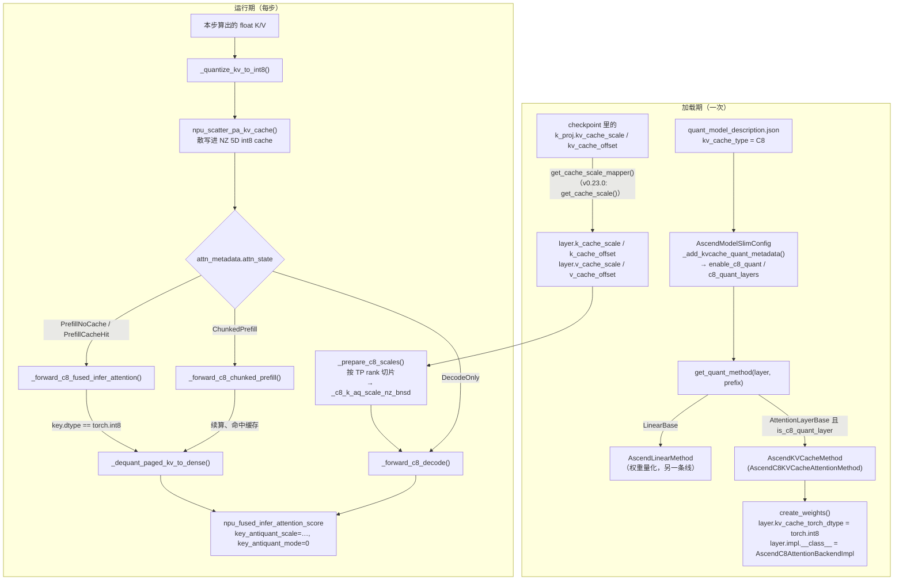

## 一句话

KV cache quantization 把每层缓存下来的 K、V 从模型 dtype 降到 int8，用一组离线标定出来的静态 per-channel scale 做量化与反量化，从而让同样的显存装下大约两倍的 token。在 vllm-ascend 上它不是一个命令行开关，而是 checkpoint 的属性：ModelSlim 产出的 `quant_model_description.json` 里写了 `kv_cache_type: "C8"`，引擎才会走这条路 [C1]。两个版本（v0.23.0 与 main）在这条主路径上逐字一致，差异集中在几处内部 API 名字和文档。

## 为什么需要它

KV cache 的字节数是「层数 × 每 token 每层字节」乘上并发 token 总数，而后者正是吞吐的上限。decode 阶段每生成一个 token 都要把整条序列的 K、V 读一遍，所以这块显存既决定了能并发多少请求（见 [KV Cache Memory Profiling](kv-cache-memory-profiling.md)），也决定了 decode 的带宽压力。把元素从 2 字节降到 1 字节，两件事同时对半砍——这是长上下文场景下最直接的一档收益。

代价是精度。KV 是激活值，动态范围随输入变，没法像权重那样离线算一次就完事。vllm-ascend 选的是**静态标定**：用校准集在离线阶段为每个 KV head 的每个通道定一个 scale，运行时固定不变。好处是运行时零开销（不需要每步统计 max）、算子可以直接吃 scale；坏处是超出标定范围的值会被截到 ±127，这是精度损失的主要来源。

为什么不做成 `--kv-cache-dtype int8`？因为 scale 必须来自校准，而校准结果只能跟 checkpoint 一起发。命令行给不出 scale，所以开关自然落在 checkpoint 上。这一点值得单独记住，因为它和 GPU 侧的习惯正好相反——在 NVIDIA 上 `--kv-cache-dtype fp8` 是个能独立打开的旋钮，在 vllm-ascend 上主力 GQA 与 MLA 后端根本没有声明 `supported_kv_cache_dtypes` [C21]；而带 `index_topk` 的模型更是会被平台把 `cache_config.cache_dtype` 静默改写回模型 dtype [C22][C23]。

昇腾侧还有一层硬件味道的设计：量化 KV 不是「读出来 → 反量化 → 送进注意力」，而是把 int8 缓存和 scale 一起塞给 `npu_fused_infer_attention_score`，由算子内部完成 antiquant [C10]。少一次 dequant 的读写来回，decode 才真的变快，否则省下的显存会被多出来的搬运吃掉。

## 怎么工作

C8 分两段：加载期把层「改装」成量化版本，运行期每一步做量化写入与 antiquant 读取。



**加载期。** `AscendC8KVCacheAttentionMethod.create_weights` 做三件事：把 `layer.kv_cache_torch_dtype` 改成 `torch.int8`、把已经建好的 `layer.impl` 直接换类成 `AscendC8AttentionBackendImpl`（Python 的 `__class__` 赋值，注释里自称 class surgery）、注册四个参数 `k_cache_scale` / `k_cache_offset` / `v_cache_scale` / `v_cache_offset` [C3][C4]。四个参数的默认值是 scale=1、offset=0——也就是说**如果 checkpoint 没带这些张量，量化会静默退化成恒等变换，而缓存已经是 int8 了，结果直接错**。scale 张量本身不在描述文件里，而是随 safetensors 一起加载，靠改名规则挂到 attention 层上 [C5][C6]；描述文件只负责登记「哪些层有」[C1]。

哪些层参与由 `c8_quant_layers` 决定：描述文件里凡出现 `k_proj.kv_cache_scale` 的层号都进这个列表，所以 C8 可以逐层开，不必全模型一刀切 [C1][C2]。

**运行期。** 首次 forward 时 `_prepare_c8_scales` 把 scale/offset 按 TP rank 切成本卡负责的那几个 KV head，再整形成算子要的 `(num_kv_heads, 1, head_size)`，并缓存 `1/scale` 供量化用 [C8]。之后每步：

1. 量化写入。`_quantize_kv_to_int8` 算 `clamp(round(x / scale + offset), -128, 127)`，再由 `npu_scatter_pa_kv_cache` 按 `slot_mapping` 散写进 NZ 5D 布局的 int8 缓存 [C9][C16]。
2. decode 读取。`_forward_c8_decode` 不做任何显式反量化，把 int8 缓存的 NZ 5D 视图、块表、以及 `key_antiquant_scale` / `value_antiquant_scale` 一起交给 `npu_fused_infer_attention_score`，`input_layout="BNSD"`、三个 antiquant mode 全填 0 [C10]。这条路径零 gather、零额外显存。
3. prefill 读取。chunked prefill 下 decode 段与 prefill 段分开算：prefill 段若全是新序列，直接用这一步还没量化的 float K/V（`float_key` / `float_value` 在量化前被留了一份）；否则必须把分页 int8 gather 出来、拼成 dense 再反量化 [C15]。也就是说 **prefill 命中前缀缓存时才付 gather 的代价**，全新 prompt 不付。

**offset 在读路径上不对称。** 量化时加了 offset [C9]，但 decode 的 FIA 只收 scale、不收 offset [C10]，`_dequant_paged_kv_to_dense` 也只乘 scale（注释写明 "Scale-only dequant for NZ (symmetric)"）[C13]；唯一把 offset 减回去的是非分页那条分支 [C14]。把三条路径并起来看，C8 实际上按**对称量化**在跑，只有非零 offset 的 checkpoint 才会暴露这个不一致 [D]。默认 offset 是 0 [C3]，所以常规场景不会撞上。

图模式不受影响：ACL graph 捕获走的 `full_graph_fia` 里同样有 C8 分支，只是多塞 antiquant 参数并把 layout 换成 BNSD [C17]。两版差别只在分派位置——main 把捕获判断提到了 `attn_state` 判断之前，v0.23.0 放在 `DecodeOnly` 分支内 [!]。

**一条硬互斥。** PD 分离时，生产端（prefill 节点）按 `is_kv_producer` 判断不降 dtype、仍存模型 dtype 的 KV [C3]，而消费端分配的是 int8 缓存。所以 GQA 模型上同时打开 C8 与 `MooncakeConnector` / `MooncakeConnectorV1` 会在启动时直接抛 `ValueError`——裸字节传过去会把 bf16 当 int8 解释；错误信息给的出路是改用会先量化再传的 `MooncakeLayerwiseConnector` [C19][C20]。

**另一条路线：FAKQuant。** MLA 模型（DeepSeek 一类）走的不是 C8，而是描述文件里的 `fa_quant_type`，scale 挂在 `fa_q` / `fa_k` / `fa_v` 上。它的 dtype 由 `get_kv_quant_dtype` 决定：Atlas A5 上是 `float8_e4m3fn`，其余型号是 int8；并且 **MLA 只量化 K，V 保持模型 dtype**，注释给的理由是保精度 [C18]。这条线本页只点到为止。

**版本差异汇总**（主路径之外）：v0.23.0 用 `get_cache_scale(name)` 逐个名字映射 scale，main 换成返回 `WeightsMapper` 的 `get_cache_scale_mapper()` [C5][C6][!]；`supported_kv_cache_dtypes` 这个声明只在 main 出现，且只出现在 MiniMax-M3 的两个稀疏后端上 [C21][!]；官方量化指南在 main 新增了「Native FP8 checkpoints」一节，讲的是权重 FP8，与 KV cache 无关 [S26][!]。

## 拿真实数字走一遍

以 Qwen3-0.6B 为例：28 层，`num_kv_heads = 8`，`head_size = 128`，`block_size` 取 128。

**每 token 的缓存字节。** 一层存 K 和 V 两份：

- bf16：`2 × 8 × 128 × 2 B = 4096 B = 4 KiB`，28 层共 `112 KiB`
- int8：`2 × 8 × 128 × 1 B = 2048 B = 2 KiB`，28 层共 `56 KiB`

一条 32768 token 的序列因此从 `112 KiB × 32768 = 3.5 GiB` 降到 `1.75 GiB` [D]。单个 block（128 token）每层从 `512 KiB` 降到 `256 KiB`。

**NZ 5D 视图。** `_nz_5d_view` 把缓存看成 `(num_blocks, 8, 128 / 32 = 4, 128, 32)` [C12]。两个整除条件都要满足：`head_size 128 % 32 == 0`，`block_size 128 % 32 == 0`——后者在 decode 里是硬 assert，`--block-size 16` 会直接挂 [C10]。

**scale 的形状与开销。** per-channel scale 的元素数应为 `num_kv_heads × head_size = 8 × 128 = 1024`，切片后整形成 `(8, 1, 128)` 交给算子 [C8]。每层四个张量（K/V 各一组 scale、offset），按 bf16 算 `4 × 1024 × 2 B = 8 KiB`，28 层共 `224 KiB`——与序列长度无关的常量，相对每 token 省下的 56 KiB 可以忽略 [D]。

**量化一个具体的数。** 设某通道标定出 `scale = 0.0125`、`offset = 0`，则 `1/scale = 80`：

- `k = 1.0` → `round(1.0 × 80 + 0) = 80`，存 int8 `80`；反量化 `80 × 0.0125 = 1.0`，无损
- `k = 1.7` → `round(1.7 × 80) = 136`，超出 int8 上界被 clamp 到 `127`；反量化 `127 × 0.0125 = 1.5875`，误差 `0.1125`

第二个例子就是静态标定的软肋：scale 是离线定死的，运行时遇到比校准集更极端的激活值只能截断 [C9]。

**怎么配。** checkpoint 侧需要描述文件里有这两样东西（键名已核实，键对应的取值格式本页未核实 [D]）：

```json
{
  "kv_cache_type": "C8",
  "model.layers.0.self_attn.k_proj.kv_cache_scale": "...",
  "model.layers.0.self_attn.v_proj.kv_cache_scale": "..."
}
```

启动侧：

```bash
vllm serve /path/to/Qwen3-0.6B-W8A8-C8 \
    --quantization ascend \
    --block-size 128 \
    --max-model-len 32768
```

- `--quantization ascend`：ModelSlim 产出的 checkpoint 必须加，否则整套 `AscendModelSlimConfig` 不会被装上，KV 量化和权重量化一起失效 [S24][S25]
- `--block-size 128`：满足 `block_size % 32 == 0` [C10]
- 没有 `--kv-cache-dtype`：C8 完全不看它 [C1]

## 事实表

| 项 | v0.23.0 | main | 意味着什么 |
|---|---|---|---|
| 开关来源 | `quant_model_description.json` 的 `kv_cache_type == "C8"` [C1][C2] | 同左 | 命令行开不出来，只能换 checkpoint |
| KV cache dtype | `torch.int8` [C3][C4] | 同左 | 每 token 每层字节数对半 |
| scale / offset 默认值 | scale=1、offset=0，dtype 取 `torch.get_default_dtype()` [C3] | 同左 | checkpoint 没带 scale 就等于恒等量化，结果静默出错 |
| scale 粒度 | per-tensor（numel=1）或 per-channel（numel = `num_kv_heads × head_size`）[C8] | 同左 | per-channel 才需要按 TP rank 切片 |
| 传给算子的 antiquant 形状 | `(num_kv_heads, 1, head_size)` [C8] | 同左 | Qwen3-0.6B 上是 `(8, 1, 128)` |
| `block_size` 约束 | 必须是 32 的倍数 [C10][C11] | 同左 | `--block-size 16` 在 decode 直接 assert 失败 |
| 缓存布局 | NZ 5D `(num_blocks, num_kv_heads, head_size/32, block_size, 32)` [C12] | 同左 | `head_size` 也必须能被 32 整除 |
| 参与量化的层 | 描述文件里出现 `k_proj.kv_cache_scale` 的层号 [C1][C2] | 同左 | 可以逐层开，不是全模型一刀切 |
| FAKQuant（MLA）dtype | A5 → `float8_e4m3fn`，其余 → `int8`；MLA 只量 K [C18] | 同左 | MLA 的 V/rope 缓存仍占模型 dtype |
| `supported_kv_cache_dtypes` | 全仓无此声明 [C21] | 仅 MiniMax-M3 的两个稀疏后端声明 `auto/bfloat16/fp8/fp8_e4m3/fp8_e5m2` [C21] | 主力 GQA、MLA 后端都没认领 `--kv-cache-dtype` |

## 常见误解

- **「加 `--kv-cache-dtype int8` 就能开」**——不能。C8 的唯一入口是 checkpoint 描述文件里的 `kv_cache_type` [C1]；`--kv-cache-dtype` 在主力后端上没有被声明支持 [C21]，在带 `index_topk` 的模型上还会被平台改写回模型 dtype [C22][C23]。
- **「FP8 checkpoint 就是 FP8 KV cache」**——不是一回事。官方指南新增的 Native FP8 一节讲的是**权重**存成 `float8_e4m3fn` [S26]，跟 KV cache 的 dtype 没有关系；量化 KV 走的是 `kv_cache_type` / `fa_quant_type` 这条完全独立的线 [C1][C18]。
- **「量化 KV 要先反量化再算注意力」**——decode 不是。int8 缓存和 scale 一起进 `npu_fused_infer_attention_score`，反量化在算子内部完成 [C10]；只有 prefill 命中前缀缓存、需要拼 dense KV 时才显式 gather + 反量化 [C15]。
- **「C8 和权重量化是两个独立开关」**——它们出自同一份描述文件、同一次 `get_quant_method` 分发：`LinearBase` 拿到权重量化方法，`AttentionLayerBase` 拿到 KV 量化方法 [C7]。所以 `--quantization ascend` 是两者共同的前提 [S24]。
