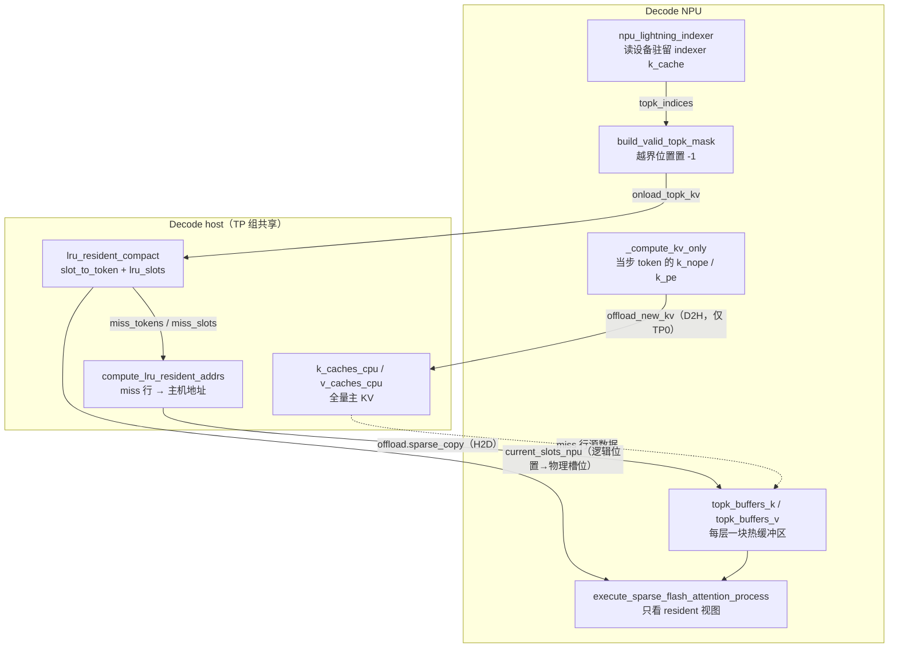

## 一句话

Sparse KV Offload 让 PD 分离部署里的 Decode 节点**完全不分配 NPU 主 KV 缓存**：全量 K/V 躺在主机的 pinned 内存池里，每个 decode step 只把稀疏注意力当步选中的 top-k token 中「设备上还没有」的那几行搬回 NPU 的按层热缓冲区 [C3]。它换来的是更长的 `max_model_len` 和更大的 decode batch，代价是每步多一次 CPU 侧 LRU 决策和一轮 H2D 传输。

官方指南见 [Layerwise and Sparse KV Cache Offloading Guide](https://docs.vllm.ai/projects/ascend/en/latest/user_guide/feature_guide/layerwise_and_sparse_kv_cache_offloading.html)，设计文档见 [Design](https://docs.vllm.ai/projects/ascend/en/latest/developer_guide/Design_Documents/layerwise_and_sparse_kv_cache_offloading.html)。

## 为什么需要它

长序列推理里，decode 阶段每步的计算量只有一个 token，而 KV Cache 的体积随上下文线性增长，最后是显存而不是算力卡住了并发。把 KV 搬到主机内存是自然的想法，但对 decode 来说是个坏交易：整层 KV 搬上来的传输时间远远盖不住一个 token 的计算时间 [S2]。

转机来自模型侧：DeepSeek-V3.2、GLM-5.1/5.2 这类**稀疏注意力**模型本来就不读全部历史——每步先由 lightning indexer 打分，只挑出 `index_topk` 个 token 参与注意力 [C14]。既然每步实际要读的只有 `index_topk` 行，那就没必要把全量 KV 留在设备上。这个特性做的事情就是把这条已有的稀疏性从「少算」延伸成「少存」：全量留主机，设备上只维持一块够装 `topk_buffer_size` 个 token 的热缓冲区，命中就直接用，未命中才搬 [S2]。

这也解释了它的准入门槛：模型配置里必须有 `index_topk`，否则直接报 `Sparse KV offload only support sparse attention model.` [C13]。没有 indexer 就没有「该保留哪些」的答案，这套机制无从谈起。

与它相对的另一半是 [Layerwise KV Offload](kv-cache-layerwise-offload.md)——Prefill 阶段每层计算量大，反而适合整层搬并与计算重叠。两者出自同一篇设计文档，常在一个 PD 分离集群里同时开。

## 怎么工作

开关生效在后端选型处：`sparse_kv_offload_config.enabled` 为真时，`AscendSFABackend` 整体换一套实现类 `AscendSFAKVOffloadImpl` / `AscendSFAKVOffloadMetadataBuilder`，而不是在热路径上插判断 [C16]。分配侧则由 `AscendMLAAttentionSpec.store_on_host` 标记哪些层的主 KV 只在主机分配 [C17]。

一个 decode step 里，每一层都会走一遍下面这条链：



几处值得单独说清楚：

**当步 token 的 K/V 不落设备。** `exec_kv` 的 decode 分支调 `_compute_kv_only` 算出 `k_nope` / `k_pe` 后，以 `k_cache_npu=None` 调用 `offload_new_kv`，直接按 `slot_mapping` D2H 写进主机池 [C4]。TP 并行时 MLA 的 K/V 在各 rank 间是复制的，所以只有 TP rank 0 真正写，其余 rank 直接返回 [C20]。

**谁来决定保留哪些。** 决定权完全在模型的 indexer 手上——`npu_lightning_indexer` 读设备驻留的 indexer K cache，输出 `topk_indices`（形状 `[tokens, topk]`）[C14][C5]。卸载层只做两件加工：把越界或尚未写入的位置按 `topk_indices >= 0 && topk_indices < seq_len` 置成 -1 [C21][C5]；以及在部分层没有自己的 indexer（`skip_topk`，如 GLM-5.2 的一部分层）时跳过整套 LRU 计算，直接把上一层的地址描述符整体平移一个层间偏移 [C15][C9]。

**驻留判定是每行独立的 LRU。** 这里的「行」是一个 decode token（投机解码下一个请求占多行），每行独享 `topk_buffer_size` 个物理槽位。C++ 侧 `lru_resident_compact` 对每行：请求换人就整行重置；把 `token >= stable_prefix_len` 的投机后缀强制作废（主机池里那几行随时可能被下一步覆写）；然后按 `slot_to_token` 判命中，命中的记进 `current_slots`，没被这一步选中的槽位进可驱逐列表 [C10]。miss 只能拿到 `min(miss_count, evictable_count)` 个槽位；重排后的 LRU 顺序是「剩余可驱逐 → 本步新装入 → 本步命中」，越靠前越先被驱逐 [C11]。

**注意力算子被骗成在读一张迷你分页缓存。** `_resident_views` 把 `[rows, topk_buffer_size, 1, d]` 的热缓冲区 view 成 `[rows * pages_per_row, block_size, 1, d]`，再配一张恒等块表 `resident_block_table_npu` 和恒为 `topk_buffer_size` 的 `resident_seq_lens_npu` [C6][C8]。算子看到的是一段普通的分页 KV，只是长度从「整段历史」缩到了 `topk_buffer_size`。

**CPU 与图模式的配合。** LRU 决策必须在 host 上跑，图模式下通过 `torch_npu.npu._launch_host_func` 挂到当前计算流上，算完的地址描述符再拷回 NPU，最后一次 `offload.sparse_copy` 把所有 miss 行批量 H2D [C9]。

## 拿真实数字走一遍

取一台 Decode 节点，模型是 DeepSeek-V3.2 这类 MLA + lightning indexer 的结构。前提取值（模型侧维度按上游测试中使用的 MLA 典型值）[A]：

| 量 | 值 | 来自 |
|---|---|---|
| `kv_lora_rank`（= `k_dim`） | 512 | 模型配置 [A] |
| `qk_rope_head_dim`（= `v_dim`） | 64 | 模型配置 [A] |
| `num_kv_heads` | 1 | MLA 固定 [C7] |
| `index_topk`（= `topk`） | 2048 | 模型配置；文档默认 `topk_buffer_size=4096` 恰是它的 2 倍 [A] |
| `topk_buffer_size` | 4096 | 默认值 [C12] |
| `block_size` | 128 | 部署选值，需整除 `topk_buffer_size` [A] |
| 带 KV 的层数 | 61 | 模型配置 [A] |
| `max_num_seqs` | 32，无 MTP 故 `decode_width=1` | 部署选值 [A] |
| `dram_size_per_dp_GB` | 128 | 默认值 [C12] |

**热缓冲区（NPU）占多少。** `max_num_topk_rows = min(max_num_batched_tokens, 32 × 1) = 32` [C7]。每层 [D]：

```
K: 32 × 4096 × 1 × 512 × 2 B = 134,217,728 B = 128 MiB
V: 32 × 4096 × 1 ×  64 × 2 B =  16,777,216 B =  16 MiB
每层合计 144 MiB；61 层 = 8,784 MiB ≈ 8.58 GiB
```

`pages_per_row = 4096 / 128 = 32`，所以注意力看到的 `resident_k` 形状是 `(32 × 32, 128, 1, 512) = (1024, 128, 1, 512)` [D][C6]。

**主机池能装多少 token。** 每 token 每层 `(512 + 64) × 2 B = 1152 B`，61 层就是 70,272 B ≈ 68.6 KiB [D][C8]。一个块（128 token）跨全部层是 `61 × 128 × 1152 = 8,994,816 B ≈ 8.58 MiB` [D]。对齐预留按每层 3 × 2 MiB 算，61 层共 383,778,816 B [C19][D]：

```
usable = 128 GiB − 383,778,816 B = 137,055,174,656 B
dram_limit_blocks = ⌊137,055,174,656 / 8,994,816⌋ = 15,237 块
                  = 15,237 × 128 = 1,950,336 token
```

这 15,237 块再与 `npu_limit_blocks`、`workload_limit_blocks` 取最小，才是最终块数，折算成字节后由 `_apply_kv_offload_decode_memory_constraints` 顶替掉原本的「NPU 还剩多少」返回给调度器 [C18][C19]；`keep_device_kv_cache=False` 时 `npu_page_size_bytes` 只算 indexer 等设备侧 spec，所以 NPU 那一路的上限通常很松 [C19]。

**每步搬多少。** 单行单层最坏情况（全 miss）是 `2048 × 1152 B = 2.25 MiB`；对照「不做稀疏、把这一行的全量历史读上来」——128K 上下文是 `131,072 × 1152 B = 144 MiB`，比值正好是 `131072 / 2048 = 64×` [D]。稳态下 LRU 命中率越高，实际传输量越小于这个上界。

**Decode 侧启动配置**（可直接复制）[S1]：

```bash
--additional-config '{
    "sparse_kv_offload_config": {
        "enabled": true,
        "topk_buffer_size": 4096,
        "dram_size_per_dp_GB": 128
    }
}' \
--kv-transfer-config '{
    "kv_connector": "SfaRemoteD2HConnector",
    "kv_role": "kv_consumer",
    "kv_port": 20050,
    "kv_connector_extra_config": {
        "transfer_backend": "memfabric",
        "use_layerwise": true
    }
}'
```

`kv_port` 起要预留 `decode_data_parallel_size × decode_tensor_parallel_size` 个连续端口 [S1]。

## 事实表

| 项 | 值 | 来源 |
|---|---|---|
| 配置入口 | `additional_config.sparse_kv_offload_config` | `docs/source/user_guide/feature_guide/layerwise_and_sparse_kv_cache_offloading.md#L213-L220` |
| `enabled` | `bool`，默认 `False` | `vllm_ascend/ascend_config.py#L1233` |
| `topk_buffer_size` | `int`，默认 `4096`；须 `> 0`、`>= index_topk`、能被 `block_size` 整除 | `vllm_ascend/ascend_config.py#L1234`、`#L1288-L1292`；`sparse_kv_offload_manager.py#L620-L624` |
| `dram_size_per_dp_GB` | `int`，默认 `128`；须 `> 0`；每 DP 组一份，组内 TP rank 共享 | `vllm_ascend/ascend_config.py#L1235`、`#L1243-L1244`；`sparse_kv_offload.po#L169` |
| `keep_device_kv_cache` | `bool`，默认 `False`；仅 PD 共置调试 | `vllm_ascend/ascend_config.py#L1236`、`#L1270-L1276` |
| `topk` | 非用户参数，取自 `hf_text_config.index_topk` | `vllm_ascend/ascend_config.py#L1287` |
| 主 KV dtype | 必须 BF16，否则 `ValueError` | `sparse_kv_offload_manager.py#L613-L617` |
| `num_kv_heads` | 断言 `== 1`（仅 SFA/MLA） | `sparse_kv_offload_manager.py#L612` |
| 热缓冲区形状（每层 K） | `[max_num_topk_rows, topk_buffer_size, 1, kv_lora_rank]`，BF16 | `sparse_kv_offload_manager.py#L74-L78` |
| 热缓冲区形状（每层 V） | `[max_num_topk_rows, topk_buffer_size, 1, qk_rope_head_dim]`，BF16 | `sparse_kv_offload_manager.py#L79-L83` |
| `max_num_topk_rows` | `min(max_num_batched_tokens, max_num_seqs × decode_width)` | `sparse_kv_offload_manager.py#L65-L68` |
| `decode_width` | `1 + num_speculative_tokens`（无投机时为 1） | `sparse_kv_offload_manager.py#L57-L59` |
| 每 token 字节数 | K `1 × kv_lora_rank × 2`，V `1 × qk_rope_head_dim × 2` | `sparse_kv_offload_manager.py#L618-L619` |
| 注意力可见序列长度 | 恒为 `topk_buffer_size` | `sparse_kv_offload_manager.py#L649-L654` |
| 主机池对齐预留 | 每层 `3 × 2 MiB` | `sparse_kv_offload_manager.py#L194` |
| 块数上限 | `min(npu_limit, dram_limit, workload_limit)` | `sparse_kv_offload_manager.py#L210-L227` |
| top-k 合法性判据 | `topk_indices >= 0 && topk_indices < seq_len` | `vllm_ascend/attention/utils.py#L61-L66` |
| 硬性不支持 | `compress_ratios` 模型、CP、PP、model runner v2 | `vllm_ascend/ascend_config.py#L1261-L1285` |
| 部署形态 | 仅 PD 分离的 D 节点；否则须 `keep_device_kv_cache=True` | `vllm_ascend/ascend_config.py#L1277-L1283` |
| 已验证模型 | GLM-5.1、GLM-5.2、DeepSeek-V3.2 | `docs/source/user_guide/feature_guide/layerwise_and_sparse_kv_cache_offloading.md#L14-L21` |
| 传输后端 | 仅 MemFabric | `docs/source/user_guide/feature_guide/layerwise_and_sparse_kv_cache_offloading.md#L265` |

## 常见误解

**「稀疏卸载会丢掉不重要 token 的 KV。」** 一个都没丢。全量 K/V 始终在主机池里，被「稀疏」掉的只是**设备驻留**——热缓冲区里没有的行，下一步被选中时照样能搬回来 [S2][C10]。

**「top-k 是这个特性挑的。」** 不是。挑选发生在模型自己的稀疏注意力里，`npu_lightning_indexer` 的输出和不开卸载时一模一样 [C14]；卸载层只负责按这份索引把数据搬到位。所以开关它不改变注意力读哪些 token，也就不引入额外的精度损失——真正被禁掉的反而是主缓存的 C8 量化（`enable_sparse_sfa_c8` 会直接抛 `NotImplementedError`），只有 indexer cache 还允许 C8 [C23][C8]。

**「开了就能省显存。」** 只在 `keep_device_kv_cache=False` 时成立。置 `True` 会照常分配设备主 KV 缓存，既省不了显存也提不了序列长度与 batch，它存在的唯一理由是 PD 共置下的调试 [C13][S22]。

**「`topk_buffer_size` 调大只是多占显存。」** 它同时决定 LRU 命中率——缓冲区越大，跨步复用越多、H2D 越少、TPOT 越低，上游给的平衡点是 `2 × index_topk` [S22][S1]。它不影响注意力读多少 token（那是 `index_topk` 的事），只影响这些 token 里有多少需要重新搬。
