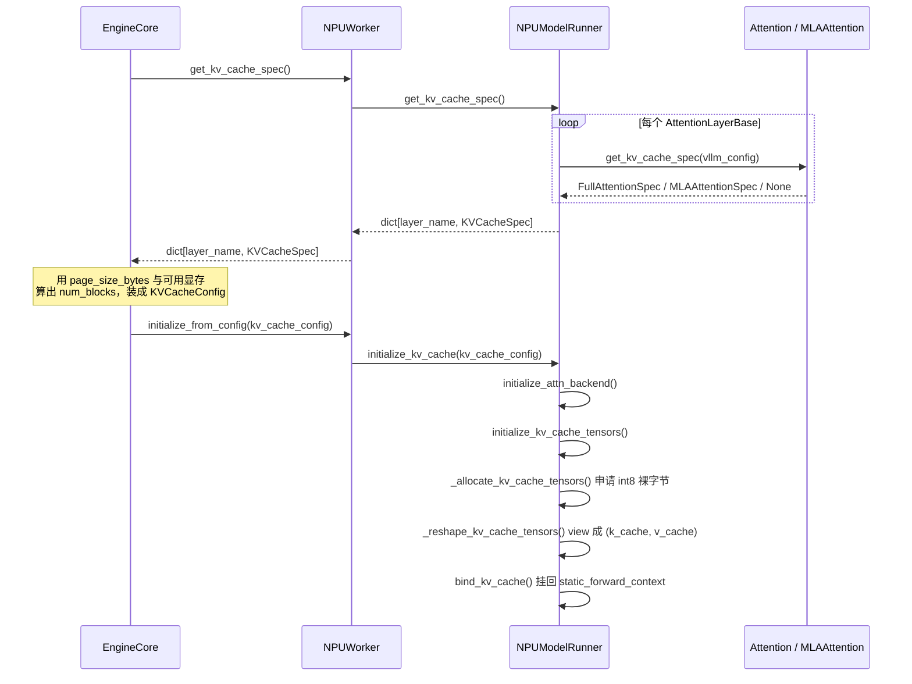

## 一句话

KV Cache Spec 是每个注意力层对「我一个 block 长什么样、占多少字节」的声明。引擎拿到全部层的声明，配合显存 profiling 结果算出能开多少个 block，再把结果（`KVCacheConfig`）发回 worker；worker 侧按声明的字节数申请裸内存，最后 `view` 成注意力算子要的张量形状。

## 为什么需要它

显存要在模型加载之后、第一次推理之前一次性切分好，这件事决定了 vLLM 的分配顺序：先声明、后分配。

没有这层声明会怎样：分配 KV Cache 的代码必须自己去猜每层的形状。可是「每层」并不整齐——同一个模型里可能同时有 GQA 的满注意力层、MLA 的压缩 latent 层、Mamba 的状态层、SFA 的 indexer 层，还可能有跨层共享 KV 的层（它完全不需要自己的缓存）。把这些分支塞进分配器，分配器就得认识每一种模型结构。

vLLM 的做法是把责任倒过来：**每层自己回答「我要什么」，分配器只认字节数**。`NPUModelRunner.get_kv_cache_spec` 遍历 static forward context 里所有 `AttentionLayerBase`，逐层问出一份 `KVCacheSpec`，不需要 KV 的层根本不进这个字典 [C]。跨层共享的层被记到 `shared_kv_cache_layers` 后直接 `continue`，KV 管理逻辑当它不存在，省下的显存换成更长的上下文或更多并发请求 [C]。

这样做还有两个具体好处：

- **调度器只需要一个数**。spec 暴露的 `page_size_bytes` 让引擎能把「可用显存」直接除成「块数」，不必理解注意力的实现细节。块数一旦定下来，[Block Table](block-table.md) 和 [PagedAttention](paged-attention.md) 就有了统一的地址空间。
- **昇腾能在不改上游的前提下换布局**。GQA 层的 spec 直接复用上游 `Attention.get_kv_cache_spec` 的返回值，而 MLA / SFA 层被替换成昇腾自己的 `AscendMLAAttentionSpec`、`AscendSFAIndexerCacheSpec`，把 scale 张量、DCP 复制份数、C8 打包这些昇腾独有的布局信息挂在 spec 上 [C]。分配器代码不变，改的只是声明。

代价是这套东西有两处必须对齐，否则跑不起来：**声明的字节数**与**分配的字节数**、**spec 的 block_size** 与**算子支持的 kernel block size**。源码里用断言把这两处钉死（见「事实表」）。

## 怎么工作

两个阶段，中间隔着引擎的一次显存 profiling。



**第一阶段：声明。** `NPUWorker.get_kv_cache_spec` 只是转发给 runner [C]。runner 按层类型分支：`Attention`（GQA）用上游返回的 spec 原样存入；`MLAAttention` 重建成 `AscendMLAAttentionSpec`；`DeepseekV32IndexerCache` 造一份 `AscendSFAIndexerCacheSpec`；`MambaBase` 留到最后统一处理 [C]。Mamba 放最后有两个原因——注意力后端的图参数更新依赖这个顺序，而且要拿 mamba 的 page 大小回头把所有注意力层的 `page_size_padded` 撑到同一个值，好让混合模型里所有层的 block 等长 [C]。v2 worker 路径上有一个同名的模块级函数 `vllm_ascend/worker/v2/attn_utils.py::get_kv_cache_spec`，逐层问 spec、跳过共享层的规则完全一致 [C]。

**第二阶段：分配。** `initialize_kv_cache` 先补齐 encoder-only 层与共享层、选定注意力后端、按各组的 block_size 重建 input batch，最后才调 `initialize_kv_cache_tensors` [C]。后者拆成两步：

1. `_allocate_kv_cache_tensors`：对每个 `kv_cache_tensor`，先用 `_get_layer_kv_cache_specs` 把「组级 spec」还原成「层级 spec」，再按层类型选分配方式。注意力层这一支把 `kv_cache_tensor.size` 按 K/V 的头维比例切两半，**分别**申请（拆开是为了支持 PD 分离，它要求张量第 0 维必须是 `num_blocks`）[C]。申请出来的一律是 `torch.int8` 一维张量——此刻只有字节数，没有形状 [C]。开了 KV transfer 时还会多申请 2 MiB 再对齐首地址 [C]。
2. `_reshape_kv_cache_tensors`：用 `num_blocks = (K 字节 + V 字节) / page_size_bytes` 反算块数，断言它不小于 `kv_cache_config.num_blocks`，然后向后端要形状、把裸字节 `view` 成目标 dtype 与目标 shape，每层产出一个 `(k_cache, v_cache)` 二元组 [C]。

最后 `bind_kv_cache` 把这些张量挂回 `compilation_config.static_forward_context`，attention 层 forward 时就从那里取自己的 cache [C]。

一个具体调用实例：Qwen3-0.6B 的 `model.layers.0.self_attn.attn` 这一层，声明阶段拿到 `block_size=128, num_kv_heads=8, head_size=128, dtype=bfloat16`；分配阶段 `AscendAttentionBackend.get_kv_cache_shape(num_blocks, 128, 8, 128)` 返回 `(2, num_blocks, 128, 8, 128)`，去掉首维 2 之后 K 和 V 各得 `(num_blocks, 128, 8, 128)` [C]。

## 拿真实数字走一遍

Qwen3-0.6B：28 层，H=1024，n_q=16，**n_kv=8**，**d_h=128**，权重与 KV 均为 bf16（`itemsize = 2` 字节）。昇腾默认 `block_size = 128` [C]。

**第一步：每 token 每层多少字节。** 后端形状 `(2, num_blocks, block_size, num_kv_heads, head_size)` 的首维 2 就是 K 与 V 两份，一个 block 覆盖 `block_size` 个 token，所以

```
bytes_per_token_per_layer = 2 × n_kv × d_h × itemsize
                          = 2 × 8 × 128 × 2
                          = 4096 B = 4 KiB
```

这条推广结论标 [D]：源码里这个形状只在 `AscendAttentionBackend` 这一支成立，且该分配分支带有 `"attn" in layer_name`、`not use_mamba`、非 sparse、非 `fa_quant` 的前提，`fa_quant` 打开时 K/V 的 dtype 会被 `get_kv_quant_dtype` 改写 [C]。把它当成「GQA 普通 bf16 路径的通式」是依据这一支覆盖了所有走 `Attention` 类的满注意力层而推广的。MLA 不适用——`AscendMLAAttentionSpec.real_page_size_bytes` 里没有因子 2，它只存一份压缩 latent [C]。

**第二步：整模型每 token。**

```
bytes_per_token = 4096 × 28 = 114688 B = 112 KiB
```

**第三步：一个 block 多少字节（即 `page_size_bytes`）。**

```
page_size_bytes = 4096 × 128 = 524288 B = 512 KiB  （每层）
```

**第四步：反推块数。** 假设 profiling 之后分给 KV Cache 的显存是 14 GiB，28 层平均分，则每层的 `kv_cache_tensor.size = 14 GiB / 28 = 536870912 B = 512 MiB`：

```
num_blocks = 536870912 / 524288 = 1024
可缓存 token = 1024 × 128 = 131072
```

复核：`131072 × 112 KiB = 14 GiB`，与假设一致。

**第五步：K/V 怎么切。** `calc_split_factor([128, 128])` 返回 `[2.0, 2.0]`，于是

```
k_tensor_size = 536870912 // 2 = 268435456 B = 256 MiB
v_tensor_size = 268435456 B = 256 MiB
```

`k_cache` 的形状是 `(1024, 128, 8, 128)`，元素数 `1024 × 128 × 8 × 128 = 134217728`，乘 bf16 的 2 字节正好 256 MiB，与申请到的裸张量对得上 [D]。

**配置片段。** 上面这组数对应的启动方式：

```bash
vllm serve Qwen/Qwen3-0.6B \
  --block-size 128 \
  --gpu-memory-utilization 0.9 \
  --max-model-len 32768
```

- `--block-size 128`：昇腾 GQA 算子只支持 128 的 kernel block size，不写也会被 `refresh_block_size` 补成 128；开了 prefix caching 或 chunked prefill 时即使显式写别的值也会被强制改回 128 [C]。
- `--gpu-memory-utilization 0.9`：决定上面第四步里「14 GiB」这个数从哪来，细节见 [KV Cache 显存 profiling](kv-cache-memory-profiling.md)。
- `--max-model-len 32768`：不影响每 token 字节数，只影响单请求最多占多少 block。

## 事实表

| 项 | 值 | 来源 |
|---|---|---|
| 声明入口（worker） | `NPUWorker.get_kv_cache_spec()` | `vllm_ascend/worker/worker.py#L983-L994` |
| 声明入口（runner，v1） | `NPUModelRunner.get_kv_cache_spec()` | `vllm_ascend/worker/model_runner_v1.py#L4947-L4986` |
| 声明入口（v2） | `vllm_ascend/worker/v2/attn_utils.py::get_kv_cache_spec()` | `vllm_ascend/worker/v2/attn_utils.py#L64-L93` |
| 分配入口（worker） | `NPUWorker.initialize_from_config()` | `vllm_ascend/worker/worker.py#L1009-L1020` |
| 分配入口（runner） | `NPUModelRunner.initialize_kv_cache()` → `initialize_kv_cache_tensors()` | `vllm_ascend/worker/model_runner_v1.py#L3910-L3938`、`#L3986-L4004` |
| 跨层共享层的处理 | 不生成 spec，记入 `self.shared_kv_cache_layers` 后 `continue` | `vllm_ascend/worker/model_runner_v1.py#L4947-L4986` |
| `block_size` 来源 | `self.block_size = vllm_config.cache_config.block_size` | `vllm_ascend/worker/model_runner_v1.py#L376` |
| `block_size` 默认值 | `128`（`deepseek_v4` 为 `32`） | `vllm_ascend/utils.py#L1167-L1180` |
| 支持的 kernel block size（GQA） | `[128]` | `vllm_ascend/attention/attention_v1.py#L151-L153` |
| 块数与 token 的换算（官方文档） | `700 blocks ≈ 89,600 tokens @ block_size=128` | `docs/source/user_guide/configuration/additional_config.md#L174` |
| GQA block 形状 | `(2, num_blocks, block_size, num_kv_heads, head_size)` | `vllm_ascend/attention/attention_v1.py#L113-L121` |
| K / V 各自形状 | `kv_cache_shape[1:]`，V 若有 `head_size_v` 则末维换成它 | `vllm_ascend/worker/model_runner_v1.py#L4647-L4659` |
| 每层产出 | `kv_caches[layer_name] = (k_cache, v_cache)` | `vllm_ascend/worker/model_runner_v1.py#L4684-L4704` |
| MLA 每 block 字节 | `storage_block_size × num_kv_heads × (head_size × itemsize(dtype) + scale_dim × itemsize(scale_dtype))` | `vllm_ascend/core/kv_cache_interface.py#L33-L61` |
| MLA `storage_block_size` | `block_size // compress_ratio` | `vllm_ascend/core/kv_cache_interface.py#L33-L61` |
| 裸张量 dtype | `torch.int8`，reshape 阶段才 `view` 成目标 dtype | `vllm_ascend/worker/model_runner_v1.py#L4333-L4354` |
| K/V 切分因子 | `calc_split_factor([k_dim, v_dim]) = [total/k_dim, total/v_dim]` | `vllm_ascend/utils.py#L1380-L1382` |
| K/V 分别申请的原因 | PD 分离要求张量第 0 维是 `num_blocks` | `vllm_ascend/worker/model_runner_v1.py#L4288-L4317` |
| 地址对齐 | `alignment = 2 * 1024 * 1024`，仅当 `kv_transfer_config is not None` 时生效 | `vllm_ascend/worker/model_runner_v1.py#L4333-L4354` |
| 块数反算 | `num_blocks = (k.numel() + v.numel()) // page_size_bytes` | `vllm_ascend/worker/model_runner_v1.py#L4598-L4614` |
| 一致性断言 1 | `sum_page_size_bytes % page_size_bytes == 0` | `vllm_ascend/worker/model_runner_v1.py#L4598-L4614` |
| 一致性断言 2 | `num_blocks >= kv_cache_config.num_blocks` | `vllm_ascend/worker/model_runner_v1.py#L4598-L4614` |
| 一致性断言 3 | 分配后层名集合必须等于各组层名并集 | `vllm_ascend/worker/model_runner_v1.py#L4355-L4361` |
| `page_size_padded` 唯一来源 | 混合模型里把注意力层的 page 撑到 mamba 的 `page_size_bytes` | `vllm_ascend/worker/model_runner_v1.py#L5076-L5089` |
| 组级 → 层级 spec 还原 | `_get_layer_kv_cache_specs()`；`UniformTypeKVCacheSpecs` 按层取回 | `vllm_ascend/worker/model_runner_v1.py#L4032-L4052` |
| 张量绑定 | `bind_kv_cache(kv_caches, static_forward_context, self.kv_caches, num_attn_module)` | `vllm_ascend/worker/model_runner_v1.py#L4019-L4030` |
| SFA indexer spec | `AscendSFAIndexerCacheSpec(num_kv_heads=1, head_size=index_head_dim, …)` | `vllm_ascend/worker/model_runner_v1.py#L5031-L5047` |

## 常见误解

- **「每层的 spec 都一样，算一层乘层数就行。」** 同构模型确实如此，但混合模型里 attention 与 mamba 的 spec 类型都不同，且 attention 的 page 会被 padding 到 mamba 的大小；按一层乘会少算这部分 padding [C]。
- **「`get_kv_cache_spec` 返回的层数等于模型层数。」** 不等于。跨层共享 KV 的层、encoder-only 的层都不会出现在返回的字典里 [C]。
- **「`page_size_bytes` 就是 K 或 V 单边的一块大小。」** 对 GQA 是 K 与 V 两边之和：反算块数时用的是 `k.numel() + v.numel()` 除以它 [C]。
- **「改 `--block-size` 就能改 KV Cache 的总占用。」** 改的是分块粒度，不是每 token 字节数；而且昇腾 GQA 算子只吃 128，其它值会被改回来 [C]。

## 接着看

- [PagedAttention](paged-attention.md) —— spec 算出的 block 是它寻址的单位，先懂分块再回头看声明会更顺。
- [KV Cache 显存 profiling](kv-cache-memory-profiling.md) —— 本页第四步里「可用显存」那个数就是它算的。
- [Block Table](block-table.md) —— `num_blocks` 定下来之后，块号到物理位置的映射由它维护。
- [KV Cache 量化](kv-cache-quantization.md) —— 量化直接改 spec 的 dtype，是验证「换布局只需改声明」的最好例子。
- [Prefix Caching](prefix-caching.md) —— 它要求 `block_size=128`，原因就在本页的 kernel block size 一行。
