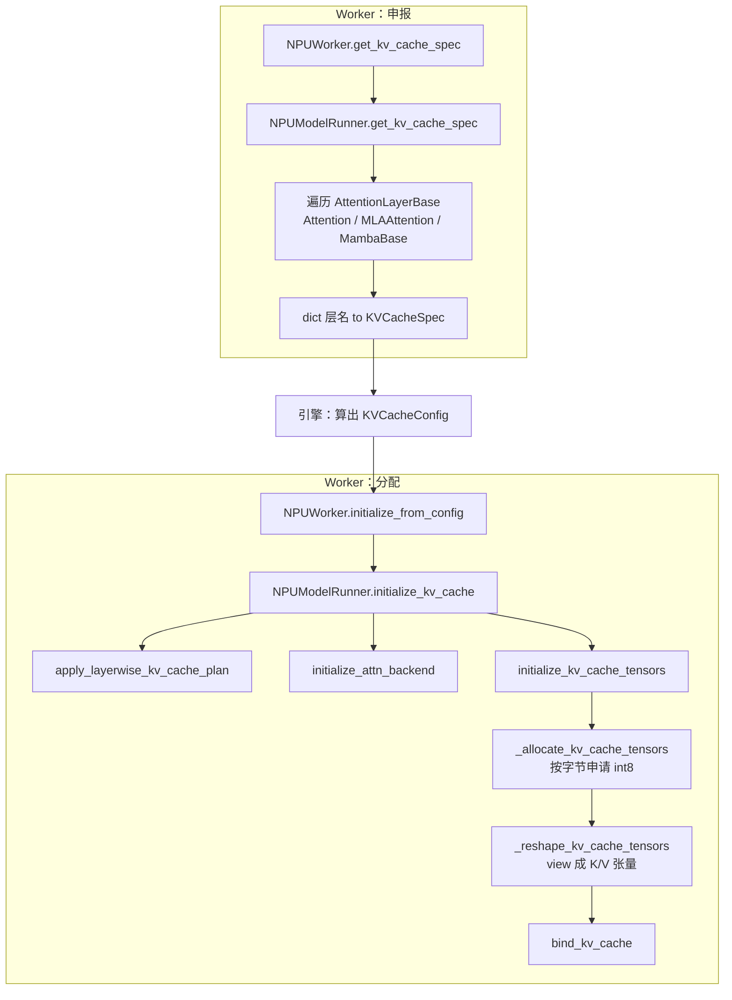

## 一句话

KV Cache Spec 是「模型有什么」与「显存怎么切」之间唯一的契约：每个需要缓存的注意力层申报一条 `KVCacheSpec`（块大小、KV 头数、head dim、dtype），引擎用它把可用显存换算成块数，Worker 再用它把一大片 int8 字节 view 成 K/V 张量。不需要缓存的层——比如跨层共享 KV 的层——根本不出现在这张表里。

## 为什么需要它

显存分配要的是三个精确的数：**这一层要不要缓存**、**一页多少字节**、**张量最终什么形状**。这三个数没有任何一方独自知道。模型代码知道自己有 28 层、每层 8 个 KV 头，但不知道昇腾 kernel 要求 K 和 V 各自独立成张量；后端 kernel 知道自己要 `(2, num_blocks, block_size, num_kv_heads, head_size)` 这种排布 [C7]，但不知道第 12 层是不是复用了第 11 层的缓存。把两边硬接在一起，结果就是两种典型故障：要么写死一套形状，遇上 MLA（`num_kv_heads` 恒为 1、`head_size` 是 `kv_lora_rank + qk_rope_head_dim`）[C3] 或 Mamba 混合模型直接崩；要么显存探测按一套公式估、真正分配按另一套公式切，两边差几个百分点就是启动即 OOM。

spec 的解法是把「申报」和「分配」彻底分开，中间只传数。`get_kv_cache_spec()` 遍历静态前向上下文里的所有注意力层，问每一层要一条 spec，不需要的层直接不进字典——跨层 KV 共享的层被记进 `shared_kv_cache_layers` 后 `continue`，encoder-only 这类层则因为返回 `None` 而被跳过。这张 `{层名: spec}` 表交给引擎，引擎算出 `KVCacheConfig`（总块数、每层分多少字节、哪些层归一组）再发回来，Worker 照单分配。

昇腾侧在这条通路上加了自己的东西，原因是硬件与部署形态。第一，昇腾的 GQA kernel 只认 128 这一个物理块大小 [C8]，所以 `spec.block_size` 与 kernel 实际用的块大小在混合块场景下会分家 [C19]。第二，为支持 P/D 分离，K 与 V 必须是两个首地址各自 2 MiB 对齐的独立张量，而不是上游那种一个张量装下 K 和 V 的布局——源码注释把这条写得很直白：「it only support the 0-dim of kv_cache is `num_blocks`」[C13]。第三，昇腾定义了自己的 spec 子类（`AscendMLAAttentionSpec`、`AscendSFAIndexerCacheSpec`、`AscendSlidingWindowMLASpec`），并把它们注册回上游的 `KVCacheSpecRegistry`，好让调度侧的 `FullAttentionManager` 认得它们。

这一页只讲「声明什么、怎么落成张量」。块号到显存地址的那一跳见 [Block Table](block-table.md)，分页缓存本身的道理见 [PagedAttention](paged-attention.md)，可用字节从哪来见 [KV Cache 显存探测](kv-cache-memory-profiling.md)。

## 怎么工作

整条链是「申报 → 引擎算账 → 分配 → 绑定」四步，跨 Worker 与引擎两次往返：



**申报**。`NPUWorker.get_kv_cache_spec` 只是转发，真正干活的是 model runner。循环里按层类型分流：普通 `Attention` 直接采用上游层自己返回的 spec；`MLAAttention` 被重建成 `AscendMLAAttentionSpec` 并把 `num_kv_heads` 写死成 1；`MambaBase` 攒到最后处理，因为昇腾的图参数更新依赖注意力组排在 Mamba 组前面。v2 worker 走的是 `vllm_ascend/worker/v2/attn_utils.py` 里的同名函数，规则一致——「按层申报、可以缺席」是两条路径共同的契约，不是 v1 的实现细节。

**算账**由引擎完成，产物是 `KVCacheConfig`：`num_blocks`（全局块数）、`kv_cache_tensors`（每项一个 `size` 字节数 + 一个 `shared_by` 层名列表）、`kv_cache_groups`（把 spec 相同的层归组）。

**分配**。`initialize_kv_cache` 的顺序是有讲究的：先改写 config（补 encoder-only 层、套 layerwise 计划、补 kv sharing 组），再建后端，最后才碰显存。由于 config 里挂的是组级 spec，分配前要用 `_get_layer_kv_cache_specs` 把它还原回层级 spec。真正的申请点是 `_allocate_int8_cache_tensor`：**不管 spec 的 dtype 是 bf16 还是 fp8，一律先按 `torch.int8` 以字节为单位申请** [C14]；只有开了 KV transfer 才多申请一个 alignment 再切出对齐地址。注意力层的那一份字节按 K/V 的 head dim 比例切成两半，比例由 `calc_split_factor` 给出——`[d_h, d_h]` 返回 `[2.0, 2.0]`，正好一半一半。

**reshape**。`_reshape_kv_cache_tensors` 先反推块数：`num_blocks = (K 字节 + V 字节) ÷ page_size_bytes` [C18]。这一句顺带证明了 GQA 下 `page_size_bytes` 是 K 与 V 两份之和。然后把 spec 的四个数交给后端换成形状，最后 `raw_k_tensor.view(dtype).view(k_shape)` 落成真正的张量。开了 KV 量化时，dtype 会被 quant config 覆写掉 spec 里申报的那个 [C20]。

**绑定**。`bind_kv_cache` 把 `{层名: (k_cache, v_cache)}` 挂回 `static_forward_context`，前向时每层就能就地取到自己的缓存；跨层共享的层在这一步被指到目标层的同一个张量上。

## 拿真实数字走一遍

Qwen3-0.6B：28 层，H=1024，n_q=16，n_kv=8，d_h=128，bf16（每元素 2 字节），`block_size=128`。后者是昇腾侧的常态取值——官方文档在解释 DyntraLB 阈值时写「700 块 ≈ 89,600 token」，700 × 128 = 89,600 正是这个值 [S22]（线上版：<https://docs.vllm.ai/projects/ascend/en/latest/user_guide/configuration/additional_config.html>）。

**一、每 token 每层多少字节。** GQA 后端的形状是 `(2, num_blocks, block_size, num_kv_heads, head_size)`，首维 2 就是 K 和 V 各一份：

```
每 token 每层 = 2 × n_kv × d_h × sizeof(bf16)
             = 2 × 8 × 128 × 2 B
             = 4096 B = 4 KiB
```

28 层合计：`28 × 4096 = 114,688 B = 112 KiB / token`。一个 4K 的 prompt 就是 448 MiB。

**二、一页（一块）多少字节。**

```
page_size_bytes = 2 × block_size × n_kv × d_h × sizeof(bf16)
                = 2 × 128 × 8 × 128 × 2 B
                = 524,288 B = 512 KiB   （每层每块）
```

全模型一块：`28 × 524,288 = 14,680,064 B = 14 MiB`。

**三、能开多少块。** 假设显存探测给出 40 GiB 可用 [A]：

```
40 GiB = 42,949,672,960 B
num_blocks = 42,949,672,960 ÷ 14,680,064 = 2925.7 → 2925 块
可缓存 token 数 = 2925 × 128 = 374,400
```

**四、张量长什么样。** 引擎给每层的 `kv_cache_tensor.size = 2925 × 524,288 = 1,533,542,400 B`，`calc_split_factor([128, 128]) = [2.0, 2.0]` [C17]，于是：

```
k_tensor_size = v_tensor_size = 1,533,542,400 ÷ 2 = 766,771,200 B   （int8 申请）[C15]
反推校验:  (766,771,200 + 766,771,200) ÷ 524,288 = 2925 ✓
k_cache.shape = v_cache.shape = (2925, 128, 8, 128), dtype = bfloat16
```

**五、一条最长请求的上界。** `max_model_len = 40960` 时，`max_memory_usage_bytes = ceil(40960 / 128) × 524,288 = 320 × 524,288 = 167,772,160 B = 160 MiB`（每层），28 层共 4.375 GiB [C5][D]——即这台机器最多只能同时喂下 9 条打满上下文的请求。

复现用的配置：

```bash
vllm serve Qwen/Qwen3-0.6B \
  --block-size 128 \            # 与昇腾 GQA kernel 唯一支持的物理块大小对齐
  --max-model-len 40960 \       # 决定上面第五步的单请求上界
  --gpu-memory-utilization 0.9  # 决定第三步的可用字节，进而决定 num_blocks
```

`--block-size` 的值会经 `cache_config.block_size` 原样进到 spec 里；`--gpu-memory-utilization` 不进 spec，它只影响分子。

## 事实表

| 项 | 值 |
| --- | --- |
| Worker 侧申报入口 | `NPUWorker.get_kv_cache_spec()` → `NPUModelRunner.get_kv_cache_spec()` |
| Worker 侧分配入口 | `NPUWorker.initialize_from_config()` → `initialize_kv_cache()` |
| 返回值类型 | `dict[str, KVCacheSpec]`，不需缓存的层不出现 |
| `spec.block_size` 来源 | `vllm_config.cache_config.block_size` |
| GQA kernel 支持的块大小 | `[128]` |
| GQA KV cache shape | `(2, num_blocks, block_size, num_kv_heads, head_size)` |
| GQA k_cache / v_cache shape | 各 `(num_blocks, block_size, num_kv_heads, head_size)` |
| GQA `page_size_bytes` | `2 × block_size × num_kv_heads × head_size × sizeof(dtype)` |
| 每 token 每层字节（GQA） | `2 × num_kv_heads × head_size × sizeof(dtype)` |
| MLA `num_kv_heads` | 恒为 `1` |
| MLA `head_size` | `kv_lora_rank + qk_rope_head_dim` |
| MLA `real_page_size_bytes` | `storage_block_size × num_kv_heads × (head_size × sizeof(dtype) + scale_dim × sizeof(scale_dtype))` |
| `storage_block_size` | `block_size // compress_ratio` |
| 单请求显存上界 | `ceil(max_model_len / block_size) × page_size_bytes`；DCP>1 时 `max_model_len` 先除以 dcp 世界大小 |
| 原始分配 dtype | `torch.int8`（按字节申请，之后再 view） |
| 地址对齐 | `2 * 1024 * 1024`（2 MiB），仅当 `kv_transfer_config is not None` 时生效 |
| K/V 切分比例 | `calc_split_factor([k_dim, v_dim]) = [total/k_dim, total/v_dim]` |
| raw tensor 形态 | `(k_tensor, v_tensor)` 二元组，按 `kv_cache_tensor.shared_by` 分发 |
| 块数反推 | `num_blocks = (k.numel() + v.numel()) // page_size_bytes`，且断言 `>= kv_cache_config.num_blocks` |
| 昇腾自定义 spec 类型 | `AscendMLAAttentionSpec`、`AscendSFAIndexerCacheSpec`、`AscendSlidingWindowMLASpec` |
| v2 worker 的申报函数 | `vllm_ascend/worker/v2/attn_utils.py::get_kv_cache_spec` |

## 常见误解

**「`spec.block_size` 就是 kernel 实际用的块大小。」** 不一定。开了混合块（`use_hybrid_blocks`，即存在多个注意力组）时，reshape 会取 `get_supported_kernel_block_sizes()[0]` 作为真正的块大小，把 `spec.block_size` 按 `block_size_chunk` 再切一刀 [C19]；MLA 压缩场景下 kernel 用的是 `storage_block_size = block_size // compress_ratio` [C4]。`spec.block_size` 是**调度器**记账的单位，不是 kernel 的物理页。

**「`page_size_bytes` 是 K 的大小。」** 对 GQA 不是——它是 K 与 V 两份之和，因为块数是用 `k.numel() + v.numel()` 除以它反推的 [C18]。把它当成 K 的大小，算出的块数会翻倍。反过来，MLA 只有一份潜在向量缓存，它的 `real_page_size_bytes` 里就没有这个因子 2；把 GQA 那条「乘 2」的公式照搬到 MLA 上会高估一倍 [D]。

**「`get_kv_cache_spec()` 返回的条目数等于模型层数。」** 不等于。跨层共享 KV 的层被记进 `shared_kv_cache_layers` 后直接跳过，spec 返回 `None` 的层（如 encoder-only attention）也不进字典 [C2]。这些层的缓存在 `initialize_kv_cache_tensors` 末尾才被指向目标层的同一个张量——它们有 KV cache，只是没有自己的那份。
