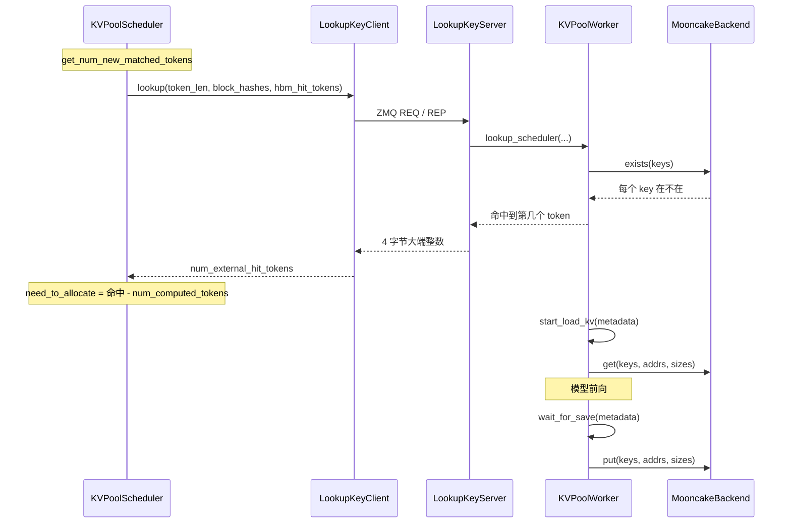
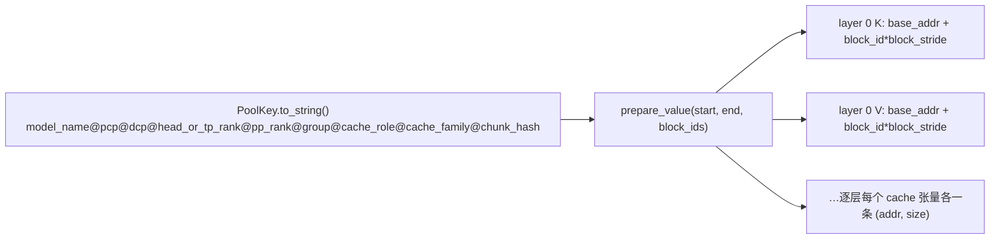

## 一句话

KV Pool 是一层挂在 vLLM KV Connector 接口上的外部 KV 存储：命中的前缀不再只能来自本卡 HBM，而可以来自 DRAM、SSD、别的节点。在 vllm-ascend 里它的实现叫 `AscendStoreConnector`，背后可换三种存储引擎（`mooncake` / `memcache` / `yuanrong`）[C14]。两个对照版本（v0.23.0 与 main）的配置项、key 格式、调用链都一致，只有 layerwise 模式下 Decode 节点写不写池这一条行为不同 [!]。

## 为什么需要它

[prefix caching](prefix-caching.md) 能省掉重复前缀的 prefill，但省多少完全取决于命中率，而命中率被两件事卡住：**片上内存装不下多少前缀**，以及**一个节点算出来的前缀，别的节点看不见**。上游文档把这两点说得很直接——命中率「受限于只用片上内存做 KV 存储」，所以要做一个池，把片上内存、DRAM、SSD 都用上，并让请求的前缀**对所有节点可见** [S3]。

于是问题变成：多出来的那一层存储，怎么接进 vLLM 的调度循环？vLLM V1 给的接口是 KV Connector——调度器侧回答「外部还有多少 token 能拿」，worker 侧负责真的把数据搬进搬出。上游本可以把 MooncakeStore 挂在 LMCache 的 remote backend 后面用，但他们选择直接写一个连接器，理由是这样才能用上贴合昇腾硬件的传输策略 [S3]。落到代码里最明显的一处就是：搬运的源和目的都是 KV cache 张量的**原始 HBM 地址**，没有 LMCache 那种中转 LocalBuffer [C17][C21]。

这一页只讲池本身。块怎么切、命中怎么判，在 [paged-attention](paged-attention.md) 与 [prefix-caching](prefix-caching.md) 那两页；把 KV 挪到本机 DRAM 的做法见 [kv-cache-cpu-offload](kv-cache-cpu-offload.md)。

## 怎么工作

一个 `AscendStoreConnector` 实例在两种角色下长得不一样：`KVConnectorRole.SCHEDULER` 下只造 `KVPoolScheduler`，其余角色造 `KVPoolWorker`，并且**只有 `rank == 0` 且非 layerwise 的 worker** 会额外起一个 `LookupKeyServer` [C7]。这就决定了查表必须跨进程：调度器进程里没有存储客户端，它通过 `LookupKeyClient` 用 ZMQ 去问 worker 里那个 REP 后台线程 [C10]。



几个容易看漏的点：

- **查表的入参带着 HBM 已命中数**。`get_num_new_matched_tokens` 把 vLLM 自己算出的 `num_computed_tokens` 当作 `hbm_hit_tokens` 一起发过去，返回值再减掉它才是真要搬的量 [C11]。官方文档把这条叫「只取多出来的块，其余直接用片上的」[S4]——这就是 KV Pool 和 prefix caching 的接缝。
- **默认只有 Prefill 节点碰池**。`kv_role == "kv_consumer"` 且没开 `consumer_is_to_load` 时，`get_num_new_matched_tokens` 第一行就返回 0 [C11]；写回侧同理由 `consumer_is_to_put` 控制 [C8]。PD 分离部署里 Decode 的 KV 由 `MooncakeConnectorV1` 点对点送来，池只服务 Prefill [S4]。
- **put 是后台线程做的，但不是不等**。`wait_for_save` 录一个 `torch.npu.Event` 后把请求塞进发送线程队列，随即 `request_queue.join()` 等队列排空 [C20]；发送线程在真正 `put` 之前会 `current_event.synchronize()`，确保前向已经把 KV 写进 HBM [C21]。
- **get 默认是同步的**。`load_async` 不开时，`start_load_kv` 里直接调 `m_store.get(...)`，这一步的耗时算在前向路径上 [C19]。

后端接口很窄，只有四个必选动作：`register_buffer`（把 HBM 区间登记给存储引擎）、`exists`（查）、`put`、`get`；put/get 收的是裸地址列表和长度列表，不是张量 [C15]。选哪个后端由 `backend` 决定，默认 `mooncake`，名字不在 `backend_map` 里会直接抛 `ValueError` 而不是悄悄回退 [C12][C14]。

一条 key 对应什么，是理解传输量的关键：



也就是说，非 layerwise 模式下**层不是 key 的一部分**：一条 key 一次覆盖该 kv cache group 在本 rank 上的全部层 [C24]。key 串里带了模型名和 pcp/dcp/tp/pp 各维度的 rank [C22]，两个版本逐字相同 [C23]——换并行切分或换模型名，池里的旧数据就全部对不上了。

**版本差异**：v0.23.0 的 `save_kv_layer` 只看 `kv_role`，是 `kv_consumer` 就直接 return，`consumer_is_to_put` 在 layerwise 路径上不起作用 [C9]；main 上这个判断改成了 `kv_role == "kv_consumer" and not self.consumer_is_to_put` [C8][!]。非 layerwise 的 `wait_for_save` 两版都认 `consumer_is_to_put`，所以差异只出现在同时开了 `use_layerwise` 和 `consumer_is_to_put` 的 Decode 节点上。此外 main 把 `config_data.py` 改名为 `metadata.py`、`backend/backend.py` 改名为 `backend/base.py`，key 格式与接口签名不变——数据兼容，import 路径不兼容。

## 拿真实数字走一遍

用 Qwen3-0.6B（28 层，n_kv = 8，d_h = 128，bf16 每元素 2 B），TP = 1，按 block_size = 128 算一条 key 要搬多少字节。

每块每张量的字节数就是 `cache[0].numel() * element_size` [C16]，源码注释给出了展开形式 `block_size * num_kv_head_per_local_rank * head_dim * elem_size` [C18]：

- 一层的 K：128 × 8 × 128 × 2 B = 262 144 B = **256 KiB**
- 昇腾侧 K 和 V 注册成两个张量，所以一层一块 = 256 KiB × 2 = **512 KiB**，这正是 `page_size_bytes = sum(block_len)` [C18][D]
- `prepare_value` 对该 group 的**每个** cache 张量都生成一条 (addr, size) [C24]，一条 key 覆盖 28 层：512 KiB × 28 = **14 MiB**
- 换算到单 token：14 MiB ÷ 128 = **112 KiB/token**（= 28 层 × 4 KiB）[D]
- 一条 32 768 token 的 prompt 全量落池：32768 ÷ 128 = 256 条 key，256 × 14 MiB = **3.5 GiB**

拿这个数去读部署文档给的 `mooncake.json` 就很清楚了：示例里 `global_segment_size` 是 `"1GB"`，那是**每张卡**贡献给池的内存 [S1]，TP = 8 全开也只有 8 GiB，装得下两条多这样的长请求。这个示例值是拿来跑通流程的，上生产必须按「并发 × 前缀长度 × 112 KiB/token」重新估。

`[D]` 的两处说明一下推广的依据：`_as_cache_tuple` 只做「是张量就包成一元组，否则原样转 tuple」[C16]，一层注册成几个张量取决于 attention 后端交上来的结构。上面按 2 个（K、V 分开）算，对 MLA 这类把 KV 合并成一个张量的布局不成立——`pool_worker` 里也确实有 `use_mla` 分支。所以 112 KiB/token 是 GQA 布局下的数，不是通用公式。

一份能直接用的 PD 混部配置（来自官方部署脚本 [S1]）：

```bash
export PYTHONHASHSEED=0                                   # 所有节点必须一致
export MOONCAKE_CONFIG_PATH="/path/to/mooncake.json"

KV_CONFIG='{
  "kv_connector": "AscendStoreConnector",
  "kv_role": "kv_both",
  "kv_connector_extra_config": {
     "backend": "mooncake",
     "lookup_rpc_port": "0"
  }
}'
```

`kv_role: kv_both` 表示这个实例既读也写池（混部场景没有 P/D 之分）；`lookup_rpc_port: "0"` 是本节点上第一个实例，第二个实例改成 `"1"`。

## 事实表

下表只有「layerwise 下 Decode 是否写池」一行两版不同，其余各行两版一致，故只写一个值列。

| 项 | 值 | 意味着什么 |
| :--- | :--- | :--- |
| 连接器注册名 | `AscendStoreConnector`；旧名 `MooncakeConnectorStoreV1` 仍指向同一个类，但会打告警 [C5][C6] | 老配置不用立刻改，新配置别再写旧名 |
| `backend` | `mooncake`（默认）/ `memcache` / `yuanrong` [C12][C14] | 名字写错是启动即 `ValueError`，不会静默退回默认后端 |
| `lookup_rpc_port` | 拼进 `ipc://$VLLM_RPC_BASE_PATH/lookup_rpc_port_<n>_dp_rank<r>` [C13] | 它不占 TCP 端口，只要同机各实例不重名即可 |
| `load_async` | 默认 `false` [S1] | 默认 get 同步做，池的读延迟直接计入前向耗时 |
| `consumer_is_to_load` / `consumer_is_to_put` | 默认都 `false` [S1][C11] | 默认 Decode 节点对池只读不写、连读也不读——池只服务 Prefill |
| layerwise 下 Decode 是否写池 | v0.23.0：只看 `kv_role`，永不写 [C9]；main：看 `consumer_is_to_put` [C8] | 同一份配置两版行为不同，`[!]` 升级前必须重测 |
| `use_layerwise` | 默认 `false`，且只在 `memcache` 后端上走 GVA 路径 [S1][C12] | 配 `mooncake` + `use_layerwise` 不会报错，但走不到逐层路径 |
| 一条池 key 的覆盖范围 | 一个 chunk × 该 group 全部层 × 本 rank 的头 [C24] | 层不是 key 的一部分，整块所有层一次 put/get |
| key 串组成 | `model_name@pcp@dcp@head_or_tp_rank@pp_rank@group@cache_role@cache_family@chunk_hash` [C22][C23] | 改并行切分或改模型名，池里旧数据全部失效 |
| 环境依赖 | CANN ≥ 8.5.0、mooncake ≥ 0.3.11.post1，多租户需 mooncake ≥ 0.3.12 [S1][S2] | 版本不够时故障点在存储侧，日志里不一定指向 vllm-ascend |

## 常见误解

- **「`lookup_rpc_port` 是个 TCP 端口，要挑没被占用的。」** 不是。它只是拼进 IPC 套接字路径 `ipc://$VLLM_RPC_BASE_PATH/lookup_rpc_port_<n>_dp_rank<r>` 的一段字符串 [C13]。文档说「每个实例需要唯一配置」是对的，但唯一性的作用域是同机的这个路径，跟端口占用无关。
- **「开了 KV Pool，prefix caching 就被替代了。」** 反过来，它建立在 prefix caching 之上：命中先在 HBM 里算，池只补上多出来的那一段，其余块仍从片上直接取 [S4][C11]。关掉 prefix caching，池也就没有可衔接的命中前缀了。
- **「池里查到了就一定能用上。」** `get` 返回非 0 的块会被记进 `_invalid_block_ids` [C19]，而 vLLM 侧默认的 `kv_load_failure_policy` 是 `fail`——请求直接报错终止；要让它退回重算必须显式配 `recompute`，且混合注意力模型还不支持 [S1]。
