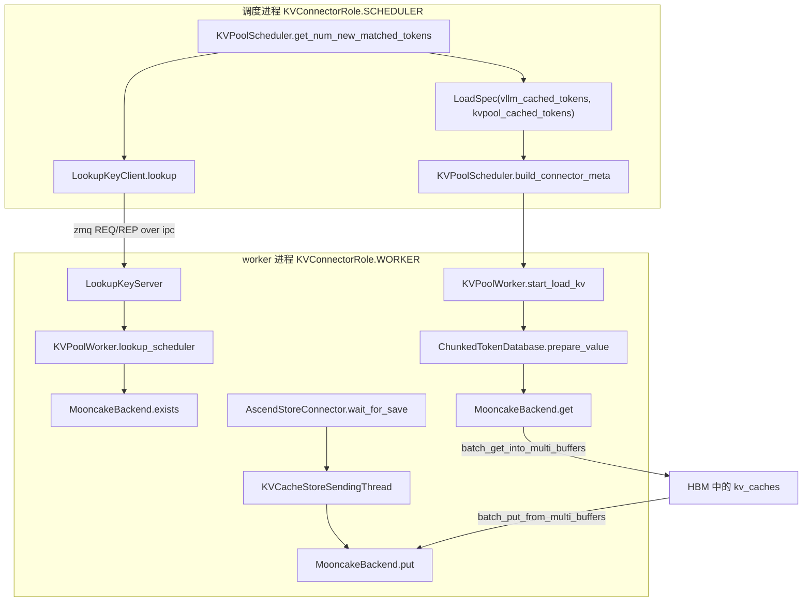

## 一句话

KV Pool 把算好的 KV 块按「块哈希 + rank 命名空间」写进一个进程外的共享存储（Mooncake、Memcache 或 Yuanrong），下一个请求命中同样的前缀时，把这些块直接搬回 HBM 而不是重算。它以 `AscendStoreConnector` 的形式接进 vLLM 的 KV Connector V1 接口。

## 为什么需要它

[prefix caching](prefix-caching.md) 的收益完全取决于命中率，而只用片上内存存 KV 时命中率被容量卡死：HBM 里装不下的旧前缀会被淘汰，同一段系统提示词换个请求、换台机器就得从头算一遍 [S1]。

KV Pool 的做法是把 DRAM、SSD 这些更便宜的层级也拉进来做 KV 的存储池，并且让前缀对所有节点可见——一个节点算过的前缀，另一个节点能直接取。官方设计文档（本地 `docs/source/developer_guide/Design_Documents/KV_Cache_Pool_Guide.md#L3-L15`，线上 <https://docs.vllm.ai/projects/ascend/en/latest/developer_guide/Design_Documents/KV_Cache_Pool_Guide.html>）把它定位成 prefix caching 的第二层，而不是替代品。

上游生态里也可以把 MooncakeStore 当作 LMCache 的远端后端来用；vllm-ascend 选择自己写一个直连的 connector，理由是这样才能用上最贴合 NPU 的传输路径——代码上表现为池的读写直接落在启动时注册过的 HBM 地址上，不经过中转缓冲 [C18]。

## 怎么工作

一个连接器实例按角色分裂成两半：调度进程里是 `KVPoolScheduler`，worker 进程里是 `KVPoolWorker`；非 layerwise 模式下还会在 `rank == 0` 的 worker 上起一个 `LookupKeyServer` 线程。查询必须绕这一圈，是因为只有 worker 进程握着后端 store 的连接。



**查（scheduler 侧）**：`get_num_new_matched_tokens` 拿到 vLLM 已经在 HBM 里命中的 `num_computed_tokens`，把请求的块哈希列表通过 zmq 发给 `LookupKeyServer`，worker 侧对每个块的 key 调 `exists`，返回命中的 token 数。命中只认连续前缀——第一个查不到的块就停，后面的块不再查 [S4]。两边相减得到真正要搬的量：`need_to_allocate = kvpool_cached_tokens − num_computed_tokens` [C13]。这就是官方文档说的「只取增量块，其余的仍从片上内存取」[S2]。

**搬（worker 侧）**：`start_load_kv` 按 `LoadSpec` 里的 `vllm_cached_tokens` 算出 `mask_num`，跳过 HBM 里已有的整块，只为剩下的块拼三个等长列表——key、addr、size，然后一次 `m_store.get`。一个 key 对应的 value 不是一段连续内存，而是**多段 HBM 地址**：`prepare_value` 为该块在每个 KV 张量里的位置各算一段 `base_addr + block_id * block_stride` [C21]，Mooncake 后端把它们交给 `batch_get_into_multi_buffers`。这些地址之所以能被后端直接写，是因为 `register_kv_caches` 阶段已经用 `register_buffer` 把整片 KV 张量区间注册给了后端。

**存**：`wait_for_save` 把要保存的请求丢给后台的 `KVCacheStoreSendingThread`，线程先 `torch.npu.Event.synchronize()` 确认本步 KV 已落到 HBM，再 `put`。

**角色门禁**：`kv_role` 为 `kv_consumer` 时，默认既不查也不存——`consumer_is_to_load` 和 `consumer_is_to_put` 都默认 false，前者让 `get_num_new_matched_tokens` 直接返回 0 [C13]，后者让 `wait_for_save` 整段 return。这对应官方文档里 PD 分离下「池只服务 Prefill 节点，Decode 的 KV 走 P2P connector」的默认分工 [S3]。

## 拿真实数字走一遍

模型 Qwen3-0.6B：28 层，n_kv = 8，d_h = 128，bf16（2 B）；TP = 1，`--block-size 128`（官方示例即用此值），prefix caching 开着。

**一个池对象有多大。** 每层 K 张量形状为 `[num_blocks, 128, 8, 128]`，按 `block_len = cache[0].numel() * element_size` 算 [C17]：

```
cache[0].numel() = 128 × 8 × 128 = 131072
block_len        = 131072 × 2 B  = 262144 B = 256 KiB
```

K/V 是两个独立张量时，28 层共 56 个 KV 张量，于是一个块的 value 由 56 段地址拼成，合计 56 × 256 KiB = **14 MiB**；折合每 token 14 MiB ÷ 128 = **112 KiB** [D]。（这一步把 `_as_cache_tuple` 的通用逻辑套到了 GQA 的 K/V 分离布局上；MLA 模型每层只有一个张量，段数和总量都要重算。）

**一次请求搬多少。** 4096 token 的 prompt = 32 个块。假设 HBM 前缀命中 1024 token（8 块），池里命中到 3072 token（24 块）：

```
need_to_allocate = 3072 − 1024 = 2048 token = 16 块
mask_num         = 1024 // 128 × 128 = 1024                  [C19]
→ 拼出 16 个 key、16 × 56 = 896 段地址
→ 一次 m_store.get 搬 16 × 14 MiB = 224 MiB
```

**key 长什么样。** TP=1、无 PCP/DCP/PP 时，第 9 个块的 key 是 [C20]：

```
Qwen3-0.6B@pcp0@dcp0@head_or_tp_rank:0@pp_rank:0@group:0@cache_role:kv@cache_family:default@<chunk_hash>
```

model_name 取自 `--model` 路径的最后一段，rank 字段全都进了 key——所以两个实例要共享前缀，模型名、并行切分方式都必须一致。

**配置。** PD 混布（单实例既产又消）的最小配置 [S7]（完整部署步骤见本地 `docs/source/user_guide/feature_guide/kv_pool.md`，线上 <https://docs.vllm.ai/projects/ascend/en/latest/user_guide/feature_guide/kv_pool.html>）：

```shell
export PYTHONHASHSEED=0                      # 全节点必须一致，否则块哈希对不上
export MOONCAKE_CONFIG_PATH=/path/mooncake.json

KV_CONFIG='{
  "kv_connector": "AscendStoreConnector",
  "kv_role": "kv_both",
  "kv_connector_extra_config": {
     "backend": "mooncake",
     "lookup_rpc_port": "0"
     }
}'
```

`kv_role: kv_both` 表示这个实例既存又取；`lookup_rpc_port` 每个实例必须唯一 [S8]，因为它拼成的是 `ipc://$VLLM_RPC_BASE_PATH/lookup_rpc_port_<port>_dp_rank<dp>` 这个本机路径。`mooncake.json` 里 `protocol` 在 NPU 上必须是 `ascend`，每卡贡献的 `global_segment_size` 要按 1 GB 对齐 [S6]。

## 事实表

| 项 | 值 |
| --- | --- |
| 连接器注册名 | `AscendStoreConnector`；`MooncakeConnectorStoreV1` 是旧名，指向同一个类并打 warning |
| `backend` | `mooncake` / `memcache` / `yuanrong`，默认 `mooncake`，非法值抛 `ValueError` |
| `lookup_rpc_port` | 每实例唯一；实际拼成 `ipc://$VLLM_RPC_BASE_PATH/lookup_rpc_port_<port>_dp_rank<dp>` |
| `load_async` | 默认 `false`；为 true 且非 layerwise 时 `get_num_new_matched_tokens` 返回异步标志 |
| `consumer_is_to_load` | 默认 `false`；false 时 `kv_consumer` 不查池 |
| `consumer_is_to_put` | 默认 `false`；false 时 `kv_consumer` 不存池 |
| `use_layerwise` | 默认 `false`；仅 Prefill 节点，且要求 `memcache` 后端 |
| `kv_load_failure_policy` | 顶层字段，vLLM 默认 `fail`；`recompute` 回退重算，混合注意力模型暂不支持 |
| 用 MultiConnector 时该字段位置 | 配在 MultiConnector 顶层，不配在子 connector 上 |
| `PYTHONHASHSEED` | 必须全节点一致（示例取 0） |
| Mooncake `protocol` | NPU 上必须 `ascend`，否则 `MooncakeBackend.__init__` 抛 `NotImplementedError` |
| Mooncake `global_segment_size` | 每卡注册给池的内存量，需 1 GB 对齐；`MOONCAKE_GLOBAL_SEGMENT_SIZE` 优先 |
| Mooncake 版本 | ≥ 0.3.11.post1；非 `default` 租户需 ≥ 0.3.12 |
| lookup 服务所在位置 | 仅 `rank == 0` 且 `use_layerwise == False` 的 worker 起 `LookupKeyServer` |
| key 格式 | `<model>@pcp<i>@dcp<i>@head_or_tp_rank:<i>@pp_rank:<i>@group:<i>@cache_role:kv@cache_family:<f>@<chunk_hash>` |
| 一段 value 的地址数 | 等于该组 KV 张量数（每张量一段 `base_addr + block_id * block_stride`） |
| 一块一层一张量的字节数 | `cache[0].numel() * element_size * block_size_scale` |
| lookup 命中规则 | 连续前缀，遇首个未命中块即停 |
| put 失败行为 | 该块之后的块不再 put |
| Mooncake 存储介质 | 文档记为仅 DRAM；SSD offload 另由 `enable_ssd_offload` 提供 |

## 常见误解

- **「开了 KV Pool 就不需要 HBM 前缀缓存了」**——反了。池只补 HBM 命中之外的增量：命中的那部分块仍然直接从片上内存取，只有多出来的块才从池里搬，为的是把传输量压到最小。
- **「配上 `AscendStoreConnector`，Decode 节点也会读写池」**——默认不会。`kv_consumer` 角色下 `consumer_is_to_load` / `consumer_is_to_put` 都默认 false，查和存两条路都被门禁挡住，PD 分离下 Decode 的 KV 默认来自 P2P connector。
- **「从池里取失败会自动退回重算」**——要显式配。`kv_load_failure_policy` 在 vLLM 里默认是 `fail`（请求直接报错终止），改成 `recompute` 才会回退到最后一个有效前缀重算 [S5]；而文档记录的另一种情况更隐蔽：lookup 说存在、get 却失败时只打日志继续跑，该请求的精度可能受影响 [S4]。
- **「`lookup_rpc_port` 是个 TCP 端口，随便填不冲突就行」**——它拼出来的是 ipc 路径，同一台机器上多个实例填同一个值会撞在同一个 socket 文件上 [C15]。
