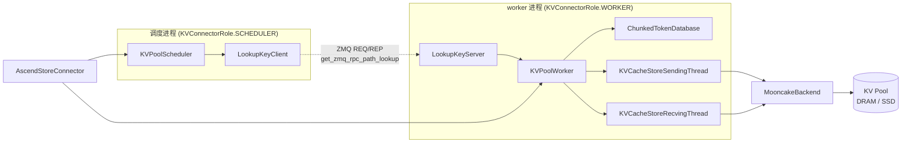
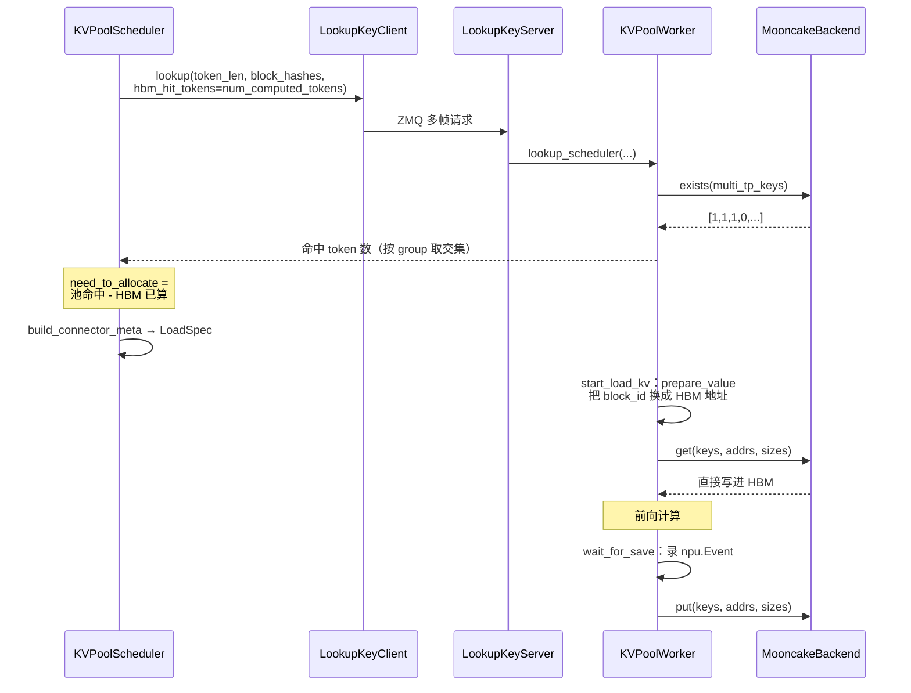

## 一句话

KV Pool 把算好的 KV cache 从 HBM 复制一份到集群共享的存储池（DRAM，可选 SSD），下次任何实例遇到相同前缀时直接把块读回 HBM，省掉重新 prefill。在 vllm-ascend 里它的实现是一个 KV Connector V1 实现类 `AscendStoreConnector`，底下可挂 mooncake、memcache、yuanrong 三种存储后端 [C]。

## 为什么需要它

Prefix caching 能省掉重复前缀的 prefill，但它的收益完全取决于命中率，而只用片上内存存 KV 时命中率会被两件事卡死 [S]：

1. **容量**：HBM 里留给 KV 的那点空间，一被新请求挤走，前缀就没了。一个 64 GiB 的 KV 区按每 token 112 KiB（Qwen3-0.6B，见下文算式）算也只装得下约 60 万 token；换成 32B 级别的模型只会更少。
2. **可见性**：实例 A 上刚算过的系统提示词，实例 B 看不见，只能自己再算一遍。多副本部署下，每多一个副本就多一份重复的 prefill。

官方设计文档给出的解法就是把 KV 存储做成一个跨片上内存、DRAM、SSD 的池，让请求的前缀对所有节点可见，从而抬高整体命中率 [S]（[KV_Cache_Pool_Guide.md#L5-L13](../raw/kv-pool.md)，线上 <https://docs.vllm.ai/projects/ascend/en/latest/developer_guide/Design_Documents/KV_Cache_Pool_Guide.html>）。

**为什么不直接用 LMCache 挂 MooncakeStore？** 上游那条路是可行的，但社区选择自己写连接器，理由是可以用最贴合昇腾硬件的数据传输策略，比如去掉 LMCache 里的 `LocalBuffer` 中转、省掉一次多余的拷贝 [S]。这一点在代码里能验证：`MooncakeBackend.put` 直接把注册过的 HBM 地址列表交给 `batch_put_from_multi_buffers`，没有 host 侧中转 buffer [C]。

**它和 PD 分离是什么关系？** 两件不同的事。PD 分离（`MooncakeConnectorV1`）解决的是 P 节点算完的 KV 怎么点对点送到 D 节点；KV Pool 解决的是「这段前缀以前有人算过吗」。所以官方部署脚本用 `MultiConnector` 把两者串起来同时用：前者做 kv_transfer，后者做跨节点 prefix cache [S]。默认只有 P 节点读写池，D 节点的 KV 仍走 P2P 直传，这样既拿到少算的收益，又不牺牲 P→D 的传输效率 [S]。

## 怎么工作

一个 `AscendStoreConnector` 类按 `role` 分裂成两半：调度进程里是 `KVPoolScheduler`，worker 进程里是 `KVPoolWorker` [C]。麻烦在于**只有 worker 进程连着存储后端**（它要注册 HBM 地址），而**决定「命中多少 token」的是调度进程**。于是多了一对 `LookupKeyClient` / `LookupKeyServer`，用 ZMQ IPC 把查询请求从调度侧转到 worker rank 0 [C]。



`LookupKeyServer` 只在 `use_layerwise=false` 且 `parallel_config.rank == 0` 时创建 [C]；layerwise 模式下调度侧自己直连后端做 `batch_is_exist`，不走这条 RPC。

一次请求的完整时序：



三个关键点：

**一、和 prefix caching 是相减关系，不是并列关系。** `get_num_new_matched_tokens` 把 HBM 已命中的 `num_computed_tokens` 作为 `hbm_hit_tokens` 一起发给池，拿回池命中总数后做减法，只把**多出来的**那段交给 vLLM 去分配和加载 [C]。文档的说法是「只从池里取额外的块，其余的块直接从片上内存拿，把传输延迟压到最小」[S]。还有一条边界：如果池把整条 prompt 都命中了，会强行减 1（`num_external_hit_tokens -= 1`），因为 vLLM 至少得算一个 token 才有 logits [C]。

**二、搬运是零拷贝的。** `register_kv_caches` 在启动时把 HBM 上所有 KV 张量的地址区间调 `register_buffer` 注册给后端 [C]；之后 `prepare_value` 只是把「第几个 block」翻译成 `base_addr + block_id * block_stride`，后端拿着这串裸地址直接 RDMA 读写 HBM [C]。所以这条路径上不存在「先拷到 host 再发走」的中间态。

**三、put 是异步的，所以块不能立刻还。** `wait_for_save` 录一个 `torch.npu.Event` 确保算子写完，把请求塞进 `KVCacheStoreSendingThread` 就返回 [C]。请求结束时 `request_finished` 返回 `delay_free_blocks=True`，让调度器延迟释放这些块，等 `get_finished` 报告发送完成再回收 [C]。

## 拿真实数字走一遍

以 Qwen3-0.6B（28 层，n_kv=8，d_h=128，bf16）、TP=1、`block_size=128`、mooncake 后端为例。

**一个块在池里占多少字节。** `block_len = cache[0].numel() * element_size`，K 张量每块的元素数是 `block_size × n_kv × d_h` [C]：

```
每层 K 单块 = 128 × 8 × 128 × 2 B = 262144 B = 256 KiB
每层 V 单块 = 256 KiB
每层合计   = 512 KiB
28 层      = 512 KiB × 28 = 14336 KiB = 14 MiB
```

`prepare_value` 对该 group 里**每一个** K/V 张量各产出一段 `(addr, size)`，也就是 28 层 × 2 = **56 段** [C]。换算成每 token：`2 × 8 × 128 × 2 B = 4 KiB` 每层，28 层共 **112 KiB/token** [D]（这一步是把 `block_len` 公式除以 `block_size` 推广成通用式；源码里 `per_token_bytes` 只在 `tp_mismatch` 分支下算过，注释写明 `block_len[0] = block_size * num_kv_head_per_local_rank * head_dim * elem_size`，我据此推广到一般情形）。

**一次 4096 token 的 prompt 全命中，要搬多少。**

```
块数     = 4096 / 128 = 32 块
key 数   = head_or_tp_ranks × 块数 = (tp_size / put_step) × 32 = 1 × 32 = 32 个 key
搬运量   = 32 × 14 MiB = 448 MiB
(addr,size) 段数 = 32 × 56 = 1792 段，一次 batch_get_into_multi_buffers 打包发出
```

TP=8 时 `num_kv_head=8 ≥ tp_size=8`，所以 `put_step=1`、`head_or_tp_ranks=8`，同一个块会拆成 8 个 key，每 rank 存自己那 1 个 kv head（每 key 1.75 MiB），合起来仍是 14 MiB [C]。MLA 模型相反：`num_kv_head=1 < tp_size`，`put_step = tp_size`，8 个 rank 共享 1 个 key [C]。

**池子能装多久的量。** mooncake.json 的 `global_segment_size` 是每卡向池贡献的内存，要按 1 GB 对齐 [S]。8 卡每卡 40 GiB：

```
池容量 = 8 × 40 GiB = 320 GiB
可存块 = 320 × 1024 MiB / 14 MiB ≈ 23405 块
      ≈ 23405 × 128 ≈ 3.0M token
```

对比 HBM 里 60 万 token 的量级，池把可见前缀扩了约 5 倍，且这 3.0M token 对集群里所有实例可见 [D]。

**最小可用配置**（PD 混合部署，照搬官方脚本的 `KV_CONFIG` [S]）：

```bash
export PYTHONHASHSEED=0                              # 必须全节点一致，否则 hash 对不上、永不命中
export MOONCAKE_CONFIG_PATH="/path/to/mooncake.json" # 指向 mooncake 的连接配置

--kv-transfer-config '{
  "kv_connector": "AscendStoreConnector",
  "kv_role": "kv_both",
  "kv_connector_extra_config": {
     "backend": "mooncake",
     "lookup_rpc_port": "0"
  }
}'
```

每个值的来由：`kv_connector` 用新名（旧名 `MooncakeConnectorStoreV1` 指向同一个类，但启动时会打 deprecation 警告）[C]；`kv_role` 混部用 `kv_both`，PD 分离时 P 写 `kv_producer`、D 写 `kv_consumer`；`backend` 不写就是 `mooncake` [C]；`lookup_rpc_port` 同机每个实例必须唯一 [S]——它其实不是 TCP 端口，而是拼进 `ipc://{VLLM_RPC_BASE_PATH}/lookup_rpc_port_{rpc_port}_dp_rank{dp_rank}` 的一段标识，撞了就是两个实例抢同一个 socket 文件 [C]。

## 事实表

| 项 | 值 | 来源 |
|---|---|---|
| Connector 注册名 | `AscendStoreConnector`；旧名 `MooncakeConnectorStoreV1` 指向同一个类 | `vllm_ascend/distributed/kv_transfer/__init__.py#L39-L49` |
| 存储后端取值 | `mooncake` / `memcache` / `yuanrong` | `.../ascend_store/backend/__init__.py#L17-L30` |
| `backend` 默认值 | `mooncake` | `.../ascend_store/pool_scheduler.py#L161-L172` |
| `load_async` 默认值 | `False` | `.../pool_scheduler.py#L90-L102` |
| `consumer_is_to_load` 默认值 | `False` | `.../pool_scheduler.py#L90-L102` |
| `consumer_is_to_put` 默认值 | `False` | `.../pool_scheduler.py#L90-L102` |
| `use_layerwise` 默认值 | `False`；仅 Prefill 节点，且要求 `backend=memcache` | `.../pool_scheduler.py#L161-L172`；`docs/source/user_guide/feature_guide/kv_pool.md#L24-L43` |
| `use_layerwise=true` 的图模式约束 | 必须 PIECEWISE cudagraph | `.../ascend_store_connector.py#L77-L83` |
| `kv_load_failure_policy` | `kv-transfer-config` 顶层字段，`fail`（默认）/ `recompute`；用 `MultiConnector` 时配在顶层而非子 connector | `docs/source/user_guide/feature_guide/kv_pool.md#L13-L22` |
| `lookup_rpc_port` | 拼成 `ipc://{VLLM_RPC_BASE_PATH}/lookup_rpc_port_{port}_dp_rank{dp}`，每实例唯一 | `.../pool_scheduler.py#L1034-L1049` |
| `PYTHONHASHSEED` | 必须全节点一致，建议 `0` | `docs/source/user_guide/feature_guide/kv_pool.md#L24-L43` |
| 池对象 key 格式 | `{model}@pcp{i}@dcp{j}@head_or_tp_rank:{h}@pp_rank:{p}@group:{g}@cache_role:{r}@cache_family:{f}@{chunk_hash}` | `.../ascend_store/metadata.py#L115-L125` |
| 每块 key 数 | `head_or_tp_ranks = tp_size // put_step`；`put_step = tp_size // num_kv_head`（当 `num_kv_head < tp_size`），否则 `1` | `.../pool_scheduler.py#L178-L188` |
| 单块字节数 | `cache[0].numel() × element_size × block_size_scale` | `.../pool_worker.py#L635-L644` |
| 单 key 的搬运段数 | 该 group 内 K/V 张量个数（= 层数 × 2） | `.../ascend_store/metadata.py#L437-L465` |
| 每段大小 | `block_len / block_size × (end - start)` | `.../ascend_store/metadata.py#L437-L465` |
| HBM 地址注册时机 | `register_kv_caches` 末尾调 `register_buffer(ptrs, lengths)`，随后起搬运线程 | `.../pool_worker.py#L790-L819` |
| 后端 put/get 调用 | `batch_put_from_multi_buffers` / `batch_get_into_multi_buffers` | `.../backend/mooncake_backend.py#L194-L212` |
| 延迟释放条件 | 非 `use_layerwise`、非只读 consumer、`num_saved_tokens > 0` 且有块 | `.../pool_scheduler.py#L935-L951` |
| 全命中时的处理 | 池命中等于 `request.num_tokens` 时减 1 | `.../pool_scheduler.py#L456-L512` |
| 命中截断规则 | 遇到第一个缺块即停，不再往后查 | `docs/source/developer_guide/Design_Documents/KV_Cache_Pool_Guide.md#L84-L91` |
| PD 分离默认读写方 | 只有 Prefill 节点读写池；D 节点回写需 `consumer_is_to_put: true` 且限 MLA 模型 | `docs/.../KV_Cache_Pool_Guide.md#L38-L52`；`docs/.../kv_pool.md#L299-L314` |

## 常见误解

- **「开了 KV Pool 就不用 prefix caching 了。」** 反了。池是 prefix caching 的第二层，命中数要减去 HBM 已命中的部分才是它的实际贡献；`get_num_new_matched_tokens` 里那个 `hbm_hit_tokens` 参数就是干这个的 [C]。关掉 prefix caching 只会让第一层失效、所有块都从池里搬。
- **「`lookup_rpc_port` 是个 TCP 端口，随便挑个没人用的就行。」** 它只是 IPC 文件路径里的一段数字，跟系统端口占用无关；但同机多实例填一样的值会让两个实例 bind 同一个 socket 文件 [C]。
- **「设计文档说只支持 DRAM，那 SSD 就是没有的。」** 设计文档那条限制已经过期——用户指南里 mooncake 的 `enable_ssd_offload` 和 memcache 的 `ock.mmc.local_service.storage.enabled` 都是现成的 SSD 通路 [S]。同一份设计文档里还写着「get 失败只打日志、继续跑」，而现在已经有 `kv_load_failure_policy` 可以选 `recompute` 回退重算 [S]。读这份 Design Document 时要当它是设计意图而非当前行为。
- **「`kv_load_failure_policy` 配在 AscendStoreConnector 里就行。」** 用 `MultiConnector` 时必须配在顶层 `kv-transfer-config`，配进子 connector 不生效 [S]。

## 接着看

- [Prefix Caching](prefix-caching.md) —— 池是它的第二层，先搞清第一层怎么算命中，再看池怎么做减法。
- [Block Table](block-table.md) —— 池里的一个 key 对应 HBM 里的一个 block，`prepare_value` 做的就是 block_id → 地址的翻译。
- [KV Cache CPU Offload](kv-cache-cpu-offload.md) —— 同样是把 KV 挪出 HBM，但只在本实例内、不跨节点共享，适合对比取舍。
- [KV Cache Layerwise Offload](kv-cache-layerwise-offload.md) —— `use_layerwise` 那条分支的展开，逐层搬运能和前向计算重叠。
- [Recompute CPU Offload](recompute-cpu-offload.md) —— `kv_load_failure_policy: recompute` 背后的重算思路，加载失败时的兜底。
