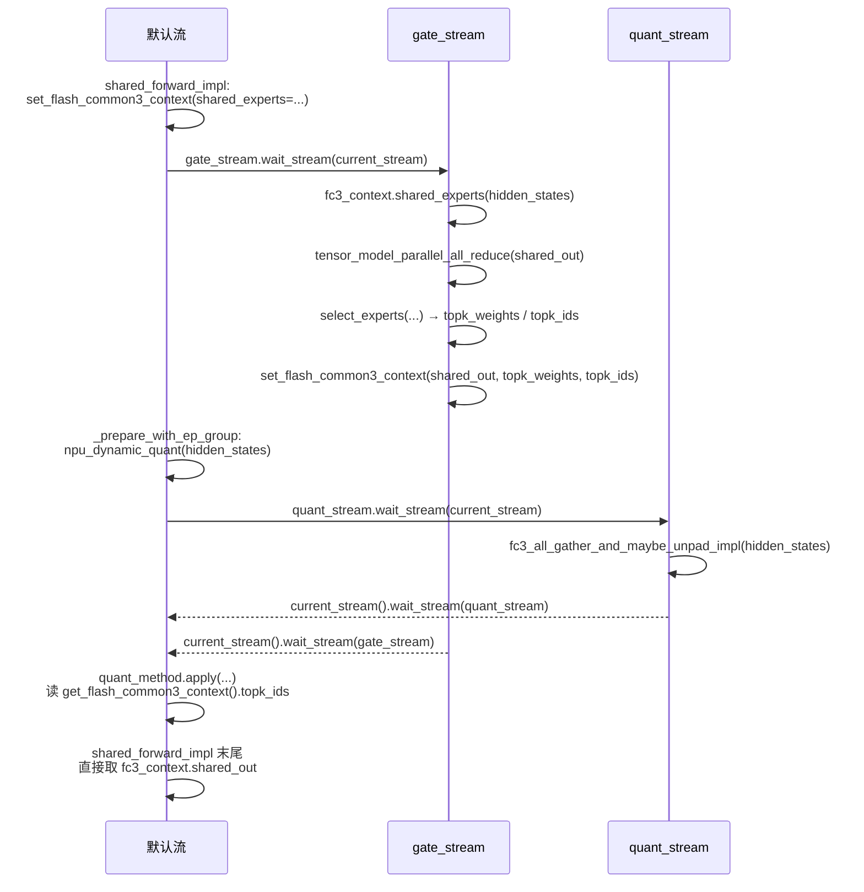

## 一句话

`multistream_overlap_gate` 是 v0.23.0 上的一个 bool 开关（默认 `False`），把 MoE 层里的**共享专家前向**和 **`select_experts` 路由**整体搬到一条副流（`gate_stream`）上执行，让它们与主线里的「动态量化 + all-gather 隐藏态」并行跑；上游给它的正式名字是 **FlashComm3 multistream-overlap gate** [S17]。**main（`28bf3a2e`）上这个开关连同整套 FlashComm3 实现已经被删除**，而且 `AscendConfig` 的 `extra="forbid"` 会把残留的这个键当未知选项拒绝，所以升级前必须从启动命令里删掉 [C19] [!]。

## 事实表

| 项 | v0.23.0 (`2c59ff10`) | main (`28bf3a2e`) | 意味着什么 |
|---|---|---|---|
| 配置键与默认值 | `additional_config.multistream_overlap_gate`，bool，`False` [C1] | 不存在，未知键报错 [C19] | 升级 main 前必须从启动命令删掉，否则起不来 [!] |
| 上游状态 | 发版时即列入 Ready to Deprecate [S17] | 已移除 [S18] | 不要往新部署里投入，v0.23.0 上也只当短期手段 |
| 搬到副流的计算 | 共享专家前向（含 TP all-reduce）+ `select_experts` [C4] | 不存在 | 省的是这两段，**不是**路由专家的 GEMM |
| 与之并行的主线 | `_prepare_with_ep_group` 的动态量化 + all-gather [C10] | 不存在 | 重叠窗口只有 `prepare()` 这一段，见「开了的代价」 |
| 新建 NPU stream | 2 条：`gate_stream` + `quant_stream` [C3] [C9] | 不存在 | 每条流有独立内存池，显存会多占一块 [I] |
| 新建 HCCL 通信组 | 1 个，`group_name="fc3_quant_x"` [C11] | 不存在 | 多一份通信域资源，启动时多一次建组 |
| 能接住它的量化方法 | 只有 `w8a8_dynamic` 与 `w8a8_mxfp8` [C13] | 不存在 | 未量化（BF16）MoE 上没有接收端 [D] |
| 有无共享专家时的降级 | 无：`self.multistream_overlap_gate` 直接取开关值，只有 `shared_multistream_overlap_gate` 与 `has_shared_experts` 做与 [C3] | 不存在 | 官方描述里的「只对带共享专家的 MoE 生效」不是静默降级 [!] |
| 硬互斥 | MoE LoRA v1 同开时抛 `AssertionError` [C14] | 不存在 | 二选一，没有自动降级 |
| 硬失效 | 310P 路径无条件置 `False` [C15] | 不存在 | Atlas 300I Duo / 200I Pro 上设了也白设 |

## 为什么存在

MoE 层在做专家计算之前有一段串行的「准备期」：先把隐藏态 dynamic-quant 成 int8/fp8，再沿 EP 组 all-gather 成全局张量 [C10]。这段时间里 NPU 的计算单元基本闲着——它在等通信。而同一层里还有两件互不依赖的活可以现在就干：**共享专家的 FFN**（输入就是未 all-gather 的本地隐藏态）和 **`select_experts` 路由**（输入是 `router_logits`）。FlashComm3 做的就是把这两件活挪到另一条流上，塞进那段等待里。

它的名字里有 "FlashComm3"，是因为它只在 FlashComm1 / 序列并行开着时的那条路径上才有意义：`PrepareAndFinalizeWithAllGather.prepare` 只有在 `enable_sp()` 为真时才走 `_prepare_with_ep_group`，也就是把 TP AG + DP AG 合成一次 EP All-Gather 的那条路 [C10]。

跨流传结果靠一个模块级全局单例 `FlashCommon3Context`，字段是 `topk_weights` / `topk_ids` / `shared_experts` / `shared_out` [C8]。

图里的 join 点是硬约束：`quant_stream` 在 `_prepare_with_ep_group` 内部就 join 回来 [C10]，`gate_stream` 在调用 `quant_method.apply` 之前 join [C5]。所以真正的重叠窗口只有 `prepare()` 这一段，收益上限是 `min(共享专家前向 + 路由, 动态量化 + all-gather)`，而不是两段时间之和 [D]。

副流上的 all-gather 走的是专门新建的 `fc3_quant_x` 通信组（rank 划分与 `mc2` 组共用同一份 `group_ranks`）[C11]，调用 `fc3_all_gather_and_maybe_unpad_impl` 而不是主线用的 `torch.ops.vllm.maybe_all_gather_and_maybe_unpad` [C12]。另起一个组和一个纯 Python 实现，看起来是为了避开自定义算子在非默认流上的行为问题 [I]。

消费端在量化方法里：`apply()` 发现开关开着就跳过自己的 `select_experts`，改从 context 取 `topk_weights` / `topk_ids` [C13]。**只有 `w8a8_dynamic` 和 `w8a8_mxfp8` 两个量化方法有这段**——未量化的 MoE 方法不读 context，而开关打开时 `_prepare_with_ep_group` 又不再 all-gather `router_logits` [C10]，两边对不上，所以这个开关实质上绑定在 W8A8 / MXFP8 量化 MoE 上 [D]。

v0.23.0 里 `AscendMoERunner`（新）和 `AscendFusedMoE`（legacy）两套实现都带同一份门控逻辑，各持一条类级 `gate_stream` [C16]；开启时会打一条 `Multistream overlap gate is enabled.` 的 info 日志，可以用它确认是否真的生效 [C16]。

**至于省多少**：v0.23.0 仓库里没有给出任何针对这个开关的收益数字或 e2e 基准，官方参数表也只有一句功能描述 [S2]（线上：<https://docs.vllm.ai/projects/ascend/en/v0.23.0/user_guide/configuration/additional_config.html>）。按上面的窗口分析，它的收益完全取决于 `prepare()` 里那次 EP all-gather 有多长——EP 规模大、每步 token 少的 decode 场景窗口最宽，序列长时量化+通信被计算淹没，收益趋近于零 [D]。

## 开了的代价

**1. 没有共享专家的 MoE 上，它不是「不生效」，是起不来。** 官方描述写的是 "This option only takes effect on MoE models with shared experts" [S2]，容易读成「没有共享专家时自动忽略」。源码不是这样：`self.multistream_overlap_gate` 直接等于开关值，只有另一个字段 `shared_multistream_overlap_gate` 才与 `has_shared_experts` 做了与 [C3]。而往 context 里写 `shared_experts` 的唯一一处在 `shared_forward_impl` 里，条件正是 `shared_multistream_overlap_gate` [C6]；没有共享专家的模型走 `_forward_impl` 的另一分支，直接进 `no_shared_forward_impl`，从不经过那一处 [C7]。于是 `no_shared_forward_impl` 里的 `assert fc3_context is not None` 会在第一次前向时命中 [C4] [D]。**只在带共享专家的 MoE（DeepSeek 系、GLM-5 系、Qwen3 MoE 的共享专家变体）上开它。**

**2. 必须是 W8A8-dynamic 或 MXFP8 量化的 MoE。** 理由见上一节 [C13] [C10] [D]。

**3. 必须开着 FlashComm1 / 序列并行。** 副流那半边的逻辑只写在 `_prepare_with_ep_group` 里，而 `prepare()` 只有 `enable_sp() or enable_sp_by_pass()` 为真时才走这条分支 [C10]；否则 `gate_stream` 这半边照样跑，`quant_stream` 那半边不跑，重叠就没了 [D]。

**4. 与 MoE LoRA v1 硬互斥。** 同开会抛 `AssertionError`，理由写在断言消息里：开关会让 `quant_method.apply` 在多条流上交错，LoRA 路径没有在这种重叠下验证过 [C14]。

**5. 310P 上无条件失效。** `_310p` 的 MoE 路径把 `multistream_overlap_gate`、`shared_multistream_overlap_gate`、`multistream_overlap_shared_expert` 三个字段一起置 `False` [C15]，用户配了不会报错也不会生效。

**6. 额外资源：2 条 NPU stream + 1 个 HCCL 通信组。** 流是类级单例，不随层数增长 [C3] [C9]，通信组在 `init_ascend_config` 之后建组时创建 [C11]。多流各自持有内存池，显存开销会有可观察的增加 [I]。

**7. 它和 `multistream_overlap_shared_expert` 是两个开关，共享专家只会被其中一个接管。** 后者把共享专家挪到 `shared_experts_calculation_stream()`；前者把共享专家挪到 `gate_stream` 并顺带把路由也带走，取结果时直接读 `fc3_context.shared_out`，完全不走 `_forward_shared_experts` [C6]。两个开关都开时共享专家由 gate 路径接管，`multistream_overlap_shared_expert` 那条分支变成死代码 [D]。注意 `multistream_overlap_shared_expert` 在 main 上仍然保留 [S18]——被删的只是 gate 这一个。

**8. 去向：main 上已整体删除。** v0.23.0 的 release notes 就把 "The FlashComm3 multistream-overlap gate" 列进了 Ready to Deprecate [S17]（线上：<https://docs.vllm.ai/projects/ascend/en/latest/user_guide/release_notes.html>）；到 `28bf3a2e`，参数表里这一行没有了 [S18]（线上：<https://docs.vllm.ai/projects/ascend/en/latest/user_guide/configuration/additional_config.html>），`flash_common3_context.py`、`fc3_quant_x` 通信组、`fc3_all_gather_and_maybe_unpad_impl` 也一并不在。因为 `AscendConfig` 是 pydantic 模型且 `model_config = ConfigDict(extra="forbid")` [C19]，留在 `--additional-config` 里的这个键不会被静默忽略，而是直接让进程启动失败——迁移时这是第一个要删的东西 [!]。

## 版本谱系

<!-- 由 pnpm wiki:lineage 生成，勿手改 -->

| 版本 | 是否存在 |
| --- | --- |
| releases/v0.13.0 | 有（5 个文件） |
| releases/v0.18.0 | 有（5 个文件） |
| releases/v0.20.2rc | 有（5 个文件） |
| releases/v0.21.0rc | 有（6 个文件） |
| releases/v0.22.1rc | 有（6 个文件） |
| releases/v0.23.0 | 有（9 个文件） |
| releases/v0.24.0rc | 无 |
| releases/v0.25.1rc | 无 |
| releases/v0.26.0rc | 无 |
| releases/v0.27.1rc | 无 |
| main | 无 |

**移除**：2026-07-15，PR [#11956](https://github.com/vllm-project/vllm-ascend/pull/11956) —— [Refactor] Remove multistream overlap gate (#11956)

影响面（删除行数最多的几个文件）：

- `vllm_ascend/ops/fused_moe/fused_moe_0_23_0.py` −76
- `vllm_ascend/ops/fused_moe/fused_moe.py` −75
- `vllm_ascend/flash_common3_context.py` −41
- `vllm_ascend/distributed/utils.py` −34
- `vllm_ascend/quantization/methods/w8a8_dynamic.py` −29

**引入**：2025-12-14，PR [#4065](https://github.com/vllm-project/vllm-ascend/pull/4065) —— [Perf]enable prefill flashcommon3 (#4065)
