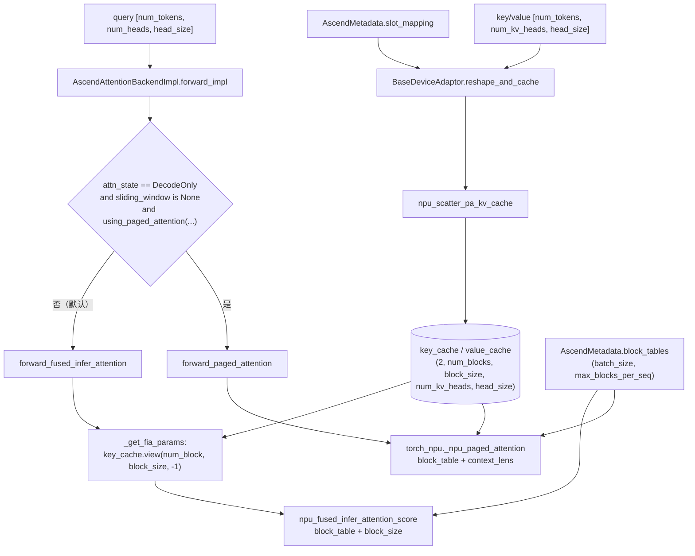

## 一句话

PagedAttention 把每一层的 KV Cache 切成定长的块（昇腾上固定 128 token 一块）散放在显存里，序列不再需要一段连续显存；attention 算子改成拿着一张「逻辑块序号 → 物理块号」的块表按块寻址取 K/V。昇腾后端把这套布局落在 `(2, num_blocks, block_size, num_kv_heads, head_size)` 这个形状上 [C2]，读的时候有两个算子可选：默认的 `npu_fused_infer_attention_score`（FIA）和名字里带 PA 的 `_npu_paged_attention`。

## 为什么需要它

没有分页时，一个序列的 KV Cache 必须按 `max_model_len` 预留一整段连续显存。请求实际只生成几百 token，预留的几万 token 空间就白占着——原始论文把这种浪费概括为「碎片与冗余复制会显著浪费这块显存，从而限制批大小」，并提出借用操作系统虚拟内存与分页的思路来做 KV Cache 管理 [S18]。分页之后，显存按块分配、用多少给多少，块与块之间无需相邻，还顺带让不同请求共享相同前缀的块成为可能（那是 [prefix caching](prefix-caching.md) 的事）。

代价是 attention 算子不能再假设「一个序列的 K/V 在显存里是连着的」。它必须多收一个入参——块表——并在算子内部做一次地址翻译。所以 PagedAttention 与其说是一个优化，不如说是一份**算子与显存管理之间的契约**：显存管理器负责按块分配并维护 [block table](block-table.md)，算子负责按块读。昇腾侧要做的事，就是把这份契约在 CANN 的算子上重新实现一遍——它不是复用上游任何一个现成后端，而是以 `CUSTOM` 名义整套自己注册进 vLLM 的后端表。

## 怎么工作

一层 attention 的 KV Cache 是一个五维张量 `(2, num_blocks, block_size, num_kv_heads, head_size)`，第 0 维的 2 是 K 和 V 各一份。所有序列的所有块都住在这一个张量里，谁占哪一块由块表记录。

**写**（每步 prefill/decode 都做）：新算出的 K/V 是逐 token 的 `[num_tokens, num_kv_heads, head_size]`，按 `slot_mapping` 散写进块化缓存。`slot_mapping` 是**展平后的全局槽号**——源码注释举的例子是 block_size=16 时槽号 35 对应「第 2 块的第 3 个槽」，即 `slot = block_id * block_size + offset` [C4]。落地算子是 `npu_scatter_pa_kv_cache`。

**读**：`forward_impl` 在两条路径之间分派。



两条路径消费块表的方式不一样，这是昇腾侧最容易踩的细节：

- `_npu_paged_attention` 直接吃四维的 `key_cache` / `value_cache`，**没有 `block_size` 入参**，块大小由 `key_cache.shape[1]` 隐含给出；每序列的 KV 长度用 `context_lens=attn_metadata.seq_lens` 传 [C7]。
- FIA 要求先把缓存 `view(num_block, block_size, -1)` 压成三维，再同时传 `block_table` 和显式的 `block_size`，KV 长度走 `actual_seq_lengths_kv` [C6]。

`using_paged_attention` 这道门把 PA 算子挡在默认路径之外：开了投机解码返回 `False`，设备是 A5 返回 `False`，`cudagraph_mode` 不是 `FULL_DECODE_ONLY` 返回 `False`，最后还要求当前 batch 的 token 数出现在 `pa_shape_list` 里 [C10]。`pa_shape_list` 默认是空列表 [S14]，`cudagraph_mode` 默认是 `FULL_AND_PIECEWISE` [S16]——两道默认值各自都足以让 PA 关着。唯一的例外是 head_size 命中 Gemma4 那个 512 维分支时强制返回 `True`。

走 ACLGraph 全图捕获时，块表还要额外处理一次：捕获期记下的块表在重放时被丢弃，每一步用当步真实的 `block_table` 与 `seq_lens` 重新下发算子 [C11]——否则重放会一直读捕获那一刻的物理块。

## 拿真实数字走一遍

Qwen3-0.6B：`num_kv_heads = 8`，`head_size = 128`，28 层，bf16（2 字节），`block_size = 128` [C3]，设 `max_model_len = 32768`。

**一块有多大**

- 每 token 每层（K 和 V 各一份）：`2 × 8 × 128 × 2 B = 4096 B = 4 KiB`
- 每块每层：`4 KiB × 128 = 512 KiB`
- 每块跨 28 层：`512 KiB × 28 = 14 MiB` [D]

**张量长什么样**

设 profiling 给 KV Cache 留了 40 GiB，则 `num_blocks = 40 × 1024 ÷ 14 ≈ 2925` [D]，每层张量形状是 `(2, 2925, 128, 8, 128)`，占 `2925 × 512 KiB = 1.43 GiB`，28 层合计约 40 GiB，总容纳 `2925 × 128 = 374400` 个 token。

**块表有几列**

`max_num_blocks_per_req = cdiv(32768, 128) = 256` [C5]，所以块表是 `(batch_size, 256)`。

**一次 decode 怎么寻址**

某请求已有 1000 个 token，正在生成第 1001 个（0-based 位置 1000）：

- 它占用 `cdiv(1000, 128) = 8` 个逻辑块，最后一块只填了 `1000 − 7 × 128 = 104` 个槽
- 新 token 落在逻辑块 `1000 // 128 = 7`，块内偏移 `1000 % 128 = 104`
- 查块表得物理块号，设 `block_tables[r][7] = 1911`，则 `slot_mapping = 1911 × 128 + 104 = 244712`
- 读的时候算子拿 `block_tables[r][0:8]` 这 8 个物理块号去取 K/V，靠 `context_lens = 1000` 把最后一块多出来的 24 个槽截掉；这 24 个槽是这个序列当前的全部浪费，跨 28 层是 `24 × 4 KiB × 28 = 2.6 MiB` [D]
- 这一步该请求读入的 KV：每层 `1000 × 4 KiB = 3.91 MiB`，28 层合计 **109 MiB** [D]

**把 PA 算子真的打开**

三个条件缺一不可，`pa_shape_list` 里填的是要走 PA 的 batch token 数：

```bash
vllm serve Qwen/Qwen3-0.6B \
  --max-model-len 32768 \
  --compilation-config '{"cudagraph_mode": "FULL_DECODE_ONLY"}' \
  --additional-config '{"pa_shape_list": [8, 16, 32]}'
```

`--compilation-config` 的写法取自官方 graph mode 文档的示例 [S17]；`8 / 16 / 32` 要与实际捕获的 decode batch 规模对齐，对不上就一步也走不到 PA。此外这台机器不能是 A5、不能开投机解码。

## 事实表

| 项 | 值 |
| --- | --- |
| 每层 KV Cache 形状 | `(2, num_blocks, block_size, num_kv_heads, head_size)` |
| 支持的 block_size | `[128]`（只此一个） |
| block_size 默认值 | `128`；开 prefix caching 或 chunked prefill 时强制改回 `128` |
| block_size 例外 | `deepseek_v4` 用 `32`（允许 32/64/128）；hybrid 模型走模型专属逻辑 |
| `block_tables` 形状 | `(batch_size, max_blocks_per_seq)` |
| 块表列数 | `cdiv(max_model_len, 128)` |
| `slot_mapping` 形状 / 语义 | `(num_tokens,)`；`slot = block_id * block_size + offset` |
| 写入算子 | `torch_npu.npu_scatter_pa_kv_cache(cache_mode="Norm")` |
| 默认读取算子 | `npu_fused_infer_attention_score`，`input_layout="TND"` |
| FIA 读缓存的视图 | `key_cache.view(num_block, block_size, -1)` |
| PA 算子入参 | `query, key_cache, value_cache, num_kv_heads, num_heads, scale_value, block_table, context_lens, out` |
| PA 算子生效条件 | `attn_state == DecodeOnly` 且 `sliding_window is None` 且 `using_paged_attention()` |
| `using_paged_attention` 四道门 | 无 speculative_config、非 A5、`cudagraph_mode == FULL_DECODE_ONLY`、`num_tokens ∈ pa_shape_list` |
| `pa_shape_list` 默认值 | `[]`（list） |
| `cudagraph_mode` 默认值 | `FULL_AND_PIECEWISE` |
| 后端注册名 | `AttentionBackendEnum.CUSTOM` / `"ASCEND"`，`get_name()` 返回 `"CUSTOM"` |
| v0.23.0 状态 | PA 算子与 `pa_shape_list` 被列入 Ready to Deprecate |

## 常见误解

- **「昇腾上的 decode 走的是 PagedAttention 算子」**——默认不走。默认路径是 `npu_fused_infer_attention_score`，`_npu_paged_attention` 要同时满足四道门槛才启用，而 `pa_shape_list` 默认为空 [C10]。官方 v0.23.0 release notes 已把 PA 算子与 `pa_shape_list` 列为计划废弃 [S15]。
- **「分页只是显存管理的事，算子不用改」**——恰恰相反，块表是算子的必需入参，两个读算子还各有各的吃法：PA 吃四维缓存不带 `block_size`，FIA 要先压成三维并显式传 `block_size`。
- **「block_size 可以调小以减少浪费」**——昇腾后端只声明支持 128，而且一旦开了 prefix caching 或 chunked prefill，启动时会把它改回 128 [C12]。想省那点尾块浪费是省不到的，尾块最多浪费 127 个 token 的空间。
- **「分页把浪费降到零」**——降到「不超过一个块」。论文说的是 near-zero waste [S18]，上面的算例里那 2.6 MiB 尾块浪费是分页方案固有的内部碎片。
