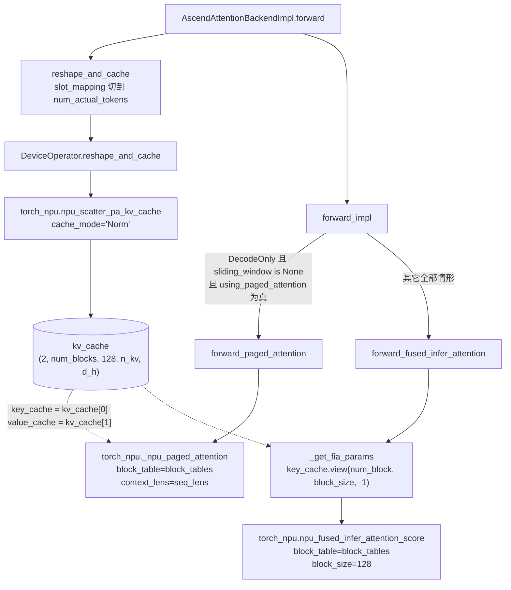

## 一句话

PagedAttention 把每层的 KV Cache 切成固定 128 个 token 的物理块，用一张 `block_table` 记录「某个请求的第 i 段上下文存在哪个物理块」，attention 算子拿着块号去分散的块里取 KV，而不要求一条序列的 KV 在显存里连续。昇腾后端 `AscendAttentionBackend` 把 KV Cache 声明成 `(2, num_blocks, block_size, num_kv_heads, head_size)`，且只支持 `block_size = 128`。

## 为什么需要它

没有分页，一条序列的 KV Cache 必须是一段连续显存，而 KV 的长度在请求开始时是不知道的——只能按 `max_model_len` 预留。一个 40960 上下文的请求，哪怕实际只生成了 300 个 token，也得占住 40960 个 token 的 KV 空间。剩下那 99% 既不能给别人用，也不能回收，显存就这么被空洞吃掉了。

分页把「逻辑上连续的序列」和「物理上连续的显存」解耦：显存被预先切成等大的块，谁需要就领一块，用完归还。序列长多少就占多少块，碎片被限制在最后一块的块内，块与块之间不再要求相邻。代价是算子不能再用一个基址加偏移去读 KV，必须先查表拿块号——这就是 `block_table` 存在的理由，也是「PagedAttention」这个名字里 paged 的含义。

昇腾侧的特别之处在于：**分页是地基，但按块读 KV 的算子有两个**。

- **FIA**（`npu_fused_infer_attention_score`）是默认算子，prefill、chunked prefill、decode 全都走它，block_table 作为一个入参传进去 [C]。
- **PA**（`torch_npu._npu_paged_attention`）是一个只做 decode 的专用算子，默认不启用。官方 FAQ 的说法是：FIA 在某些 batch size（尤其中等并发）下性能不理想，可以用 `pa_shape_list` 手动切到 PA，这是一个临时调优旋钮，将来 FIA 优化完就会废弃 [S]（[本地 faqs.md#L304-L306](https://docs.vllm.ai/projects/ascend/en/latest/faqs.html)）。

所以在昇腾后端里，「PagedAttention」这个词有两层意思：作为**内存布局**它永远开着；作为**算子**（`forward_paged_attention`）它默认关着。混淆这两层是读这段代码时最容易踩的坑。

另一个昇腾特有的约束是块大小被钉死在 128。后端的 `get_supported_kernel_block_sizes()` 直接返回 `[128]` [C]，`refresh_block_size` 在不指定时也填 128，并且一旦开了 prefix caching 或 chunked prefill 就强制改回 128 [C]。上游 CUDA 后端常用的 16 在这里不成立。

## 怎么工作

一次 forward 里，KV Cache 被读两次、写一次，全部以块为单位寻址：

- **写**：`reshape_and_cache` 拿本步新算出的 K/V 和 `slot_mapping`，调 `DeviceOperator.reshape_and_cache`，最终落到昇腾算子 `npu_scatter_pa_kv_cache`（`cache_mode="Norm"`）把每个 token 散写进它该去的槽位 [C]。`slot_mapping` 是**展平后的槽位号**，不是块号：块大小 128 时，slot 35 表示 0 号块的第 35 槽 [C]（字段注释里的例子用的是 block size 16）。
- **读**：`forward_impl` 分流。三个条件同时满足才走 PA 算子——`attn_state` 是 `DecodeOnly`、没有 sliding window、`using_paged_attention(num_tokens, ...)` 为真；否则一律走 FIA [C]。



两条读路径给算子的 KV 张量形状不一样，这是读代码时另一个容易看岔的地方：

- PA 路径把 `self.key_cache` / `self.value_cache` 原样传进去（四维，`(num_blocks, 128, n_kv, d_h)`），并把 `attn_metadata.block_tables` 和 `attn_metadata.seq_lens` 分别作为 `block_table` 和 `context_lens` 传参 [C]。
- FIA 路径在 `_get_fia_params` 里先把 KV 压成三维 `(num_block, block_size, n_kv * d_h)`，`block_size` 是从 `key_cache.shape[1]` 读出来的而不是写死的，`block_table` 取 `attn_metadata.block_tables` [C]。唯一不传 block_table 的分支是 `PrefillNoCache`——这一步没有历史 KV 可读，`block_table=None`，`block_size` 硬编码成 128 [C]。

### decode 时 block_table 怎么到算子手里

非图模式下很直白：`AscendAttentionMetadataBuilder.build` 把 `common_attn_metadata.block_table_tensor` 放进 `AscendMetadata.block_tables`，`forward_paged_attention` 直接把这个张量传给算子 [C]。

图模式（ACLGraph）下要绕一圈。捕获时 `full_graph_pa` 把当时的 `block_tables` 和 `seq_lens` 记进 `PagedAttentionGraphParam`；重放前 `update_paged_attention_graph_param` 把捕获的那两个张量丢掉（形参名就叫 `_captured_block_table` / `_captured_seq_lens`），改用本步 metadata 里的新值重新算 workspace 并重新下发 `_npu_paged_attention` 任务 [C]。换句话说，**block_table 每一步都会变，所以它不能被图固化**，必须走 graph task update 通道刷新。

### PA 算子什么时候才真的启用

`using_paged_attention` 的判定是一串早退 [C]：

1. 配了 `speculative_config` → 不用 PA；
2. 设备是 A5 → 不用 PA；
3. `head_size` 等于 `FIA_TND_LARGE_HEAD_FALLBACK_HEAD_SIZE` → 强制用 PA（这是 Gemma4 512 维全局注意力头的临时回退，代码注释写明是 TODO）；
4. `cudagraph_mode` 不是 `FULL_DECODE_ONLY` → 不用 PA；
5. 最后：本步 token 数是否落在 `pa_shape_list` 里。

`pa_shape_list` 默认是空列表 [S]（[additional_config.md#L61](https://docs.vllm.ai/projects/ascend/en/latest/user_guide/configuration/additional_config.html)），所以默认情况下第 5 条永远不成立——除了 Gemma4 那条强制回退，**开箱即用的路径是 FIA**。

## 拿真实数字走一遍

以 Qwen3-0.6B 为例：H = 1024，n_q = 16，n_kv = 8，d_h = 128，28 层，bf16（每元素 2 字节）。

**一、缓存形状。** `get_kv_cache_shape(num_blocks, 128, 8, 128)` 返回 `(2, num_blocks, 128, 8, 128)` [C]。首维的 2 是 K 和 V，`forward` 里被拆成 `kv_cache[0]`（key_cache）与 `kv_cache[1]`（value_cache）[C]。

**二、一块多大。** 单层单块字节数 = 2 × 128 × 8 × 128 × 2 B = 524,288 B = **512 KiB**；除以 128 个 token，**每 token 每层 4 KiB**；28 层合计 **每 token 112 KiB**，**整块 28 层 14 MiB** [D]。（这是按 `get_kv_cache_shape` 的五个维度直接相乘推出来的，只对 GQA/MHA 这条后端成立；MLA 的 `AscendMLABackend.get_kv_cache_shape` 返回的是四维 `(num_blocks, block_size, num_kv_heads, head_size)`，算法不同。）

**三、block_table 有多宽。** 取 `--max-model-len 40960`，则 `max_num_blocks_per_req = cdiv(40960, 128) = 320` 列 [C]。

**四、一个 decode batch。** 4 个请求，已有上下文 `seq_lens = [300, 130, 128, 1000]`：

| 请求 | seq_len | 占用块数 `cdiv(seq_len,128)` | 最后一块用掉的槽 |
|---|---|---|---|
| 0 | 300 | 3 | 300 − 256 = 44 / 128 |
| 1 | 130 | 2 | 2 / 128 |
| 2 | 128 | 1 | 128 / 128（正好填满） |
| 3 | 1000 | 8 | 1000 − 896 = 104 / 128 |

合计 14 块。`block_tables` 形状 `(4, 320)`，每行前若干列是真实块号、其余是填充；decode 的 `query` 形状是 `[4, 16, 128]`（每请求 1 个 token）[C]。

**五、块内碎片。** 浪费的槽位 = (384−300) + (256−130) + (128−128) + (1024−1000) = 84 + 126 + 0 + 24 = **234 槽**，按每槽 112 KiB 算是 **25.6 MiB** [D]。这就是 128 这个块大小的账：块越大，`block_table` 越窄、算子每次读的连续段越长，但块内碎片越多。

**六、FIA 路径看到的形状。** `_get_fia_params` 把 key_cache reshape 成 `(num_block, 128, 8 × 128)` 即 `(num_block, 128, 1024)`，`block_size` 从 `key_cache.shape[1]` 读出来正好是 128 [C]。

**七、要让 PA 算子真的跑起来**，四个条件都得凑齐（不开投机解码、非 A5、`FULL_DECODE_ONLY`、token 数命中）：

```bash
vllm serve Qwen/Qwen3-0.6B \
  --max-model-len 40960 \
  --block-size 128 \
  --compilation-config '{"cudagraph_mode": "FULL_DECODE_ONLY"}' \
  --additional-config '{"pa_shape_list": [4, 8, 16, 32, 48, 64]}'
```

- `--block-size 128`：写不写都一样，`refresh_block_size` 不指定时就填 128，且开 prefix caching / chunked prefill 会强制改回 128 [C]。写出来只是让配置自解释。
- `--compilation-config` 的写法照官方文档的 CLI 示例 [S]（[graph_mode.md#L76-L79](https://docs.vllm.ai/projects/ascend/en/latest/user_guide/feature_guide/graph_mode.html)），把模式换成 `FULL_DECODE_ONLY`——`using_paged_attention` 只认这一个模式 [C]。
- `pa_shape_list` 里的数按 `num_tokens = query.shape[0]` 命中 [C]；decode 每请求 1 token 时它等于 batch size [D]，官方 FAQ 也是按 "runtime batch size" 描述的 [S]。上面这组值取自仓库 e2e 配置的量级（`[48,64,72,80]`、`[4,8,16,32,48,64,96,128,160,192]`），实际该填哪些要按自己的并发压测出来 [I]。

## 事实表

| 项 | 值 | 来源 |
|---|---|---|
| KV Cache 声明形状 | `(2, num_blocks, block_size, num_kv_heads, head_size)` | `vllm_ascend/attention/attention_v1.py#L113-L121` |
| 支持的 block_size | `[128]`（`get_supported_kernel_block_sizes` 返回定值） | `vllm_ascend/attention/attention_v1.py#L151-L153` |
| block_size 缺省值 | 128；开 prefix caching / chunked prefill 时强制 128 | `vllm_ascend/utils.py#L1178-L1204` |
| block_size 例外 | `deepseek_v4` 缺省 32，允许 32/64/128；hybrid 模型走模型专属逻辑 | `vllm_ascend/utils.py#L1184-L1198` |
| `block_tables` 形状 | `(batch_size, max_blocks_per_seq)` | `vllm_ascend/attention/attention_v1.py#L200-L203` |
| `max_num_blocks_per_req` | `cdiv(max_model_len, 128)` | `vllm_ascend/attention/attention_v1.py#L251-L253` |
| `slot_mapping` 形状与语义 | `(num_tokens,)`，值为 `block_id * block_size + offset` | `vllm_ascend/attention/attention_v1.py#L205-L210` |
| query / key / value 形状 | `[num_tokens, num_heads, head_size]` / `[num_tokens, num_kv_heads, head_size]` | `vllm_ascend/attention/attention_v1.py#L1695-L1705` |
| 写缓存算子 | `torch_npu.npu_scatter_pa_kv_cache(cache_mode="Norm")` | `vllm_ascend/device/device_op.py#L43-L53` |
| decode PA 算子 | `torch_npu._npu_paged_attention(block_table=..., context_lens=...)` | `vllm_ascend/attention/attention_v1.py#L1569-L1579` |
| 默认读路径算子 | `torch_npu.npu_fused_infer_attention_score`（FIA，`input_layout="TND"`） | `vllm_ascend/attention/attention_v1.py#L1453-L1474` |
| FIA 路径的 KV 视图 | `key_cache.view(num_block, block_size, num_kv_heads * head_size)` | `vllm_ascend/attention/attention_v1.py#L1324-L1333` |
| `PrefillNoCache` 分支 | `block_table = None`，`block_size = 128`（硬编码） | `vllm_ascend/attention/attention_v1.py#L1307-L1312` |
| PA 启用条件 | 无 `speculative_config` + 非 A5 + `cudagraph_mode == FULL_DECODE_ONLY` + `num_tokens in pa_shape_list` | `vllm_ascend/attention/utils.py#L206-L222` |
| PA 强制启用例外 | `head_size == FIA_TND_LARGE_HEAD_FALLBACK_HEAD_SIZE` 时直接返回 True | `vllm_ascend/attention/utils.py#L214-L215` |
| `pa_shape_list` 默认值 | `[]`（list） | `docs/source/user_guide/configuration/additional_config.md#L61` |
| 图模式下 block_table 刷新 | 捕获值被丢弃，重放前用本步 metadata 重新下发 | `vllm_ascend/attention/utils.py#L94-L138` |
| 块搬运接口 | `swap_blocks` / `copy_blocks`，按块号索引赋值 | `vllm_ascend/attention/attention_v1.py#L123-L149` |
| 后端注册名 | `AttentionBackendEnum.CUSTOM` / `"ASCEND"`，`get_name()` 返回 `"CUSTOM"` | `vllm_ascend/attention/attention_v1.py#L77-L83` |

## 常见误解

- **「PagedAttention 就是 `_npu_paged_attention` 这个算子」**——不是。分页布局（block_table + slot_mapping）在所有路径上都生效，而 `forward_paged_attention` 默认不走：`pa_shape_list` 默认为空，`using_paged_attention` 的最后一条判定就过不去 [C]。
- **「block_size 可以像上游那样设成 16」**——设了也会被改掉。后端只声明支持 128，`refresh_block_size` 在开启 prefix caching 或 chunked prefill 时会把它强制拉回 128 [C]；`deepseek_v4` 是另一套（32/64/128）[C]。
- **「`slot_mapping` 里存的是块号」**——存的是展平槽位号。块号在 `block_tables` 里，`slot_mapping` 已经把「第几块 × 块大小 + 块内第几槽」算成了一个整数 [C]。
- **「decode 时 block_table 可以随图一起固化」**——不能，它每步都变。图模式专门有 `update_paged_attention_graph_param` 在重放前把新的 `block_table` 和 `seq_lens` 重新绑上去 [C]。

## 接着看

- [block-table](block-table.md) —— 这一页只说了 block_table 怎么传给算子，它是怎么被调度器填出来、怎么随着块的分配增长，在那边。
- [kv-cache-spec](kv-cache-spec.md) —— `get_kv_cache_shape` 只给出单层形状，`num_blocks` 从哪来、不同层怎么分组，由 KV cache spec 决定。
- [kv-cache-memory-profiling](kv-cache-memory-profiling.md) —— 上面算出「每 token 112 KiB」之后，下一个问题就是总共能开多少块。
- [prefix-caching](prefix-caching.md) —— 块能被多个请求共享，正是分页布局换来的能力；它也是把 block_size 钉死在 128 的原因之一。
- [kv-cache-quantization](kv-cache-quantization.md) —— 把块里每个元素从 bf16 换成 int8，上面那张账单直接减半。
