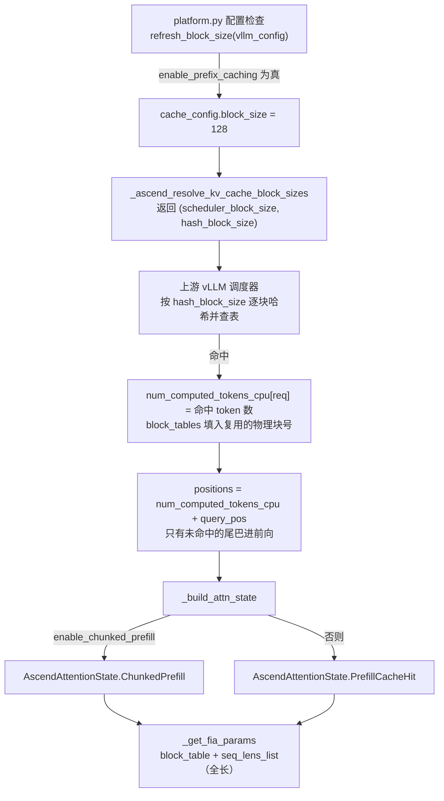

## 一句话

前缀缓存（Automatic Prefix Caching，APC）把算完的 KV 块按「这一块之前的全部 token 内容」哈希索引起来；下一条请求开头若与某条已缓存序列逐 token 相同，调度器把那些物理块的编号直接填进新请求的块表，模型只对不同的尾巴做前向。昇腾侧不实现缓存管理本身——匹配、引用计数、淘汰全在上游 vLLM；vllm-ascend 做的是三件适配：开 APC 时把 `block_size` 强制成 128、在上下文并行下重算哈希块大小、为命中后的批次单列一个 `AscendAttentionState.PrefillCacheHit` 走带块表的算子入参。

## 为什么需要它

多轮对话、few-shot 模板、长 system prompt、同一篇文档反复提问——这些场景里请求之间共享的开头往往占总长的九成以上。没有前缀缓存时，每来一条请求都要把这段共享开头重新过一遍：28 层的 QKV 投影、注意力、MLP 全部重算一次，算完的 KV 写进新分配的块，上一条请求算出的一模一样的 KV 在旁边被当作垃圾释放掉。TTFT 因此几乎与 prompt 全长成正比，而不是与「新增的那点内容」成正比。

前缀缓存的想法很朴素：既然 KV 只取决于「这个 token 和它前面所有 token」，那么两条请求只要开头字节级相同，这段开头的 KV 就必然逐位相同，可以直接共用同一份物理块。它是无损优化——昇腾 CI 的验收方式正是把开 APC 和关 APC 的输出做逐 token 相等断言，MHA（Qwen3-8B）与 MLA（DeepSeek-V2-Lite）各跑一遍 [C23]。

昇腾上这件事和 chunked prefill 是同一批打通的：官方 release note 记录，把 CANN 升到 8.1.RC1 才同时支持了 chunked prefill 与 `--enable_prefix_caching` [S22]。这个历史耦合留下了痕迹——`refresh_block_size` 里两者共用同一个 `if` 分支、把块大小一起强制成 128 [C1][C2]。但它们并不互斥，官方互斥矩阵里 APC 与 chunked prefill 那一格是 ✅ [S21]；只是同时开启时，`_build_attn_state` 会优先给出 `ChunkedPrefill` 而不是 `PrefillCacheHit` [C5][C6]。

块是复用的最小单位，也是哈希的最小单位——为什么是块而不是 token，见 [块表](block-table.md)；块内怎么排布、一块多少字节，见 [KV Cache Spec](kv-cache-spec.md)。

## 怎么工作



**配置阶段。** `platform.py` 在配置检查里调用 `refresh_block_size` [C3][C4]；只要 `enable_prefix_caching` 或 `enable_chunked_prefill` 为真，`block_size` 就被无条件改成 128，只打一条 info 日志 [C1][C2]。这与 `AscendAttentionBackend.get_supported_kernel_block_sizes()` 返回 `[128]` 是一致的 [C20]。

**哈希粒度。** vllm-ascend 打了 `_ascend_resolve_kv_cache_block_sizes` 覆盖上游同名函数，返回的是一个二元组 `(scheduler_block_size, hash_block_size)` ——「哈希以块为单位」这件事直接写在这个接口的形状里 [C12]。单 KV cache group 时两者相等；多 group 且开了上下文并行时，调度块取各 group 块大小的 lcm 再乘 CP 因子，而哈希块在开 APC 时取 gcd [C12][C13]。**这里两版不同** [!]：main 只把 `decode_context_parallel_size` 乘进去、只在 `dcp != 1` 时走这条分支 [C12]；v0.23.0 还额外乘 `prefill_context_parallel_size`，且 `pcp != 1` 单独就能触发 [C13]。

**命中后跳过什么。** 调度器把命中的 token 数写进 `num_computed_tokens_cpu`，模型运行器算 position 时以它为起点：`positions = num_computed_tokens_cpu[req_indices] + query_pos` [C7][C8]。命中的那段 token 根本不出现在这一步的输入张量里——省掉的是它们的 embedding、QKV 投影、注意力和 MLP，整整 28 层。**没省掉的是注意力对历史 KV 的读取**：`_build_attn_state` 判定出 `PrefillCacheHit` 后，`_get_fia_params` 把 `block_tables` 切片和 `seq_lens_list` 交给算子，而 `seq_lens_list` 是含已命中部分的完整序列长度 [C10][C11]。

**状态判定。** `_build_attn_state` 的第一条分支是 `num_computed_tokens_cpu` 全为 0 才算 `PrefillNoCache`；只要有任何一条请求命中了前缀，这条分支就不成立，批次最终落到 `ChunkedPrefill`（开了 chunked prefill）或 `PrefillCacheHit`（没开）[C5][C6]。两条路在 `_get_fia_params` 里都走带 `block_table` 的分页路径，区别只在 `block_table` 是否按 batch_size 切片 [C10]。这套判定在 v2 模型运行器的 `build_attn_state` 里逐条重复了一遍，两版一致。

## 拿真实数字走一遍

Qwen3-0.6B：28 层，`n_kv = 8`，`d_h = 128`，bf16。开 APC 后 `block_size = 128` [C1]。

两条请求共享一段 1700 token 的 system prompt + 文档，第二条请求总长 1712 token（1700 共享 + 12 token 的新问题）。

1. **能命中多少。** 哈希按 128 token 一块做，只有**写满的**块才有哈希。1700 ÷ 128 = 13 余 36，所以命中 13 块 = **1664 token**；尾部那 36 个 token 落在没写满的块里，拿不到哈希，不参与匹配。
2. **本轮要算多少。** `num_computed_tokens_cpu[0] = 1664`，本次调度 1712 − 1664 = **48 个 token** 进前向。
3. **position 从哪开始。** `positions = 1664 + [0, 1, …, 47]` = 1664…1711 [C7]。
4. **省下的前向量。** 1 − 48 / 1712 = **97.2%** 的 embedding / QKV 投影 / MLP 计算不再发生。
5. **没省下的读取量。** 注意力拿到的 `actual_seq_lengths_kv = seq_lens_list = [1712]` [C10]，块表给出 ⌈1712 / 128⌉ = **14** 个块号。每 token 每层的 K+V 字节数为 2 × 8 × 128 × 2 B = 4 KiB，28 层合计 112 KiB [D]；这一次前向要读的 KV 约 1712 × 112 KiB ≈ **187 MiB** [D]。一整块（128 token × 28 层）占 **14 MiB** [D]。

这一步的算式沿用通用 GQA 布局，MLA 模型（DeepSeek 系）的每 token 字节数按另一套公式算，见 [KV Cache Spec](kv-cache-spec.md)。

结论：前缀缓存砍的是**计算**，不是**显存带宽**。前缀越长、共享比例越高，收益越接近上限；而注意力的读带宽一分没少。

启动配置：

```python
from vllm import LLM

llm = LLM(
    model="Qwen/Qwen3-0.6B",
    enable_prefix_caching=True,   # 官方文档要求显式设置此项开启 APC [S24]
    max_model_len=2048,
    # 不要设 block_size：refresh_block_size 会在 APC 开启时把它改回 128 [C1]
)
```

## 事实表

| 项 | v0.23.0 | main | 意味着什么 |
|---|---|---|---|
| 开关 | `enable_prefix_caching` / `--enable-prefix-caching` | 同左 | 昇腾侧没有自己的开关，直接用上游 `CacheConfig` 字段 |
| 开启后的 `block_size` | 强制 128 | 同左 | 你在命令行给的 `--block-size 64` 会被静默改回 128，只留一条 info 日志 [C1][C2] |
| `hash_block_size`（多 group + CP） | `gcd(各 group block_size)` | 同左 | 混合模型开 CP 时哈希块比调度块小，匹配粒度更细 [C12][C13][C14] |
| `scheduler_block_size`（多 group + CP） | `lcm(...) × dcp × pcp` | `lcm(...) × dcp` | [!] v0.23.0 把 PCP 也乘进去，main 不乘；同一套 PCP 配置两版块大小不同 [C12][C13] |
| 命中后的 `attn_state` | 开 chunked prefill → `ChunkedPrefill`；否则 `PrefillCacheHit` | 同左 | 两条路都走带块表的分页算子，不会退回连续 KV 路径 [C5][C6] |
| `PrefillCacheHit` 的 KV 长度 | `seq_lens_list`（含已命中部分） | 同左 | 注意力仍读全长 KV，省的是投影和 MLP [C10][C11] |
| `AscendAttentionBackend` 支持的 kernel block size | `[128]` | 同左 | 想为省内存把块调小无从下手 [C20] |
| 310P model runner v2 | 该路径不存在 | 开 APC 直接 `NotImplementedError` | [!] main 新增的 310P MRV2 明确不支持 APC，用 310P 要留意选哪条 runner [C18] |
| `mamba_block_size`（混合模型 + `mamba_cache_mode="align"`） | 开 APC → `block_size`；否则 `max_model_len` | 同左 | 关掉 APC 会让 mamba 状态按 `max_model_len` 整条分配，显存占用差一个量级 [C19] |
| 与 chunked prefill | 官方矩阵 ✅ | 同左 | 不互斥，可同时开；同开时 attn_state 由 chunked prefill 优先决定 [S21][C5] |

## 常见误解

- **「命中了就不用读 KV 了。」** 不是。命中省掉的是把前缀 token 再过一遍 embedding / QKV 投影 / MLP；注意力算子拿到的 `actual_seq_lengths_kv` 仍是完整序列长度，命中的那部分 KV 一个字节不少地从 HBM 读进来 [C10][C11]。所以 APC 改善 TTFT 很明显，对 decode 阶段的吞吐几乎没有影响。
- **「`--block-size 64` 可以和前缀缓存一起用。」** 不能。`refresh_block_size` 在 APC 或 chunked prefill 打开时把 `block_size` 无条件改成 128，不报错也不警告，只有一条 info 级日志 [C1][C2]。以为自己在用 64 却实际在用 128，显存估算会全盘偏掉。
- **「`layer.py` 里那句 `cache_config.enable_prefix_caching = False` 说明昇腾会在某些模型上自动关掉 APC。」** 实际上不会触发。那条分支要求后端名等于 `TRITON_MLA` 或 `FLASHINFER` [C15][C16]，而这条路径上能取到的后端只有 `AscendDSABackend` 及其子类，`get_name()` 返回的是 `ASCEND_DSA` / `ASCEND_DSA_C4` / `ASCEND_DSA_C128` / `ASCEND_DSA_SWA` [C17]——它是从 CUDA 侧照搬过来的死分支 [D]。
