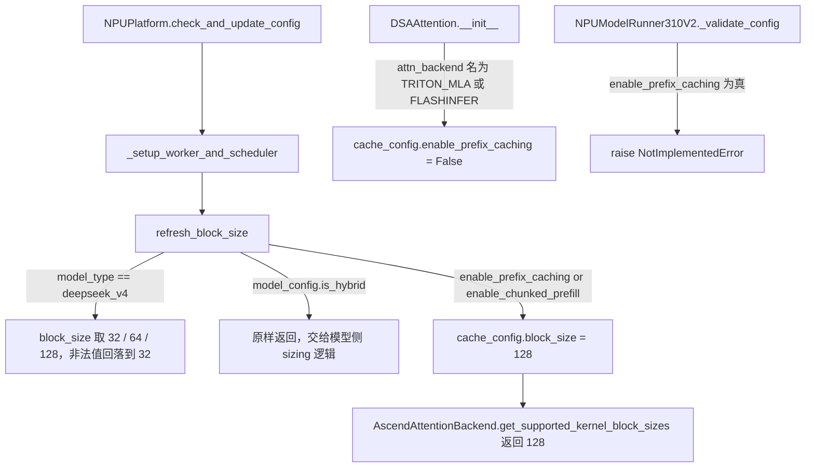
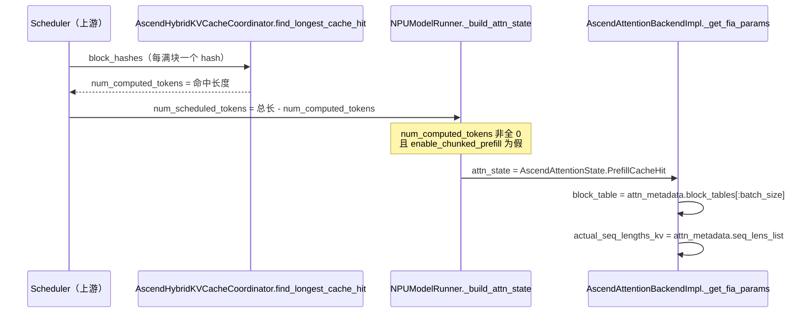

## 一句话

前缀缓存（Automatic Prefix Caching，APC）把已经算过的 KV 按 block 为单位哈希后留在显存里，下一个请求只要开头的 token 完全一样，就能直接认领这些 block、把 `num_computed_tokens` 推到命中长度，跳过这段 prefill 的全部计算。它在 vLLM V1 下默认开启，昇腾侧不需要额外开关 [S]。真正的哈希、匹配与引用计数都在上游 vLLM；vllm-ascend 做的是三件适配：把 `block_size` 锁到 128、为「命中后的 prefill」单独开一个注意力状态 `PrefillCacheHit`，以及在少数后端与硬件上把它关掉或直接拒绝启动 [C]。

## 为什么需要它

没有前缀缓存时，每个请求的 prefill 都从第 0 个 token 重算。在真实服务里这是纯浪费：多轮对话的每一轮都要把之前所有轮次重算一遍；同一个 system prompt 被几千个请求共用；few-shot 的示例块在每个请求里一字不差地重复。这些 token 的 K/V 上一秒刚算完就被扔了。

前缀缓存的做法是让这些 KV block 活下来。命中之后省掉的是 prefill 阶段的计算，**不是** decode 阶段的——上游官方文档把这一点说得很直白：APC "only reduces the time of processing the queries (the prefilling phase)" [S]（<https://docs.vllm.ai/en/latest/features/automatic_prefix_caching/>）。所以它的收益完全由命中率决定，官方模型教程的 FAQ 也承认：命中率低时它「may add memory pressure without visible gains」 [S]（`docs/source/tutorials/models/Qwen3.6-35B-A3B.md#L387`，线上 <https://docs.vllm.ai/projects/ascend/en/latest/tutorials/models/Qwen3.6-35B-A3B.html>）。

**为什么它必须以 block 为单位，而不是以 token 为单位。** KV cache 本身就是按 block 分配和寻址的（见 [PagedAttention](paged-attention.md)），复用的最小单位只能是分配的最小单位——你没法「只复用半个 block」，因为 block table 里一个槽位要么指向某个物理块要么不指向。上游据此设计成：每个满块算一个 hash，hash 的输入是「父块的 hash + 本块的 token ids + extra keys（LoRA ID、多模态输入 hash、cache salt）」，父块 hash 串成链保证了「同一个 hash 意味着从序列开头到这里的全部 token 都相同」，而不只是这 128 个 token 相同 [S]。同一份文档也明说 "We only cache full blocks."——不满一个 block 的尾巴不会被缓存 [S]（<https://docs.vllm.ai/en/latest/design/prefix_caching.html>）。

昇腾仓库里能直接看到这个设计的落点。`resolve_kv_cache_block_sizes` 的昇腾版本返回的是一个二元组 `(scheduler_block_size, hash_block_size)`，而且只有在 `enable_prefix_caching` 为真时这两个值才会分开——关掉前缀缓存时两者相等 [C]。KV cache coordinator 的构造函数里，注释直接给出了定义：「hash_block_size: the block size used to compute block hashes」，并断言每个 KV cache 组的有效 block size 必须能被它整除 [C]。也就是说，「以 block 为单位哈希」不是一个外部推测，而是这套代码里显式存在的一等概念。

**昇腾侧和上游的差别在哪。** 上游 CUDA 后端能接受多种 block size（16、32、64……），昇腾的 FlashAttention 后端 `get_supported_kernel_block_sizes` 只返回 `[128]` [C]。因此只要开了前缀缓存（或 chunked prefill），启动期就会把用户给的 `block_size` 强行改写成 128 并打一行 info 日志 [C]。这带来一个直接后果：前缀复用的最小粒度是 128 个 token，比 CUDA 上常见的 16 粗 8 倍，短前缀更容易一个块都凑不满。

历史上这两个特性在昇腾侧一直被当成一对处理——它们是在同一个 PR（#3967）里一起改成默认开启的 [S]（`docs/source/user_guide/release_notes.md#L1507`）。当前官方特性矩阵把 Automatic Prefix Caching 标为 🟢 Functional [S]。

## 怎么工作

分启动期和运行期两段看。启动期决定「块多大、哈希以多大为单位、这台机器上到底开不开」，运行期决定「这一批请求命中后走哪条 kernel 分支」。

### 启动期：block size 被锁到 128



`refresh_block_size` 在 `check_and_update_config` 的第 8 步被调用，是启动期一次性的改写，运行期不会再变 [C]。图右侧两条是「被关掉」的路径：`DSAAttention`（DeepSeek-V4 稀疏注意力层）在构造时若发现后端是 `TRITON_MLA` 或 `FLASHINFER`，会**静默**把 `cache_config.enable_prefix_caching` 置为 `False`，用户不会收到任何报错 [C]；310P 上的 model runner v2 则相反，直接抛 `NotImplementedError` 拒绝启动 [C]。

哈希粒度由 `resolve_kv_cache_block_sizes` 决定。单个 KV cache 组时 `hash_block_size` 就等于 `block_size × dcp`；多组且开了 DCP 时，调度块大小取各组 block size 的 `lcm` 再乘 DCP，哈希块大小取各组的 `gcd`——用最小公约数当哈希单位，才能让不同 block size 的组在同一批 hash 上对齐 [C]。

### 运行期：命中把「无缓存 prefill」变成「带 block table 的 prefill」



关键在 `_get_fia_params` 的分支：`PrefillNoCache` 是唯一把 `block_table` 设为 `None` 的状态，K/V 直接用本次前向算出来的张量；一旦命中，`PrefillCacheHit` 分支改为把 `self.key_cache` / `self.value_cache` 展平成 `(num_block, block_size, -1)`，按 block table 去分页 KV cache 里取 [C]。这正是「命中」在 kernel 层面的全部含义——注意力仍然要看完整序列，只是前半段从缓存读而不是现算。

**命中时具体跳过了什么。** 三处：

1. `positions_np` 从 `num_computed_tokens` 起算，而不是从 0 起算 [C]。
2. `input_ids` 用 `torch.index_select` 按 `positions_np` 取——命中的前缀 token 根本不进入本次 forward 的输入张量，所以 embedding、28 层的 QKV/O 投影、MLP、以及这段前缀内部的注意力打分全部不执行 [C]。
3. 这段前缀不会再次被写入 KV cache（它的 slot mapping 不在本批里）。

**没有跳过的是**：`seq_len` 仍然是 `num_computed_tokens + num_scheduled_tokens` [C]，新 token 的注意力必须覆盖整条序列，所以命中前缀的那部分 KV 依然要被读一遍。省的是写和算，不是读。

**与 chunked prefill 的耦合。** 两件事：

- 配置层面，两者共享同一条 block size 改写规则——任一为真都强制 128 [C]。
- 运行层面，`_build_attn_state` 的分支顺序决定了 `enable_chunked_prefill` 为真时永远走 `ChunkedPrefill` 分支，`PrefillCacheHit` 只在 chunked prefill 关闭时才可能出现 [C]。也就是说，开着 chunked prefill 时前缀缓存照常生效（`num_computed_tokens` 照常被推进），但 kernel 走的是 chunked prefill 那条路径。model runner v2 的 `build_attn_state` 判定条件与 v1 逐条一致，不是 v1 独有的行为 [C]。

### 昇腾侧只做了哪些适配

核心机制在上游：block hash 的计算、`BlockPool` 的引用计数与 LRU 驱逐、`find_longest_cache_hit` 的匹配，都在 `vllm.v1.core.*`，vllm-ascend 只是 import 它们 [C]。本地没有克隆 vLLM 仓库，因此这些上游内部实现的细节无法给出行号，相关论断按官方文档标 [S]，文档也没写到的按 [I] 处理。

昇腾侧实际写了代码的地方是四处 [C]：

| 适配 | 做了什么 |
|---|---|
| `refresh_block_size` | 把 block size 锁到 kernel 支持的 128 |
| `AscendAttentionState.PrefillCacheHit` | 为「命中后的 prefill」单开一个 kernel 分支 |
| `patch_kv_cache_utils` / `patch_kv_cache_coordinator` | 让 hybrid + DCP 组合下的 `hash_block_size` 解析不再报错，并修 PD 分离场景下 Mamba 组把 FullAttention 命中长度归约成 0 的问题 |
| `DSAAttention` / 310P MRv2 | 在不支持的后端与硬件上关闭或拒绝 |

补丁清单里写得很清楚，第 8 号补丁改的是上游的 `HybridKVCacheCoordinator.find_longest_cache_hit_per_group`，理由是「Upstream's min-reduction across all KV groups collapses the FullAttention hit length to 0」 [C]。

## 拿真实数字走一遍

以 Qwen3-0.6B 为例：H=1024，n_q=16，n_kv=8，d_h=128，28 层，intermediate_size=3072，bf16 [S]（<https://huggingface.co/Qwen/Qwen3-0.6B/blob/main/config.json>）。昇腾上 `block_size = 128` [C]。

**一个 block 值多少显存。**

- 每 token 每层 KV：`2 (K 与 V) × 8 (n_kv) × 128 (d_h) × 2 B (bf16) = 4096 B = 4 KiB` [D]
- 每 token 全模型：`4 KiB × 28 = 112 KiB` [D]
- 一个 128-token 逻辑块（跨 28 层同一块号）：`112 KiB × 128 = 14336 KiB = 14 MiB` [D]

**一段 1000 token 的共享 system prompt 能复用多少。**

- 满块数：`⌊1000 / 128⌋ = 7`，覆盖 `7 × 128 = 896` 个 token
- 尾部 `1000 − 896 = 104` 个 token 凑不满一块，不会被缓存 [S]
- 占用显存：`7 × 14 MiB = 98 MiB` [D]

第二个请求带同样的 1000 token 前缀加 40 token 的问题，总长 1040：

- `num_computed_tokens = 896`
- `num_scheduled_tokens = 1040 − 896 = 144`（104 个没缓存的前缀尾巴 + 40 个新问题）
- `positions_np` 从 896 开始编号 [C]
- `seq_len = 896 + 144 = 1040`，注意力照样覆盖全长 [C]

**省下多少计算。** 每层每 token 的线性层 MAC：

```
q_proj  1024 → 2048 : 2,097,152
k_proj  1024 → 1024 : 1,048,576
v_proj  1024 → 1024 : 1,048,576
o_proj  2048 → 1024 : 2,097,152
gate    1024 → 3072 : 3,145,728
up      1024 → 3072 : 3,145,728
down    3072 → 1024 : 3,145,728
合计               : 15,728,640 MAC = 31.46 MFLOP
```

- 全模型每 token：`31.46 MFLOP × 28 = 880.8 MFLOP` [D]
- 896 个跳过的 token：`880.8 MFLOP × 896 ≈ 789 GFLOP` [D]
- 这 896 token 内部的因果注意力打分：每层 `2 × n_q × d_h × L² = 2 × 16 × 128 × 896² ≈ 3.29 GFLOP`，28 层 `≈ 92 GFLOP` [D]
- 合计约 **881 GFLOP** 不用算了；剩下要算的只有 144 个 token 的前向，外加它们对 896 个缓存 token 的注意力读取。

**一份可以直接复制的配置。**

```bash
# 前缀缓存在 vLLM V1 下默认开启，不需要任何开关
vllm serve Qwen/Qwen3-0.6B \
  --max-model-len 4096 \
  --max-num-seqs 64 \
  --gpu-memory-utilization 0.9

# 需要对照测试（例如随机 prompt 的 benchmark）时显式关掉
vllm serve Qwen/Qwen3-0.6B \
  --max-model-len 4096 \
  --no-enable-prefix-caching
```

每个值的来由：`--block-size` 不必给，`refresh_block_size` 会把它锁成 128，给别的值只会看到一行 info 日志说它被改了 [C]；`--no-enable-prefix-caching` 是官方 FAQ 给出的关闭写法 [S]；`--gpu-memory-utilization` 决定 KV 池大小，进而决定能存下多少个上面算的 14 MiB 的块（详见 [KV Cache 显存 profiling](kv-cache-memory-profiling.md)）。

## 事实表

| 项 | 值 | 来源 |
|---|---|---|
| 配置字段 | `cache_config.enable_prefix_caching` | `vllm_ascend/utils.py#L1201` |
| 默认值 | vLLM V1 下默认开启 | `docs/source/user_guide/release_notes.md#L71` |
| 关闭写法 | `--no-enable-prefix-caching` / `enable_prefix_caching=False` | `docs/source/tutorials/models/Qwen3.6-35B-A3B.md#L389`、`tests/e2e/pull_request/two_card/test_prefix_caching.py#L77` |
| 支持状态 | 🟢 Functional | `docs/source/user_guide/support_matrix/supported_features.md#L12` |
| block_size（开启后） | 强制 128 | `vllm_ascend/utils.py#L1200-L1203` |
| 后端支持的 kernel block size | `[128]` | `vllm_ascend/attention/attention_v1.py#L151-L153` |
| deepseek_v4 例外 | 32 / 64 / 128，非法值回落 32 | `vllm_ascend/utils.py#L1184-L1192` |
| hybrid 模型例外 | 不走通用改写 | `vllm_ascend/utils.py#L1195-L1198` |
| 改写时机 | `check_and_update_config` 第 8 步 | `vllm_ascend/platform.py#L461-L462`、`#L1210` |
| 哈希粒度字段 | `hash_block_size` | `vllm_ascend/patch/platform/patch_kv_cache_coordinator.py#L156-L160` |
| 多组 + DCP 时哈希粒度 | `gcd(各组 block_size)`；关闭 APC 时退化为 `scheduler_block_size` | `vllm_ascend/patch/platform/patch_kv_cache_utils.py#L77-L82` |
| 约束 | 每组 effective block_size % hash_block_size == 0 | `vllm_ascend/patch/platform/patch_kv_cache_coordinator.py#L161-L165` |
| mamba 约束 | `mamba_block_size % block_size == 0`（注释：so that it can hand the block hash） | `vllm_ascend/platform.py#L342-L345` |
| 命中态枚举 | `AscendAttentionState.PrefillCacheHit = 1` | `vllm_ascend/attention/attention_v1.py#L156-L161` |
| 命中态触发条件 | `num_computed_tokens` 非全 0，且 `enable_chunked_prefill` 为假 | `vllm_ascend/worker/model_runner_v1.py#L1543-L1562` |
| model runner v2 判定 | 与 v1 逐条一致 | `vllm_ascend/worker/v2/attn_utils.py#L314-L336` |
| 命中后 block_table | `attn_metadata.block_tables[:batch_size, :]`（`PrefillNoCache` 为 `None`） | `vllm_ascend/attention/attention_v1.py#L1307-L1323` |
| 命中后 seq_len | `num_computed_tokens + num_scheduled_tokens` | `vllm_ascend/worker/model_runner_v1.py#L1295-L1299` |
| 静默禁用条件 | 后端为 `TRITON_MLA` 或 `FLASHINFER`（DSAAttention） | `vllm_ascend/models/layer/attention/layer.py#L122-L127` |
| 硬性不支持 | 310P + model runner v2，抛 `NotImplementedError` | `vllm_ascend/_310p/worker/v2/model_runner.py#L104-L106` |
| 正确性契约 | 开与不开的 greedy 输出必须逐 token 相同 | `tests/e2e/pull_request/two_card/test_prefix_caching.py#L85-L90` |
| 上游查找入口 | `HybridKVCacheCoordinator.find_longest_cache_hit_per_group`（被昇腾打补丁） | `vllm_ascend/patch/__init__.py#L151-L159` |

## 常见误解

- **「开了前缀缓存就一定更快。」** 不是。它只缩短 prefill，命中率低时既省不到计算又白占显存，官方 FAQ 明说这种情况下它「may add memory pressure without visible gains」 [S]。随机 prompt 的 benchmark 尤其容易得出「开了反而更差」的结论。
- **「前缀只要有一段相同就能复用。」** 只缓存满块 [S]，昇腾上一块是 128 个 token [C]。1000 token 的共享前缀实际只有 896 个能被复用，剩下 104 个每次都要重算——前缀越短，这个损耗占比越高 [D]。
- **「`attn_state == PrefillCacheHit` 就等于这一批命中了前缀缓存。」** 不等价。它只是「不是全新 prefill、且 chunked prefill 没开」这个分支的名字；开着 chunked prefill 时命中同样发生，但 `attn_state` 会是 `ChunkedPrefill` [C]。想确认命中，该看 `num_computed_tokens` 而不是 `attn_state`。

## 接着看

- [Block Table](block-table.md) —— 命中后 K/V 全靠 block table 寻址，`PrefillCacheHit` 分支传的就是它。
- [PagedAttention](paged-attention.md) —— 为什么复用的最小单位只能是 block，根源在这里。
- [KV Cache Spec](kv-cache-spec.md) —— `hash_block_size` 的约束是按每个 KV cache 组的 spec 校验的，多组模型先读它。
- [KV Cache 显存 profiling](kv-cache-memory-profiling.md) —— 缓存住的前缀要占块，先算清楚一共有多少块可占。
- [KV Cache CPU Offload](kv-cache-cpu-offload.md) —— NPU 上没命中但 CPU 上还在时，前缀缓存的射程可以再延长一层。
