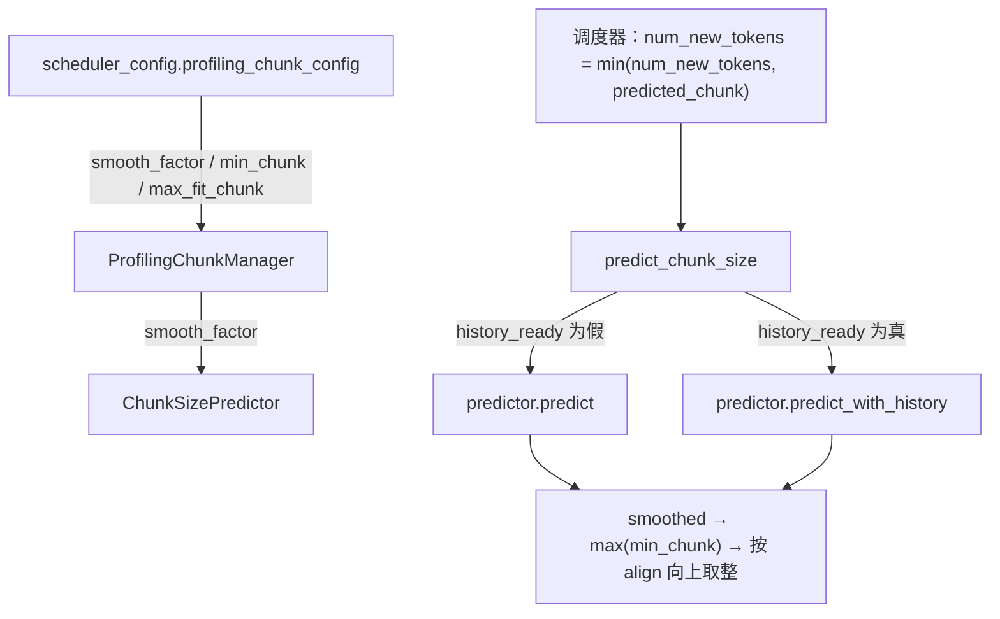

## 一句话

`profiling_chunk_config` 控制基于 profiling 的动态 chunk 大小，默认 `enabled: False`。本次补料只覆盖 **main 开发主线**，对应 2026-08-29 的源码快照（完整提交见下文链接）。在这个快照里，`smooth_factor` 的作用是：把二次方程解出的原始预测 `x` 按比例拉向调度器的固定预算 `base_chunk_size`，公式为 `base + smooth_factor·(x − base)`。配置默认值是 `1.0`，所以默认等于直接采用原始预测 [D]。v0.23 维护分支不在本次材料范围内，本页不给出两版对比。

## 事实表

| 项 | 值（main 开发主线） | 意味着什么 |
|---|---|---|
| `smooth_factor` 配置默认 | `1.0`（`ascend_config.py` L1033） | 默认 `smoothed = x`，平滑实际上不起作用 [D] |
| 取值范围 | `(0, 1]`，越界时 after-validator 抛 `ValueError`（L1051–L1052） | 填 0 或大于 1 会在启动时直接失败。无法把结果推到 `x` 之外，也无法完全忽略预测 [D] |
| 平滑公式 | `smoothed = base_chunk_size + smooth_factor * (x - base_chunk_size)` | 这是在 `base_chunk_size` 和 `x` 之间做线性插值，每次预测单独计算，不依赖上一次的结果 [D] |
| `base_chunk_size` 的来源 | 调度器的 `self.max_num_scheduled_tokens`（`scheduler_profiling_chunk.py` L86–L89） | 系数越小，结果越接近原本的固定 token 预算 [D] |
| 平滑之后的处理 | `max(int(smoothed), min_chunk)`，再向上取整到 `align = max(page_size, 64)` 的倍数 | 最终值可能大于 `smoothed`：`min_chunk`（默认 4096）优先于预测值，对齐只向上取整 [D] |
| `page_size` 的来源 | `self.cache_config.block_size`（L90） | 对齐粒度跟随 KV cache 的块大小，最小为 64 |
| `ProfilingChunkManager` 构造参数默认 | `smooth_factor=0.8` | 调度器构造它时显式传入 `profiling_cfg.smooth_factor`，所以在这条路径上生效的是配置默认 1.0，不是 0.8 [D] |
| 原始预测无效时 | `x <= 0` 时直接 `return None` | 不会进入平滑。调度器发现 `predicted_chunk` 为 `None`，就不按预测截断 |
| 预测结果的用法 | `num_new_tokens = min(num_new_tokens, predicted_chunk)`（L558） | 在这处调用点，预测只能调小本步 token 数，不能调大 [D] |
| 调用前提 | `is_ready`，且 prompt 未算完，且 `num_computed_tokens > 0 or not need_timing` | `need_timing` 为真（开启后默认如此）时，请求的首个 chunk 不使用预测 [D] |

## 为什么存在

材料没有直接说明这个系数的设计动机。下面只写代码能证明的行为，以及从公式推出的含义。

### 公式与位置

`smooth_factor` 的数据流如下，节点名均来自材料中的源码：



1. **配置定义**：[`vllm_ascend/ascend_config.py` L1030–L1055](https://github.com/vllm-project/vllm-ascend/blob/28bf3a2e8e8db396ee5dcfa6812626eee2d394ab/vllm_ascend/ascend_config.py#L1030-L1055)。字段默认值是 `smooth_factor: float = 1.0`，`_validate_and_link_need_timing` 校验它必须落在 `(0, 1]`。
2. **传入调度器**：[`vllm_ascend/core/scheduler_profiling_chunk.py` L82–L96](https://github.com/vllm-project/vllm-ascend/blob/28bf3a2e8e8db396ee5dcfa6812626eee2d394ab/vllm_ascend/core/scheduler_profiling_chunk.py#L82-L96)。调度器从 `get_ascend_config().scheduler_config.profiling_chunk_config` 取出配置，构造 `ProfilingChunkManager(base_chunk_size=self.max_num_scheduled_tokens, page_size=self.cache_config.block_size, smooth_factor=profiling_cfg.smooth_factor, ...)`。
3. **再传给预测器**：[`vllm_ascend/core/profiling_chunk_predictor.py` L390–L438](https://github.com/vllm-project/vllm-ascend/blob/28bf3a2e8e8db396ee5dcfa6812626eee2d394ab/vllm_ascend/core/profiling_chunk_predictor.py#L390-L438)。这段 `__init__` 带 `smooth_factor: float = 0.8`，并把参数转交给 `ChunkSizePredictor`。摘录没有显示这段 `__init__` 所属的类名，但它的参数表与调度器调用 `ProfilingChunkManager(...)` 时的关键字一一对应，所以判断它属于 `ProfilingChunkManager` [I]。
4. **公式本体**出现在两处，逻辑相同：
   - [L300–L315](https://github.com/vllm-project/vllm-ascend/blob/28bf3a2e8e8db396ee5dcfa6812626eee2d394ab/vllm_ascend/core/profiling_chunk_predictor.py#L300-L315)
   - [L367–L380](https://github.com/vllm-project/vllm-ascend/blob/28bf3a2e8e8db396ee5dcfa6812626eee2d394ab/vllm_ascend/core/profiling_chunk_predictor.py#L367-L380)

   两段摘录都没有包含函数定义行。后一段日志写着 "History-aware raw prediction"，`predict_chunk_size` 也按 `history_ready` 在 `predict` 和 `predict_with_history` 之间选择，据此推断前一段属于 `predict`，后一段属于 `predict_with_history` [I]。

完整的后处理链如下：

```text
x          = (-B + sqrt(discriminant)) / (2 * A)      # 若 x <= 0 → return None
smoothed   = base_chunk_size + smooth_factor * (x - base_chunk_size)
chunk_size = max(int(smoothed), min_chunk)
align      = max(page_size, 64)
chunk_size = ceil(chunk_size / align) * align
return chunk_size  (≥ align 时，否则 None)
```

材料只给出了求根这一行，`A`、`B` 和 `discriminant` 怎样由 profiling 数据和 `target_time` 构造，材料没有覆盖。因此无法说明 `x` 的物理含义，只能看出它是二次模型在给定时间预算下解出的 token 数 [I]。

### 拿数字走一遍

以下输入均为假设，只用来演示公式。设 `max_num_scheduled_tokens = 8192`、`block_size = 128`、`min_chunk = 4096` [A]，于是 `align = max(128, 64) = 128`。

| 原始预测 `x` [A] | `smooth_factor` | `smoothed` | `max(·, 4096)` | 按 128 向上取整 | 调度器 `min(num_new_tokens, ·)` |
|---|---|---|---|---|---|
| 20000 | 1.0 | 20000 | 20000 | ceil(156.25)=157 → 20096 | 不超过 `num_new_tokens`，预测不会放大本步 |
| 20000 | 0.5 | 8192 + 0.5×11808 = 14096 | 14096 | ceil(110.125)=111 → 14208 | 同上 |
| 3000 | 1.0 | 3000 | 4096 | 32 → 4096 | 最多截到 4096 |
| 3000 | 0.5 | 8192 + 0.5×(−5192) = 5596 | 5596 | ceil(43.72)=44 → 5632 | 最多截到 5632 |

后两行说明了一个关键点：`x` 小于 `base` 时，调小 `smooth_factor` 会让结果**大于**原始预测 [D]。原始预测的依据是 `target_time`，所以此时得到的 chunk 可能超出时间预算 [I]。

### 与 `need_timing` 的联动

两处调度调用点都要求 `request.num_computed_tokens > 0 or not self.profiling_chunk_config.need_timing`：

- [L317–L329](https://github.com/vllm-project/vllm-ascend/blob/28bf3a2e8e8db396ee5dcfa6812626eee2d394ab/vllm_ascend/core/scheduler_profiling_chunk.py#L317-L329)
- [L550–L563](https://github.com/vllm-project/vllm-ascend/blob/28bf3a2e8e8db396ee5dcfa6812626eee2d394ab/vllm_ascend/core/scheduler_profiling_chunk.py#L550-L563)

前一处调用点还检查 `profiling_chunk_manager.is_ready`。第二处的摘录从条件中途开始，看不到是否有同样的检查，但 `predict_chunk_size` 内部在 `not self.is_ready` 时会先返回 `None`。

第一处摘录停在 debug 日志中间，没有显示预测值怎样写回。第二处明确写的是 `num_new_tokens = min(num_new_tokens, predicted_chunk)`。预测为空时，第二处的处理是：

- `need_timing` 为真：打印 "Online calibration stage" 日志；
- 否则，若 `time_budget == target_latency`：`warning_once` 输出 "Profiling Failed. Degenerated to a fixed chunk size"。

材料没有继续展示后续分支。

## 开了的代价

- **默认值下没有平滑**：配置默认 `smooth_factor = 1.0`，最终结果只受 `min_chunk` 下限和对齐影响。不要被构造函数里的 `0.8` 误导，调度器路径不会用到它 [D]。
- **调小系数不等于更保守**：公式把结果向 `max_num_scheduled_tokens` 拉。原始预测大于预算时，结果变小；原始预测小于预算时，结果反而变大，可能偏离 `target_time` 对应的预测 [D]。又因为第二处调用点取 `min(num_new_tokens, predicted_chunk)`，预测大于本步 token 数时不起作用，所以实际能观察到的影响主要落在「预测偏小」这一侧 [D]。
- **下限和对齐会覆盖平滑结果**：`min_chunk`（默认 4096）在平滑之后才生效。平滑值低于它时，系数的差异会被下限抹平。对齐只会向上取整，最多多出 `align − 1` 个 token [D]。
- **首块不受影响**：`need_timing` 为真时，请求首个 chunk（`num_computed_tokens == 0`）不走预测，`smooth_factor` 对它没有作用 [D]。
- **材料缺口**：
  - `A`、`B`、`discriminant` 的构造方式，以及 `target_time` / `time_budget` 从哪里来；
  - 第一处调度调用点怎样使用预测值；
  - `smooth_factor` 取不同值时对吞吐或延迟的实际影响（材料里没有性能数据）；
  - v0.23 维护分支中同一公式和调用路径是否一致；
  - 配置层的其他全局校验（PP 要求、与 `enable_balance_scheduling` 互斥、`min_chunk` 钳位、`max_fit_chunk` 阈值的完整报错）。这些不在本次摘录内（配置摘录止于 `max_fit_chunk <= 5` 判断行），本页不重复下结论，留待整合时与既有页面核对。
