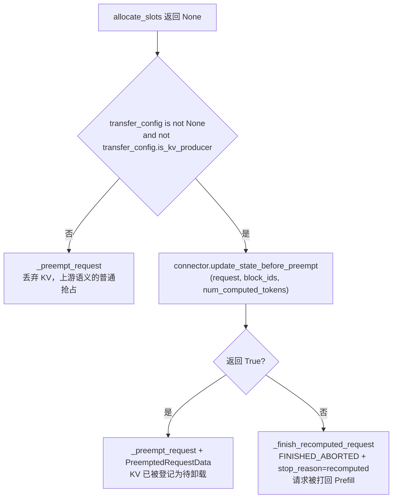
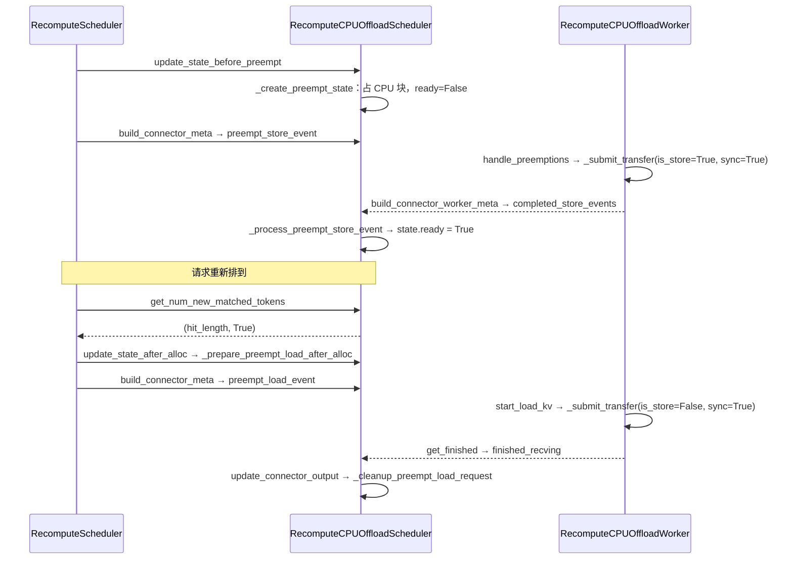

## 一句话

在 P/D 分离的 Decode 节点上，HBM 的 KV 块不够时 `RecomputeScheduler` 会抢占一个正在跑的请求；`RecomputeCPUOffloadConnector` 让这次抢占不再丢掉已算好的 KV，而是先把它拷进 pinned CPU 内存，等请求重新排上再拷回 HBM 继续 decode [S1]。

## 为什么需要它

上游抢占的语义是"丢弃 KV、以后重算"。这在 PD 混部里问题不大，但 Decode 节点被调得极端：`max_num_batched_tokens` 通常按 `max_num_seqs * (1 + num_spec_tokens)` 来设，也就是每个请求每步只排一个新 token 加上投机 token [S1]。这个预算对 decode 刚刚好，对重算一段几千上万 token 的 prompt 则小得离谱——重算要拆成几十上百个 chunk 才喂得进去。

所以在 P/D 分离下，vllm-ascend 的 `RecomputeScheduler` 干脆不在本地重算：被抢占的请求以 `FINISHED_ABORTED` 结束，同时向前端补发一条 `stop_reason="recomputed"` 的输出 [C11][C12]，由外部 P/D 代理把它重新投给 Prefill 节点跑一遍 prefill。代价是整段 prompt 的算力全部白费，而且要再走一次跨节点 KV 传输。

Recompute CPU Offload 给这条路加了个中间选项：既然 KV 已经在 HBM 里躺着，抢占前把它搬去 CPU DRAM 就是一次纯拷贝，比重算便宜得多。官方把这个特性定位成"面向正确性优先、opt-in"的能力 [S1]，当前的 D2H/H2D 还是朴素的 `torch` 拷贝，没有做传输吞吐优化 [S4]。

它依赖的块表结构、前缀哈希、KV cache 分组各有专页，这里只讲抢占这条路上多出来的那几步。

## 怎么工作

### 抢占时：三选一

`RecomputeScheduler.schedule()` 在 `allocate_slots` 返回 `None`（HBM 块不够）时进入抢占循环。分支只看两件事：有没有配 `kv_transfer_config` 且不是 producer、以及连接器的抢占钩子返不返 `True`。



钩子是用 `getattr(self.connector, "update_state_before_preempt", None)` 取的 [C9]，所以不装这个连接器（钩子不存在）时 `offloaded` 恒为 `False`，走右下那条打回 Prefill 的路——这就是文档说的"未配置连接器则回退到原始 recompute 行为" [S1]。而完全没有 `kv_transfer_config` 的普通部署走的是左边那条上游原语义的分支 [C10]，跟本特性无关。

### 换出与换回的完整时序



几个关键点：

- **`_create_preempt_state` 是唯一的准入判定。** 它按每组的 `block_size` 算出 `logical_num_blocks = cdiv(num_computed_tokens, block_size)`，逐块决定要不要新 CPU 块，最后拿 `num_needed` 和 `cpu_block_pool.get_num_free_blocks()` 比；不够就打一条 warning 并返回 `False` [C19]。返回 `False` 的请求就落到上面那条打回 Prefill 的路，这是"CPU 容量不足则回退"的实际实现 [S4]。
- **搬运发生在 `handle_preemptions()` 里，而不是 forward 前。** 调度器可能在同一步就把这些 HBM 块 id 分给别的请求，所以这次 D2H 必须早于 worker 更新状态、早于 forward 写 KV，代码注释写明了这一点，调用用的是 `sync=True` [C23]。
- **换回不是抢占的镜像，而是伪装成一次"外部命中"。** 请求重新排队时走的是 WAITING 分支里的通用连接器路径：`get_num_new_matched_tokens` 返回 `(hit_length, True)`，调度器把它当成 `num_external_computed_tokens` 计入 [C13][C18]；随后 `update_state_after_alloc` 才根据真正分到的新 HBM 块建 CPU→HBM 映射 [C20]。这也解释了为什么 store 没完成时 `get_num_new_matched_tokens` 返回 `None` ——调度器看到 `None` 就把这个请求跳过本步 [C13][C18]。
- **多卡要等齐。** worker 每步用 `RecomputeCPUOffloadWorkerMetadata` 上报 `{event_idx: 1}`，`aggregate()` 跨 worker 求和，调度器侧累计到 `world_size` 才把状态置 `ready` [C25][C21]。

一个需要注意的接线：`bind_gpu_block_pool()` 在 vllm-ascend 仓库里只有定义没有调用者，且被注释标成 "New API only for RecomputeCPUOffloadConnector"。没有它 `_gpu_block_pool is None`，`_create_preempt_state` 会直接返回 `False`，整条卸载路径失效。推断这个绑定由上游 vLLM 的 KV cache 初始化路径完成 [I]。

### 滑窗与 MTP

滑窗模型的块表里会有 null（0）块 id。`_align_group_block_ids` 不压缩非零 id，而是在前面补 `0` 把长度顶到 `logical_num_blocks`，使 `[0, 0, 20, 21]` 在 CPU 侧对齐成 `[0, 0, cpu_20, cpu_21]`，只搬非零块 [C17][S3]。开 MTP / 投机解码时调度器会多分 lookahead 块，`_prepare_preempt_load_after_alloc` 用 `min(...)` 把 H2D 的块区间夹到实际分到的 GPU 块表长度内 [C20][S3]。

## 拿真实数字走一遍

按 Qwen3-0.6B（28 层，n_kv=8，d_h=128，bf16）、`--block-size 128`、`cpu_bytes_to_use_per_rank=17179869184`（16 GiB）算 CPU 侧能存多少：

1. 每 token 每层的 K+V 字节：`2 × 8 × 128 × 2 B = 4096 B = 4 KiB` [D]
2. 28 层合计：`28 × 4 KiB = 112 KiB / token` [D]
3. 每个块 128 个 token：`128 × 112 KiB = 14 MiB / 块` [D]
4. worker 侧 `num_cpu_blocks = cpu_capacity_bytes // total_bytes_per_block = 16384 MiB // 14 MiB = 1170` [C22]
5. 能保住的 token 数：`1170 × 128 = 149760`
6. 若 `--max-model-len 32768`，一个满长请求占 `cdiv(32768, 128) = 256` 块，16 GiB 大约能同时保住 `1170 // 256 = 4` 个满长请求

第 1–3 步是我按 Qwen3-0.6B 的模型维度推的，源码里 worker 用的是 `tensor.shape[-1] * tensor.element_size()` 直接量出每块字节数 [C22]，并不假设 GQA 或 bf16；所以这三步标 `[D]` 而不是 `[C]`，换 MLA 或量化 KV 时这个算式不成立。

调度器侧另有一条等价的算式 `num_gpu_blocks * cpu_capacity_bytes // gpu_total_bytes` [C16]，两边整数除法结果可能差 1，worker 发现不一致时会打 warning 并以调度器的值为准 [C22]。

对应的最小配置（Decode 节点，P/D 分离）：

```bash
vllm serve /path/to/model \
    --block-size 128 \
    --max-model-len 32768 \
    --additional-config '{"scheduler_config":{"recompute_scheduler_enable":true}}' \
    --kv-transfer-config '{
        "kv_connector": "RecomputeCPUOffloadConnector",
        "kv_role": "kv_consumer",
        "kv_connector_extra_config": {
            "cpu_bytes_to_use_per_rank": 17179869184,
            "enable_offload_prefix_caching": false
        }
    }'
```

`recompute_scheduler_enable` 打开 `RecomputeScheduler`（两者缺一不可），`kv_role` 必须是 `kv_consumer`，`cpu_bytes_to_use_per_rank` 是每卡预算、直接就是上面算式里的 16 GiB [S2]。真实 P/D 部署里还要把它和 P/D 连接器一起包进 `MultiConnector` [S2]。容器里跑记得把 `--shm-size` 开大（A3 + 每卡 16 GiB 预算官方建议 `1024g`），否则 pinned CPU 张量分配失败会让服务启动时 OOM 或卡住 [S4]。

## 事实表

| 项 | 值 | 来源 |
|---|---|---|
| 连接器注册名 | `RecomputeCPUOffloadConnector` → `RecomputeCPUOffloadConnectorV1` | `vllm_ascend/distributed/kv_transfer/__init__.py#L91-L95` |
| 必需的 `kv_role` | `kv_consumer` | `docs/source/user_guide/feature_guide/recompute_cpu_offload.md#L46-L47` |
| `recompute_scheduler_enable` 默认值 | `False` | `docs/source/user_guide/configuration/additional_config.md#L144` |
| `recompute_scheduler_enable` 合法场景 | 仅 P/D 分离 Decode 节点；`kv_producer` 上被强制改回 `False` 并告警，其余非 `kv_consumer` 情形直接 `ValueError` | `vllm_ascend/platform.py#L966-L996` |
| `cpu_bytes_to_use` 默认值 | `8 * 1024**3`（8 GiB，整实例，除以 `world_size`） | `recompute_cpu_offload_connector.py#L40`、`#L55-L60` |
| `cpu_bytes_to_use_per_rank` | 每卡字节数；与 `cpu_bytes_to_use / world_size` 不等时打 warning 并以本值为准 | `recompute_cpu_offload_connector.py#L61-L70` |
| `enable_offload_prefix_caching` 默认值 | `False` | `recompute_cpu_offload_connector.py#L56` |
| `enable_offload_prefix_caching` 非 bool | 抛 `ValueError` | `recompute_cpu_offload_connector.py#L57-L58` |
| DCP / PCP 约束 | `assert decode_context_parallel_size == 1 and prefill_context_parallel_size == 1` | `manager.py#L91-L93` |
| CPU 块数（worker 侧） | `max(1, cpu_capacity_bytes // total_bytes_per_block)`，与调度器不一致时对齐到调度器 | `worker.py#L90-L100` |
| CPU 块数（调度器侧） | `max(1, num_gpu_blocks * cpu_capacity_bytes // gpu_total_bytes)` | `manager.py#L158-L160` |
| CPU 张量 | `torch.zeros(..., pin_memory=True, device="cpu")`，dtype 与 GPU KV 相同 | `worker.py#L104-L112` |
| CPU 块池的分组 | 直接复用 `gpu_config.kv_cache_groups` | `manager.py#L168-L172` |
| 传输流 | `torch.npu.Stream()` 各一条（`load_stream` / `store_stream`） | `worker.py#L114-L115` |
| D2H / H2D 提交方式 | 均 `sync=True`；每次提交前先 `torch.npu.synchronize()`，逐块逐张量 `copy_(non_blocking=True)` | `worker.py#L143-L165`、`#L229-L253` |
| store 完成判定 | 累计上报计数 ≥ `parallel_config.world_size` | `manager.py#L542-L548`、`metadata.py#L35-L52` |
| 容量不足时 | 打 warning `Skip recompute offload for request ...`，返回 `False`，请求回退到原 recompute 路径 | `manager.py#L311-L318` |
| Mamba 组卸载范围 | 只卸最后 `1 + num_spec_tokens` 个块 | `manager.py#L271-L279` |
| 滑窗组对齐 | 前补 `0` 到 `logical_num_blocks`，只传非零块 | `manager.py#L183-L187` |
| 已知不支持 | PD 混部 / 非 P/D 部署；Qwen3.5 + async scheduling | `docs/.../recompute_cpu_offload.md#L258-L272` |

官方文档线上地址：<https://docs.vllm.ai/projects/ascend/en/latest/user_guide/feature_guide/recompute_cpu_offload.html>、<https://docs.vllm.ai/projects/ascend/en/latest/user_guide/configuration/additional_config.html>。

## 常见误解

- **"开了它请求就不会被打回 Prefill 了。"** 不会被打回的只有卸载成功的那些。`update_state_before_preempt` 返回 `False`（CPU 块不够、`num_computed_tokens <= 0`、GPU 块池未绑定）时，请求照样走 `_finish_recomputed_request`，以 `FINISHED_ABORTED` 结束并带 `stop_reason="recomputed"` 通知前端 [C11][C12][C19]。
- **"D2H 是后台异步做的，不占 decode 时间。"** 当前两条路径都用 `sync=True` 提交，并且 `_submit_transfer` 进去就先 `torch.npu.synchronize()`，拷完才返回 [C23][C24]。worker 里那套 `_poll_load_events` / `wait_for_layer_load` 的异步机制目前用不上。
- **"它就是 KV Cache CPU Offload 的别名。"** 官方 FAQ 专门否掉了这一条：那个是给非活跃前缀块做的缓存卸载，这个只负责保住被 Decode 侧 recompute 调度器抢占的请求的 KV [S5]。
