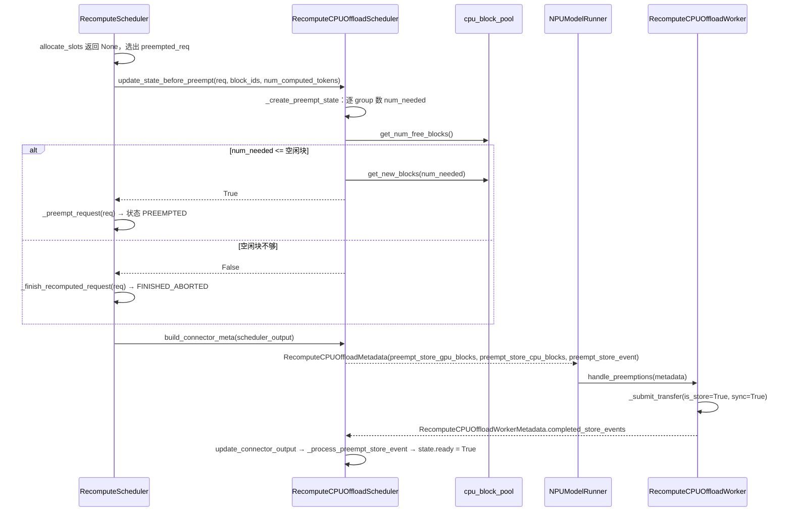
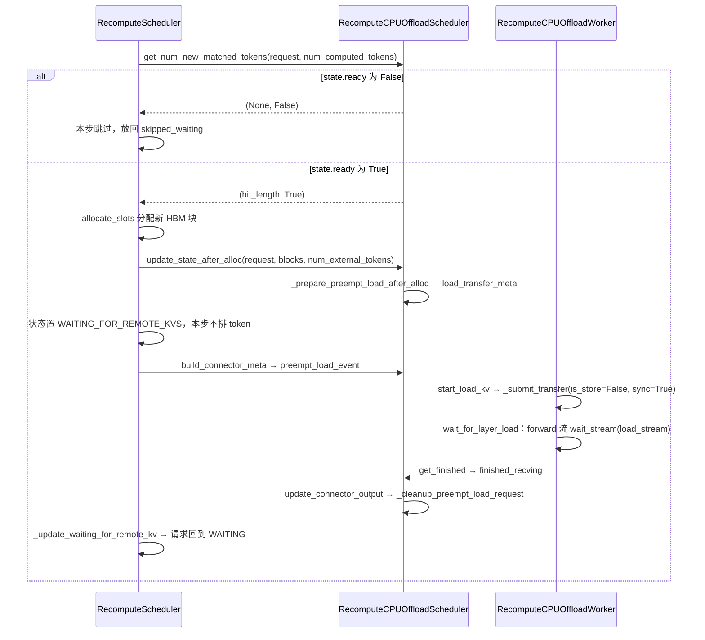
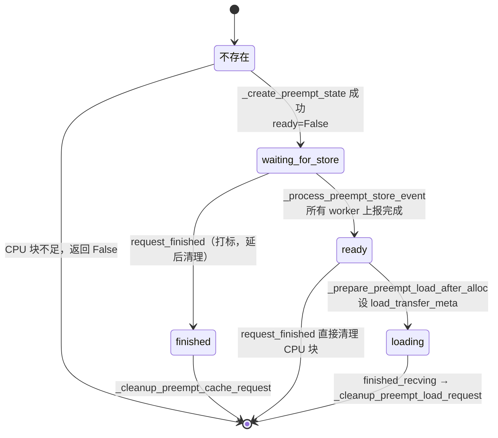

## 一句话

在 P/D 分离的 Decode 节点上，HBM 的 KV 块用光时 `RecomputeScheduler` 要抢占一个正在跑的请求；`RecomputeCPUOffloadConnector` 在它的 HBM 块被回收之前，先把这些块拷进一块常驻的 pinned CPU 内存，等这个请求重新被调度时再拷回 HBM，让它从原来的位置继续 decode，而不是被打回 Prefill 节点把整个 prompt 重算一遍。

## 为什么需要它

Decode 节点是按 decode 调参的。官方文档说得很直白：典型 Decode 部署把 `max_num_batched_tokens` 设成 `max_num_seqs * (1 + num_spec_tokens)` 左右，也就是每个请求每步只喂一个新 token（开 MTP 时再加上投机 token）[S]。这个预算对 decode 是最优的，但它小到根本没法重算一个几千 token 的 prompt [S]。

于是 Decode 侧一旦抢占，代价就特别不对称。看 `RecomputeScheduler.schedule` 里的抢占分支：只要 `kv_transfer_config` 存在且不是 kv_producer（即 Decode 侧），被抢占的请求走的不是「放回 waiting 队列等会儿重跑」，而是 `_finish_recomputed_request`——用 `RequestStatus.FINISHED_ABORTED` 把请求结束掉 [C]，同时在 `_add_recomputed_outputs` 里发一条 `stop_reason="recomputed"` 的终止输出给前端 [C]。也就是说，这条请求在这个 Decode 实例上**消失了**，要靠外层把它重新投给 Prefill 节点，从头做一遍 prefill、再把 KV 传回来。已经生成到第 200 个 token 的请求，为了腾几个块，整段 prompt 的计算和一次完整的 P→D KV 传输全要重来。

这就是这个特性要堵的窟窿：KV 已经在 HBM 里躺着了，与其扔掉再花几百毫秒重算，不如花几十毫秒搬到 CPU DRAM 存着。DRAM 比 HBM 便宜且量大，而重算的代价随 prompt 长度线性增长——prompt 越长，搬运相对重算越划算 [I]。

它和上游普通抢占的差别也在这里。上游 vLLM 的 recompute 抢占是「本地丢弃 KV，请求回到 waiting 队列，将来在本实例重新 prefill」；Decode 节点没有能力做后半句，所以 vllm-ascend 的 `RecomputeScheduler` 把它改成了「结束请求 + 通知外层重投」。本特性则是在这两者之外插进第三条路：**既不丢也不重算，就地换出到 CPU**。三条路在同一段代码里由 `update_state_before_preempt` 的返回值和 `is_kv_producer` 分流 [C]。

设计上它明确是 opt-in、correctness first 的：官方文档自己写了 D2H/H2D 目前只是普通的 torch copy，还没为吞吐优化 [S]。

## 怎么工作

整条链路分成两半：**换出（D2H）**发生在抢占那一步，**换回（H2D）**发生在请求重新被调度时。两半之间用一个 `PreemptedRequestState` 串起来。

### 组件与角色

连接器按 vLLM 的 KV connector 惯例一分为二：scheduler 侧的 `RecomputeCPUOffloadScheduler`（`manager.py`）持有一整套 CPU 侧的 `KVCacheCoordinator` 与 `BlockPool`，负责决定「哪些块搬到哪些 CPU 块」；worker 侧的 `RecomputeCPUOffloadWorker`（`worker.py`）持有 pinned CPU 张量，负责真正的拷贝 [C]。两边通过每步的 `RecomputeCPUOffloadMetadata` 通信 [C]。

CPU 侧那套 `BlockPool` 是完整复用 vLLM 块管理器的——同样的块大小、同样的 `kv_cache_groups`，只是块数按 CPU 预算折算 [C]。这也意味着它继承了 `assert dcp_world_size == 1 and pcp_world_size == 1` 的限制：开了 DCP 或 PCP 就直接断言失败 [C]。

manager 还需要 HBM 侧的 `BlockPool` 才能把 block id 还原成带 `block_hash` 的 `KVCacheBlock`，这由 `bind_gpu_block_pool` 注入；在 vllm-ascend 仓库内 grep 不到它的调用点，应由 vLLM 引擎侧调用 [I]。

### 换出：抢占那一步



几个关键点：

**判定换出与否的唯一依据是 CPU 空闲块数。** `_create_preempt_state` 先逐 KV group 扫一遍 block table，把需要**新**分配的 CPU 块数算成 `num_unhashed + len(missing_hashes) + num_mamba_blocks`——未哈希的块（含最后那个没填满的块）每个都要一块新的，已哈希且 CPU 侧已缓存过的块可以直接 `touch` 复用，Mamba 组只搬最后 `1 + num_spec_tokens` 块 [C]。然后一句 `if num_needed > self.cpu_block_pool.get_num_free_blocks(): return False`，不够就放弃，日志里打 `Skip recompute offload for request ...` [C]。没有优先级、没有部分卸载、没有挤占别的请求——够就全搬，不够就回退。

**块哈希复用只在 `enable_offload_prefix_caching=true` 时生效**：`block_hash` 只有在 `block_is_computed and self.enable_offload_prefix_caching` 时才取，否则一律按 `None` 处理，即每个块都私有一份 CPU 块 [C]。默认关闭 [S]。

**滑窗组的空洞被保留而不是压缩。** `_align_group_block_ids` 在块数不足时在**前面**补 0 补到 `logical_num_blocks`，于是 `[0, 0, 20, 21]` 这样的逻辑 block table 在 CPU 侧仍然是 `[0, 0, cpu_20, cpu_21]`，只有非零块进搬运列表 [C][S]。这样换回时按逻辑下标配对就不会错位。

**D2H 的时机是硬约束。** `handle_preemptions` 在 `NPUModelRunner.execute_model` 里被调用，位置在 `_update_states()` 之前，源码注释写明原因：调度器可能在同一步里就把这些被抢占的 block id 重新分配给别的请求，`_update_states()` 会去清零这些新分配的块 [C]。所以这次 D2H 必须是阻塞的（`sync=True`）[C]。

**store 完成要等齐所有 worker。** 每个 worker 在 `build_connector_worker_meta` 里上报 `{event_idx: 1}`，manager 累加到 `>= world_size` 才调 `_process_preempt_store_event`，把 `state.ready` 置为 `True` [C]。在此之前这个请求**不可换回**。

### 换回：重新调度那一步



换回借用的是 vLLM 已有的「外部 KV 命中 + 异步加载」通道，没有新开一条路：`get_num_new_matched_tokens` 返回 `(hit_length, True)`，第二个 `True` 就是 `load_kv_async`，调度器据此把 `num_new_tokens` 置 0、请求状态改成 `WAITING_FOR_REMOTE_KVS` [C]。所以**换回至少要花一个额外的调度步**，这一步不产出任何 token。

`hit_length = min(state.num_computed_tokens, request.num_tokens) - num_computed_tokens`，即「换出时存了多少」减去「本地前缀缓存已经命中多少」[C]。如果本地前缀缓存已经覆盖了全部存下来的 token，`hit_length <= 0`，manager 直接释放 CPU 块、返回 `(0, False)`，等于白存一场 [C]。

`_prepare_preempt_load_after_alloc` 按 `[load_start_tokens, load_end_tokens)` 这个 token 窗口换算出块下标区间，再用 `_align_group_block_ids` 把新分配的 HBM block table 对齐到同样的逻辑长度，逐下标配对；任何一侧 `block_id <= 0` 就跳过 [C]。开 MTP 时调度器会多分 lookahead 块，`end_block` 取了 `cdiv(load_end_tokens, group_block_size)` 与实际 GPU block table 长度的较小值，把 H2D 范围夹回真正分配到的块 [C][S]。

H2D 同样是 `sync=True` 的阻塞拷贝，发生在 forward 之前的 `start_load_kv` 里 [C]。

### 状态机



`_cleanup_preempt_cache_request` 把这个请求占的所有 CPU 块（`block_id > 0` 的）还给 `cpu_block_pool`；换回路径还要额外 `free_blocks` 掉之前 `touch` 过的 HBM 块 [C]。

## 拿真实数字走一遍

用 Qwen3-0.6B 的真实维度算一遍「16 GiB 每卡预算能存多少」。参数：28 层，`n_kv = 8`，`d_h = 128`，bf16（2 字节），昇腾后端 `block_size = 128`。

**每块字节数。** 源码里这个数是从张量形状量出来的（`tensor.shape[-1] * tensor.element_size()` 逐张量求和），下面是按模型维度反推的同一个量 [D]：

| 量 | 算式 | 结果 |
|---|---|---|
| 每 token 每层 KV | 2 (K 和 V) × 8 × 128 × 2 B | 4096 B = 4 KiB |
| 每 token 全模型 | 4096 × 28 | 114,688 B = 112 KiB |
| 每块（128 token） | 114,688 × 128 | 14,680,064 B = 14 MiB |

**CPU 块数。** `_derive_cpu_config` 的公式是 `num_cpu_blocks = num_gpu_blocks * cpu_capacity_bytes // gpu_total_bytes`，而 `gpu_total_bytes = num_gpu_blocks × 每块字节数`，所以等价于 `cpu_capacity_bytes // 每块字节数` [C]：

- `cpu_bytes_to_use_per_rank = 17179869184`（16 GiB）
- `17,179,869,184 // 14,680,064 = 1170` 块
- 容量 = `1170 × 128 = 149,760` token

**能装几个请求。** 一个已经算了 8192 token 的请求占 `cdiv(8192, 128) = 64` 块，所以最多同时存 `1170 // 64 = 18` 个这样的请求；第 19 个被抢占时 `num_needed > get_num_free_blocks()`，直接回退 [D]。

**一次换出要搬多少。** 64 块 × 14 MiB = **896 MiB** 的 D2H，而且是阻塞在调度步里完成的 [D]。这个数字解释了为什么官方文档强调当前实现是 correctness-oriented [S]——按 PCIe/统一总线的量级，这不是一次可以忽略的暂停。

**完整配置片段**（Decode 节点，单机 TP1，值的来由见右列）：

```bash
vllm serve /path/to/Qwen3-0.6B \
    --max-model-len 32768 \
    --block-size 128 \
    --max-num-batched-tokens 4096 \
    --additional-config '{"scheduler_config":{"recompute_scheduler_enable":true}}' \
    --kv-transfer-config '{
        "kv_connector": "RecomputeCPUOffloadConnector",
        "kv_role": "kv_consumer",
        "kv_connector_extra_config": {
            "cpu_bytes_to_use_per_rank": 17179869184,
            "enable_offload_prefix_caching": false
        }
    }'
```

| 配置 | 为什么是这个值 |
|---|---|
| `recompute_scheduler_enable: true` | 不开它 `scheduler_cls` 不会被换成 `RecomputeScheduler`，`update_state_before_preempt` 这个钩子根本不会被调用，连接器等于没装 [C] |
| `kv_role: "kv_consumer"` | `platform.py` 里非 `kv_consumer` 直接 `raise ValueError`，P 节点上会被降级为关闭并告警 [C] |
| `cpu_bytes_to_use_per_rank` | 直接指定每卡预算，绕开 `cpu_bytes_to_use / world_size` 的歧义（见「常见误解」第 4 条）[S] |
| `enable_offload_prefix_caching: false` | 官方标注为 experimental，默认关 [S] |

P/D 生产环境里这个连接器不单独用，而是塞进 `MultiConnector` 和 `MooncakeConnectorV1` 这类 P/D 连接器并列；`kv_load_failure_policy` 要配在顶层 `MultiConnector` 上而不是子连接器里 [S]。

容器部署还要注意 pinned 内存：CPU 张量是 `pin_memory=True` 一次性分配的 [C]，`--shm-size` 太小会在启动时分配失败甚至挂住，官方对 16 GiB/卡 的 A3 部署建议 `--shm-size=1024g` [S]。

## 事实表

| 项 | 值 | 来源 |
|---|---|---|
| 配置名（连接器） | `RecomputeCPUOffloadConnector` → `RecomputeCPUOffloadConnectorV1` | `vllm_ascend/distributed/kv_transfer/__init__.py#L91-L95` |
| `kv_role` | 必须 `kv_consumer` | `docs/source/user_guide/feature_guide/recompute_cpu_offload.md#L47` |
| `cpu_bytes_to_use` | int，默认 `8 * 1024**3`（8 GiB 总量），除以 `parallel_config.world_size` | `recompute_cpu_offload_connector.py#L39-L60` |
| `cpu_bytes_to_use_per_rank` | int，可选；设了就覆盖上一项并告警 | `recompute_cpu_offload_connector.py#L61-L70` |
| `enable_offload_prefix_caching` | bool，默认 `False`；非 bool 直接 `raise ValueError` | `recompute_cpu_offload_connector.py#L56-L58` |
| `scheduler_config.recompute_scheduler_enable` | bool，默认 `False` | `docs/source/user_guide/configuration/additional_config.md#L144` |
| 适用范围 | 仅 P/D 分离的 D 节点；`kv_producer` 降级关闭并告警，其余 `kv_role` 直接 `raise ValueError` | `vllm_ascend/platform.py#L966-L988` |
| CPU 块数 | `max(1, num_gpu_blocks * cpu_capacity_bytes // gpu_total_bytes)` | `manager.py#L160` |
| CPU 块大小 / 分组 | 与 HBM 侧一致，直接复用 `gpu_config.kv_cache_groups` | `manager.py#L168-L172` |
| CPU 张量 | `torch.zeros(..., pin_memory=True, device="cpu")` | `worker.py#L107-L112` |
| 换出判定 | `num_unhashed + len(missing_hashes) + num_mamba_blocks > get_num_free_blocks()` → 返回 `False` | `manager.py#L308-L318` |
| 换出失败的后果 | `_finish_recomputed_request` → `FINISHED_ABORTED` + `stop_reason="recomputed"` | `recompute_scheduler.py#L222-L239`, `#L1054-L1073` |
| 换回可用条件 | `state.ready`，即 store 事件被 `world_size` 个 worker 全部确认 | `manager.py#L542-L548`, `#L565-L570` |
| 换回未就绪的返回值 | `(None, False)` → 调度器本步跳过该请求 | `manager.py#L199-L200` |
| 换回命中长度 | `min(state.num_computed_tokens, request.num_tokens) - num_computed_tokens` | `manager.py#L202-L203` |
| D2H 调用点 | `NPUModelRunner.execute_model` 中，早于 `_update_states()` | `model_runner_v1.py#L2088-L2093` |
| D2H / H2D 同步性 | 两者都 `sync=True`，且提交前有一次 `torch.npu.synchronize()` | `worker.py#L148-L150`, `#L163-L164`, `#L229` |
| 搬运实现 | 逐块逐张量 `Tensor.copy_(non_blocking=True)`，源码 TODO 标注待换专用 NPU kernel | `worker.py#L236-L271` |
| 并行约束 | `assert dcp_world_size == 1 and pcp_world_size == 1` | `manager.py#L91-L93` |
| Mamba 组搬运范围 | 最后 `1 + num_spec_tokens` 块 | `manager.py#L271-L279` |
| 滑窗组对齐 | 前置补 0 到 `logical_num_blocks`，只搬非零块 | `manager.py#L174-L187` |
| 已知不支持 | Qwen3.5 + async scheduling | `docs/source/user_guide/feature_guide/recompute_cpu_offload.md#L271-L272` |
| 日志关键字 | `Recompute preemption offload enabled` / `Created recompute offload state` / `Prepared recompute offload H2D load` / `Skip recompute offload` | `recompute_scheduler.py#L436-L441`, `manager.py#L368-L377`, `#L481-L487`, `#L312-L317` |

官方文档线上地址：<https://docs.vllm.ai/projects/ascend/en/latest/user_guide/feature_guide/recompute_cpu_offload.html>、<https://docs.vllm.ai/projects/ascend/en/latest/user_guide/configuration/additional_config.html>。

## 常见误解

1. **「这和 KV Cache CPU Offload 是一回事」——不是。** 官方 FAQ 专门澄清过：KV Cache CPU Offload 卸的是**非活跃的前缀缓存块**，为的是提高 prefix cache 命中率；本特性卸的是**被抢占请求的活跃 KV**，为的是不让它被打回 Prefill [S]。两者的触发时机、生命周期和回收策略都不同，可以同时存在于一个 `MultiConnector` 里。

2. **「开了它就不会再回 Prefill 重算」——不对。** CPU 块不够时 `_create_preempt_state` 返回 `False`，调度器立刻走 `_finish_recomputed_request`，请求照样以 `FINISHED_ABORTED` 结束并发出 `stop_reason="recomputed"` [C]。这个特性降低的是回退概率，不是消除回退；预算设小了它几乎不起作用，所以日志里出现 `Skip recompute offload` 就该加预算 [S]。

3. **「换出换回是后台异步的，不占调度步」——不对。** D2H 必须在 `_update_states()` 清零复用块之前完成，所以是 `sync=True` 的阻塞拷贝；H2D 在 `start_load_kv` 里同样 `sync=True`，而且提交前还有一次全局 `torch.npu.synchronize()` [C]。加上换回要单独占一个不产 token 的调度步 [C]，整条路径的延迟是实打实计入 TPOT 的。

4. **「`cpu_bytes_to_use` 是每卡预算」——不是，它会被除。** 源码里除数是 `vllm_config.parallel_config.world_size` [C]，而官方文档把这个除法描述为「按 Decode DP size 划分」，并举例 DP2TP8 下 16 GiB 给每个 DP rank 的卡约 8 GiB [S]。两种说法是否等价取决于上游 `ParallelConfig.world_size` 的定义，本地没有 vLLM 源码可核对，我没能确认 [I]。**结论不受影响：用 `cpu_bytes_to_use_per_rank` 直接写每卡预算**，文档本身也这么建议 [S]。

## 接着看

- [KV Cache CPU Offload](kv-cache-cpu-offload.md) —— 另一条通向 CPU 的路，看完就知道两者为什么不能互相替代。
- [Block Table](block-table.md) —— 本页反复出现的「逻辑块下标 vs 物理 block id」和滑窗空洞，都是 block table 的概念。
- [Prefix Caching](prefix-caching.md) —— `enable_offload_prefix_caching` 复用的就是这套块哈希，也是 `hit_length <= 0`（白存一场）的成因。
- [KV Pool](kv-pool.md) —— 本特性住在 `kv_pool/` 目录下，那里还有几个共用同一套 connector 接口的兄弟。
- [PagedAttention](paged-attention.md) —— 为什么 KV 是按块搬的、块为什么能任意换位置，根在这里。
