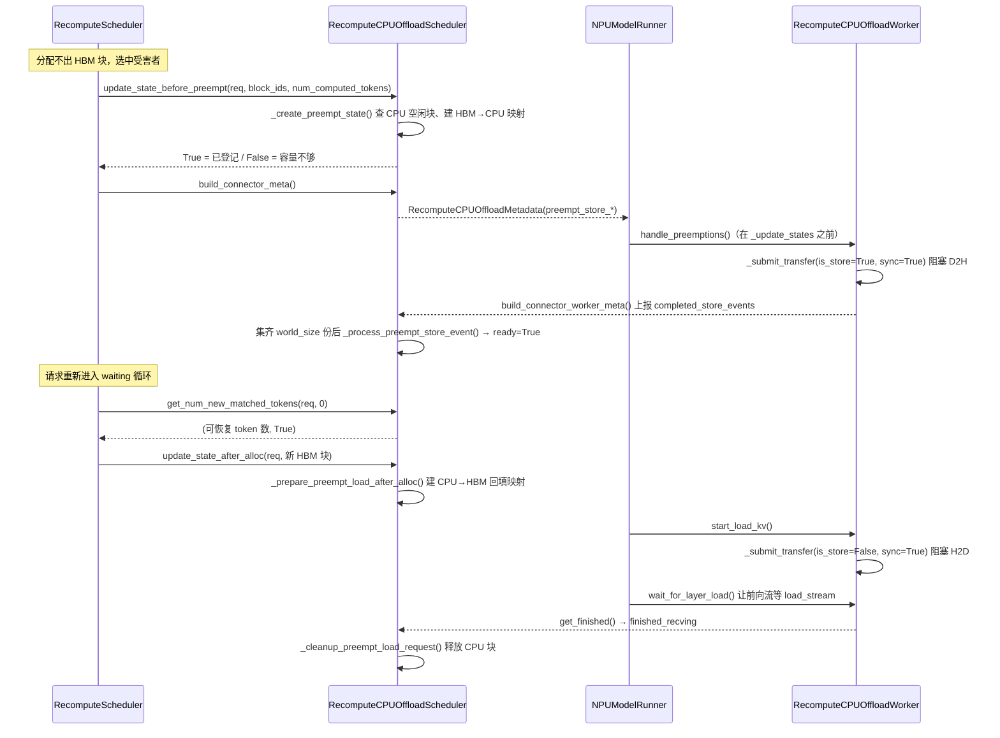

## 一句话

在 PD 分离的 Decode 节点上，当 HBM 的 KV 块不够、`RecomputeScheduler` 必须踢掉一个正在跑的请求时，`RecomputeCPUOffloadConnector` 先把这个请求已经算好的 KV 块拷到锁页 CPU 内存，等它重新被调度时再拷回 HBM，从而避免把整条请求打回 Prefill 节点重算一遍 prompt。它是可选的：不配这个 connector、或 CPU 容量不够时，调度器静默退回原来的重算行为。

## 为什么需要它

先看没有它会发生什么。Decode 节点是按 decode 调优的：`max_num_batched_tokens` 通常只开到 `max_num_seqs * (1 + num_spec_tokens)` 那个量级，够每个请求每步吐一两个 token 就行 [S22]。这时如果 KV 显存吃紧，调度器踢掉一个请求，那个请求的几万个 prompt token 就得重新走一遍 —— 而这台机器的 token 预算根本不是为跑长 prefill 准备的。

vllm-ascend 在这条路上的原始做法更直接：`RecomputeScheduler` 在 `kv_role` 不是 `kv_producer` 的节点上，被抢占的请求不是退回等待队列重算，而是**直接以 `stop_reason="recomputed"` 终止**，由 PD proxy 把它重新投给 Prefill 节点 [C4]。这比本地重算合理（Prefill 节点本来就是干这个的），但代价是整条 prompt 的计算和一次完整的跨节点 KV 传输全部重来。

Recompute CPU offload 换了个思路：这些 KV 明明还在 HBM 里、内容完全有效，被抢占只是因为**块要让给别人用**。那就把它挪到 CPU DRAM 存着 —— DRAM 比 HBM 便宜得多，一台 A3 上留 16 GiB/卡 做这件事不算奢侈。请求回来时把块拷回去，从被打断的位置接着 decode，一个 token 都不用重算。

这条路和它旁边那条容易混：[KV Cache CPU Offload](kv-cache-cpu-offload.md) 搬的是**可跨请求复用的 prefix cache 冷块**，服务于缓存命中率；这条搬的是**某个特定请求自己的活跃 KV**，服务于抢占恢复。官方 FAQ 专门澄清了这一点 [S24]。

## 怎么工作

整条链路横跨调度器、connector 和 worker 三侧，关键在于**D2H 必须早于 HBM 块被复用**。



几处值得单独说：

**受害者选出来之后才问 connector。** `RecomputeScheduler.schedule()` 先按策略挑出 `preempted_req`，再对它调 `update_state_before_preempt`；钩子返回 `True` 就走正常的 `_preempt_request()`（请求转 PREEMPTED、回等待队列），返回 `False` 才落到 `_finish_recomputed_request()` 终止请求 [C1]。**注意这里两版的受害者选择不一样**：main 在 `kv_consumer` 分支之前已经按 `SchedulingPolicy.PRIORITY` 选过 `max(r.priority, r.arrival_time)`；v0.23.0 的 `kv_consumer` 分支写死了 `self.running.pop()`，不看调度策略 [!][C1][C2]。

**D2H 是阻塞的，而且必须阻塞。** 模型侧在 `_update_states()` **之前**调 `handle_preemptions()`，因为调度器可能在同一步里就把这些块 id 分给别的请求 [C16]。worker 侧的 `_submit_transfer` 以 `sync=True` 提交，进循环前还有一次全设备 `torch.npu.synchronize()`，实现是逐块逐张量的 `torch.Tensor.copy_`，源码自带 TODO 说还没换成专用算子 [C15][S24]。H2D 侧同样是 `sync=True` [C14]。

**「存好了」要全体 worker 点头。** 每个 worker 上报 `{event_idx: 1}`，scheduler 侧累加到 `world_size` 才把请求置 `ready=True` [C11]。在那之前 `get_num_new_matched_tokens` 返回 `None` [C8]，调度器看到 `None` 就把请求挪进 skipped 队列、这一步不调度它 [C5] —— 恢复因此被自然推迟到 D2H 真正落盘之后，不需要额外的等待状态。

**空洞位保留，不压缩。** 滑窗模型的块表里会有 0（窗口外的 token 没有块）。`_create_preempt_state` 对 `block_id <= 0` 的位置往 CPU 列表里塞 `None`/`0` 占位，让两侧下标严格对齐，只搬非零块 [C9][S24]。

**两版的 `_create_preempt_state` 有两处实质差异** [!]：main 多了 Mamba 组分支（Mamba 组只卸载最后 `1 + num_spec_tokens` 块），v0.23.0 完全没有这段、所有组都按普通 attention 的 block_size 逻辑处理 [C9][C10]；反过来 v0.23.0 多一个 `_maybe_evict_cached_block` 循环，把「本步 `allocate_slots()` 刚打上 hash、但前向还没写入」的 GPU 块从 prefix cache 里逐出，main 上这段被删掉了 [C10]。

**开关和部署形态的校验在 platform 里。** 只有 `kv_role == "kv_consumer"` 才真的把 `scheduler_config` 换成 `RecomputeSchedulerConfig`；`kv_producer` 上警告并强制关闭；PD 混布（`kv_both` 或没有 `kv_transfer_config`）直接 `ValueError` [C17][C18]。两版的约束一致，但**开关的键路径不同** [!]：v0.23.0 读 `additional_config["recompute_scheduler_enable"]` [C20][S23]，main 读 `additional_config["scheduler_config"]["recompute_scheduler_enable"]`，顶层旧写法仍被接受但会打一条弃用警告 [C19][S22]。

## 拿真实数字走一遍

用 Qwen3-0.6B（28 层、`n_kv=8`、`d_h=128`、bf16）配 `--block-size 128`，算一下 16 GiB/卡 的预算能保住什么。

每 token 每层的 KV：`2 (K 和 V) × 8 × 128 × 2 B = 4096 B = 4 KiB`。
28 层合计：`4 KiB × 28 = 112 KiB/token` [D]。
一个块 128 个 token：`112 KiB × 128 = 14336 KiB = 14 MiB/块` [D]。

CPU 块数由 `cpu_capacity_per_rank // 每块字节数` 决定 [C7][C13]：

```
16 GiB / 14 MiB = 16384 MiB / 14 MiB = 1170.28 → 1170 块
1170 × 128 = 149760 token
```

也就是说这张卡的 CPU 侧最多同时保住约 15 万个 token 的 KV。按每条请求 32K 上下文算，一条要占 `32768 / 128 = 256` 块，`1170 / 256 = 4.57` → **同时最多保住 4 条被抢占的请求**，第 5 条来的时候 `_create_preempt_state` 发现空闲块不够，打一条 warning 返回 `False`，那条请求就退回原来的重算路径 [C9]。

搬运量也值得看一眼：保一条 32K 的请求要同步搬 `256 × 14 MiB = 3.5 GiB`，D2H 和 H2D 各一次，都在调度关键路径上阻塞 [C14][C15]。

完整配置（main / `latest`）：

```bash
vllm serve /path/to/model \
    --block-size 128 \
    --additional-config '{"scheduler_config":{"recompute_scheduler_enable":true}}' \
    --kv-transfer-config '{
        "kv_connector": "RecomputeCPUOffloadConnector",
        "kv_role": "kv_consumer",
        "kv_connector_extra_config": {
            "cpu_bytes_to_use_per_rank": 17179869184,
            "enable_offload_prefix_caching": false
        }
    }'
```

每个值的来由：`kv_connector` 写注册名 `RecomputeCPUOffloadConnector`（实现类叫 `RecomputeCPUOffloadConnectorV1`，注册表负责这层映射）[C21]；`kv_role` 必须是 `kv_consumer`，否则 platform 直接报错 [C17]；`17179869184 = 16 GiB`，用 `_per_rank` 而不是 `cpu_bytes_to_use` 是为了绕开「再除一次 `world_size`」的坑 [C12][S22]；`enable_offload_prefix_caching` 保持 `false`，官方标它为实验性 [S24]。

**在 v0.23.0 上，`--additional-config` 那一行要写成 `'{"recompute_scheduler_enable":true}'`** [!][C20][S23]。

真机上还得记得 Docker 的 `--shm-size`：CPU 侧是启动时一次性分配的 pinned 张量 [C13]，官方建议 A3 上按 16 GiB/卡 的预算给 `--shm-size=1024g`，给小了会在启动阶段 OOM 或挂住 [S24]。

## 事实表

| 项 | v0.23.0 | main | 意味着什么 |
|---|---|---|---|
| 开关键路径 | `additional_config.recompute_scheduler_enable` | `additional_config.scheduler_config.recompute_scheduler_enable`（顶层写法仍接受，打弃用警告） | 把 main 的嵌套写法照抄到 v0.23.0，开关会被静默忽略、特性根本没生效 [C19][C20] |
| `kv_role` 约束 | 必须 `kv_consumer`；`kv_producer` 警告后关闭；其余 `ValueError` | 同左 | PD 混布下开这个开关是启动失败，不是降级运行 [C17][C18] |
| `cpu_bytes_to_use` 默认 | 8 GiB（整实例） | 8 GiB（整实例） | 不显式配，DP8 上每卡只剩 1 GiB，几乎保不住几条请求 [C12] |
| `cpu_bytes_to_use_per_rank` | 无默认；设了就覆盖 `cpu_bytes_to_use // world_size` | 同左 | 这是唯一不会被 `world_size` 再除一次的写法，DP 部署里优先用它 [C12] |
| `enable_offload_prefix_caching` 默认 | `false` | `false` | 默认每个被抢占请求的 CPU 块完全私有，不跨请求共享 [C12][S24] |
| CPU 块数 | `每卡预算 // 每块字节数` | 同左 | 预算直接换算成「能保住多少块」，和 HBM 块大小同构 [C7][C13] |
| D2H / H2D 同步性 | 两个方向都 `sync=True`，逐块 `torch.copy_` | 同左 | 每次抢占和每次恢复都在关键路径上同步阻塞一次全量拷贝 [C14][C15] |
| 容量不足时 | `_create_preempt_state` 返回 `False` | 同左 | 不报错也不排队，直接静默退回原重算路径，只在日志里留一条 warning [C9] |
| Mamba / 混合模型组 | 无专门分支，按普通 attention 组处理 | 只卸载最后 `1 + num_spec_tokens` 块 | 混合模型上两版行为不同，v0.23.0 未针对 Mamba 状态做适配 [!][C9][C10] |
| dcp / pcp | 断言必须均为 1 | 同左 | 开了 decode/prefill context parallel 就直接 assert 失败，两者不能同时用 [C6] |

## 常见误解

- **「它和 KV Cache CPU Offload 是一回事」** —— 不是。那条路径把**可复用的 prefix cache 冷块**搬到 CPU 以提高命中率，任何请求都能命中；这条只保**被抢占请求自己的 KV**，别的请求碰不到，官方 FAQ 专门澄清过 [S24]。
- **「开了就一定不会重算」** —— 不一定。CPU 空闲块不够时 `_create_preempt_state` 返回 `False`，调度器照样把请求终止掉走原来的重算路径，而且这是静默降级、只有日志里一条 warning [C9][C1]。预算配小了，等于白配。
- **「PD 混布也能开，顶多没效果」** —— 会直接启动失败。`kv_role` 不是 `kv_consumer`（也没有 `kv_transfer_config`）时 platform 抛 `ValueError`，两版都一样 [C17][C18]。
