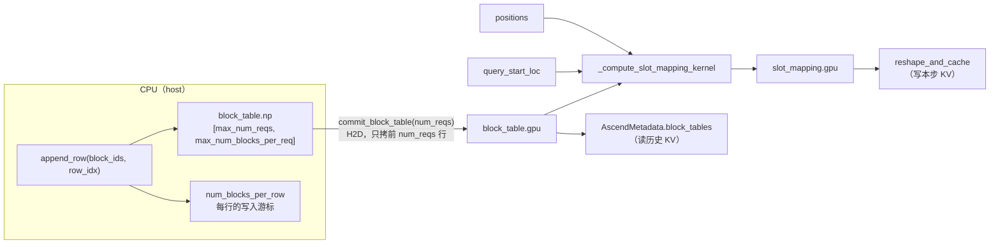
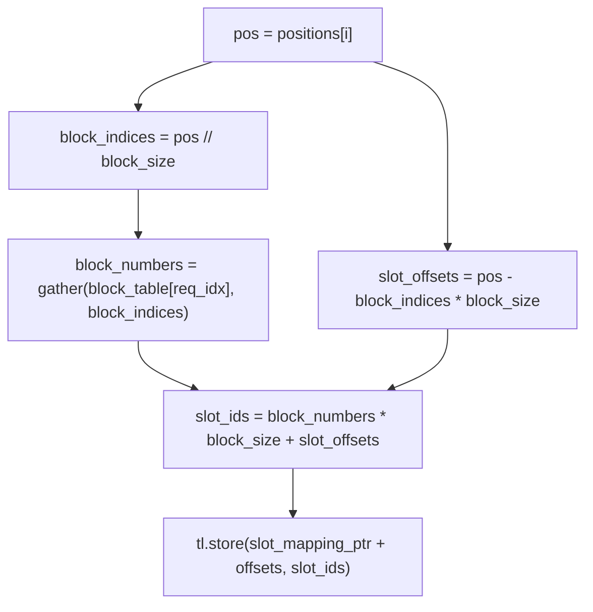
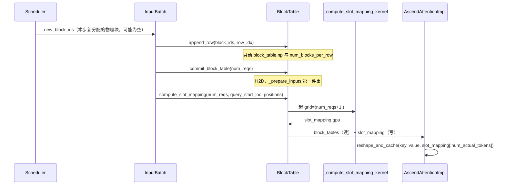

## 一句话

Block Table 是 worker 侧一张 `[请求槽位, 逻辑块号]` 的 int32 二维表，单元格里存的是显存 KV cache 中的**全局物理块号**。它把「这是本序列的第几块」翻译成「它在显存哪一块」，attention 算子据此读历史 KV，`compute_slot_mapping` 据此算出这一步每个 token 该写进哪个槽位。

## 为什么需要它

[PagedAttention](paged-attention.md) 允许一条序列的 KV 散落在显存各处，代价是「第 k 块在哪」不再能由地址算出来，必须查。块表就是这张查询表——官方设计文档把它定义为「把每块的逻辑地址（序列内的）翻译成设备显存里的全局物理地址」[S18]。

但仅仅「有一张表」还不够用，真正的设计压力来自它在每个 step 都要被访问两次、且访问方式截然不同：

- **写这张表的是 CPU。** 调度器每步返回的是新分配的物理块号（Python list），只能在 host 侧填进去。
- **读这张表的是 NPU。** attention 内核和槽位映射内核都要在设备上随机索引它。

如果每步把整张表重新搬一遍，`[max_num_reqs, max_num_blocks_per_req]` 在长上下文下是几十上百 KiB 的 H2D，还卡在关键路径上。vllm-ascend 的做法是把表做成 CPU/NPU 双缓冲：CPU 侧用 numpy 视图**增量追加**（decode 一步最多加一格，多数步一格都不加），再用 `commit_block_table` 只把当前批用到的前 `num_reqs` 行拷过去，并且把这次拷贝放在 `_prepare_inputs` 的第一行发出，好和后面一长串 CPU 端准备工作重叠。

另一件只有块表能解决的事是**槽位**。KV cache 在显存里是 `(2, num_blocks, block_size, num_kv_heads, head_size)` 的大张量 [C13]，写入算子 `reshape_and_cache` 不认「第几块第几位」，只认一个把前两维压平后的整数下标 `slot`。块表加一次取模就能把 `position` 变成 `slot`，这就是 `compute_slot_mapping` 的全部工作。

块粒度本身（一块装多少 token、块怎么被分配和回收）属于 [KV Cache Spec](kv-cache-spec.md)；块在请求之间怎么共享属于 [Prefix Caching](prefix-caching.md)。

## 怎么工作

### 谁写、谁读、什么时候过河



`block_table` 是一个 `CpuGpuBuffer`，同一份数据有 `.np`（numpy 视图，给 CPU 增量写）、`.cpu`、`.gpu` 三个面。写只发生在 `.np` 上，`commit_block_table(num_reqs)` 是唯一的过河口。

### 行、列、格子各是什么

- **行 = 批内请求槽位 `req_index`**，不是 request id。请求换出/换入时靠 `move_row` / `swap_row` 整行搬动，同一条请求在不同 step 可能坐在不同行。
- **列 = 请求内逻辑块号** `position // block_size`。
- **格子 = 全局物理块号**，即它在 KV cache 第二维 `num_blocks` 上的下标。

列数默认是 `cdiv(max_model_len, block_size * dcp_world_size)` [C6]，attention builder 侧用同一个式子（非 DCP 时 `dcp_world_size = 1`）。

`num_blocks_per_row` 是一个纯 CPU 的 `[max_num_reqs]` int32 数组，记录每行已经填到第几列。它就是 `append_row` 的写入游标：

```python
start = self.num_blocks_per_row[row_idx]
self.block_table.np[row_idx, start : start + num_blocks] = block_ids
self.num_blocks_per_row[row_idx] += num_blocks
```

所以 decode 步的「追加」不需要知道序列长度，只按游标往右推一格。`add_row` 是先把游标清零再 `append_row`，用于一条新请求占用这一行。

### position → slot 的四步

官方文档把这段拆成四步：算表内索引 → 查物理块号 → 算块内偏移 → 合成 slot [S19]。落到 Ascend 的 Triton 内核里是：



内核的分工是 **一个 program 一条请求**，grid 取 `(num_reqs + 1,)`；第 `req_idx` 个 program 从 `query_start_loc` 里读出本请求的 token 区间 `[start_idx, end_idx)`，按 `TILE_BLOCK_SIZE = 1024` 分 tile 循环。

查表那一步不是逐 token 随机访存：内核先取本 tile 里最小的 `block_indices` 作为基址 `block_idx_base`，把表行上长度 `BLOCK_TABLE_WINDOW_SIZE` 的一段整体载入，再在这个窗口里 `tl.gather`。窗口大小取 `_next_power_of_2(cdiv(TILE_BLOCK_SIZE, block_size) + 1)` [C4]——1024 个连续 position 最多跨 `1024/block_size + 1` 个逻辑块，取 2 的幂是为了 Triton 能向量化 [D]。

**最后一个 program（`req_idx == num_programs(0) - 1`）不处理请求**，它专门把 `slot_mapping[num_tokens : max_num_tokens)` 填成 `PAD_ID`（即 `PAD_SLOT_ID = -1`），让图捕获下固定形状的尾部不会误写 KV cache [C7]。

### 一个 decode step 的完整时序



注意 `commit` 在 `compute_slot_mapping` 之前：内核读的是 `block_table.gpu`，没提交就会查到上一步的旧块号 [C10]。

### 两个会改变「块」含义的开关

- **hybrid 块**：当 `kernel_sizes` 给出的内核块粒度小于物理块时，一个物理块被切成 `blocks_per_phys_block` 个逻辑块，表的列数相应放大到 `max_num_blocks_per_req * blocks_per_phys_block`，`append_row` 会先把物理块号展开成一串连续逻辑块号 [C3]。默认路径下 `blocks_per_phys_block = 1`，逻辑块就是物理块。
- **DCP**：开了 decode context parallel 后一个「虚拟块」含 `block_size * dcp_size` 个 token，每个 rank 只存属于自己的交错分片，不属于本 rank 的 token 在 `slot_mapping` 里写 `PAD_ID` [S20]。此时表的行数还会乘上 `duplicate_size = 1 + num_speculative_tokens`。

## 拿真实数字走一遍

配置（Qwen3-0.6B：28 层，`n_kv = 8`，`d_h = 128`，bf16）：

```python
from vllm import LLM

llm = LLM(
    model="Qwen/Qwen3-0.6B",
    max_model_len=40960,          # Qwen3-0.6B 的 max_position_embeddings
    max_num_seqs=64,              # → 表的行数 = 64
    max_num_batched_tokens=8192,  # → slot_mapping 长度 = 8192
    block_size=128,               # Ascend 后端唯一接受的取值 [C14]
)
```

**表的尺寸。** 列数 `cdiv(40960, 128) = 320`。表本体 `64 × 320 × 4 B = 81,920 B = 80 KiB`，这就是每步 `commit_block_table` 最坏情况下要过河的量 [D]。`num_blocks_per_row` 是 `64 × 4 B = 256 B`，始终留在 CPU。`slot_mapping` 是 `8192 × 4 B = 32 KiB`。

**一个物理块有多大。** KV cache 每层形状 `(2, num_blocks, 128, 8, 128)`，一块一层的 K 是 `128 × 8 × 128 × 2 B = 262,144 B = 256 KiB`，K+V 共 512 KiB；28 层合计 `512 KiB × 28 = 14 MiB` [D]。也就是说表里每个 int32 格子指向 14 MiB 显存。

**填表。** 一条 300 token 的请求坐在第 2 行，需要 `cdiv(300, 128) = 3` 块，调度器给了物理块 `[17, 4, 92]`。`add_row([17, 4, 92], 2)` 之后：

```
block_table.np[2] = [17, 4, 92, 0, 0, ..., 0]   # 320 列，后面 317 列是垃圾/0
num_blocks_per_row[2] = 3
```

**prefill 最后一个 token（position = 299）。**
- 逻辑块号 `299 // 128 = 2`
- 块内偏移 `299 % 128 = 43`
- 查表 `block_table[2][2] = 92`
- `slot = 92 × 128 + 43 = 11776 + 43 = 11819` [D]

**decode 第 1 步（position = 300）。** 本行还有余量，调度器不发新块，`append_row` 被空 `block_ids` 直接短路返回。`300 // 128 = 2`、`300 % 128 = 44` → `slot = 11776 + 44 = 11820`。此后 position 301…383 一路填到 `slot = 11903`，表完全不变，但 `commit_block_table` 每步照发。

**decode 第 85 步（position = 384）。** `384 // 128 = 3`，第 3 列还是 0——必须先拿新块。调度器分配物理块 55，`append_row([55], 2)`：写入列 `start = num_blocks_per_row[2] = 3`，游标变 4。

```
block_table.np[2] = [17, 4, 92, 55, 0, ...]
num_blocks_per_row[2] = 4
```

`commit` 之后内核查到 `block_table[2][3] = 55`，`slot = 55 × 128 + 0 = 7040` [D]。注意新块的 slot（7040）比上一个 token 的 slot（11903）小——**slot 在序列内不单调**，这正是分页的含义。

**这一行还能走多远。** 320 列 × 128 token/块 = 40,960 token，正好等于 `max_model_len`；`cdiv` 保证表不会被写溢出 [D]。

## 事实表

| 项 | 值 / 形状 | 来源 |
|---|---|---|
| `block_table` 缓冲区 | `[max_num_reqs × duplicate_size, logical_table_size]`，int32，CpuGpuBuffer | `vllm_ascend/worker/block_table.py#L87` |
| 行索引含义 | 批内请求槽位 `req_index`（非 request id），可被 `move_row` / `swap_row` 搬动 | `vllm_ascend/ops/triton/compute_slot_mapping.py#L46`、`vllm_ascend/worker/block_table.py#L127-L138` |
| 列索引含义 | 请求内逻辑块号 `position // block_size` | `vllm_ascend/ops/triton/compute_slot_mapping.py#L53` |
| 单元格含义 | 全局物理块号 | `docs/source/developer_guide/Design_Documents/ModelRunner_prepare_inputs.md#L62` |
| `logical_table_size` | `max_num_blocks_per_req`；hybrid 下 `× blocks_per_phys_block` | `vllm_ascend/worker/block_table.py#L79-L82` |
| `max_num_blocks_per_req` 默认 | `cdiv(max_model_len, block_size * dcp_world_size)` | `vllm_ascend/worker/block_table.py#L353` |
| `duplicate_size` | `1`；`dcp_world_size > 1` 时 `1 + num_speculative_tokens` | `vllm_ascend/worker/block_table.py#L84-L86` |
| `num_blocks_per_row` | `[max_num_reqs]`，int32，numpy，仅 CPU | `vllm_ascend/worker/block_table.py#L88` |
| `slot_mapping` 缓冲区 | `[max_num_batched_tokens + max(num_speculative_tokens-1, 0) × max_num_reqs]`，int32 | `vllm_ascend/worker/block_table.py#L89-L95` |
| 支持的 kernel block size | `[128]`（唯一取值） | `vllm_ascend/attention/attention_v1.py#L151-L153` |
| KV cache 每层形状 | `(2, num_blocks, block_size, num_kv_heads, head_size)` | `vllm_ascend/attention/attention_v1.py#L121` |
| slot 公式（非 CP） | `block_numbers * block_size + position % block_size` | `vllm_ascend/ops/triton/compute_slot_mapping.py#L81` |
| 内核 grid | `(num_reqs + 1,)`，最后一个 program 专做 padding | `vllm_ascend/worker/block_table.py#L169`、`vllm_ascend/ops/triton/compute_slot_mapping.py#L30-L41` |
| `TILE_BLOCK_SIZE` | `1024` | `vllm_ascend/worker/block_table.py#L157` |
| `BLOCK_TABLE_WINDOW_SIZE` | `_next_power_of_2(cdiv(TILE_BLOCK_SIZE, block_size) + 1)` | `vllm_ascend/worker/block_table.py#L166` |
| padding 值 | `PAD_ID = PAD_SLOT_ID = -1`，填 `[num_tokens, max_num_tokens)` | `vllm_ascend/ops/triton/compute_slot_mapping.py#L36-L40`、`vllm_ascend/ops/triton/compute_slot_mapping.md#L73` |
| `positions` / `slot_mapping` dtype | int64 / int32 | `vllm_ascend/ops/triton/compute_slot_mapping.md#L58,L62` |
| 提交口 | `commit_block_table(num_reqs)` → `copy_to_gpu(num_reqs)` | `vllm_ascend/worker/block_table.py#L278-L279` |
| 提交时机 | `_prepare_inputs` 第一件事，早于 `compute_slot_mapping` | `vllm_ascend/worker/model_runner_v1.py#L1145`、`#L1468` |
| 消费方 | `AscendMetadata.block_tables` / `.slot_mapping` | `vllm_ascend/attention/attention_v1.py#L200-L210` |
| FIA 行数补齐 | 行数不足时补 0 行（指向物理块 0，不写 KV） | `vllm_ascend/attention/attention_v1.py#L380-L387` |
| DCP 虚拟块 | `block_size * dcp_size` 个 token/虚拟块，非本 rank 的 token 写 `PAD_ID` | `docs/source/developer_guide/Design_Documents/context_parallel.md#L13-L20` |

官方文档在线地址：[ModelRunner prepare inputs](https://docs.vllm.ai/projects/ascend/en/latest/developer_guide/Design_Documents/ModelRunner_prepare_inputs.html)、[Context Parallel](https://docs.vllm.ai/projects/ascend/en/latest/developer_guide/Design_Documents/context_parallel.html)。

## 常见误解

- **「块表里存的是显存地址。」** 存的是块号——一个 int32 的下标。要变成能写的位置还得 `× block_size + 偏移` 得到 slot，再由 `reshape_and_cache` 按 KV cache 张量的布局落到具体地址 [C16]。
- **「一行固定对应一条请求。」** 行是批内槽位。请求被抢占换出、批次重排时 `move_row` / `swap_row` 会挪动整行（连同 `num_blocks_per_row` 一起换），同一条请求的行号在不同 step 可能不同；`req_index` 只在当前 step 有效 [C2]。
- **「decode 每步都要把表搬到设备。」** 前半句对，后半句的直觉错在量级：搬的是前 `num_reqs` 行，而表内容多数步根本没变——变化只在每满 128 个 token 时新增一格 [D]。这次 H2D 留着是为了顺带覆盖抢占换行等变动，且被刻意提前发出与 CPU 端工作重叠 [C10]。
