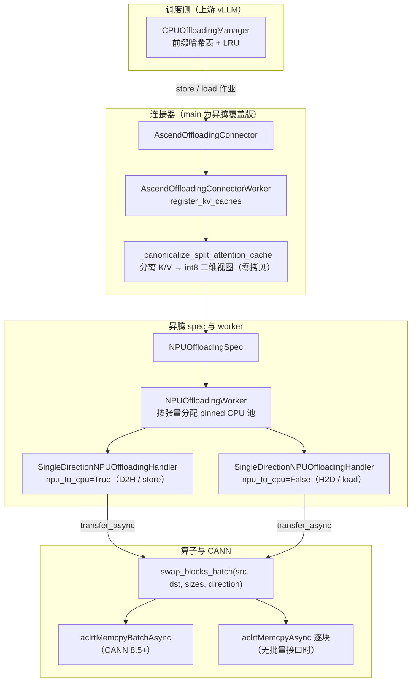

## 一句话

KV Cache CPU Offload 在 NPU 的 KV 块被淘汰之前，把它异步拷一份到主机内存的块池里；下一条请求若与它共享前缀、而 NPU 上那几块已经被别的请求占了，就从 CPU 池异步拷回来，省掉重新 prefill 这一段。昇腾侧不实现淘汰逻辑——块池、LRU、前缀匹配全是上游 vLLM `OffloadingConnector` 的，vllm-ascend 提供的是一个 `NPUOffloadingSpec`：用 NPU 流 + `aclrtMemcpyBatchAsync` 做双向搬运。**两版的配置键完全不同** [!]：v0.23.0 填 `num_cpu_blocks`（块数），main 填 `cpu_bytes_to_use`（字节数）[S2]，`spec_module_path` 的模块路径也换了。

## 为什么需要它

HBM 装不下的时候，vLLM 的默认反应是丢弃：块池满了就按 LRU 把最久没用的块释放掉，下次谁再需要那段前缀，老老实实重新 prefill 一遍。问题在于「丢弃」和「重算」之间的代价差得离谱——一段 1024 token 的前缀在 Qwen3-0.6B 上只占 14 MiB，而把它重算一遍要过 28 层的 QKV 投影、注意力和 MLP。主机内存通常有几百 GiB 闲着，却没有被用起来。

这个特性就是在「丢弃」和「重算」之间插了一层：块被淘汰前先 D2H 拷进主机内存，需要时再 H2D 拷回来。它换的是**带宽换算力**——付出一次跨 PCIe 的往返，省下一次全层前向。官方文档把收益点说得很直接：NPU 内存紧张时能撑更长的上下文或更多并发，而 CPU 命中相比冷启动降低的是重算延迟 [S1]（在线版见 <https://docs.vllm.ai/projects/ascend/en/latest/user_guide/feature_guide/kv_cache_cpu_offload.html>）。

注意它**不省 HBM**。NPU 上的 KV 块池还是 `gpu_memory_utilization` 说了算，这个特性一个字节都不会给你退回来；官方文档反过来提示：把 `gpu_memory_utilization` 调低会让卸载更活跃 [S3]——因为 NPU 侧块池越小，淘汰越频繁，CPU 池的命中机会越多。真正被换掉的是主机内存，而且是 pinned（页锁定）内存，预留过多会直接把宿主机 OOM 掉。

判断某段前缀值不值得留、留多久，是上游 `CPUOffloadingManager` 的 LRU 在管；前缀怎么按哈希匹配、为什么命中的是「块」而不是任意长度，见 [Prefix Caching](prefix-caching.md) 与 [Block Table](block-table.md)。

## 怎么工作



**接管点在哪。** main 把 `OffloadingConnector` 这个名字从 `KVConnectorFactory._registry` 里摘掉，重注册成 `AscendOffloadingConnector`；原因写在注释里——上游的原生卸载 worker 假设一层的 KV 打包成一个张量，而昇腾把 K 和 V 存成两个独立张量。适配只在布局确实不同时才介入：`register_kv_caches` 先扫一遍，`AttentionSpec` 却不是单张量、或 `MambaSpec` 是 list，才走昇腾分支，否则原样调 `super()`。规范化产出的是 `[num_blocks, page_size_bytes]` 的 int8 `as_strided` 视图，别名原 NPU 显存，**模型执行路径上不增加任何分配与拷贝**。

**v0.23.0 不是这样** [!]。那一版的 `register_connector` 里根本没有 `OffloadingConnector` 这一项——用的是上游原版连接器，昇腾只通过配置里的 `spec_module_path` 把 `NPUOffloadingSpec` 插进去。`CpuNpuOffloadingHandler` 给每层固定分配一个装着两张张量的 tuple、形状直接抄 `gpu_tensor[0].shape`，也就是硬编码了「每层恰好 K、V 两段」这个假设，布局不是两段的模型走不通这条路 [D]。main 的规范化层正是为了拆掉这个假设。

main 这边还有一处不得不改的地方：上游 `CPUOffloadingSpec.get_worker()` 会把非 CUDA/XPU 的平台直接拒掉，所以 `NPUOffloadingSpec` 重写了这个方法——只替换掉那道平台门禁与 worker 的构造，worker 缓存与生命周期照用上游的。

**CPU 池怎么分配。** main 逐个规范张量分配：`torch.zeros((num_cpu_blocks, npu_page_size_bytes × blocks_per_chunk), dtype=int8, pin_memory=...)` [C13]。也就是说 CPU 侧一个"块"是 NPU 侧 `blocks_per_chunk` 个块首尾相接的一整段，这个倍数关系被搬运器的断言锁死：`cpu_tensor.shape[1] == npu_tensor.shape[1] * blocks_per_chunk`。v0.23.0 不做 int8 化，CPU 张量保留 NPU 张量的 dtype 和形状，只把第 0 维改成 `num_cpu_blocks × block_size_factor`，且每层固定分配两张。

**一次搬运的时序。** 两版同构。store（D2H）下发前先 `stream.wait_stream(torch.npu.current_stream())`——KV 是在模型主流上写进去的，D2H 不能在写完之前读。然后同方向的后一笔等前一笔的 `end_event`，把这个方向的传输串成一条链。真正的拷贝是一次 `torch.ops._C_ascend.swap_blocks_batch(src, dst, sizes, direction)`，`direction` 0=H2D、1=D2H。完成后 `get_finished` 用 `start_event.elapsed_time(end_event)` 算出实测耗时，连同字节数一起上报成 `TransferResult`——所以带宽不是估出来的，是每笔都被量过的。

**到 CANN 那一层。** `swap_blocks_batch` 把拷贝挂在**当前 NPU 流**上（`c10_npu::getCurrentNPUStream()`），Python 侧的 `with torch.npu.stream(stream)` 决定它落在哪条流。CANN 8.5+ 编到 `CANN_MEMCPY_BATCH_ASYNC` 时，整批描述符压成一次 `aclrtMemcpyBatchAsync` 下发；否则退化成逐描述符的 `aclrtMemcpyAsync` 循环，下发次数等于描述符个数。这段 C++ 两版逐字相同。

**流的数量两版不同，但并发度没变** [!]。v0.23.0 每个方向一条固定流 `d2h_stream` / `h2d_stream`；main 改成每笔传输从 `_stream_pool` 取一条、用完回收。但因为后一笔仍要 `wait_event` 前一笔，同方向实际仍是串行——换池子省的是 `torch.npu.Stream()` 的创建开销，不是拿到了并行。

## 拿真实数字走一遍

Qwen3-0.6B：28 层，`n_kv = 8`，`d_h = 128`，bf16。NPU 块大小默认 128 token。K 与 V 在昇腾上是两个独立张量，所以规范张量共 28 × 2 = **56** 个。

1. **一个张量一块多少字节。** 128 token × 8 head × 128 dim × 2 B = 262144 B = **256 KiB**，这就是 `page_size_bytes` [D]。
2. **一个 NPU 块（全部 56 个张量）多少字节。** 56 × 256 KiB = 14336 KiB = **14 MiB**。
3. **一个 CPU 块多少字节。** 取 `blocks_per_chunk = 8`（官方示例值）：CPU 侧每张量每块 = 256 KiB × 8 = **2 MiB**，跨 56 个张量合计 8 × 14 MiB = **112 MiB**。
4. **4 GiB 预算能装几块。** TP=1 时 `cpu_bytes_to_use = 4 GiB` 全归这一个 worker。4 GiB ÷ 112 MiB = 36.57 → `num_cpu_blocks = 36`（上游还会做块大小对齐，这里是不含对齐的估算）[D]。实占 56 × 36 × 2 MiB = 4032 MiB ≈ **3.94 GiB** pinned 主机内存 [D]。
5. **能缓存多长的前缀。** 36 × 8 × 128 = **36864 token**。全部给一条请求就是 36 K 的上下文，分给多条请求则按前缀哈希共享。
6. **一次 store 作业搬多少。** 一个 chunk = 8 个 NPU 块 × 56 个张量 = **448 个拷贝描述符**，每个 256 KiB，合计 **112 MiB**。CANN 8.5+ 上这 448 个描述符是**一次** `aclrtMemcpyBatchAsync`；老 CANN 上是 448 次 `aclrtMemcpyAsync`。
7. **这一次往返的时间代价。** 设 D2H 有效带宽 20 GB/s [A]，112 MiB ≈ 117.4 MB，一次 store ≈ **5.9 ms**，回填同量再 5.9 ms [D]。这笔时间跑在独立流上，与模型计算重叠，但它占的是同一条主机-设备链路的带宽。

**同样的模型换到 v0.23.0**，文档示例填 `num_cpu_blocks = 1000`、`block_size = 128`（等于 NPU 块大小，故 `block_size_factor = 1`）：CPU 侧每层两张 `[1000, ...]` 的张量，合计 1000 × 14 MiB = **13.67 GiB** 主机内存，能缓存 1000 × 128 = **128000 token**。同一份"看起来很小"的配置，在两版上的主机内存占用差了 3.5 倍——因为一个填的是块数，一个填的是字节数 [!]。

main 上的完整配置：

```python
from vllm import LLM
from vllm.config import KVTransferConfig

kv_transfer_config = KVTransferConfig(
    kv_connector="OffloadingConnector",          # 被昇腾覆盖成 AscendOffloadingConnector
    kv_role="kv_both",                           # 存与取都开，只写不读没意义
    kv_connector_extra_config={
        "cpu_bytes_to_use": 4 * 1024**3,         # 全服务器预算，上游按 worker 分
        "blocks_per_chunk": 8,                   # 8 个 NPU 块合成一个 CPU 块 → 112 MiB/块
        "spec_name": "NPUOffloadingSpec",
        "spec_module_path": "vllm_ascend.distributed.kv_transfer.kv_pool.kv_offload.native.npu",
    },
)

llm = LLM(
    model="Qwen/Qwen3-0.6B",
    gpu_memory_utilization=0.5,                  # 调低会让卸载更活跃
    kv_transfer_config=kv_transfer_config,
)
```

## 事实表

| 项 | v0.23.0 | main | 意味着什么 |
|---|---|---|---|
| 连接器注册 | 注册表里没有 `OffloadingConnector`，用上游原版 | 覆盖成 `AscendOffloadingConnector` | 只有 main 能处理 K/V 分离与 Mamba 布局 |
| `spec_module_path` | `vllm_ascend.kv_offload.npu` | `vllm_ascend.distributed.kv_transfer.kv_pool.kv_offload.native.npu` | 照抄旧配置到 main 会直接 import 失败 |
| 容量参数 | `num_cpu_blocks`，块数，**必填**，缺了抛异常 | `cpu_bytes_to_use`，字节，全服务器预算 | 同一个数字在两版含义完全不同 |
| 分块参数 | `block_size`：CPU 块的 token 数，须为 NPU 块的整数倍 | `blocks_per_chunk`：一个 CPU 块装几个 NPU 块，须 > 0 | 前者是绝对值、后者是倍数，迁移时要换算 |
| `num_cpu_blocks` 的地位 | 唯一容量参数 | 遗留项，折算成 `cpu_bytes_to_use`；≤ 0 抛错 | 旧配置迁到 main 不会静默失效，但新配置别再用 |
| CPU 池张量 | 保留原 dtype，形状 `[num_cpu_blocks × factor, ...]`，每层两张 | `int8` 二维 `[num_cpu_blocks, page_size × blocks_per_chunk]` | main 的池按字节寻址，与模型布局解耦 |
| 一个 NPU 块字节数（Qwen3-0.6B） | 14 MiB | 同左 | 卸载 1024 token 的前缀就是一次 112 MiB 的 DMA [D] |
| 主机内存类型 | pinned（可用时） | pinned（可用时） | 是页锁定内存，预留过多会把宿主机 OOM |
| 传输流 | 每方向一条固定流 | 每笔从流池取一条 | 并发度不变：同方向仍被 `end_event` 串行 |
| e2e 用例 | `@pytest.mark.skip("cpu offload connector is deprecated.")` | 正常执行 | v0.23.0 上这条路径没有 CI 守着，自己验 |

## 常见误解

- **「开了卸载就能省 NPU 显存。」** 不能。NPU 侧 KV 块池的大小完全由 `gpu_memory_utilization` 决定，这个特性只是给被淘汰的块在主机内存里留了个副本。官方文档的建议恰恰相反：**调低** `gpu_memory_utilization` 会让卸载更活跃。它花的是主机内存——4 GiB 预算在 Qwen3-0.6B 上就是 3.94 GiB 的 pinned 内存实打实被锁住 [D]。
- **「两条流 = D2H 和 H2D 并行跑满带宽。」** 两条流只保证两个方向互不阻塞、且都不阻塞模型主流。同一方向内部，后一笔传输显式 `wait_event` 前一笔的结束事件，是严格串行的。main 把固定流换成流池也没有改变这一点。
- **「文档写 `blocks_per_chunk`，那 `block_size` 就是废弃键。」** 没那么确定。main 的文档写的是 `blocks_per_chunk`，但同一个 commit 里的 e2e 用例传的仍是 `block_size`。两个键名当前并存，以哪个为准要看上游 `OffloadingConfig` 的解析（本页未读上游源码）[I]——照文档写最保险。
- **「v0.23.0 上这个特性是稳定可用的。」** 该版本的 e2e 用例被整条 skip 掉，理由写的是「cpu offload connector is deprecated」[C22]。要在 v0.23.0 上用，先自己跑通验收。
