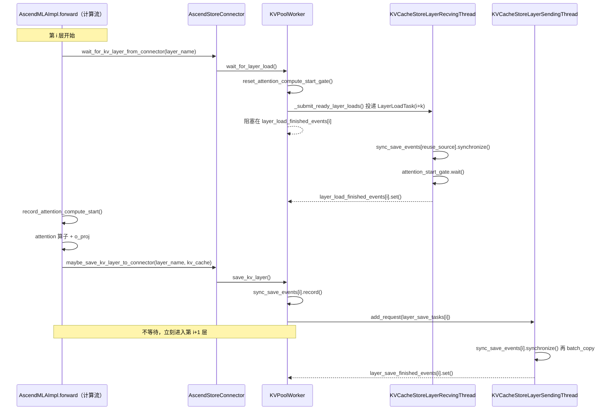

## 一句话

Layerwise KV Offload 把 KV 的存取粒度从「一次请求」降到「一层」：第 *i* 层算完就立刻把它的 KV 发往 memcache 池，第 *i+1* 层的计算与这次搬运并行；反向的加载也一样，算第 *i* 层前只等第 *i* 层的 KV 到位 [S1]。开关是 `AscendStoreConnector` 的 `use_layerwise: true`。main 在此之上多了一层：让多层轮流复用同一份 HBM buffer，把 Prefill 侧的 KV 显存占用压到常数份——这部分 v0.23.0 没有 [!]。

## 为什么需要它

不开 layerwise 时，一个请求的 KV 是整趟前向结束后一次性写出去（或开始前一次性读进来）的。这就是一个串行的墙：长 prompt 下这一次搬运动辄上百 MiB，期间 NPU 只能干等。搬运的总字节数不变，但它被压在了一个点上。

按层切开之后，同样的字节数摊到 28（或 61）个层间隙里。每个间隙里的搬运量只有原来的 1/层数，而每个间隙后面都跟着一层实打实的计算可以拿来遮盖。这是典型的用流水线把一次长阻塞换成多次短阻塞——总时间不变的前提下，可被重叠的部分大幅增加。

main 上还有第二个动机，而且它解决的是显存而不是延迟：如果 KV 反正要马上搬走，那本地这份 HBM buffer 就没必要每层留一个。让第 4 层复用第 1 层的 buffer（等第 1 层确实搬完之后），28 层就只需要 `1 + layerwise_num_shared_buffers` 份 buffer。代价是引入了一个新的等待——第 4 层开始前必须确认第 1 层的 D2H 真的完成了。官方文档把这条路径称作 Prefill 侧的 NPU 显存削减，配合 Decode 侧的[稀疏 KV 卸载](kv-cache-sparse-offload.md)组成一套 P/D 分离部署 [S5]。它额外要求 Memcache 后端与 eager 模式，并且暂时不能与 `MooncakeLayerwiseConnector` 同时使用——按 buffer 粒度的传输完成门控还没实现。

存取本身怎么组织、池后端怎么装、key 怎么算，见 [KV Pool](kv-pool.md)。

## 怎么工作

三层结构：注意力后端里的两个挂钩点 → connector → 两个后台传输线程。挂钩点在 `vllm_ascend/attention/utils.py`，是 `wait_for_kv_layer_from_connector` 与 `maybe_save_kv_layer_to_connector`，都只是把调用转给当前的 KV transfer group。`AscendStoreConnector` 在这两个方法里检查 `use_layerwise`，没开就直接返回。

关键在于摆放位置。以 `AscendMLAImpl` 为例：等待放在 `mla_preprocess_*` 之前，而且**只在 `has_prefill` 为真时才等**；保存放在本层 `o_proj` 之后、返回之前。中间还有第三个点——`record_attention_compute_start()`，它在 attention 算子即将下发前记一个 NPU Event，让后台线程能对齐到计算流真正走到 attention 的时刻，而不是 Python 调用返回的时刻。



**同步点一共三类，两类在 CPU 侧、一类在 NPU 侧：**

- `sync_save_events[i]`：`torch.npu.Event`。保存侧在 `save_kv_layer` 里 `record()`，发送线程在真正 `batch_copy` 之前 `synchronize()`。作用是保证「KV 已经写进 paged cache」这件事在设备上真的完成了，而不只是 Python 调用返回了。
- `layer_load_finished_events[i]` / `layer_save_finished_events[i]`：`threading.Event`。前向线程与两个传输线程之间的 CPU 握手。
- `AttentionComputeStartGate`：跨线程 + 跨流。前向线程 `record()` 一个 Event，传输线程 `wait()` 时对它 `synchronize()`。只对**预取**的层生效——当前层本来就要立刻用，不需要让路。

**预取深度决定重叠多少。** `_submit_ready_layer_loads` 在第 0 层一次性投递 `num_prefetch_layers` 个任务，之后每层补一个，始终保持 `num_prefetch_layers` 层在飞。

**没有独立的传输 stream。** 搬运由 Python 后台线程调 memcache 的 `batch_copy` 发起，与前向的重叠靠的是线程并行加 Event 定序，不是同一进程内两条 NPU stream 互相 `wait_event` [D]。多 TP rank 同时发 H2D 会抢总线，`h2d_stagger_us` 用忙等错开，错开量是 `(tp_rank + layer_id) % tp_size * h2d_stagger_us` [C18]。

### 两个版本的差别

| | v0.23.0 | main |
|---|---|---|
| 逐层存取的主干 | 已完整（`wait_for_layer_load` / `save_kv_layer` / 三类同步点） | 同 |
| 共享 buffer 复用 | 无：`wait_for_save_layer` 恒为 `None`，仓库里没有 `layerwise_cache_layout.py` | 有：`prefetch_layer_map` 给出「第 i 层复用第 j 层的 buffer」，接收线程据此先等 j 层落盘 |
| 栅栏所在模块 | `vllm_ascend/memcache_comm_fence.py` | `.../ascend_store/attention_fence.py`，代码逐字相同 |
| 等待超时的处理 | `wait(timeout=10)` 超时只打一行日志就往下走 | 改成 `while not ...wait(timeout=10)` 循环等，并每轮 `raise_if_failed()` |
| 用户文档 | 只有 [Layerwise KV Pool](https://docs.vllm.ai/projects/ascend/en/v0.23.0/user_guide/feature_guide/layerwise_kv_pool.html)，正文与 main 逐字相同 | 另有 [Layerwise and Sparse KV Cache Offloading](https://docs.vllm.ai/projects/ascend/en/latest/user_guide/feature_guide/layerwise_and_sparse_kv_cache_offloading.html) 讲共享 buffer 与 P/D 组合部署；[Layerwise KV Pool](https://docs.vllm.ai/projects/ascend/en/latest/user_guide/feature_guide/layerwise_kv_pool.html) 仍在 |

超时那一条值得单独留意 [!]：v0.23.0 上如果某层的 KV 10 秒没到齐，前向会带着未就绪的 buffer 继续算下去，症状是精度异常而不是报错。

## 拿真实数字走一遍

`layerwise_num_shared_buffers` 的效果只跟**层数**有关，与 hidden size、头数都无关，所以可以直接拿 Qwen3-0.6B 的 28 层做算术（注意这个模型自己跑不了 layerwise，见下面的误解一节）。配置取官方样例的那一组 [S5]：

```json
{
    "kv_connector": "AscendStoreConnector",
    "kv_role": "kv_producer",
    "kv_connector_extra_config": {
        "backend": "memcache",
        "use_layerwise": true,
        "layerwise_num_shared_buffers": 3,
        "layerwise_independent_layers": [0]
    }
}
```

`build_layerwise_cache_layout(num_layers=28, ...)` 逐步算 [C20]：

1. `independent_layers = [0]`——第 0 层独占一份 buffer。
2. `reused_layers = [1, 2, ..., 27]`，共 27 层参与复用。
3. `has_layer_reuse = 27 > 3` → `True`，复用生效。
4. `prefetch_layer_map = {reused[n]: reused[n-3] for n in 3..26}`。代入就是 `{4:1, 5:2, 6:3, 7:4, ..., 27:24}`，共 24 条，规律是 **第 L 层复用第 L−3 层的 buffer**。
5. `storage_indices`：`[[0]]` 再加 3 个 slot，`slot k = reused_layers[k::3]`：
   - slot 0 → `[1, 4, 7, 10, 13, 16, 19, 22, 25]`（9 层）
   - slot 1 → `[2, 5, 8, 11, 14, 17, 20, 23, 26]`（9 层）
   - slot 2 → `[3, 6, 9, 12, 15, 18, 21, 24, 27]`（9 层）
6. `num_prefetch_layers = min(3, 8) = 3`——没显式写 `layerwise_prefetch_layers` 时取 `min(num_shared_buffers, _DEFAULT_MAX_PREFETCH_LAYERS)`，**不是文档写的 1** [C19]。

于是 28 个 `KVCacheTensor` 描述符被 `apply_layerwise_kv_cache_plan` 合并成 `1 + 3 = 4` 个，日志会打 `Layerwise KV cache reuse merged 28 descriptors into 4 descriptors using 4 buffer assignments.`。这一步发生在 `initialize_kv_cache` 里、KV cache 真正分配之前，所以省下的是真实 HBM：本地 KV buffer 从 28 份降到 4 份，约 **1/7** [D]。

代价也能从同一张表读出来：第 4 层要开始时，必须先确认第 1 层的 D2H 搬完。`layerwise_num_shared_buffers` 越小越省显存、越容易卡在这个等待上；官方建议从 2~4 起步 [S5]。

## 事实表

| 项 | v0.23.0 | main | 意味着什么 |
|---|---|---|---|
| `use_layerwise` 默认 | `false` | `false` | 不写就是整趟前向搬一次，layerwise 的代码路径完全不进 |
| 要求的 `backend` | `memcache` | `memcache` | `mooncake` / `yuanrong` 上设了也没用，得先把 memcache_hybrid 装起来 |
| `layerwise_prefetch_layers` 缺省 | `1` | `min(num_shared_buffers, 8)`，而 `num_shared_buffers` 不填等于层数 → 实际 8 | 同一份配置换到 main 上预取深度从 1 跳到 8，飞行中的临时 buffer 也涨 8 倍 |
| `layerwise_num_shared_buffers` | 不存在 | 缺省 = 层数（即不复用） | 不显式写就拿不到显存收益，只有流水线收益 |
| `layerwise_independent_layers` | 不存在 | 缺省 `[0]`；填 `"all"` 关掉复用 | 第 0 层默认独占，因为它最早被写、最晚有机会被复用 |
| `h2d_stagger_us` 默认 | `0` | `0` | 多 TP rank 抢总线时才需要调；实现是忙等，设大了直接烧 CPU |
| 每层的同步点 | NPU Event ×1 + threading.Event ×2 | 同 | 逐层不是零成本，层数越多固定开销越明显 |
| 加载超时 10s 后 | 放行，继续算 | 循环继续等并检查线程异常 | v0.23.0 上超时表现为精度问题而非报错 [!] |
| `use_layerwise` + TP mismatch | `ValueError` | `ValueError` | P/D 两侧 TP 不一致时这条路走不通，传输线程没实现重切分 |
| 图模式 | 强制 PIECEWISE | 强制 PIECEWISE | `requires_piecewise_for_cudagraph` 返回 `use_layerwise`；逐层挂钩点必须能在图里断开 |

## 常见误解

- **「layerwise 对任何模型都能开。」** 不是。两个版本里调用这对挂钩点的只有 `mla_v1.py`、`sfa_v1.py`、`dsa_v1.py` 和 `dsa_cp.py`；`attention_v1.py` 只调了 `record_attention_compute_start()`，没有 wait/save [C7]。所以 Qwen3 这类普通 GQA 模型即使配上 `use_layerwise: true` 也不会真的逐层搬——开关生效在 connector 层，但没人去调它 [D]。
- **「文档说 `layerwise_prefetch_layers` 默认是 1。」** 那是非 memcache 路径的默认值。而 layerwise 只支持 memcache，所以 main 上实际永远走 `build_layerwise_cache_layout` 那条分支，缺省是 `min(num_shared_buffers, 8)`。文档这一行两个版本都写着 `1` [S2]，在 main 上已经对不上代码。
- **「CP 和 hybrid KV cache 都不支持。」** 文档这么写 [S3]，但 `dsa_cp.py` 在两个版本里都调了 `wait_for_kv_layer_from_connector` 与 `maybe_save_kv_layer_to_connector`；源码里与 layerwise 相关的硬报错只有 TP mismatch 那一条 [C24]。稳妥的读法是：文档说的是「未验证」而非「代码里拦住了」，真要用请自己验 [D]。
