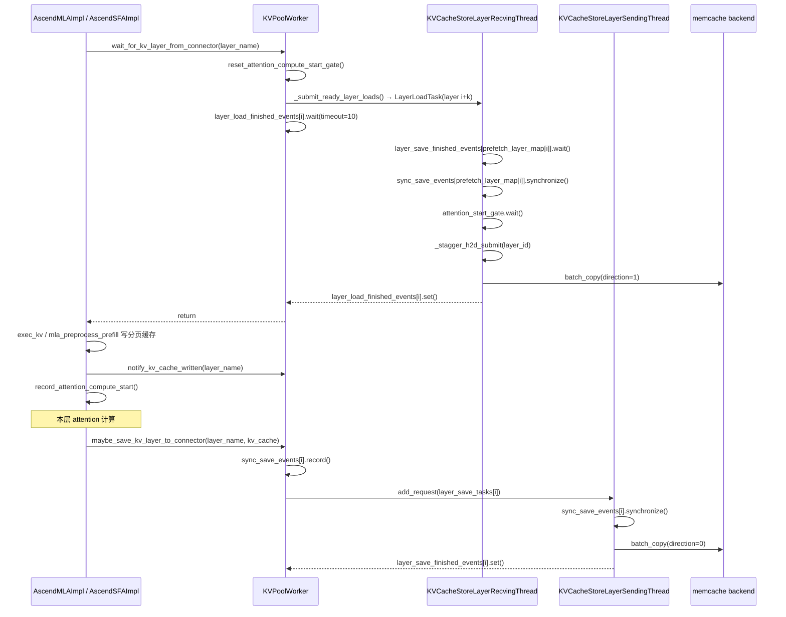
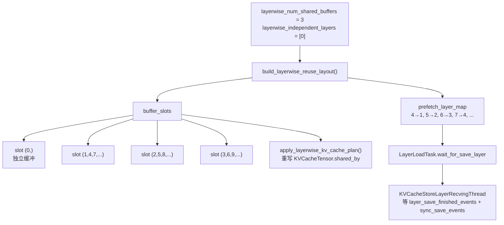

## 一句话

Layerwise KV Offload 把 KV cache 与外部池之间的搬运切到**层粒度**：算完第 *i* 层的 attention 就立刻把这一层的 KV 发出去，算第 *i* 层之前只等第 *i* 层的 KV 到位。搬运因此与相邻层的计算重叠，而不是堆成前向开头／结尾的一次性停顿 [S]。在 memcache 后端上它还附带一个显存优化：多个层共用同一块 HBM KV 缓冲，靠「上一个占用者已经搬走」这个信号串起来 [C]。

## 为什么需要它

不开 layerwise 时，一个请求的 KV 整趟前向结束后一次性存入池子，或者前向开始前一次性从池子取回。官方文档把这种行为直接称为 bulk operation，并指出长 prompt 下它「introduces a serialization stall」[S]。停顿的位置很具体：`AscendStoreConnector.wait_for_save` 在 `use_layerwise` 为真时直接 `return`，为假时才调用 `connector_worker.wait_for_save(...)` 去等整趟传输收尾 [C]。也就是说，关掉 layerwise 的那条路径上，前向的最后一步必须等所有层的 KV 写完。

切到层粒度有两个好处：

第一是**把传输藏进计算**。一层的 KV 体积只有整趟的 1/L，发出去之后紧接着就有下一层的 `qkv_a_proj`、`exec_kv`、attention 可以跑。保存侧甚至不需要主线程等待——`KVPoolWorker.save_kv_layer` 只在计算流上 `record()` 一个 `torch.npu.Event` 就返回，真正的 `synchronize()` 在发送线程里做 [C]。

第二是**让 KV 缓冲可以轮转**。这一条只在 Prefill 卸载场景成立，而且是昇腾侧特有的做法：既然每层的 KV 算完就搬走，那它在 HBM 里的生命周期只有「本层算完」到「搬完」这一小段，不必为 L 层各留一块常驻缓冲。`apply_layerwise_kv_cache_plan` 在 `initialize_kv_cache` 里把每层一个 `KVCacheTensor` 重写成按槽合并的描述符，多层共享一块物理缓冲 [C]。代价是引入了一道跨层的等待：后一个占用者写入前必须确认前一个占用者已经搬完，这就是 `prefetch_layer_map` 与 `wait_for_layer_reuse` 存在的原因 [C]。

和它容易混的是同一篇官方指南里的另一半——Decode 侧的稀疏 KV 卸载。那条路径在 Decode 上根本不保留 NPU 主 KV cache（只留 indexer K cache），按 top-k 把需要的块 H2D 拉进常驻缓冲 [C]，与本页讨论的「按层搬整层」是两套数据面，见 [Sparse KV Offload](kv-cache-sparse-offload.md)。两者官方建议在 PD 分离部署里组合使用：P 侧开 layerwise 卸载，D 侧开稀疏卸载 [S]。

## 怎么工作

三个 hook 定义了注意力层与 connector 的边界，都在 `vllm_ascend/attention/utils.py` 里 [C]：

- `wait_for_kv_layer_from_connector(layer_name)` → `connector.wait_for_layer_load(layer_name)`，本层计算前的等待点；
- `notify_kv_cache_written(layer_name)` → `connector.on_kv_cache_written(...)`，本层 KV 已 scatter 进分页缓存的通知点；
- `maybe_save_kv_layer_to_connector(layer_name, kv_cache)` → `connector.save_kv_layer(...)`，本层的发送点。

`AscendStoreConnector` 对前两个 hook 的实现都以 `if not self.use_layerwise: return` 开头——`use_layerwise` 是逐层路径与整趟路径的唯一分叉 [C]。

### 一层之内的时序



`direction` 的编码在 `_batch_copy_with_limits` 的注释里：0 是存（L2G），1 是取（G2L）[C]。

### 涉及的 stream 与同步点

这套机制里**没有额外的 NPU stream**——传输不是下发到另一条计算流上，而是由两个 Python 线程（`KVCacheStoreLayerSendingThread` / `KVCacheStoreLayerRecvingThread`）调用后端的 `batch_copy` 完成，与计算流的协调靠 `torch.npu.Event` 跨线程 `synchronize()` [C]。per-layer 的同步原语在 `_start_kv_transfer_threads` 里一次性建齐：两组 `threading.Event`（`layer_load_finished_events`、`layer_save_finished_events`）加一组 `torch.npu.Event`（`sync_save_events`）[C]。

值得单独拎出来的是 `AttentionComputeStartGate`。光靠「Python 调到了这一行」判断计算进度是不够的——下发是异步的，调用点返回时算子可能还没开始跑。所以注意力层在提交 attention 之前调 `record_attention_compute_start()`，在当前计算流上打一个 event；传输线程 `wait()` 到这个 event 完成才开始提交搬运，于是「传输开始」对齐的是**计算流真的推进到 attention 边界**，而不是 Python 调用点 [C]。门是每层一把：`wait_for_layer_load` 开头 `reset_attention_compute_start_gate()` 换新，提交预取任务时把当前这把门的引用存进 `LayerLoadTask` [C]。注意只有 `layer_id != self.current_layer` 的预取任务才带门——当前层自己的加载必须立刻开始，不能等 [C]。

### 共享缓冲区怎么排

识别条件是 `get_gva_layerwise_config`：connector 属于 AscendStore 系、`backend == "memcache"`、`use_layerwise` 为真；`MultiConnector` 下逐个子 connector 查 [C]。`pool_worker` 侧对应 `use_gva_layerwise = self.use_layerwise and self.backend_name == "memcache"` [C]。



`build_layerwise_reuse_layout` 先按 KV cache spec 把层分桶（同一桶内形状一致才能共享），再在桶内按步长 `num_shared_buffers` 切片成槽；`prefetch_layer_map[后一个占用者] = 前一个占用者` [C]。只支持 `AttentionSpec`——出现 Mamba 之类的非注意力 spec 会 `NotImplementedError` [C]。合并完成时打出这行日志，官方文档就是让你用它确认复用生效的 [S][C]：

```text
Layerwise KV cache reuse merged 28 descriptors into 4 descriptors using 4 buffer assignments.
```

在 PD 组合部署里还有第二道闸。`AscendMultiConnector` 把子 connector 分成两类：声明了 `supports_layerwise_buffer_reuse` 且实现 `wait_for_layer_reuse` 的 provider（`SfaRemoteD2HConnector`），和其余 sibling。三个 hook 都按「provider 先关门、sibling 后发布工作」两阶段调用，并把 `_wait_for_external_slot_release` 注册给 `AscendStoreConnector` 当等待器 [C]。provider 这一侧的 `wait_for_layer_reuse` 就是 `wait_for_layer_send`：等 D 侧回 READ_DONE / READ_FAILED，确认对端不再读这块缓冲，P 才能覆盖它 [C]。

## 拿真实数字走一遍

取官方 Prefill 示例里的两个参数 `layerwise_num_shared_buffers: 3`、`layerwise_independent_layers: [0]` [S]，层数取 **L = 28**（与本 wiki 其它页用的 Qwen3-0.6B 同为 28 层，便于对照；注意 Qwen3-0.6B 本身是 GQA、走 `attention_v1`，并不能开这个特性，而 `build_layerwise_cache_layout` 的算术只依赖层数）。

代入 `build_layerwise_cache_layout` [C]：

1. `num_shared_buffers = 3`（显式给了）。
2. `layerwise_prefetch_layers` 没给 → `num_prefetch_layers = min(3, 8) = 3`。
3. `independent_layers = [0]`。
4. `reused_layers = [1, 2, ..., 27]`，共 `28 - 1 = 27` 层。
5. `has_layer_reuse = (27 > 3) = True`。
6. `prefetch_layer_map = {reused[i]: reused[i-3]}`，`i` 取 3..26 → `{4:1, 5:2, 6:3, 7:4, ..., 27:24}`，共 `27 - 3 = 24` 条。
7. 槽划分（步长 3）：
   - `(0,)` —— 独立层；
   - `(1, 4, 7, 10, 13, 16, 19, 22, 25)` —— 9 层；
   - `(2, 5, 8, 11, 14, 17, 20, 23, 26)` —— 9 层；
   - `(3, 6, 9, 12, 15, 18, 21, 24, 27)` —— 9 层。
   合计 `1 + 9 + 9 + 9 = 28` ✓，物理缓冲区 `1 + 3 = 4` 块。

于是 HBM 里的 KV 缓冲从 28 块降到 4 块，占比 `4 / 28 = 1/7 ≈ 14.3%`，省掉约 85.7% [D]（按每层 `KVCacheTensor.size` 相等推算；同一槽内要求 `size` 与 spec 完全一致，否则 `_merge_specs` 直接报错 [C]）。

预取窗口怎么推进（`_submit_ready_layer_loads`，`submit_count = num_prefetch_layers if current_layer == 0 else 1` [C]）：

| 当前层 | 本次提交的加载任务 | `next_layer_to_submit` 提交后 | 带 attention 门？ |
|---|---|---|---|
| 0 | 层 0、1、2 | 3 | 层 0 不带（`layer_id == current_layer`），层 1、2 带 |
| 1 | 层 3 | 4 | 带 |
| 2 | 层 4 | 5 | 带 |
| *k* ≥ 1 | 层 *k*+2 | *k*+3 | 带 |

跟着第 4 层走一遍复用等待：层 4 的 `LayerLoadTask` 在当前层 = 2 时提交，任务里 `wait_for_save_layer = prefetch_layer_map[4] = 1`。接收线程拿到它后先 `layer_save_finished_events[1].wait(timeout=10)`（层 1 的 D2H 已由发送线程完成并置位），再 `sync_save_events[1].synchronize()`（补上非保存 TP rank 只 record 未同步的情形），`clear()` 事件，然后才等 attention 门、做 `_stagger_h2d_submit`、发 `batch_copy(direction=1)` 写进槽 `(1,4,7,...)` 那块缓冲 [C]。层 1 的保存在当前层 = 1 时就派发了，到当前层 = 2 才需要它完成，这段就是重叠出来的窗口 [D]。

完整的 Prefill 侧配置（官方示例，变量已按 main 展开；组合部署需要 `--enforce-eager`）[S]：

```bash
--enforce-eager \
--kv-transfer-config '{
    "kv_connector": "MultiConnector",
    "kv_role": "kv_producer",
    "kv_connector_extra_config": {
        "connectors": [
            {
                "kv_connector": "SfaRemoteD2HConnector",
                "kv_role": "kv_producer",
                "kv_connector_extra_config": {
                    "transfer_backend": "memfabric"
                }
            },
            {
                "kv_connector": "AscendStoreConnector",
                "kv_role": "kv_producer",
                "kv_connector_extra_config": {
                    "backend": "memcache",
                    "use_layerwise": true,
                    "layerwise_num_shared_buffers": 3,
                    "layerwise_independent_layers": [0]
                }
            }
        ]
    }
}'
```

每个值的来由：`MultiConnector` 让 `AscendStoreConnector` 把层缓冲卸到 memcache、同时让 `SfaRemoteD2HConnector` 把同一块缓冲暴露给 Decode [S]；`backend: "memcache"` 是共享缓冲区路径的硬条件（`use_gva_layerwise` 要求它）[C]；`layerwise_num_shared_buffers: 3` 落在官方建议的 2–4 区间 [S]；`layerwise_independent_layers: [0]` 就是默认值，把第 0 层留成独立缓冲 [C]。若只想要逐层传输、不要缓冲区复用，把它设成 `"all"`，`reused_layers` 变空、`prefetch_layer_map` 为空、`has_layer_reuse` 为假 [C]。

## 事实表

### 开关与参数

| 项 | 默认 | 取值 / 约束 | 来源 |
|---|---|---|---|
| `use_layerwise`（`AscendStoreConnector`） | `false` | bool | `ascend_store_connector.py#L77-L90` |
| `use_layerwise`（`SfaRemoteD2HConnector`） | `true` | bool | `sfa_pd_rd2h/connector.py#L54-L69` |
| `backend` | `"mooncake"` | 共享缓冲区路径要求 `"memcache"` | `pool_worker.py#L155-L157` |
| `layerwise_num_shared_buffers` | `num_layers`（即不复用） | ≥ 1，官方建议 2–4 | `layerwise_cache_layout.py#L114-L134`；`layerwise_and_sparse_kv_cache_offloading.md#L144-L196` |
| `layerwise_independent_layers` | `[0]` | 整数列表或 `"all"`；支持负索引；越界报 `ValueError` | `layerwise_cache_layout.py#L136-L178` |
| `layerwise_prefetch_layers` | memcache 路径 `min(num_shared_buffers, 8)`；非 memcache 路径 `1` | ≥ 1 | `layerwise_cache_layout.py#L114-L134`；`pool_worker.py#L414-L434` |
| `layerwise_max_transfer_blocks` | `0`（不限） | 每批最多多少 block | `pool_worker.py#L183-L185` |
| `layerwise_max_transfer_bytes` | `0`（不限） | 每批最多多少字节 | `pool_worker.py#L183-L185` |
| `h2d_stagger_us` | `0` | 实际延时 `((tp_rank + layer_id) % tp_size) * h2d_stagger_us` 微秒，忙等实现 | `kv_transfer.py#L1467-L1479` |
| `discard_partial_chunks` | 非 layerwise `true` / layerwise `false` | bool | `layerwise_kv_pool.md#L79-L88` |

### 同步原语与阻塞点

| 原语 | 类型 / 数量 | 谁置位 | 谁等待 | 超时 | 来源 |
|---|---|---|---|---|---|
| `layer_load_finished_events[i]` | `threading.Event` × `num_layers` | 接收线程 | `KVPoolWorker.wait_for_layer_load` | 10 s 轮询 | `pool_worker.py#L463-L471`、`#L1618-L1664` |
| `layer_save_finished_events[i]` | `threading.Event` × `num_layers` | 发送线程 | 末层 `save_kv_layer`；复用层的接收线程 | 10 s 轮询 | `pool_worker.py#L1672-L1699`、`kv_transfer.py#L1484-L1535` |
| `sync_save_events[i]` | `torch.npu.Event` × `num_layers` | `save_kv_layer` 在计算流 `record()` | 发送线程 `synchronize()`；复用层接收线程 `synchronize()` | 无 | `pool_worker.py#L1672-L1699`、`kv_transfer.py#L1358-L1402`、`#L1484-L1535` |
| `AttentionComputeStartGate._event` | `torch.npu.Event`，每层一把门 | `record_attention_compute_start()` | 接收线程 `wait(timeout=10)` | 10 s 轮询 | `attention_fence.py#L27-L61`、`#L64-L91` |
| `get_event` | `threading.Event` | 接收线程 | `retrieve_layer` | 3 s | `pool_worker.py#L463-L471` |

### 调用位置

| 位置 | 调用 | 来源 |
|---|---|---|
| `AscendMLAImpl`，预处理开头（仅 `has_prefill`） | `wait_for_kv_layer_from_connector` | `mla_v1.py#L1898-L1913` |
| `AscendMLAImpl`，预处理末尾 | `notify_kv_cache_written` | `mla_v1.py#L1898-L1913` |
| `AscendMLAImpl`，o_proj 之后 | `maybe_save_kv_layer_to_connector` | `mla_v1.py#L2015-L2020` |
| `AscendSFAImpl`，`exec_kv` 之前 | `wait_for_kv_layer_from_connector` | `sfa_v1.py#L1588-L1600` |
| `AscendSFAImpl`，scatter 之后 | `notify_kv_cache_written` + `record_attention_compute_start` | `sfa_v1.py#L1650-L1659` |
| `AscendSFAImpl`，o_proj 之后 | `maybe_save_kv_layer_to_connector` | `sfa_v1.py#L1692-L1700` |
| `NPUModelRunner.initialize_kv_cache`，attention backend 初始化之前 | `apply_layerwise_kv_cache_plan` | `model_runner_v1.py#L3917-L3923` |

### 适用范围与互斥

| 项 | 状态 | 来源 |
|---|---|---|
| 注意力后端 | MLA（`mla_v1`）、SFA（`sfa_v1`）已接入；官方另列 DSA 可用于共享缓冲区版 | `layerwise_kv_pool.md#L224-L245`；`layerwise_and_sparse_kv_cache_offloading.md#L144-L196` |
| `attention_v1` 与 CP 变体（`mla_cp`/`sfa_cp`/`attention_cp`） | 未接入逐层 wait/save | `layerwise_kv_pool.md#L224-L245` |
| 组合部署已验证模型族 | GLM-5.1、GLM-5.2、DeepSeek-V3.2 | `layerwise_and_sparse_kv_cache_offloading.md#L12-L21` |
| `kv_role` | `kv_both` / `kv_producer` / `kv_consumer` 均可（纯 consumer 不发布 KV） | `ascend_store_connector.py#L227-L251` |
| 后端 | 仅 `memcache`（`mooncake`、`yuanrong` 不支持） | `layerwise_kv_pool.md#L224-L245` |
| TP mismatch | `ValueError` | `pool_worker.py#L236-L241` |
| Hybrid KV cache（多 KV cache group family） | 不支持，`NotImplementedError` | `layerwise_kv_pool.md#L224-L245` |
| 非 `AttentionSpec` 的 cache spec（如 Mamba）+ 缓冲区复用 | `NotImplementedError` | `layerwise_cache_layout.py#L245-L276` |
| 图模式 | 开 `use_layerwise` 时要求 PIECEWISE；共享缓冲区版官方要求 eager | `ascend_store_connector.py#L77-L90`；`layerwise_and_sparse_kv_cache_offloading.md#L260-L268` |
| 缓冲区复用 + `MooncakeLayerwiseConnector` | 暂不支持（缺 per-buffer 完成门控） | `layerwise_and_sparse_kv_cache_offloading.md#L260-L268` |
| `batch_copy` 方向编码 | `0` = 存（L2G），`1` = 取（G2L） | `kv_transfer.py#L435-L445` |

官方文档在线地址：[Layerwise KV Pool](https://docs.vllm.ai/projects/ascend/en/latest/user_guide/feature_guide/layerwise_kv_pool.html)、[Layerwise and Sparse KV Cache Offloading Guide](https://docs.vllm.ai/projects/ascend/en/latest/user_guide/feature_guide/layerwise_and_sparse_kv_cache_offloading.html)。

## 常见误解

- **「逐层传输用了一条独立的 NPU 传输流」**——不是。搬运由两个 Python 线程调后端 `batch_copy` 完成，跨线程协调靠 per-layer 的 `torch.npu.Event`；代码里没有为此新建 stream [C]。
- **「`layerwise_prefetch_layers` 默认是 1」**——官方参数表这么写 [S]，但那个默认只在非 memcache 路径上生效；开了 `use_layerwise` 且 `backend: "memcache"` 时走的是 `build_layerwise_cache_layout`，默认值是 `min(layerwise_num_shared_buffers, 8)` [C]。
- **「开了 `use_layerwise` 就自动省显存」**——不一定。`layerwise_num_shared_buffers` 不给就等于层数，`has_layer_reuse` 为假，`apply_layerwise_kv_cache_plan` 直接返回，显存布局不变 [C]。要省显存必须显式把它调小。
- **「预取任务一提交就开始搬」**——不会。非当前层的加载任务带着 `AttentionComputeStartGate`，要等计算流真的推进到上一层 attention 才放行，免得预取抢走当前层的带宽 [C]。
- **「MLA 每层都会等一次加载」**——只有 `has_prefill` 为真的步才调 `wait_for_kv_layer_from_connector`；纯 decode 步跳过这个等待点 [C]。

## 接着看

- [KV Pool](kv-pool.md) —— 本特性是 KV Pool 的一种传输模式，池子本身的后端、key 布局、lookup 流程在那页。
- [Sparse KV Offload](kv-cache-sparse-offload.md) —— 官方建议与本特性组合的 Decode 侧另一半，数据面完全不同。
- [CPU Offload](kv-cache-cpu-offload.md) —— 同样是把 KV 搬出 HBM，但粒度与触发时机是另一套，值得对照看「搬什么时候搬」的取舍。
- [Prefix Caching](prefix-caching.md) —— PD-Mixed（`kv_both`）下池子扮演的就是跨请求前缀缓存，命中逻辑在那页。
- [Block Table](block-table.md) —— 逐层搬运的地址是按 block 拼出来的，块号到物理位置的映射看这页。
