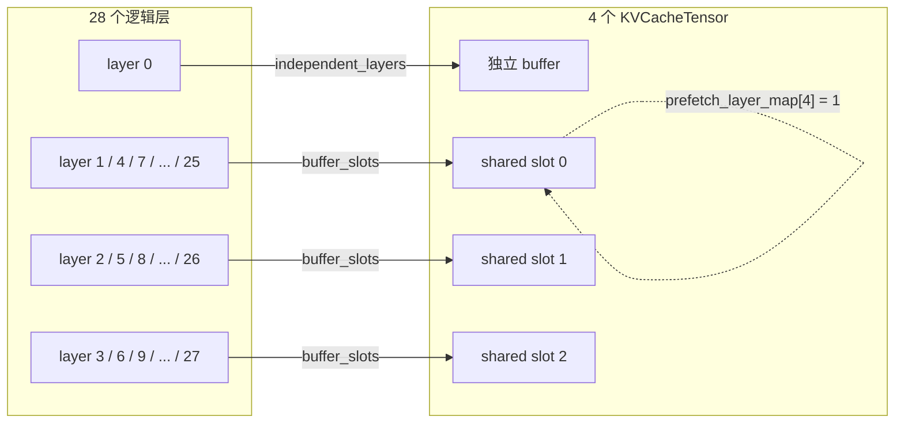
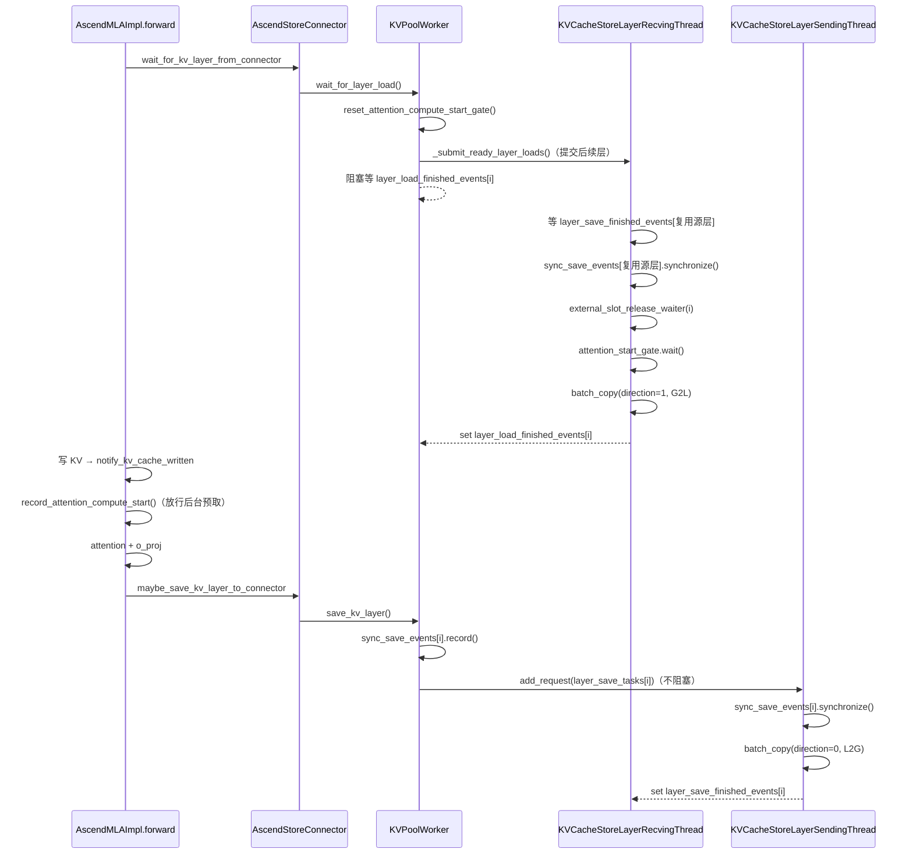

## 一句话

逐层 KV 卸载（Layerwise KV Offload）把「整份 KV 一次搬完」改成「算完一层搬一层」：注意力后端在每层前后各插一个挂钩点，`AscendStoreConnector` 据此把这一层的 KV 存进 / 取出 Memcache 池，搬运交给后台线程，与下一层的计算重叠。在此之上，多个逻辑层还可以共用少数几块物理 KV buffer，把 Prefill 侧主 KV 的 HBM 占用压到 `物理 buffer 数 / 层数`。

## 为什么需要它

不开逐层时，一个请求的 KV 是一次 bulk 操作：前向全部跑完才整份存进池，或者整份取回池才开始前向 [S32]。长 prompt 下这段传输完全串行在计算之外——池在 host 或远端，几十层的 KV 一次性过总线，这段时间 NPU 空转。

逐层把这段串行时间摊进前向里：第 *i* 层算完就立刻发出这一层的保存，第 *i+1* 层的计算与它并行；取的方向对称，进第 *i* 层之前只等第 *i* 层到位，第 *i+1* 层在后台继续拉。

为什么这招在 Prefill 上成立、在 Decode 上不成立，上游设计文档给了明确理由：Prefill 每层计算量大，足以掩盖一整层的传输；Decode 每 token 计算量小，每步拉一整层的延迟藏不住，所以 Decode 改用只搬 top-k 命中行的做法 [S37]。两者在同一套 P/D 分离部署里是配合关系，Decode 侧的做法见 [Sparse KV Offload](kv-cache-sparse-offload.md)。

第二个动机与重叠无关，是省显存。既然任一时刻只有少数几层的 KV 真正在被读写，Prefill 节点就不必为每层各留一块 buffer：把兼容的层轮转映射到 B 块共享 buffer 上，主 KV 的 HBM 占用比例约等于 `物理 buffer 数 / 层数` [S38]。代价是引入了一条新的正确性约束——一块 buffer 被覆盖前，上一轮内容的所有消费者都必须读完。

池本身（键怎么算、backend 怎么选、命中怎么查）属于 [KV Pool](kv-pool.md)，这里不重复。

## 怎么工作

分三件事：启动期的 buffer 规划、每层的挂钩点与同步点、后台线程真正做的搬运。

### 启动期：把每层一个张量合并成每 slot 一个

`apply_layerwise_kv_cache_plan` 在 `initialize_kv_cache` 里、真正分配 KV 张量之前改写 `kv_cache_config.kv_cache_tensors`。它把同一 slot 的若干逻辑层合并成一个 `KVCacheTensor(shared_by=[...], size=...)`——`size` 不变，描述符数量变少，省下来的显存就是这么来的 [C26]。合并前有两道硬校验：同 slot 各层的 tensor size 必须相等、cache spec 必须完全相同，否则直接抛错而不是错位共享。MTP 层参与同一套规划。

这条路径只在「连接器是 `AscendStoreConnector`（或 `MooncakeConnectorStoreV1`）、`backend` 是 `memcache`、`use_layerwise` 为真」时才启用，且支持从 `MultiConnector` 的子连接器配置里把这段挖出来。worker 侧对应的判定式就是 `use_gva_layerwise = self.use_layerwise and self.backend_name == "memcache"` [C11]。



虚线是 `prefetch_layer_map`：层 4 要覆盖的这块 buffer 上一轮属于层 1，所以加载层 4 之前必须先确认层 1 的保存已经落地 [C25]。

### 每层：四个挂钩点、两类 event

注意力实现里按顺序出现四个调用（以 MLA 为例）：

- `wait_for_kv_layer_from_connector(layer_name)`——只在 `has_prefill` 时调，进这一层前等 KV 到位；
- KV 写入 paged cache 后立刻 `notify_kv_cache_written(layer_name)`，让连接器在 scatter 处就能派发传输；
- 提交 attention 算子之前 `record_attention_compute_start()`，在计算流上打一个 NPU event；
- 层尾（`o_proj` 之后）`maybe_save_kv_layer_to_connector(layer_name, list(kv_cache))`。

前两个与最后一个都会先检查有没有 KV transfer group、`attn_metadata` 是否为空，再转给连接器；连接器侧若没开 `use_layerwise` 则直接返回，这就是「不开就完全无开销」的地方 [C10]。



几个容易看漏的点：

- **保存不阻塞。** `save_kv_layer` 记完 event 就把任务丢进发送线程队列并让 `current_layer += 1`；只有最后一层才会在这里等 `layer_save_finished_events[num_layers - 1]` [C17]。
- **加载会阻塞，但只阻塞当前层。** `wait_for_layer_load` 先重置栅栏、再提交后续层的加载任务，然后才等当前层的 `threading.Event`，超时 10 秒只是打日志继续等 [C16]。
- **预取深度只在第 0 层用满。** 第 0 层一次提交 `num_prefetch_layers` 个加载任务，之后每层补提交一个，形成滑动窗口。
- **栅栏是每层一个。** `AttentionComputeStartGate` 记录的是计算流上的 NPU event；后台线程等的是「计算流真正走到 attention」，而不是「Python 调到了这一行」[C7]。预取任务提交时抓住当时那一只栅栏，只有非当前层的加载才挂栅栏（当前层本来就要立刻等）。

### 搬运：后台线程 + Memcache 的 batch_copy

`use_layerwise` 为真时，worker 按层数各建一组 `threading.Event`（load / save 完成）与一组 `torch.npu.Event`（`sync_save_events`），再起一对线程。真正的搬运是 Memcache 的 `batch_copy(gvas, addrs, sizes, direction)`，`direction=0` 是存（L2G）、`1` 是取（G2L）；`layerwise_max_transfer_blocks` / `layerwise_max_transfer_bytes` 在这里把一次大批切成多次。

所以**这里没有第二条 NPU stream**：传输由 CPU 侧线程发起，跨越计算流的只有两类 event——`sync_save_events[i]`（发送线程搬之前 `synchronize()`，确保这一层 KV 已写完）和 `AttentionComputeStartGate`（接收线程搬之前等，确保不抢计算的起跑时间）。多 TP 时 `h2d_stagger_us` 按 `(tp_rank + layer_id) % tp_size` 算出槽位并忙等错峰，避免各 rank 同时压总线 [C20]。

### 联合部署：谁说了算「这块 buffer 可以覆盖了」

Prefill 用 `MultiConnector` 同时挂 `SfaRemoteD2HConnector` 与 `AscendStoreConnector` 时，前者自报 `supports_layerwise_buffer_reuse = True` 并提供 `wait_for_layer_reuse`（等价于等这一层发送完成）。`AscendMultiConnector` 把这个等待包成 `external_slot_release_waiter` 注入 AscendStore，并保证「完成信号提供方」总是先于其它连接器执行——不管配置里两者的书写顺序如何。于是 buffer 复用的闸门要求 Memcache 保存与 Decode 远端读**都**完成。

## 拿真实数字走一遍

拿 28 层、`layerwise_num_shared_buffers: 3`、`layerwise_independent_layers: [0]` 走一遍 `build_layerwise_cache_layout`。28 是本 wiki 教学模型 Qwen3-0.6B 的层数，但**它本身走不到这条路径**（`attention_v1` 没接入逐层调用），这里只借它的层数做算术。

1. 独立层 `independent_layers = [0]`，可复用层 `reused_layers = [1, 2, ..., 27]`，共 27 个。
2. `has_layer_reuse = 27 > 3 = True`——只要可复用层数不超过 buffer 数，这里就是 `False`，整套复用直接不启用。
3. `prefetch_layer_map`：对 `next_index` 从 3 到 26，`reused[next_index] → reused[next_index - 3]`，即层 4→1、5→2、…、27→24，共 24 条。规律是**层 L 复用层 L-3 的 buffer**。
4. `storage_indices`：`[[0]]`，再加三个共享槽
   - slot 0 = 层 1, 4, 7, 10, 13, 16, 19, 22, 25（9 层）
   - slot 1 = 层 2, 5, 8, 11, 14, 17, 20, 23, 26（9 层）
   - slot 2 = 层 3, 6, 9, 12, 15, 18, 21, 24, 27（9 层）
5. 物理 buffer 数 = `I + min(B, R)` = `1 + min(3, 27)` = **4**；主 KV 的 HBM 占用比例 ≈ 4 / 28 = **14.3%**。若每层主 KV buffer 是 *S* 字节，总量从 28*S* 降到 4*S* [D]。
6. `num_prefetch_layers` 没配，取 `min(num_shared_buffers, 8)` = `min(3, 8)` = **3**——第 0 层一次提交 3 个加载任务 [C23]。

对应的 Prefill 启动配置（取自官方指南 [S35]，[在线版](https://docs.vllm.ai/projects/ascend/en/latest/user_guide/feature_guide/layerwise_and_sparse_kv_cache_offloading.html)）：

```bash
--enforce-eager \
--kv-transfer-config '{
    "kv_connector": "MultiConnector",
    "kv_role": "kv_producer",
    "kv_connector_extra_config": {
        "connectors": [
            {
                "kv_connector": "SfaRemoteD2HConnector",
                "kv_role": "kv_producer",
                "kv_connector_extra_config": {
                    "transfer_backend": "memfabric"
                }
            },
            {
                "kv_connector": "AscendStoreConnector",
                "kv_role": "kv_producer",
                "kv_connector_extra_config": {
                    "backend": "memcache",
                    "use_layerwise": true,
                    "layerwise_num_shared_buffers": 3,
                    "layerwise_independent_layers": [0]
                }
            }
        ]
    }
}'
```

每个值的来由：`MultiConnector` 是为了让 `SfaRemoteD2HConnector` 提供「Decode 已读完」的完成信号，否则 buffer 复用没有第二道闸门 [C27]；`backend: "memcache"` 是硬条件，别的 backend 下 `use_gva_layerwise` 为假、整套规划不启用；`3` 对应上面算出的 4 块物理 buffer，官方建议从 2~4 起调；`[0]` 是默认值，第 0 层保持独占；`--enforce-eager` 来自共享 buffer 部署的限制 [S36]。

启动后可以拿这行日志核对规划结果（描述符数量应从 28+ 降到 buffer 数）：

```text
Layerwise KV cache reuse merged ... descriptors into ... descriptors using ... buffer assignments.
```

## 事实表

| 项 | 值 | 来源 |
| :-- | :-- | :-- |
| `use_layerwise` 默认 | `false` | `layerwise_kv_pool.md#L81` |
| `backend` 要求 | 仅 `memcache`；判定式 `use_layerwise and backend_name == "memcache"` | `pool_worker.py#L155-L157` |
| `layerwise_num_shared_buffers` 默认 | 未配置时 = 层数（等价于不复用） | `layerwise_cache_layout.py#L118-L126` |
| `layerwise_independent_layers` 默认 | `[0]`；可写负索引、可写 `"all"`（全独占） | `layerwise_cache_layout.py#L136-L156` |
| `layerwise_prefetch_layers` 默认 | GVA 路径：`min(num_shared_buffers, 8)`；非 GVA 路径：`1` | `layerwise_cache_layout.py#L128-L134`、`pool_worker.py#L434` |
| `layerwise_max_transfer_blocks` / `_bytes` 默认 | `0` / `0`（不限） | `pool_worker.py#L183-L185` |
| `h2d_stagger_us` 默认 | `0`；延迟 = `((tp_rank + layer_id) % tp_size) * h2d_stagger_us` 微秒忙等 | `kv_transfer.py#L1467-L1479` |
| 物理 buffer 数 | `I + min(B, R)`，`R = N - I` | 设计文档 `#L100-L109` |
| 主 KV HBM 占用比例 | ≈ 物理 buffer 数 / 层数（仅主 KV，不含 indexer） | 设计文档 `#L107-L114` |
| 复用启用条件 | `has_layer_reuse = len(reused_layers) > num_shared_buffers` | `layerwise_cache_layout.py#L160` |
| 每层同步对象 | `layer_load_finished_events[i]`、`layer_save_finished_events[i]`（`threading.Event`）、`sync_save_events[i]`（`torch.npu.Event`） | `pool_worker.py#L467-L471` |
| 传输线程（GVA 路径） | `KVCacheStoreLayerSendingThread` / `KVCacheStoreLayerRecvingThread` | `pool_worker.py#L473-L534` |
| 搬运原语与方向 | `batch_copy(gvas, addrs, sizes, direction)`，`0` = 存（L2G）、`1` = 取（G2L） | `kv_transfer.py#L438-L473` |
| 保存侧同步点 | 发送线程搬运前 `sync_save_events[layer].synchronize()` | `kv_transfer.py#L1359` |
| 加载侧同步点 | 复用源层的 save 事件 + `sync_save_events[源层].synchronize()` + `external_slot_release_waiter` + `attention_start_gate.wait()` | `kv_transfer.py#L1489-L1535` |
| 阻塞点 | 仅「当前层加载」与「最后一层保存」阻塞前向 | `pool_worker.py#L1661`、`#L1688-L1691` |
| 已接入的注意力后端 | `mla_v1`、`sfa_v1`、`dsa_v1`、`dsa_cp` | `mla_v1.py#L1901`、`sfa_v1.py#L1698`、`dsa_v1.py#L1284`、`dsa_cp.py#L1434` |
| 未接入 | `attention_v1`、`attention_cp`、`mla_cp`、`sfa_cp`（无 wait/save 调用） | `layerwise_kv_pool.md#L229-L231` |
| 图模式 | `use_layerwise` 为真时 `requires_piecewise_for_cudagraph` 返回 `True`（禁整图） | `ascend_store_connector.py#L77-L83` |
| 共享 buffer 部署要求 | Memcache + eager 模式 | `layerwise_and_sparse_kv_cache_offloading.md#L262` |
| 不支持 | hybrid KV cache（非 `AttentionSpec` 直接 `NotImplementedError`）、预共享/打包的 tensor 描述符、与 `MooncakeLayerwiseConnector` 组合复用 | `layerwise_cache_layout.py#L255-L267`、`#L302-L305`、`layerwise_and_sparse_kv_cache_offloading.md#L266-L268` |
| PD 分离额外要求 | 需专用 layerwise 代理（提供 `/v1/metaserver`），普通 disagg 代理不行 | `layerwise_kv_pool.md#L242-L245` |

## 常见误解

- **「开了 `use_layerwise` 就省显存」——不。** 它换来的是重叠；省显存来自 `layerwise_num_shared_buffers`，而且只有当可复用层数**严格大于** buffer 数时 `has_layer_reuse` 才为真、描述符才会合并；不配这一项时它默认等于层数，规划算出来就是「不复用」。
- **「传输跑在另一条 NPU stream 上」——不。** 搬运由 CPU 侧后台线程调 Memcache 的 `batch_copy` 发起，与计算流的关系只通过两类 event 表达：`sync_save_events[i]` 保证搬之前 KV 已写完 [C19]，`AttentionComputeStartGate` 保证搬不早于计算流进入 attention。调不了 stream 优先级，能调的是 `h2d_stagger_us` 与两个 `max_transfer_*`。
- **「CP 都没接入」——文档如此，代码已经不完全是。** 官方文档点名 `mla_cp` / `sfa_cp` / `attention_cp` 未接入逐层 wait/save [S34]，这三个在本 commit 确实没有；但 `dsa_cp.py` 已经直接调用了 `wait_for_kv_layer_from_connector` [C6]，文档未同步 [!]。判断能不能用请以自己那条后端路径的源码为准。
