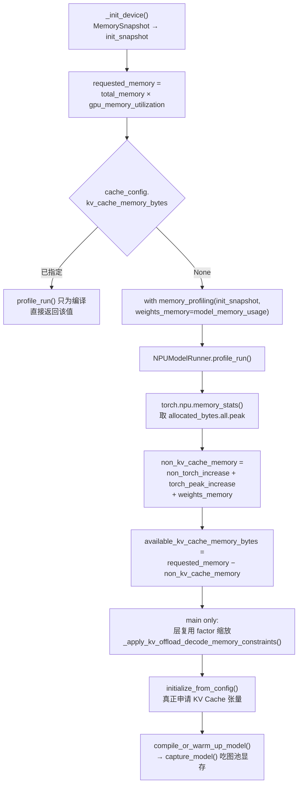

## 一句话

引擎起来后、KV Cache 分配前，`NPUWorker.determine_available_memory()` 借 `profile_run()` 跑一遍最大规模的假数据前向，量出权重、激活峰值、非 torch 三块显存，然后用 `整卡 total_memory × gpu_memory_utilization − 这三块` 定下 KV Cache 的字节预算。这个数字是后面一切分块、调度、抢占的总量上限。

## 为什么需要它

KV Cache 要的是「剩下的全部显存」，可这个「剩下」在启动那一刻没人知道。权重多大要看模型和量化方式，激活峰值要看 `max_num_batched_tokens` 和算子实现，还有一大块谁都数不清的非 torch 占用——ACL context、HCCL 通信缓冲、驱动层分配。写死一个常数必然要么浪费显存，要么在第一个长请求上炸。

所以 vLLM 选择实测：先拍一张启动快照，再故意跑一次「最坏情况」的前向，两张快照一减就是模型跑起来真正要吃掉的量。剩下的都给 KV Cache。

昇腾侧和上游的关键分歧在**分母**。`gpu_memory_utilization` 乘的是 `init_snapshot.total_memory`，也就是整卡容量，而不是启动时的空闲容量 [C1]。这条选择是有代价也有理由的：好处是同一张卡上起两个实例，各自 `--gpu-memory-utilization 0.4`，第二个实例照样按 `64 × 0.4 = 25.6 GiB` 立预算，不会因为第一个实例已经占了 25.6 GiB 就把自己算成负数——上游为此专门留了回归测试。坏处是这个乘法不认账：卡上被别的进程占走的显存不会自动从预算里扣，只在启动时做一次「空闲 < 请求量就直接报 `ValueError`」的粗检查。

官方文档把 `gpu_memory_utilization`（默认 `0.9`）定位成 OOM 时的第一个旋钮：调小它是为了给运行期的显存碎片留余量。CPU offload 的文档更直接，把调小它当作驱动卸载的手柄——具体见 [KV Cache CPU Offload](kv-cache-cpu-offload.md)。

## 怎么工作



四个输入各有出处。`weights_memory` 不是现算的，是 `load_model()` 期间 `DeviceMemoryProfiler` 记下的 `model_memory_usage`。`torch_peak_increase` 被**手动覆写**过：代码在 `memory_profiling` 上下文**内部**、图捕获之前单独读一次 `allocated_bytes.all.peak`，再减去 profiling 前的峰值，为的是不把图池分配算成激活。`non_torch_increase` 由上游 `memory_profiling` 从两张快照的差值里推出来。`requested_memory` 在 `_init_device()` 里就算好了。

`profile_run()` 被 vllm-ascend 加过料，且两版加的不是同一件事 [!]：main 里多了 sparse offload 的 topk 缓冲预分配，v0.23.0 里多了 PCP 分支——`pcp_size > 1` 时把 `max_num_tokens` 缩小到 `ceil(max_num_tokens / (pcp_size × 2)) × 2` 再跑，跑完还原。后者会直接压低测出的激活峰值，从而放大 KV 预算。

**图捕获的显存不在预算里**。`capture_model()` 在 `compile_or_warm_up_model()` 里调用，那时 KV Cache 张量早已申请完毕；它的返回值是实测的图池字节数。单元测试还明确断言不调用上游的 `profile_cudagraph_memory`、不设 `npugraph_memory_estimate`。官方模型手册记录过这个坑的真实后果：自动 profiling 顺利通过，图捕获阶段峰值超限，worker 直接 `died unexpectedly` [S20]。

算完主公式后，main 还有两道 v0.23.0 没有的后处理 [!]：[Layerwise Offload](kv-cache-layerwise-offload.md) 开启且存在层复用时，预算乘上 `层数 ÷ 缓冲区个数` 这个 factor；[Sparse KV Offload](kv-cache-sparse-offload.md) 开启时，整个数字交给 `plan_sparse_kv_offload_memory` 按 NPU、DRAM、workload 三个上限重新规划，返回 `final_planner_bytes`。v0.23.0 算完主公式就 `return`。

Atlas 300I Duo（310P）整个方法被覆盖，预算**再整除 2**，注释说明是给算子 workspace 和其它缓存留地方；RC 形态下还改用 `psutil.virtual_memory()` 统计，因为主机内存与设备内存共享 [C14]。这一段两版逐字相同。

预算落到 `initialize_from_config()` 后怎么切成块，是 [KV Cache Spec](kv-cache-spec.md) 的事。

## 拿真实数字走一遍

Qwen3-0.6B（H=1024，n_q=16，n_kv=8，d_h=128，28 层，bf16），单卡 Atlas 800I A2，`total_memory` 按 64 GiB 计 [A]。

```bash
vllm serve Qwen/Qwen3-0.6B \
  --gpu-memory-utilization 0.9 \
  --max-model-len 32768 \
  --block-size 128
```

- `--gpu-memory-utilization 0.9`：默认值，官方 OOM 指南就是从它开始调。
- `--block-size 128`：取值约束见 [KV Cache Spec](kv-cache-spec.md)；本例按 128 算 [A]。

**第一步，立预算。**

```
requested_memory = 64 GiB × 0.9 = 57.60 GiB
```

**第二步，量三块。** 权重可以推出来：每层 attn `1024×2048 + 1024×1024 + 1024×1024 + 2048×1024 = 6.29M`，MLP（intermediate=3072）`3 × 1024×3072 = 9.44M`，合计每层 15.73M，×28 层 = 440.4M；加上 tied 词表 `151936×1024 = 155.6M`，共约 596M 参数，bf16 下 `596M × 2 B = 1.192 GB = 1.11 GiB` [D]。另两块只能实测，这里取一组典型值 [A]：

| 分类 | 值 | 来源 |
|---|---|---|
| `weights_memory` | 1.11 GiB | 推算 [D] |
| `torch_peak_increase` | 2.30 GiB | 假设的实测值 [A] |
| `non_torch_increase` | 1.20 GiB | 假设的实测值 [A] |

```
non_kv_cache_memory = 1.11 + 2.30 + 1.20 = 4.61 GiB
```

**第三步，算预算。**

```
available_kv_cache_memory_bytes = 57.60 − 4.61 = 52.99 GiB
```

**第四步，换成块数。** 每 token 每层的 KV 字节：`2（K 和 V）× n_kv 8 × d_h 128 × 2 B = 4096 B = 4 KiB`；28 层共 `112 KiB` [D]。每块 128 token：`128 × 112 KiB = 14 MiB`。

```
块数 = 52.99 GiB × 1024 ÷ 14 MiB = 54261.8 ÷ 14 = 3875 块
可缓存 token = 3875 × 128 = 496,000
```

**第五步，看日志里的建议值。** 图捕获跑完后假设图池吃了 1.80 GiB、启动时空闲 63.2 GiB [A]，`redundancy_buffer` 固定 150 MiB = 0.146 GiB [C8]：

```
non_kv_memory          = 1.11 + 2.30 + 1.20 + 1.80 = 6.41 GiB
suggested_to_requested = 57.60 − 6.41 − 0.146 = 51.04 GiB
suggested_to_gpu_limit = 63.20 − 6.41 − 0.146 = 56.64 GiB
```

第一个数比刚才的 52.99 GiB 小了 1.95 GiB——差额正是图池那 1.80 GiB 加安全余量。日志会把它写成一条可直接抄的 `--kv-cache-memory=<字节数>`，这就是把「预算没算图捕获」这个缺口补回来的官方办法。

同一台机器换成 310P，最后一步要再折半：`52.99 ÷ 2 = 26.49 GiB`，块数掉到 1937。

## 事实表

| 项 | v0.23.0 | main | 意味着什么 |
|---|---|---|---|
| `requested_memory` 算式 | `total_memory × gpu_memory_utilization` | 同左 | 分母是整卡容量，不是空闲容量；别人占走的显存不会自动扣 |
| `gpu_memory_utilization` 默认值 | `0.9` | `0.9` | 64 GiB 卡默认按 57.6 GiB 立预算 |
| KV 预算主公式 | `requested_memory − non_kv_cache_memory` 后直接返回 | 同式，再过层复用缩放与 sparse 重规划 | main 上开了这两个特性，返回值不等于主公式 [!] |
| `non_kv_cache_memory` 组成 | `non_torch_increase + torch_peak_increase + weights_memory` | 同 | 只有三项，图池不在内 |
| 图捕获显存是否扣除 | 否 | 否 | profiling 通过不代表 `capture_model()` 跑得过 |
| 预算为负时 | 原样返回负数 | 原样返回负数 | 不夹到 0，错误推迟到分配阶段才爆 |
| `--kv-cache-memory-bytes` 快路径 | 跳过全部 profiling 计算，直接返回该值 | 同，但仍过一遍 sparse 规划 | 该值不受 `gpu_memory_utilization` 约束 [!] |
| 建议值安全余量 | `150 MiB` | `150 MiB` | 日志给的 `--kv-cache-memory` 已扣掉这块 |
| 310P 预算 | 主公式结果 `// 2` | 主公式结果 `// 2` | 同样的卡同样的配置，310P 只拿到一半 |
| `profile_run()` 的昇腾加料 | EPLB 预热 + MC2 dummy run + PCP token 切分 | EPLB 预热 + MC2 dummy run + sparse topk 缓冲 | v0.23.0 开 PCP 会压低激活峰值、放大预算 [!] |

## 常见误解

- **「`gpu_memory_utilization=0.9` 是最多用掉空闲显存的 90%」**——分母是整卡 `total_memory`，不是 `free_memory`。卡上已经跑着别的东西时，0.9 意味着你要走的是整卡的九成，只有启动那一刻的「空闲够不够」会被检查一次。
- **「profiling 过了就不会 OOM」**——预算里没有图池那一块，`capture_model()` 在 KV Cache 分配之后才吃显存。官方模型手册里就有 profiling 通过、图捕获把 worker 撑死的实测记录 [S20]。
- **「预算算成负数会兜底成 0」**——不会，`int()` 之后原样返回负值，单元测试专门锁住了这个行为 [C18]。真正的报错要等到按这个字节数去切块时才出现。
