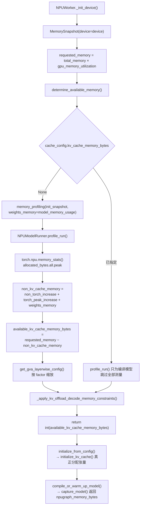

## 一句话

引擎启动时，`NPUWorker.determine_available_memory()` 先用 `gpu_memory_utilization` × 整卡 HBM 定下本实例的总预算，再跑一次最大规模的假 batch 前向（`profile_run()`）实测出权重、激活峰值、非 torch 三类开销，预算减去这三类，剩下的字节数就是 KV Cache 能拿到的全部显存。这个数再交给 vLLM 核心换算成 block 数。

## 为什么需要它

KV Cache 要在模型跑起来之前就一次性分配好——[PagedAttention](paged-attention.md) 的全部前提就是有一个固定大小的 block 池，运行时只做 block 的借还，不再向分配器要新显存。所以问题变成：开机那一刻，到底能给这个池子留多少字节？

静态算不出来。权重大小可以从配置推，但激活峰值取决于 `max_num_batched_tokens`、算子实现、融合策略；非 torch 那部分（ACL context、HCCL 通信 buffer、算子 workspace、驱动层占用）根本不在 PyTorch 分配器的账本里。留少了浪费一张卡的容量，留多了跑到一半 OOM。vllm-ascend 的做法和上游一致：**不猜，实测一次**。

昇腾侧还多两层麻烦：

- `MemorySnapshot` 在上游会走 `torch.accelerator.get_memory_info()`，而 NPU 的缓存分配器不是 c10 的 `DeviceAllocator`，这条路会直接崩在 "Allocator for npu is not a DeviceAllocator"。vllm-ascend 用 monkey-patch 把它重定向到 `torch.npu.mem_get_info`，于是 `total_memory` / `free_memory` 拿到的是**驱动层整卡口径**的数 [C]。
- MoE 模型用 MC2 通信算子时，HCCL buffer 的申请量由 MC2 的 token 容量决定，而不是由 `max_num_tokens` 决定。所以 `NPUModelRunner.profile_run()` 在调用上游实现之前，会先按 `get_mc2_tokens_capacity()` 多跑一次 dummy run，把这块 buffer 也算进峰值 [C]。

预算的基数是 `total_memory` 而不是 `free_memory`，这是个刻意的设计而不是笔误：

```
requested_memory = init_snapshot.total_memory × gpu_memory_utilization
available        = requested_memory − non_kv_cache_memory
```

如果用 `free_memory` 当基数，同一张卡上起第二个实例时，第一个实例已占的显存会被算进第二个实例的开销里，`available` 直接变负数 → 启动即 OOM。这正是 PR #7427 修的回归，单测用 64 GiB 卡 + 两个 Qwen3-0.6B + `gpu_memory_utilization=0.4` 把前后行为都锁死了：修复后第二个实例拿到 `25.6 − 0.5 = 25.1 GiB`，修复前是 `25.6 − 26.1 = −0.5 GiB` [C]。

官方 FAQ 对这个旋钮的建议只有一句：默认 `0.9`，**调小它是为了给碎片留余量**，配合 `--max-model-len` 与 `PYTORCH_NPU_ALLOC_CONF=expandable_segments:True` 一起用 [S]（[本地 docs/source/faqs.md#L138-L148](../raw/kv-cache-memory-profiling.md)，线上 <https://docs.vllm.ai/projects/ascend/en/latest/faqs.html>）。

## 怎么工作



几处值得单独说明：

**测量窗口的边界是手工划的。** `memory_profiling` 上下文退出时会自己算一遍 `torch_peak_increase`，但 vllm-ascend 在上下文**内部**、`profile_run()` 结束后立刻读一次 `allocated_bytes.all.peak`，退出后用这个「图捕获之前」的值覆盖掉上下文算出来的值，避免 graph pool 的分配被当成激活峰值重复计入 [C]。

**三类扣除各自的来源不同**：`weights_memory` 是 `model_runner.model_memory_usage`（加载模型时记的）；`torch_peak_increase` 来自 torch 分配器的峰值统计；`non_torch_increase` 是 `memory_profiling` 用「整卡已用 − torch 已占」的差值反推出来的，涵盖 ACL context、HCCL buffer、算子 workspace 这些 PyTorch 看不见的部分。

**profiling 失效会直接 assert 而不是静默降级。** 如果 `profile_run()` 跑完后设备的 free memory 反而比开机时更多，说明同容器里别的进程在这期间释放了显存，这次测量已经不可信，代码抛 `AssertionError` 并提示把 vLLM 隔离到独立容器 [C]。

**ACL graph 的显存不在这一步扣。** `capture_model()` 发生在 `compile_or_warm_up_model()` 里，排在 KV 张量分配之后；单测 `test_determine_available_memory_does_not_profile_npugraph_memory` 明确断言 `profile_cudagraph_memory` 不被调用、`npugraph_memory_estimate` 属性不存在 [C]。也就是说 graph pool 花的是 `requested_memory` 之外、整卡 free memory 之内的那块余量 [D]——推广依据是 `capture_model()` 在 `compile_or_warm_up_model()` 内部（worker.py#L778-L780），而 worker.py#L586 的注释把 `compile_or_warm_up_model()` 称为 "step 5"，晚于 profiling 与 `initialize_from_config()`。

**返回值之后还有两道修正**（默认都不生效）：开了 layerwise KV 复用时，多个 layer 映射到同一块 buffer，按 `factor = num_layers / num_buffer_assignments` 把物理字节放大成逻辑字节；开了 sparse KV offload 时，`_apply_kv_offload_decode_memory_constraints()` 会用 `plan_sparse_kv_offload_memory()` 重新规划设备侧/主机侧的切分。两者都关闭时这一步是恒等函数 [C]。

**310I Duo 不走这条路径。** `NPUWorker310P.determine_available_memory()` 是独立实现，结果还要**再除以 2** 给算子 workspace 留量；RC 模式下 host 与 device 内存共享，口径整个换成 `psutil.virtual_memory()` [C]。本页其余内容只适用于 A2 / A3 主线。

## 拿真实数字走一遍

Qwen3-0.6B（28 层，H=1024，n_q=16，n_kv=8，d_h=128），bf16，TP=1，单张 64 GiB 的 Atlas 800I A2。

**第 1 步：预算。**

```
total_memory     = 64 GiB = 68,719,476,736 B
requested_memory = 68,719,476,736 × 0.9 = 61,847,529,062 B = 57.60 GiB
```

启动检查要求 `free_memory ≥ requested_memory`；设开机时 free = 62.5 GiB，通过 [C]。

**第 2 步：权重。** 按 HF 配置逐项数参数 [D]：

| 部分 | 算式 | 参数量 |
|---|---|---|
| embed_tokens（与 lm_head 共享） | 151,936 × 1,024 | 155,582,464 |
| 每层 q/k/v/o | 1024×2048 + 1024×1024 + 1024×1024 + 2048×1024 | 6,291,456 |
| 每层 q_norm + k_norm | 128 + 128 | 256 |
| 每层 gate/up/down | 3 × 1024 × 3072 | 9,437,184 |
| 每层两个 RMSNorm | 2 × 1024 | 2,048 |
| 每层合计 | — | 15,730,944 |
| 28 层 | 15,730,944 × 28 | 440,466,432 |
| 最终 norm | — | 1,024 |
| **合计** | — | **596,049,920** |

```
weights_memory = 596,049,920 × 2 B = 1,192,099,840 B = 1.110 GiB
```

**第 3 步：跑 profile_run。** dummy batch 的形状由调度器上限决定：`max_num_tokens = max_num_batched_tokens`，`max_num_reqs = max_num_seqs`。设 `--max-num-batched-tokens 8192`、`--max-num-seqs 256`，则 256 条请求各 32 token（8192 ÷ 256），最后一条补上余数 [C]。

这一步测出的两个数只能实测，这里取一组示例值 [D]：

```
torch_peak_increase (激活峰值) = 1.80 GiB
non_torch_increase             = 0.60 GiB
```

**第 4 步：扣除。**

```
non_kv_cache_memory = 0.60 + 1.80 + 1.110 = 3.510 GiB
available_kv_cache_memory_bytes = 61,847,529,062 − 3,769,080,217 = 58,078,448,845 B = 54.09 GiB
```

**第 5 步：换算成 block。** 每 token 每层要存 K 和 V 各 `n_kv × d_h` 个 bf16 元素：

```
每 token 每层 = 2 × 8 × 128 × 2 B = 4,096 B = 4 KiB
每 token 28 层 = 4,096 × 28       = 114,688 B = 112 KiB
每 block（block_size = 128）      = 114,688 × 128 = 14,680,064 B = 14 MiB
num_blocks = 54.09 GiB ÷ 14 MiB = 55,388.16 MiB ÷ 14 MiB = 3,956
可缓存 token 数 = 3,956 × 128 = 506,368
```

这一段是按 GQA 的通用 KV 布局推的 [D]——block 数的真正落地由 [kv-cache-spec](kv-cache-spec.md) 与 [block-table](block-table.md) 决定，不同 attention 后端的 block 布局可能带额外对齐。

**第 6 步：读启动日志里的建议值。** 图捕获完成后（设 `capture_model()` 返回 0.42 GiB）：

```
non_kv_memory          = 1.110 + 1.80 + 0.60 + 0.42 = 3.930 GiB
redundancy_buffer      = 150 MiB = 0.1465 GiB
suggested_to_requested = 57.60 − 3.930 − 0.1465 = 53.52 GiB   ← 卡在 0.9 的预算里
suggested_to_gpu_limit = 62.50 − 3.930 − 0.1465 = 58.42 GiB   ← 吃满整卡空闲
```

日志会把这两个数直接印成可复制的 `--kv-cache-memory=<字节数>`。下次启动带上它，就走 fast path：仍跑 `profile_run()` 编译模型，但完全跳过测量，也**完全不再看** `gpu_memory_utilization` [C]。

对应的完整命令：

```bash
# 第一次：自动探测，从日志里抄建议值
vllm serve Qwen/Qwen3-0.6B \
  --gpu-memory-utilization 0.9 \    # 本实例总预算占整卡 HBM 的比例，默认 0.9
  --max-num-batched-tokens 8192 \   # 决定 profile_run 的 dummy batch token 数
  --max-num-seqs 256                # 决定 profile_run 的 dummy batch 请求数

# 第二次：锁定 KV 字节数，跳过测量（数值取自上一次日志的 suggested_to_requested）
vllm serve Qwen/Qwen3-0.6B \
  --kv-cache-memory 57470190879 \
  --max-num-batched-tokens 8192 \
  --max-num-seqs 256
```

> 换卡、换 CANN 版本、换并发参数之后必须重测——`--kv-cache-memory` 是绝对字节数，不会跟着环境变。日志里那句提示说的就是这件事：OOM 时先对比两次运行的 initial free memory 差值 [C]。

## 事实表

| 项 | 值 | 来源 |
|---|---|---|
| 入口函数 | `NPUWorker.determine_available_memory()`，带 `@torch.inference_mode()` | `vllm_ascend/worker/worker.py#L536-L537` |
| 预算公式 | `requested_memory = init_snapshot.total_memory × gpu_memory_utilization` | `vllm_ascend/worker/worker.py#L443` |
| 结果公式 | `available = requested_memory − (non_torch_increase + torch_peak_increase + weights_memory)` | `vllm_ascend/worker/worker.py#L582-L600` |
| `gpu_memory_utilization` 默认值 | `0.9` | `docs/source/faqs.md#L146` |
| 预算基数 | `total_memory`（整卡），不是 `free_memory` | `vllm_ascend/worker/worker.py#L443` |
| 启动前置检查 | `free_memory < requested_memory` → `ValueError` | `vllm_ascend/worker/worker.py#L444-L454` |
| profiling 有效性检查 | `init_snapshot.free_memory > after_profile.free_memory`，否则 `AssertionError` | `vllm_ascend/worker/worker.py#L591-L599` |
| 快照来源（昇腾） | `torch.accelerator.get_memory_info` 被重定向到 `torch.npu.mem_get_info` | `vllm_ascend/patch/platform/patch_torch_accelerator.py#L17-L23` |
| 扣除项 1 | `weights_memory` ← `model_runner.model_memory_usage` | `vllm_ascend/worker/worker.py#L567-L569` |
| 扣除项 2 | `torch_peak_increase` ← `torch.npu.memory_stats()["allocated_bytes.all.peak"]` 减 `before_profile.torch_peak` | `vllm_ascend/worker/worker.py#L573-L581` |
| 扣除项 3 | `non_torch_increase`（ACL context / HCCL buffer / 算子 workspace） | `vllm_ascend/worker/worker.py#L582-L588` |
| **不**扣除项 | ACL graph pool（`npugraph_memory_bytes`）；单测断言 `profile_cudagraph_memory` 不被调用 | `tests/ut/worker/a2/test_worker_multi_instance.py#L156-L167` |
| dummy batch 形状 | `max_num_tokens = max_num_batched_tokens`，`max_num_reqs = max_num_seqs` | `vllm_ascend/worker/model_runner_v1.py#L340-L341` |
| 昇腾额外 dummy run | `max_num_tokens > get_mc2_tokens_capacity()` 且通信方式为 `MC2` / `FUSED_MC2` 时，先按 MC2 容量跑一次 | `vllm_ascend/worker/model_runner_v1.py#L3722-L3726` |
| fast path 触发条件 | `cache_config.kv_cache_memory_bytes` 为真值（`--kv-cache-memory`） | `vllm_ascend/worker/worker.py#L550` |
| fast path 行为 | 仍调 `profile_run()`，跳过全部测量，不遵守 `gpu_memory_utilization` | `vllm_ascend/worker/worker.py#L550-L563` |
| 建议值冗余量 | `redundancy_buffer = 150 × (1 << 20)` = 150 MiB | `vllm_ascend/worker/worker.py#L790` |
| 建议值公式 A | `requested_memory − non_kv_memory − 150 MiB` | `vllm_ascend/worker/worker.py#L798` |
| 建议值公式 B | `init_snapshot.free_memory − non_kv_memory − 150 MiB` | `vllm_ascend/worker/worker.py#L799` |
| 图显存来源 | `NPUModelRunner.capture_model() -> int`，返回实测 graph pool 字节数 | `vllm_ascend/worker/model_runner_v1.py#L5175-L5185` |
| layerwise 修正 | `available ×= num_layers / num_buffer_assignments` | `vllm_ascend/worker/worker.py#L602-L620` |
| sparse offload 修正 | `_apply_kv_offload_decode_memory_constraints()`，未开启时恒等返回 | `vllm_ascend/worker/worker.py#L500-L534` |
| 310I Duo 差异 | 结果 `// 2`；RC 模式改用 `psutil.virtual_memory()` 口径 | `vllm_ascend/_310p/worker_310p.py#L113-L125` |
| KV 张量分配点 | `initialize_from_config()` → `model_runner.initialize_kv_cache()` | `vllm_ascend/worker/worker.py#L1009-L1020` |

## 常见误解

- **「`gpu_memory_utilization=0.9` 是说 90% 的显存给 KV Cache」** —— 不是。它是**本实例总预算**占整卡 HBM 的比例，权重、激活峰值、非 torch 内存都要从这 90% 里先扣掉，KV Cache 拿的是剩下的。上面的例子里 0.9 对应 57.6 GiB 预算，KV 只拿到 54.09 GiB。
- **「同卡起第二个实例时，第一个实例占的显存会被算进第二个实例的开销」** —— 不会。预算基数是 `total_memory` 而不是 `free_memory`，`profile_run()` 测的也只是本进程新增的分配。这条是 PR #7427 修过的 bug，现在有单测锁着。
- **「ACL graph 的显存已经在 KV 预算里扣掉了」** —— 没有。`capture_model()` 排在 KV 张量分配之后，它花的是预算之外的余量；只有 `--kv-cache-memory` 的**建议值**才把这一项算进去。所以 eager 模式下的实际余量会比图模式宽松。
- **「指定了 `--kv-cache-memory` 就不跑 profile_run 了」** —— 仍然跑。跳过的只是测量与计算，`profile_run()` 本身还要负责编译模型、预热算子。

## 接着看

- [kv-cache-spec](kv-cache-spec.md) —— 本页算出的字节数交给谁、怎么变成 block 数，答案在这里。
- [block-table](block-table.md) —— block 数定了之后，block 的实际布局与索引方式。
- [PagedAttention](paged-attention.md) —— 为什么 KV 必须提前一次性分配，这是全部前提。
- [kv-cache-quantization](kv-cache-quantization.md) —— 每 token 字节数减半，同样的预算能装多少倍的 token。
- [kv-cache-sparse-offload](kv-cache-sparse-offload.md) —— 开启后会接管 `determine_available_memory()` 的返回值做二次规划。
