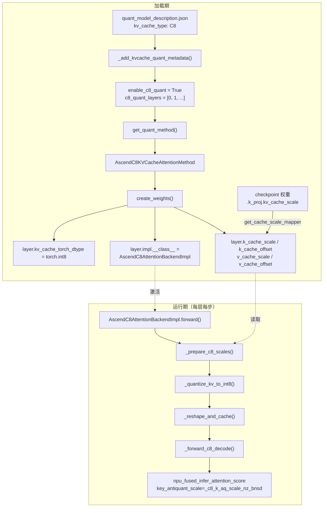

## 一句话

KV cache 量化把每个 token 每层存下来的 K 和 V 从 bf16 压成 INT8，显存正好减半，换来每个数值约 0.4% 的相对误差。在 vllm-ascend 里这套东西叫 **C8**（cache 8-bit），它不是命令行开关，而是由 ModelSlim 量化 checkpoint 里的 `kv_cache_type: "C8"` 字段自动激活的。

## 为什么需要它

KV cache 是长上下文推理里唯一随序列长度线性增长、且无法复用的显存开销。权重是固定的，激活是瞬时的，只有 KV cache 会一直堆到请求结束。把它压一半，等价于在同样的卡上把并发或上下文长度翻一倍——这是 [kv-cache-memory-profiling](kv-cache-memory-profiling.md) 算出来的可用块数直接翻倍。

那为什么不直接用 `--kv-cache-dtype int8`？因为 INT8 不是一个「存储格式」问题，而是一个「需要校准数据」的问题。要把一个 bf16 张量压进 [-128, 127]，必须先知道这一路数值的动态范围，也就是 scale。K 和 V 的每个通道（head × head_dim 的每一维）分布差异很大，用一个全局 scale 会把小通道压成全 0。所以 scale 必须离线校准：跑一批 calibration 数据，统计每个通道的极值，把结果写进 checkpoint。这件事只能在量化工具里做，vLLM 运行时做不到。

vllm-ascend 的选择因此是：**KV 量化跟着 checkpoint 走，不跟着命令行走**。ModelSlim 量化后生成的 `quant_model_description.json` 里带 `kv_cache_type` 和逐层的 `k_proj.kv_cache_scale` 键 [C]，引擎加载时扫出这些键、自动把对应层切到 INT8 路径 [C]。用户侧只需要 `--quantization ascend` [S]。这也解释了为什么 `--kv-cache-dtype` 在昇腾上基本没用武之地——vllm-ascend 里唯一声明 `supported_kv_cache_dtypes` 的后端是 MiniMax-M3 的 indexer 后端，取值集合是 `auto` / `bfloat16` / `fp8` / `fp8_e4m3` / `fp8_e5m2`，没有 `int8` [C]。

代价是显而易见的：你不能拿一个普通的 bf16 模型开 KV 量化，必须先用 ModelSlim 跑一遍量化流程，或者直接下载社区已经量化好的 W8A8C8 权重。好处是精度可控——scale 是校准出来的，不是猜的。

昇腾侧还有一个上游没有的分叉：同一套 C8 配置，在 Atlas 800I A2/A3 上落成 `torch.int8`，在 Ascend 950（代码里的 `AscendDeviceType.A5`）上落成 `torch.float8_e4m3fn` [C]。两者都是 1 字节，显存收益相同，但 FP8 的动态范围更大、对离群值更宽容。

## 怎么工作

分两个阶段：加载期把 scale 从 checkpoint 搬到 attention layer 上并改掉 cache dtype，运行期在写入前量化、在算子内反量化。



几个图里塞不下的细节：

- **类替换（class surgery）**。`create_weights` 直接改 `layer.impl.__class__`，把通用的 `AscendAttentionBackendImpl` 就地换成 `AscendC8AttentionBackendImpl` [C]。这样 C8 路径对模型代码完全透明，不需要模型文件里写任何分支。
- **scale 在第一次 forward 时才分片**。`_prepare_c8_scales` 有 `_c8_scales_prepared` 哨兵，只跑一次；它按 TP rank 把全局的 `num_kv_heads_total × head_size` 切成本 rank 的份额，再 reshape 成算子要的 `(num_kv_heads, 1, head_size)` BNSD 布局 [C]。
- **prefill 不读量化 cache**。`forward` 在非 DecodeOnly 状态下会把原始浮点 `key`/`value` 存进 `float_key`/`float_value`，量化只是为了写 cache；当前这一段 attention 仍用浮点 KV 算 [C]。这样 prefill 的精度不受量化影响。
- **decode 完全不做显式反量化**。`_forward_c8_decode` 把 INT8 分页 cache 以 NZ 5D 视图直接交给 `npu_fused_infer_attention_score`，同时传 `key_antiquant_scale` / `value_antiquant_scale`，反量化发生在算子内部、和 attention 计算融合 [C]。省掉了一次全量 KV 的 dequant 读写，这是 INT8 KV 除了省显存之外还能提速的原因。
- **MLA 走的是另一条路**（`fa_quant_type`，代码里叫 FAKQuant）。scale 粒度是每 KV head 一个而不是每通道一个 [C]；参数名是 `dequant_scale_key` 而不是 `key_antiquant_scale`，而且连 query 也量化（`query_quant_mode: 3`）[C]；MLA 模型只量化 K、V 保持原 dtype，注释写明是为了保精度 [C]。

## 拿真实数字走一遍

用 Qwen3-0.6B 的维度算显存账：H=1024，n_q=16，n_kv=8，d_h=128，28 层。（Qwen3-0.6B 本身没有公开的 C8 checkpoint，这里只是借它的维度把算式走通 [D]。）

GQA 后端的 cache 形状是 `(2, num_blocks, block_size, num_kv_heads, head_size)` [C]，量化前后形状不变、只有 dtype 变。

**每 token 每层：**

- 元素数 = 2 (K和V) × n_kv × d_h = 2 × 8 × 128 = 2048
- bf16：2048 × 2 B = 4096 B = 4 KiB
- int8：2048 × 1 B = 2048 B = 2 KiB

**28 层合计：**

- bf16：4 KiB × 28 = 112 KiB/token
- int8：2 KiB × 28 = 56 KiB/token

**一个 block（block_size = 128，GQA 后端只支持这一个值 [C]）：**

- int8：128 × 8 × 128 × 1 B = 131072 B = 128 KiB（K），K+V 共 256 KiB，每层
- bf16：512 KiB，每层

**scale 本身占多少？** 每层四个张量（k/v 各 scale + offset），每个 `n_kv × d_h = 1024` 个 bf16 值 = 2048 B，四个共 8192 B；28 层 = 229376 B = 224 KiB。这是全模型一次性开销，和「每 token 56 KiB」比可以忽略——存 4 个 token 的 KV 就把 scale 的开销赚回来了 [D]。

**单个数值的量化误差。** 设某通道 scale = 0.0125、offset = 0，一个 k 值是 0.87。按 `torch.clamp(torch.round(k * inv_scale + offset), -128, 127)` [C]：

- `inv_scale = 1 / 0.0125 = 80`
- `0.87 × 80 = 69.6` → `round` → `70`，在 [-128, 127] 内不截断 → 存 int8 `70`
- 算子内反量化：`70 × 0.0125 = 0.875`
- 绝对误差 0.005，相对误差 0.005 / 0.87 = 0.57%

量化步长是 scale 的一半即 0.00625，相对该通道满量程（127 × 0.0125 ≈ 1.59）是 0.39% [D]。

**TP=2 时 scale 怎么切。** `_prepare_c8_scales` 拿到的 `k_cache_scale.data` 有 1024 个元素，本 rank 期望 `num_kv_heads × head_size = 4 × 128 = 512`，不相等就进分片分支 [C]：

- `total_kv_heads = 1024 / 128 = 8`
- rank 1：`kv_head_start = 1 × 8 // 2 = 4`，取 `raw.view(8, 128)[4:8]`
- reshape 成 `(1, 4, 128)`，再变成算子要的 `(4, 1, 128)`

**完整启动命令**（以仓库 e2e 配置里的真实参数为骨架 [C]）：

```bash
vllm serve vllm-ascend/MiniMax-M2.7-w8a8c8-QuaRot \
    --tensor-parallel-size 8 \
    --enable-expert-parallel \
    --max-model-len 199608 \
    --max-num-batched-tokens 16384 \
    --max-num-seqs 24 \
    --trust-remote-code \
    --gpu-memory-utilization 0.8 \
    --quantization ascend
```

每个值的来由：`--quantization ascend` 是 ModelSlim 量化模型的必需开关 [S]，KV 量化随 checkpoint 里的 `kv_cache_type: "C8"` 自动生效，**命令行里没有也不该有任何 KV dtype 参数** [C]。`--max-model-len 199608` 能开到接近 200k，正是 KV 减半换来的。

## 事实表

| 项 | 值 | 来源 |
|---|---|---|
| 激活方式 | checkpoint 的 `quant_model_description.json` 中 `kv_cache_type == "C8"` | `vllm_ascend/quantization/configs/modelslim_config.py#L89-L90`、`#L1104-L1105` |
| 用户侧开关 | `--quantization ascend` | `docs/source/user_guide/feature_guide/quantization.md#L124` |
| 逐层名单来源 | checkpoint 中含 `k_proj.kv_cache_scale` 的键（GQA）/ `fa_k.scale` 的键（MLA） | `modelslim_config.py#L1108-L1115` |
| 分派入口 | `get_quant_method()` 中按 `is_c8_quant_layer(prefix)` 逐层选 `AscendC8KVCacheAttentionMethod` | `modelslim_config.py#L799-L809` |
| scale 键映射 | `.k_proj.kv_cache_scale` → `.attn.k_cache_scale`（offset、v 同理） | `modelslim_config.py#L658-L670` |
| GQA layer 上的参数 | `k_cache_scale`、`k_cache_offset`、`v_cache_scale`、`v_cache_offset` | `vllm_ascend/quantization/methods/kv_cache/kv_c8.py#L132-L139` |
| GQA scale 粒度 | 每通道，`num_kv_heads × head_size` | `vllm_ascend/attention/attention_v1.py#L1908-L1917` |
| MLA scale 粒度 | 每 KV head，`(num_kv_heads, 1)`；另有 `fa_q.scale` `(num_heads, 1)` | `vllm_ascend/quantization/methods/kv_cache/kv_c8.py#L44-L49` |
| 算子 scale 布局 | `(num_kv_heads, 1, head_size)`，字段 `_c8_k_aq_scale_nz_bnsd` | `attention_v1.py#L1927-L1929` |
| KV cache dtype（A2/A3） | `torch.int8` | `kv_c8.py#L125`、`vllm_ascend/worker/v2/attn_utils.py#L78` |
| KV cache dtype（Ascend 950 / A5） | `torch.float8_e4m3fn` | `attn_utils.py#L75`、`vllm_ascend/attention/mla_v1.py#L868` |
| MLA 量化范围 | 只量化 K，V 保持 `model_config.dtype` | `modelslim_config.py#L909-L913` |
| KV cache 形状 | `(2, num_blocks, block_size, num_kv_heads, head_size)` | `attention_v1.py#L114-L121` |
| 支持的 block_size | `[128]`；C8 另断言 `block_size % 32 == 0` | `attention_v1.py#L152-L153`、`#L2013` |
| 量化公式 | `clamp(round(x * (1/scale) + offset), -128, 127).to(int8)` | `attention_v1.py#L1992-L2001` |
| 反量化（gather 路径） | `int8.to(dtype) * scale`，不减 offset | `attention_v1.py#L1976-L1978` |
| decode 算子参数 | `key_antiquant_scale` / `value_antiquant_scale`，`key_antiquant_mode=0`，`antiquant_mode=0`，`input_layout="BNSD"` | `attention_v1.py#L2019-L2037` |
| MLA 算子参数 | `dequant_scale_key` / `dequant_scale_value` / `dequant_scale_query`，`query_quant_mode=3` | `mla_v1.py#L1639-L1647` |
| prefill KV 来源 | 原始浮点 `float_key` / `float_value`，不读量化 cache | `attention_v1.py#L1829-L1830`、`#L1848` |
| 每 token 每层字节（GQA） | `2 × num_kv_heads × head_size × itemsize` | `attention_v1.py#L114-L121` |
| DSA 稀疏侧独立开关 | `enable_sparse_sfa_c8`、`enable_sparse_li_c8`、`c8_enable_reshape_optim`，默认均 `False` | `docs/source/user_guide/configuration/additional_config.md#L63-L65` |
| 与 EAGLE3 | 不支持共用 | `docs/source/tutorials/models/MiniMax-M2.md#L596-L598` |
| 与 MooncakeConnector（GQA） | 直接报 `ValueError`，需改用 `MooncakeLayerwiseConnector` | `vllm_ascend/ascend_config.py#L716-L721` |
| 声明了 `supported_kv_cache_dtypes` 的后端 | 仅 `AscendMiniMaxM3IndexerBackend`：`auto` / `bfloat16` / `fp8` / `fp8_e4m3` / `fp8_e5m2` | `vllm_ascend/models/minimax_m3/msa_m3.py#L114-L120` |

官方文档在线地址：[Quantization Guide](https://docs.vllm.ai/projects/ascend/en/latest/user_guide/feature_guide/quantization.html)、[Additional Configuration](https://docs.vllm.ai/projects/ascend/en/latest/user_guide/configuration/additional_config.html)。

## 常见误解

- **「加 `--kv-cache-dtype int8` 就能开 KV 量化。」** 不能。C8 的唯一入口是 checkpoint 里的 `kv_cache_type` 字段 [C]——因为 scale 必须离线校准出来，运行时凭空造不出来。
- **「W8A8 模型的 KV cache 也是 INT8。」** 不是。`QuantType` 枚举里的 W/A 指权重和激活，八个取值没有一个描述 KV cache [C]；只有名字里带 `c8` 的权重（如 `GLM-5.2-w8a8c8`）才同时量化 KV。
- **「模型是原生 FP8 的，KV cache 就跟着是 FP8。」** 无关。官方文档讲原生 FP8 checkpoint 那一节，从头到尾说的都是**权重**怎么存、怎么在不同代次昇腾上执行 [S]；KV cache 的 dtype 由 C8/FAKQuant 元数据决定，两者互不影响。
- **「KV 量化只省显存，不省时间。」** 不止。decode 路径把 INT8 分页 cache 连同 antiquant scale 一起丢给 `npu_fused_infer_attention_score`，反量化在算子内部完成，省掉一轮全量 KV 的读写 [C]。
- **「scale 里带 offset，所以是非对称量化。」** 参数确实有 `k_cache_offset`，量化时也加了 [C]；但 gather 反量化路径只乘 scale（注释明写 `symmetric`）[C]，且传给算子的只有 antiquant scale、没有 antiquant offset [C]。也就是说这条路实际按 offset = 0 处理 [D]。
- **「C8 和 PD 分离随便配。」** GQA 模型上 C8 + `MooncakeConnector` 会直接启动失败：P 节点仍存 bf16、D 节点分配 int8，裸传字节会被误读 [C]。

## 接着看

- [kv-cache-memory-profiling](kv-cache-memory-profiling.md) —— 量化把每 token 字节减半后，可用块数是怎么重新算出来的。
- [kv-cache-spec](kv-cache-spec.md) —— `dtype` 字段就是在 spec 这一层被改成 `torch.int8` 的。
- [paged-attention](paged-attention.md) —— 先弄清楚分页 KV 怎么喂给算子，再看 INT8 版本的 NZ 5D 视图。
- [block-table](block-table.md) —— C8 decode 传给算子的 `block_table` 与非量化路径完全一致。
- [kv-pool](kv-pool.md) —— 跨实例共享 KV 时，两端的 KV dtype 必须一致，这正是 Mooncake 报错的根因。
