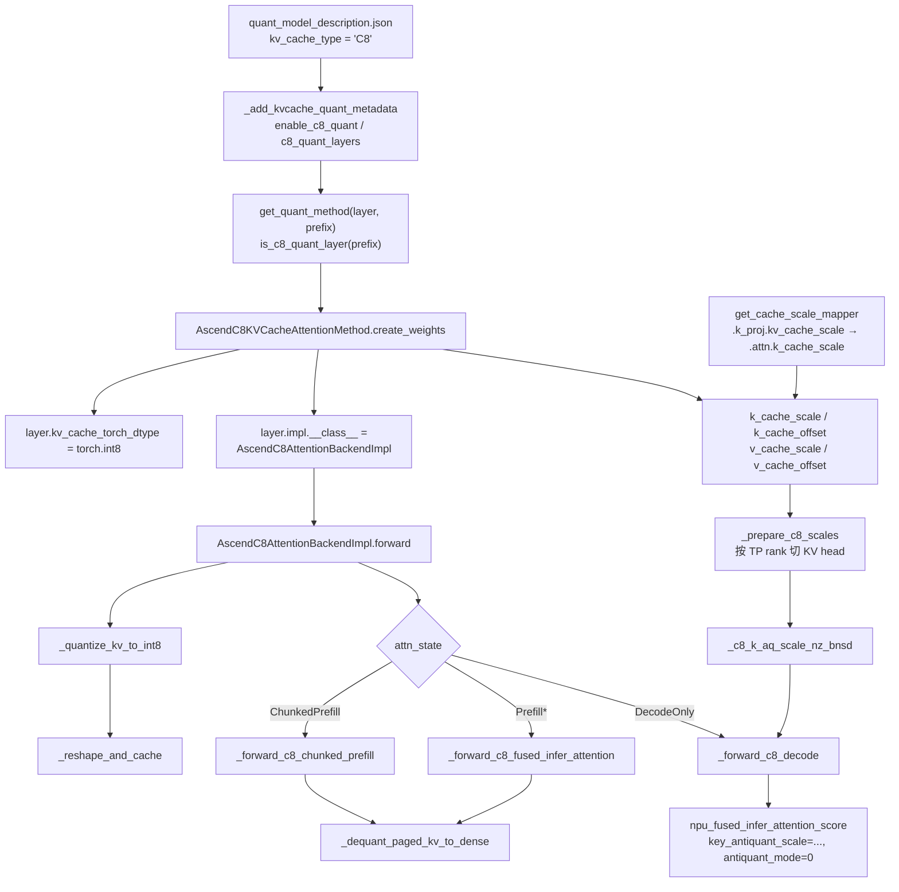

## 一句话

KV Cache Quantization 把每层缓存的 K 和 V 从模型 dtype（通常 BF16）降到 INT8 存放，每个通道配一个静态 scale；decode 时不在框架里还原，而是把分页 INT8 缓存连同 scale 一起交给 `npu_fused_infer_attention_score`，由算子内部完成反量化后直接算 attention。vllm-ascend 里它有三条互不相通的实现路线：dense 模型的 C8、MLA 模型的 FAKQuant、DSA 模型的稀疏 C8。

## 为什么需要它

decode 阶段的瓶颈不在算力而在读带宽：每生成一个 token，都要把整条序列的 K 和 V 从 HBM 读一遍。缓存的体积同时决定了两件事——能同时跑多少条请求（受 [KV Cache Memory Profiling](kv-cache-memory-profiling.md) 算出的块数限制），以及每步 decode 要搬多少字节。每 token 占多少字节由 [KV Cache Spec](kv-cache-spec.md) 的 dtype 与形状算出。BF16 下 Qwen3-0.6B 每 token 要 112 KiB，32K 上下文一条请求就吃掉 3.5 GiB；换到 70B 级模型，显存里往往只放得下个位数的长请求。

把 K/V 存成 INT8 一刀切掉一半。这里的关键判断是：KV cache 对精度的敏感度**低于**权重。权重量化误差会在 28 层里逐层放大，而 KV 的量化误差只经过一次 softmax 加权求和，被平均掉了很多。所以业界普遍的做法是先量化 KV、再考虑量化权重——这也解释了为什么 vllm-ascend 把两者做成完全独立的两套开关。

昇腾侧与上游 vLLM 的差别在于「谁来反量化」。上游常见做法是取完页之后在框架里 dequant 成 BF16 再进 attention kernel，那样读带宽是省了，但多一趟写回和一份临时显存。vllm-ascend 走的是把 scale 作为算子入参传进去（`key_antiquant_scale`），让 FIA 算子原地吃 INT8 页——decode 快路上框架侧一次 gather 都没有。

真正反直觉的一点：**这个特性没有命令行开关**。它由 checkpoint 自带的量化描述文件触发，详见下一节。上游官方的《Quantization Guide》通篇只讲权重量化和 `--quantization ascend` [S1]，一个字没提 KV cache 量化，这是目前的文档缺口。

## 怎么工作

三条路线的入口都在 `AscendModelSlimConfig`，按 checkpoint 里的描述键分流。以最常用的 dense C8 为例：



**开关从哪来。** `_add_kvcache_quant_metadata` 读 checkpoint 描述里的 `kv_cache_type`，等于字符串 `"C8"` 才置 `enable_c8_quant`；哪些层参与，则由所有含 `k_proj.kv_cache_scale` 的键上正则出来的层号决定 [C3]。所以量化是 per-layer 的，校准工具可以只量化一部分层。

**scale 从哪来。** 不是运行时统计出来的，是 ModelSlim 离线校准后写进权重文件的**静态**值。它们在 checkpoint 里挂在 `k_proj` / `v_proj` 名下，由 `get_cache_scale_mapper` 的后缀映射改名搬到 attention 层上，成为 `k_cache_scale`、`k_cache_offset`、`v_cache_scale`、`v_cache_offset` 四个参数。`create_weights` 里这四个参数以 `numel() == 1` 的占位张量注册（scale 填 1、offset 填 0），真实形状由权重加载时的 `_c8_kv_scale_weight_loader` 直接替换。

**怎么接上 attention。** `create_weights` 做了两件不常见的事：把 `layer.kv_cache_torch_dtype` 改成 `torch.int8`，由此让这一层的 [KV Cache Spec](kv-cache-spec.md) 申请到一半大小的显存；以及直接改写 `layer.impl.__class__`，把已经建好的 attention impl 就地换成 `AscendC8AttentionBackendImpl` [C6]。这种 class surgery 的好处是不用在基类 forward 里加分支，代价是 impl 的构造参数必须两个类完全兼容。

**每步 forward。** 首次调用时 `_prepare_c8_scales` 把 per-channel scale 按 TP rank 切出本卡的 KV head，预算好倒数 `_c8_k_inv_scale`，并整理成算子要的 BNSD 布局 `_c8_k_aq_scale_nz_bnsd`；`_c8_scales_prepared` 哨兵保证只做一次。之后每步先 `_quantize_kv_to_int8` 把新 token 的 K/V 压成 INT8 再 `_reshape_and_cache` 写页。

**算子怎么消费。** 分三种状态：

- `DecodeOnly` —— 最快的一条。把 NZ 5D 视图的分页 INT8 cache、`block_table` 和 `key_antiquant_scale` 一起传给 `npu_fused_infer_attention_score`，`antiquant_mode=0` 表示每通道反量化，框架侧零拷贝 [C11]。
- `ChunkedPrefill` / `Prefill` —— 新 token 用还没量化的浮点 K/V 直接算（`forward` 在非 DecodeOnly 时留了一份 `float_key` / `float_value`）；若这一批命中了历史页，则退回 `_dequant_paged_kv_to_dense` 在框架侧 gather + NZ→ND + 反量化。
- ACL Graph 全图捕获 —— `full_graph_fia` 同样把 antiquant scale 作为算子入参塞进去，所以 C8 与图模式兼容 [C14]。

**另外两条路线。** MLA 模型走 `fa_quant_type`（FAKQuant），scale 粒度是 per-head 的 `(num_kv_heads, 1)` [C16]，且 `get_kv_quant_dtype` 明确只量化 K、V 保持模型 dtype，注释写的理由是保精度 [C15]。DSA 模型（DeepSeek V3.2、GLM5）走 `enable_sparse_sfa_c8` / `enable_sparse_li_c8` 两个额外配置项，是唯一能从配置显式开启的 KV 量化 [S17]。

## 拿真实数字走一遍

用 Qwen3-0.6B：n_kv = 8，d_h = 128，L = 28 层，`--block-size 128`。

**省了多少。** 每层每 token 要存 K 和 V 各 `n_kv × d_h` 个数：

- BF16：`2 × 8 × 128 × 2 B = 4096 B = 4 KiB`，28 层合计 **112 KiB/token**
- INT8：`2 × 8 × 128 × 1 B = 2048 B = 2 KiB`，28 层合计 **56 KiB/token**

一条 32K 上下文的请求，BF16 要 `32768 × 112 KiB = 3.5 GiB`，INT8 只要 **1.75 GiB**。同样的 KV 池能放下的请求数翻倍。

**scale 的额外开销。** 每层四个 per-channel 张量，各 `8 × 128 = 1024` 个元素，BF16 存储共 `4 × 1024 × 2 B = 8 KiB/层`，28 层 **224 KiB**。相对上面省下的 1.75 GiB 是万分之一量级，可以忽略。

**一个页在显存里长什么样。** C8 decode 把 cache 看成 NZ 5D 布局 `(num_blocks, num_kv_heads, head_size // 32, block_size, 32)` [C12]，代入即 `(num_blocks, 8, 4, 128, 32)`。单个 block 的 K 占 `8 × 4 × 128 × 32 × 1 B = 131072 B = 128 KiB`——也就是 128 个 token × 每 token 每层 1 KiB 的 K。这里的 32 是 NZ 格式的最后一维，也正是 `block_size % 32 == 0` 这条断言的由来 [C11]。

**量化一个数。** 取某个通道（比如 head 3 的第 7 维），设它的 `k_cache_scale = 0.0123`、`k_cache_offset = 0`，则 `_c8_k_inv_scale = 1 / 0.0123 = 81.30`。按 `clamp(round(x × inv_scale + offset), -128, 127)` [C10]：

| 原始 K 值 | `× 81.30` | `round` | `clamp` | 反量化 `× 0.0123` | 误差 |
|---|---|---|---|---|---|
| 0.85 | 69.11 | 69 | 69 | 0.8487 | 0.0013（0.15%） |
| 2.00 | 162.60 | 163 | **127** | 1.5621 | 0.4379（21.9%） |

第二行说明这套方案的全部风险所在：scale 是离线校准定死的，一旦推理时某个通道出现校准集里没见过的大值，它会被硬生生截到 127，误差从 0.15% 跳到 22%。这就是为什么 C8 必须配一份有代表性的校准数据集，而不能随便拿几条 prompt 凑。

**怎么跑起来。** checkpoint 里的 `quant_model_description.json` 至少要有这些键（加载器只看 `kv_cache_type` 的取值和这些键上的层号，键的值本身不参与判断）：

```json
{
  "kv_cache_type": "C8",
  "model.layers.0.self_attn.k_proj.kv_cache_scale": "C8",
  "model.layers.0.self_attn.k_proj.kv_cache_offset": "C8",
  "model.layers.0.self_attn.v_proj.kv_cache_scale": "C8",
  "model.layers.0.self_attn.v_proj.kv_cache_offset": "C8"
}
```

启动命令里**不需要**、也**不应该**加 `--kv-cache-dtype`：

```bash
vllm serve /path/to/Qwen3-0.6B-C8 \
    --quantization ascend \
    --block-size 128 \
    --max-model-len 32768
```

`--quantization ascend` 是 ModelSlim 产物的通用开关；`--block-size 128` 满足 32 的倍数约束；INT8 存储由 `create_weights` 里的 `layer.kv_cache_torch_dtype = torch.int8` 决定，与 `--kv-cache-dtype` 无关。

## 事实表

| 项 | 值 | 来源 |
|---|---|---|
| dense 路线开关 | checkpoint `kv_cache_type == "C8"` | `vllm_ascend/quantization/configs/modelslim_config.py#L1104-L1105` |
| 参与量化的层 | 键名含 `k_proj.kv_cache_scale` 的层号 | `modelslim_config.py#L1114-L1115` |
| scale 参数名 | `k_cache_scale` / `k_cache_offset` / `v_cache_scale` / `v_cache_offset` | `modelslim_config.py#L663-L669` |
| checkpoint 侧原名 | `.k_proj.kv_cache_scale` / `.v_proj.kv_cache_scale` 等 | `modelslim_config.py#L665-L668` |
| C8 scale 粒度 | per-channel，`num_kv_heads × head_size` | `vllm_ascend/attention/attention_v1.py#L1908-L1917` |
| C8 scale 运行时形状 | `(1, num_kv_heads, head_size)`；算子入参 `(num_kv_heads, 1, head_size)` | `attention_v1.py#L1917`、`#L1927-L1929` |
| FAKQuant scale 粒度 | per-head，`(num_kv_heads, 1)`；offset 为 `torch.int8` | `vllm_ascend/quantization/methods/kv_cache/kv_c8.py#L45-L49` |
| C8 存储 dtype | `torch.int8` | `vllm_ascend/quantization/methods/kv_cache/kv_c8.py#L125` |
| FAKQuant 存储 dtype | A5（950）`torch.float8_e4m3fn`，其余 `torch.int8` | `modelslim_config.py#L908` |
| FAKQuant + MLA | 只量化 K，V 保持 `model_config.dtype` | `modelslim_config.py#L910-L911` |
| 稀疏 C8 存储 dtype | A5 `torch.float8_e4m3fn` + `float32` scale；其余 `torch.int8` + `float16` scale | `vllm_ascend/worker/model_runner_v1.py#L383-L388` |
| 量化算式 | `clamp(round(x / scale + offset), -128, 127)` | `attention_v1.py#L1992-L2001` |
| 分页反量化算式 | `int8.to(dtype) * scale`（不减 offset） | `attention_v1.py#L1977-L1978` |
| 非分页反量化算式 | `(int8.to(dtype) - offset) * scale` | `attention_v1.py#L2180-L2181` |
| decode 算子 | `torch_npu.npu_fused_infer_attention_score` | `attention_v1.py#L2019` |
| 算子反量化入参 | `key_antiquant_scale` / `value_antiquant_scale`，`antiquant_mode=0` | `attention_v1.py#L2023-L2034` |
| decode 布局 | `input_layout="BNSD"`，NZ 5D `(num_blocks, num_kv_heads, head_size//32, block_size, 32)` | `attention_v1.py#L2029`、`#L1893-L1896` |
| block_size 硬约束 | `block_size % 32 == 0`（断言失败即崩） | `attention_v1.py#L2013` |
| PD 分离例外 | `is_kv_producer` 为真的 P 节点不改 dtype，仍存浮点 | `kv_c8.py#L120-L125` |
| 图模式兼容 | `full_graph_fia` 传同一组 antiquant 入参 | `attention_v1.py#L950-L958` |
| 稀疏 C8 配置项 | `enable_sparse_sfa_c8`、`enable_sparse_li_c8`，默认均 `False` | `docs/source/user_guide/configuration/additional_config.md#L63-L64` |
| 稀疏 offload 互斥 | 主 KV cache 必须 BF16，量化只能用于 indexer cache | `docs/.../layerwise_and_sparse_kv_cache_offloading.md#L265-L267` |
| `--kv-cache-dtype` 白名单 | 全仓仅 MiniMax-M3 后端声明：`auto`/`bfloat16`/`fp8`/`fp8_e4m3`/`fp8_e5m2` | `vllm_ascend/models/minimax_m3/msa_m3.py#L114-L120` |
| DSA on A5 | 覆写 `cache_config.cache_dtype = "float8_e4m3fn"` | `vllm_ascend/models/layer/attention/layer.py#L181-L183` |
| `QuantType` 覆盖范围 | 仅权重/激活组合（W8A8…W4A16MXFP），不含 KV | `vllm_ascend/quantization/quant_type.py#L26-L37` |

线上文档：[Quantization Guide](https://docs.vllm.ai/projects/ascend/en/latest/user_guide/feature_guide/quantization.html)、[Additional Configuration](https://docs.vllm.ai/projects/ascend/en/latest/user_guide/configuration/additional_config.html)。

## 常见误解

**「加 `--kv-cache-dtype int8` 就能开」——不能。** dense C8 完全由 checkpoint 的 `kv_cache_type` 字段驱动，INT8 存储是 `create_weights` 直接改 `layer.kv_cache_torch_dtype` 实现的，跟 `cache_config.cache_dtype` 走的不是同一条路。通用 Ascend attention 后端甚至不声明 `supported_kv_cache_dtypes`——全仓只有 MiniMax-M3 后端声明了这个白名单 [C20]，而 DeepSeek V4 的 DSA 层在昇腾 950 上还会反过来**覆写**用户给的值 [C21]。想开 KV 量化，要换权重，不是换参数。

**「KV 量化和权重量化是一个开关」——不是。** `QuantType` 枚举的八项全是「权重×激活」的组合，没有一项描述 KV cache [C2]；KV 走的是 `kv_cache_type` / `fa_quant_type` 这组独立的键。一个 W8A8 的 checkpoint 未必量化 KV，反之亦然。`--quantization ascend` 只是告诉 vLLM「这是 ModelSlim 产物」，具体量化什么由描述文件逐项决定。

**「offset 非零也能正常工作」——很可能不能。** 写入时用的是 `round(x / scale + offset)`，但 decode 快路把 scale 交给算子时只传了 `key_antiquant_scale`、没有 offset 入参 [C11]，prefill 的分页反量化也只乘 scale、注释直接写着 `Scale-only dequant for NZ (symmetric)` [C12]。只有非分页那条分支老老实实减了 offset [C13]。三处口径只在 offset 全零时自洽，所以实际可用的 C8 checkpoint 事实上必须是**对称量化**（offset 恒为 0）[D]——源码里没有任何断言拦住非零 offset，装进去也不会报错，只会静默地算错。

**「量化后 prefill 也变快了」——不一定。** decode 确实是零拷贝走算子内反量化，但 prefill 命中历史页时要走 `_dequant_paged_kv_to_dense`：gather 一遍、NZ→ND permute 一遍、再乘 scale 展开成 BF16 [C12]，比 BF16 直接读多了一整趟。省的是显存和 decode 带宽，不是 prefill 时间。
