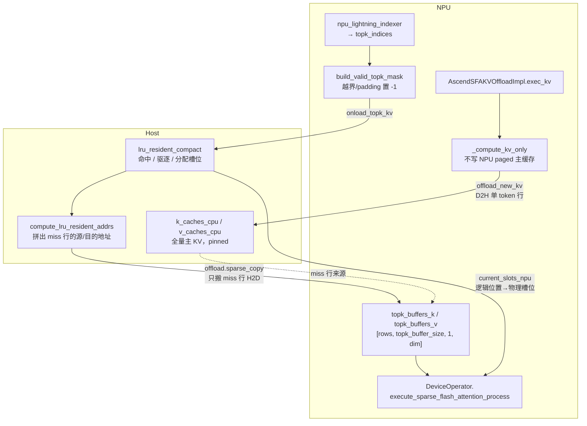

## 一句话

Sparse KV Offload 让 PD 分离部署里的 D 节点**不再分配 NPU 主 KV 缓存**：全量主 KV 住在主机 pinned 内存，每个 decode 步由 indexer 选出 `index_topk` 个 token，再由一张每层独立的 LRU 表判断哪些已经在 NPU 热缓冲区里，只把未命中的行 H2D 搬回来 [S2]。它只在 main 上存在，v0.23.0 完全没有这个特性 [!]。

## 为什么需要它

上游两篇官方文档配套读：[使用指南](https://docs.vllm.ai/projects/ascend/en/latest/user_guide/feature_guide/layerwise_and_sparse_kv_cache_offloading.html)（本页的 S1）讲怎么配，[设计文档](https://docs.vllm.ai/projects/ascend/en/latest/developer_guide/Design_Documents/layerwise_and_sparse_kv_cache_offloading.html)（S2）讲为什么这么设计。

decode 每步只算一个 token，算力极少，却要读整条历史的 KV。把 KV 整层搬主机（[逐层卸载](kv-cache-layerwise-offload.md) 的做法）在 prefill 能被算力盖住，在 decode 盖不住——搬运时间直接变成 TPOT。

但稀疏注意力模型给了一个出口：DeepSeek-V3.2、GLM-5.x 这类模型的每个 query 本来就只 attend `index_topk` 个 token，其余历史这一步根本用不到 [S1]。既然如此，NPU 上就没必要常驻全量 KV，只需要常驻「最近几步被选中过」的那部分。搬运量于是从「正比于序列长度」变成「正比于 top-k 未命中数」。

这带来一个平时反着的结论：**NPU 侧的 KV 块数上限不再由主 KV 决定**。`plan_sparse_kv_offload_memory` 里 `npu_page_size_bytes` 只算 `store_on_host=False` 的那些 spec（也就是留在设备上的 indexer 缓存），主 KV 的容量改由 `dram_size_per_dp_GB` 卡 [C13]。换句话说，能开多长的 `max_model_len`、多大的 batch，变成了一个主机内存问题。

相邻概念在这里只点一句：哪些层落主机由 [KV Cache Spec](kv-cache-spec.md) 的 `store_on_host` 标记，这个标记就是开关本身；逻辑 token 到物理地址的换算仍走 [块表](block-table.md)；显存怎么量出来见 [显存 profiling](kv-cache-memory-profiling.md)。

## 怎么工作

开关是 `additional_config.sparse_kv_offload_config.enabled`，另外三个字段默认 `topk_buffer_size=4096`、`dram_size_per_dp_GB=128`、`keep_device_kv_cache=false` [C4]。一旦打开，`AscendSFABackend.get_impl_cls()` / `get_builder_cls()` 换成 `AscendSFAKVOffloadImpl` / `AscendSFAKVOffloadMetadataBuilder`，整条卸载逻辑与干净的 `sfa_v1.py` 分开；同时 impl 把预处理固定成 `PreprocessType.NATIVE`，关掉 `sfa_prolog_v3`/mlapo 融合路径。

一个 decode 步在**一层**里发生的事：



三处值得单独说：

**新 token 的 KV 不经过 NPU 主缓存。** `exec_kv` 在 decode-only 分支里调 `_compute_kv_only` 算出 `k_nope`/`k_pe`，然后以 `k_cache_npu=None` 调 `offload_new_kv`，按 token 行直接 D2H 写进主机池 [C9]。`keep_device_kv_cache=False` 时 NPU 上压根没有主 paged 缓存这个张量。

**top-k 选谁与卸载无关。** `topk_indices` 由 `torch_npu.npu_lightning_indexer` 读 indexer 的 K 缓存算出 [C11]，这是模型自带的 DSA 机制，开不开卸载都一样。卸载只改变「选中的 KV 从哪里取」。落到卸载路径前还会过一道 `build_valid_topk_mask`，把 ≥ 当前 `seq_len` 的位置和 padding 置成 -1。

**LRU 表是每层一份、每行一份的。** `lru_slots_row` 按最久未用到最近使用排序：命中的槽位被挪到队尾，未命中优先占用队首的可驱逐槽位，然后 `slot_to_token` 更新映射。MTP/投机场景下 `stable_prefix_len` 之后的 token 会被强制作废，因为那段后缀可能已被下一步改写。这段 C++ 跑在 host 上；图模式下通过 `torch_npu.npu._launch_host_func` 挂到计算流上执行。

TP 下 decode 产生的 KV 是复制的，所以只有 TP rank 0 分配主机池并写新 token 行，其它 rank 通过广播出来的全局虚拟地址访问同一块。

**版本差异 [!]**：以上全部只适用于 main（28bf3a2e）。v0.23.0（2c59ff10）全仓 grep `sparse_kv_offload` 零命中，特性指南目录里也没有这一页 [S17]；它有完整的 SFA + lightning indexer 稀疏注意力，但选中的 KV 仍然全部读 NPU 上的 paged 主缓存。

## 拿真实数字走一遍

这一页不能用 Qwen3-0.6B：`_validate_preconditions` 要求模型配置里有 `index_topk`，没有稀疏注意力的稠密模型直接报 `Sparse KV offload only support sparse attention model.`。下面用 DeepSeek-V3.2（`kv_lora_rank=512`、`qk_rope_head_dim=64`、`num_hidden_layers=61`、`index_topk=2048`）[S19]，D 节点 `max_num_seqs=32`、不开 MTP、`block_size=128`。

配置片段（D 节点）：

```bash
--additional-config '{
    "sparse_kv_offload_config": {
        "enabled": true,
        "topk_buffer_size": 4096,
        "dram_size_per_dp_GB": 128
    }
}' \
--kv-transfer-config '{
    "kv_connector": "SfaRemoteD2HConnector",
    "kv_role": "kv_consumer",
    "kv_port": 20050,
    "kv_connector_extra_config": {
        "transfer_backend": "memfabric",
        "use_layerwise": true
    }
}'
```

`topk_buffer_size = 4096` 这个值同时满足三条：≥ `index_topk`（2048，启动期硬校验 [C5]）、是 `block_size` 的整数倍（128 × 32，运行期硬校验 [C14]）、按文档建议取 `2 × index_topk`。

**一、每 token 每层的主 KV 字节数。** MLA 只有一个 KV 头，K 走 `kv_lora_rank`、V 走 `qk_rope_head_dim`，BF16：

- K：1 × 512 × 2 B = 1024 B
- V：1 × 64 × 2 B = 128 B
- 合计 1152 B；61 层 = 70,272 B ≈ 68.6 KiB / token

**二、主机池能装多少。** 每层每块 = 128 × 1152 = 147,456 B；61 层 = 8,994,816 B ≈ 8.58 MiB / 块。对齐预留 = 61 层 × 3 × 2 MiB = 366 MiB。于是

```
usable   = 128 GiB − 366 MiB = 137,055,174,656 B
dram_limit_blocks = 137,055,174,656 ÷ 8,994,816 = 15,237 块
                  = 15,237 × 128 = 1,950,336 token 的 KV 历史
```

（这里按 `real_page_size_bytes` 计算，未计入可能的 `page_size_padded` 对齐；真实块数以启动日志里那行 `Sparse KV offload memory plan:` 为准 [D]。）

**三、NPU 上常驻多少。** `max_num_topk_rows = min(max_num_batched_tokens, 32 × 1) = 32` [C12]：

- `topk_buffers_k`：32 × 4096 × 1 × 512 × 2 B = 128 MiB / 层
- `topk_buffers_v`：32 × 4096 × 1 × 64 × 2 B = 16 MiB / 层
- 61 层合计 = 61 × 144 MiB = 8,784 MiB ≈ **8.58 GiB**

对比一下不卸载：把这 1,950,336 个 token 全放 NPU 需要 1,950,336 × 70,272 B ≈ **127.6 GiB**。8.58 GiB 换 127.6 GiB，这就是这个特性的全部意义。

**四、为什么热缓冲区必须大于 `index_topk`。** 冷启动最坏情况下 2048 个 top-k 全部 miss：每行每层 2048 × 1152 B = 2.25 MiB，32 行 × 61 层 = 4.29 GiB 的 H2D，一个 decode 步绝无可能扛住。稳态下相邻两步的 top-k 高度重叠，miss 只有个位数到几十行，搬运量才降到可接受。缓冲区越大命中率越高、TPOT 越低，代价是上面第三步那笔常驻显存 [S3]。

**五、一条推导出来的安全性质。** 因为启动期强制 `topk_buffer_size ≥ topk`，而 LRU 里 `evictable_count = capacity − hit_count ≥ topk − hit_count ≥ miss_count`，所以 `assign_count = min(miss_count, evictable_count)` 恒等于 `miss_count`——**每一个 miss 都一定分得到槽位，不会出现某个 top-k 位置拿不到 KV 而被静默丢掉** [D]。这条只在 `topk_buffer_size ≥ topk` 成立时为真，也正是那条校验存在的理由。

## 事实表

v0.23.0 整个特性不存在，故该列统一为「—」。

| 项 | v0.23.0 | main (28bf3a2e) | 意味着什么 |
|---|---|---|---|
| 特性本身 | —（代码与文档均无） | `sparse_kv_offload_config.enabled` | 稳定分支上照 main 文档配，这个配置项无人接收 [!] |
| `topk_buffer_size` | — | 默认 4096；须 ≥ `index_topk` 且被 `block_size` 整除 | 两条都是硬校验；正因 ≥ topk，每个 miss 必定分得到槽位 |
| `block_size` | — | 128（SFA 后端唯一支持值） | `topk_buffer_size` 实际只能取 128 的倍数 |
| `dram_size_per_dp_GB` | — | 默认 128，每 DP 一份 | 主机总占用 = 该值 × `data_parallel_size`；DP 内 TP 共享一份 |
| `keep_device_kv_cache` | — | 默认 `false` | 开了等于不省显存，只为 PD 同机调试；生产必须关 |
| 主 KV dtype | — | 必须 BF16 | `enable_sparse_sfa_c8` 直接报错；indexer 的 LI C8 不受限 |
| 每 token 每层字节 | — | `(kv_lora_rank + qk_rope_head_dim) × 2` | MLA 专属公式（`num_kv_heads == 1` 是 assert 出来的） |
| 部署形态 | — | 仅 PD 分离的 D 节点（`is_kv_consumer`） | 非 D 节点启用直接 `AssertionError` |
| 并行 | — | DP / TP 支持；CP、PP 报错 | 长序列想同时开 CP 的路走不通 |
| 预处理路径 | — | 强制 `PreprocessType.NATIVE` | `sfa_prolog_v3`/mlapo 融合预处理被关掉，是确定要付的吞吐代价 |

## 常见误解

- **「稀疏卸载会掉精度。」** 不会额外掉。稀疏来自模型自身的 DSA indexer（每步选 `index_topk` 个 token），开不开卸载选出来的都是同一批 token；卸载只决定这些 KV 从主机还是从显存取。真正动精度的是主缓存量化，而它在这条路径上被直接禁掉、强制 BF16。
- **「热缓冲区调大能省显存。」** 正相反。`topk_buffers_k/v` 是常驻 NPU 的开销，调大是**拿显存换命中率**：命中率上去、H2D 少了、TPOT 才降。省显存靠的是「主 KV 不在设备上」，不是靠这个缓冲区。
- **「D 节点还留着一份 NPU 主 paged KV，热缓冲区只是加速。」** 默认不留。`keep_device_kv_cache=False` 时 NPU 的 `k_tensor`/`v_tensor` 就是 `None`，新 token 算完直接 D2H [C9]。留着那份是 `keep_device_kv_cache=True` 的调试形态，官方明确写着生产别开 [S1]。
