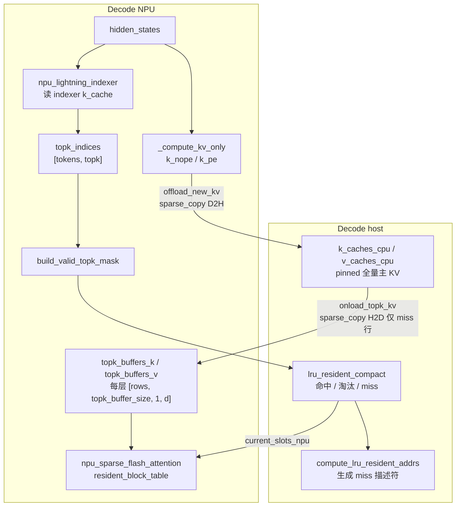

## 一句话

Sparse KV Offload 让 PD 分离部署里的 Decode 节点不再在 NPU 上保存完整主 KV：全量历史留在主机内存的固定池里，每个 decode step 由 lightning indexer 选出 `index_topk` 个 token，只有其中没在设备热缓冲区里的那些行才被搬回 NPU，注意力在这个小小的常驻缓冲区上算完。它不改变稀疏注意力选谁，只改变被选中的那些 KV 存在哪儿。

## 为什么需要它

稀疏注意力模型（DeepSeek-V3.2、GLM-5.1/5.2）在 decode 时其实只用很少一部分 KV：每个 query token 经 indexer 打分后只取 top-k 个 key 参与注意力，DeepSeek-V3.2-Exp 的 `index_topk` 是 2048。但 KV cache 仍然按完整序列长度分配——128K 上下文的一条请求，61 层主 KV 要占 8.58 GiB HBM（算例见下），其中每步真正被读到的不到 1/64。显存被「可能会用到」的历史占满，直接压死并发数和 `max_model_len`。

Prefill 侧已经有 [Layerwise KV Offload](kv-cache-layerwise-offload.md)：每层算完就整层搬走，用几个可复用的层缓冲区换显存。但这招在 decode 上不成立——decode 每步每层的计算量只有一个 token 的量级，整层搬运的传输时延根本藏不住，官方设计文档把这一点写成了两阶段用不同策略的理由 [S]（[design doc#L24-L27](https://docs.vllm.ai/projects/ascend/en/latest/developer_guide/Design_Documents/layerwise_and_sparse_kv_cache_offloading.html)）。

稀疏卸载的取巧之处在于：既然注意力本来就只读 top-k 行，那搬运量就可以正比于 top-k 的 miss 数，而不是正比于序列长度 [S]。再叠一层每层独立的 LRU 常驻表——相邻两步选中的 token 高度重叠，上一步搬上来的行这一步大概率还在选中集合里——实际 H2D 流量远小于 top-k 全量 [C]。

代价也很直白：主机池要能装下完整 KV（`dram_size_per_dp_GB` 默认 128 GiB），设备上要额外留出每层的热缓冲区，而且这套东西只在 PD 分离的 D 节点上成立——`_validate_preconditions` 里若 `keep_device_kv_cache=False` 而 `kv_transfer_config` 不是 consumer，直接 `AssertionError` [C]。

## 怎么工作

开关打开后，`AscendSFABackend.get_impl_cls()` / `get_builder_cls()` 整体换成 `AscendSFAKVOffloadImpl` / `AscendSFAKVOffloadMetadataBuilder`，卸载逻辑全部隔离在 `sfa_kv_offload.py` 里，不污染普通 SFA 路径 [C]。同时 `model_runner_v1` 把主 MLA 的 `AscendMLAAttentionSpec` 标上 `store_on_host=True`，KV cache 张量因此变成一个六元组 `(k_npu, v_npu, k_cpu, v_cpu, topk_buffer_k, topk_buffer_v)`，其中 `k_npu`/`v_npu` 在生产配置下是 `None` [C]。

一个 decode step 内，每层做这几件事：



**新 token 写哪儿。** `exec_kv` 在 decode-only 分支走 `_compute_kv_only`，只做 `npu_rms_norm` + `npu_interleave_rope` 算出 `k_nope`/`k_pe`，完全不碰 NPU 分页缓存，然后交给 `offload_new_kv` 逐 token 行 D2H 到主机池的 `slot_mapping` 指定位置 [C]。TP>1 时只有 `tp_rank == 0` 真写——decode 产生的 K/V 在各 TP rank 上是复制的 [C]。

**选哪些 token。** `topk_indices` 来自本层的 `indexer_select_post_process`（最终落到 `npu_lightning_indexer`，只读设备常驻的 indexer K cache），或者当这一层 `skip_topk=True` 时直接复用缓存下来的上一层索引 [C]。`skip_topk` 由模型配置的 `index_topk_pattern` / `index_topk_freq` 决定，是 GLM-5.2 一类模型自己的属性，不是卸载引入的 [C]。**卸载路径对这个张量不做任何再筛选**，只做一次合法性掩码：`build_valid_topk_mask` 把负数和 ≥ 该行实际 key 长度的位置置为 `-1` [C]。

**常驻表怎么决定搬什么。** `onload_topk_kv` 把 top-k 索引拷到 host，调用 C++ 的 `lru_resident_compact`（OpenMP，8 线程），对每一行独立地：把上一步的 `slot_to_token` 与本步 top-k 对照，标出命中槽；其余槽进可淘汰列表；未命中的 top-k 位置按顺序占用可淘汰槽；最后把 `lru_slots` 重排成「未用的淘汰候选 → 本步新装入 → 本步命中」，于是下一步优先淘汰最久没被选中的槽 [C]。`req_id`（scheduler request id 的 adler32）变了就整行重置；`stable_prefix_lens` 之后的 token 一律作废，因为 MTP 的投机后缀可能已被主机池里的新值覆盖 [C]。

**怎么让算子看不出差别。** `compute_lru_resident_addrs` 只为 miss 行生成 (源 GVA, 目标地址, 长度) 三元组，交给 `offload.sparse_copy` 做 H2D。注意力则跑在一套伪造的分页视图上：`resident_block_table_npu` 给每行分配 `topk_buffer_size // block_size` 个连续页，`resident_seq_lens_npu` 恒等于 `topk_buffer_size`，`current_slots_npu` 把逻辑 top-k 位置重映射成热缓冲区里的物理槽号 [C]。`npu_sparse_flash_attention` 照常调用，只是 KV 换成了 `resident_k`/`resident_v` 的视图 [C]。

## 拿真实数字走一遍

用 DeepSeek-V3.2-Exp 的真实维度：`kv_lora_rank = 512`、`qk_rope_head_dim = 64`、`num_hidden_layers = 61`、`index_topk = 2048`（读自 [模型卡 config.json](https://huggingface.co/deepseek-ai/DeepSeek-V3.2-Exp/raw/main/config.json)）[I]。SFA 后端的 `block_size` 固定 128 [C]。

**每 token 每层的主 KV 字节数**（`register_kv_caches` 里的定义，`num_kv_heads` 恒为 1）：

- `token_size_bytes_k = 1 × 512 × 2 = 1024 B`
- `token_size_bytes_v = 1 × 64 × 2 = 128 B`
- 合计 `1152 B`；61 层共 `61 × 1152 = 70,272 B = 68.625 KiB`

**一条 128K 请求的全量主 KV**：`131,072 × 70,272 B = 8.58 GiB`。这就是不卸载时必须钉在 HBM 里的量 [D]。

**每步实际要读的量**：top-k 全 miss 的最坏情况是 `2048 × 1152 B = 2.25 MiB` 每层，61 层 `137.25 MiB`，正好是全量的 `2048 / 131072 = 1/64` [D]。有 LRU 命中时只搬 miss 行，实测流量远低于此 [I]。反方向，新 token 每步 D2H `70,272 B ≈ 68.6 KiB` [D]。

**主机池能装多少**（`plan_sparse_kv_offload_memory`，`dram_size_per_dp_GB = 128`）：

- 每层每块：`128 × 1152 = 147,456 B = 144 KiB`（`real_page_size_bytes`）
- `host_page_size_bytes = 61 × 147,456 = 8,994,816 B = 8.578125 MiB`
- 对齐预留：`61 × 3 × 2 MiB = 366 MiB`
- 可用：`128 GiB − 366 MiB = 137,055,174,656 B`
- `dram_limit_blocks = 137,055,174,656 // 8,994,816 = 15,237` 块 = `1,950,336` token

最终块数还要和 `npu_limit_blocks`、`workload_limit_blocks` 取小；若 DRAM 是瓶颈会打一条建议调大 `dram_size_per_dp_GB` 的 warning [C]。

**设备热缓冲区要多少**（`allocate_kv_offload_topk_buffer_pair`，取 `max_num_seqs = 16`、无投机解码故 `decode_width = 1`、`max_num_batched_tokens ≥ 16`）：

- `max_num_topk_rows = min(max_num_batched_tokens, 16 × 1) = 16`
- K：`16 × 4096 × 1 × 512 × 2 = 64 MiB`；V：`16 × 4096 × 1 × 64 × 2 = 8 MiB`
- 每层 `72 MiB`，61 层 `4,392 MiB = 4.29 GiB`

开 MTP（1 个投机 token）时 `decode_width = 2`，行数翻倍，热缓冲区也翻倍到 `8.58 GiB`——这是配 `topk_buffer_size` 时最容易低估的一项 [D]。profile run 阶段就会把这批缓冲区实打实分配一遍，所以显存探测看到的可用量已经扣掉了它 [C]。

Decode 节点的完整启动配置（官方文档给的形式，参数值按上面推算）[S]：

```bash
--additional-config '{
    "sparse_kv_offload_config": {
        "enabled": true,
        "topk_buffer_size": 4096,
        "dram_size_per_dp_GB": 128
    }
}' \
--kv-transfer-config '{
    "kv_connector": "SfaRemoteD2HConnector",
    "kv_role": "kv_consumer",
    "kv_port": 20050,
    "kv_connector_extra_config": {
        "transfer_backend": "memfabric",
        "use_layerwise": true
    }
}'
```

- `topk_buffer_size: 4096` = `2 × index_topk`，官方推荐的起点；必须 ≥ `topk` 且能被 `block_size`（128）整除，4096 两条都满足 [S][C]。
- `dram_size_per_dp_GB: 128` 按上面算出的 1,950,336 token 容量取；每个 DP rank 一份，同 DP 内 TP rank 共享 [S]。
- `kv_role: kv_consumer` 是硬要求；`kv_port` 起要连续预留 `decode_data_parallel_size × decode_tensor_parallel_size` 个端口，实际端口号为 `kv_port + dp_rank * d_tp_size + tp_rank` [S]。

## 事实表

| 项 | 值 | 来源 |
|---|---|---|
| `sparse_kv_offload_config.enabled` | 默认 `false` | `vllm_ascend/ascend_config.py#L1233` |
| `topk_buffer_size` | 默认 `4096`，须 > 0、≥ `topk`、能被 `block_size` 整除 | `ascend_config.py#L1234`、`#L1241-L1242`、`#L1288-L1292`、`sparse_kv_offload_manager.py#L620-L624` |
| `dram_size_per_dp_GB` | 默认 `128`，须 > 0 | `ascend_config.py#L1235`、`#L1243-L1244` |
| `keep_device_kv_cache` | 默认 `false`，仅 PD 同机调试用 | `ascend_config.py#L1236`、`#L1270-L1276` |
| `topk` | 不可配置，`= hf_text_config.index_topk` | `ascend_config.py#L1237`、`#L1287` |
| 主 KV dtype | 必须 BF16，否则 `ValueError` | `sparse_kv_offload_manager.py#L613-L617` |
| `num_kv_heads` | 必须为 1（仅 SFA/MLA） | `sparse_kv_offload_manager.py#L612` |
| SFA 后端 `block_size` | 只支持 `[128]` | `sfa_v1.py#L140-L142` |
| 每 token 每层字节 | `1 × kv_lora_rank × 2 + 1 × qk_rope_head_dim × 2` | `sparse_kv_offload_manager.py#L618-L619` |
| 热缓冲区形状 | K `[max_num_topk_rows, topk_buffer_size, 1, kv_lora_rank]`，V 同形但末维 `qk_rope_head_dim` | `sparse_kv_offload_manager.py#L74-L83` |
| `max_num_topk_rows` | `min(max_num_batched_tokens, max_num_seqs × decode_width)`，`decode_width = 1 + num_speculative_tokens` | `sparse_kv_offload_manager.py#L57-L68` |
| `current_slots_npu` 形状 | `[max_num_topk_rows, topk]`，int32 | `sparse_kv_offload_manager.py#L638-L642` |
| `resident_seq_lens_npu` | 全填 `topk_buffer_size` | `sparse_kv_offload_manager.py#L649-L654` |
| 主机池块数上限 | `min(npu_limit_blocks, dram_limit_blocks, workload_limit_blocks)` | `sparse_kv_offload_manager.py#L210-L227` |
| 主机对齐预留 | `层数 × 3 × 2 MiB` | `sparse_kv_offload_manager.py#L194` |
| 主机池写入者 | 仅 `tp_rank == 0`；其余 rank 通过广播的 GVA 读 | `sparse_kv_offload_manager.py#L900-L904` |
| LRU 线程数 | `lru_workspace_threads = 8` | `sparse_kv_offload_manager.py#L743` |
| 部署要求 | PD 分离、仅 D 节点、Model Runner V1 | `ascend_config.py#L1278-L1285` |
| 不支持 | CP、PP、压缩型稀疏（`compress_ratios`）、hybrid KV 布局、主缓存 sparse SFA C8 | `ascend_config.py#L1261-L1269`、`sfa_kv_offload.py#L166-L173`、`sparse_kv_offload_manager.py#L537` |
| 预处理路径 | 强制 `PreprocessType.NATIVE`，禁用 `sfa_prolog_v3`/`mlapo` | `sfa_kv_offload.py#L176-L180` |
| 传输后端 | 仅 MemFabric（`SfaRemoteD2HConnector`） | 用户文档 `layerwise_and_sparse_kv_cache_offloading.md#L265` |
| 已验证模型 | GLM-5.1、GLM-5.2、DeepSeek-V3.2 | 用户文档 `layerwise_and_sparse_kv_cache_offloading.md#L14-L21` |

## 常见误解

- **「稀疏卸载会掉精度」**——它不改变注意力读到的数值。选谁仍由同一个 `npu_lightning_indexer` 决定，被选中的 KV 以 BF16 原样搬回，最后调的还是同一个 `npu_sparse_flash_attention`；相对**不卸载的同一个稀疏模型**，数学上没有额外近似 [C]。真正的精度前提是模型本身用稀疏注意力，这件事和卸载无关。
- **「`topk_buffer_size` 越大越好」**——它只影响 LRU 命中率进而影响传输量，装不下的部分会被淘汰但不会丢数据（下次 miss 再搬）。代价是每层每行都要按这个大小实打实分配 HBM，算例里从 4096 加到 8192 会让 61 层的热缓冲区从 4.29 GiB 涨到 8.58 GiB [D]。
- **「开了它 Prefill 也省显存」**——不。`sparse_kv_offload_config` 只能开在 Decode 节点，Prefill 侧对应的是 [Layerwise KV Offload](kv-cache-layerwise-offload.md)，两者是两套独立机制 [S]。
- **「主 KV 也能顺便量化成 C8」**——不能。主缓存必须 BF16，C8 只支持设备常驻的 indexer cache，构造 `AscendSFAKVOffloadImpl` 时若发现 `enable_sparse_sfa_c8` 会直接 `NotImplementedError` [C]。

## 接着看

- [Layerwise KV Offload](kv-cache-layerwise-offload.md) —— 同一套部署的 Prefill 半边，两者合起来才是完整的 P/D 卸载方案。
- [KV Cache Spec](kv-cache-spec.md) —— `store_on_host` 这个标记挂在哪、怎么影响块大小与内存规划。
- [Block Table](block-table.md) —— 先理解真正的分页表，才看得懂这里伪造的 `resident_block_table`。
- [KV Cache 显存探测](kv-cache-memory-profiling.md) —— 热缓冲区在 profile run 阶段就被计入，解释了为什么开启后可用块数会变。
- [KV Cache CPU Offload](kv-cache-cpu-offload.md) —— 另一条「往主机搬」的路子，对比它能看清「按块搬」与「按 top-k 行搬」的差别。
