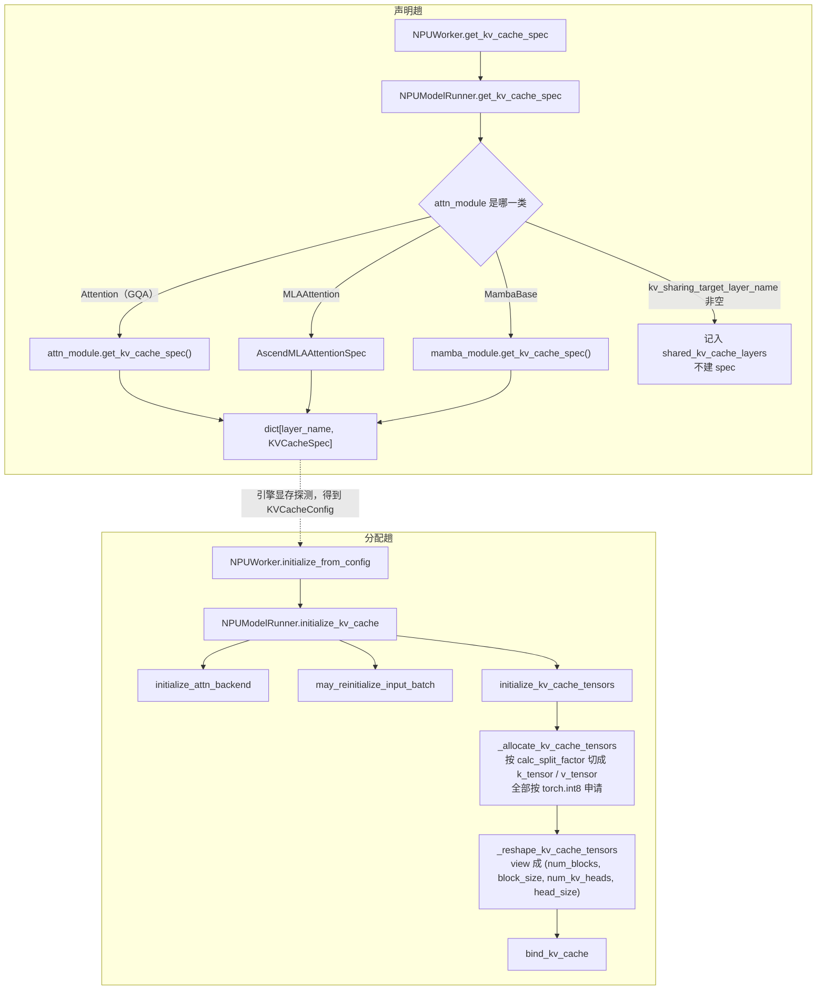

## 一句话

`get_kv_cache_spec()` 遍历模型里每个注意力层，为每层产出一个 `KVCacheSpec`：块大小、KV 头数、头维、dtype，以及由这四项算出的「一块多少字节」。引擎拿这些声明去做显存探测，把结果封成 `KVCacheConfig` 交回来，`initialize_kv_cache()` 再按它把显存真正切成张量。声明与分配分处引擎启动的一前一后，中间隔着一次显存探测。

## 为什么需要它

引擎启动时要回答一个具体问题：**剩下这些显存能装多少个块**。这个问题只有模型自己能回答，因为「一块多少字节」取决于每层有几个 KV 头、头维多大、用什么 dtype 存——而这些在 vLLM 里是每层独立的，不是全模型一个数。

于是就有了 spec 这一层：每层报一份自己的规格，引擎负责把「可用字节」除以「每块单价」得到块数（见 [KV Cache 显存探测](kv-cache-memory-profiling.md)），再把块数发回来让 worker 分配。倒过来做不行——分配之前必须先知道单价。

**为什么是按层报而不是按模型报**，有四个现实原因，都在 `get_kv_cache_spec()` 的分发逻辑里留了痕迹：

- 跨层 KV 共享的层压根不需要自己的缓存，它们被记进 `shared_kv_cache_layers` 后直接跳过，不产生 spec，也就不占块；
- 同一个模型里可以混着 GQA、MLA、Mamba、draft model 的 cache-only 层，每类的形状算法完全不同；
- Mamba 混合模型里，注意力层的页要被 padding 到 Mamba 页的大小才能共用一套块编号，这一步是在所有 spec 收齐之后统一做的；
- 量化、稀疏、offload 这些特性改的正是 spec 里的 dtype 与 head_size（见 [KV Cache 量化](kv-cache-quantization.md)、[稀疏 KV Offload](kv-cache-sparse-offload.md)），改在 spec 上就等于改在了显存账本上。

**昇腾侧和上游最大的不同在分配趟，不在声明趟。** 上游把一层的 KV 申请成一整块 `(2, num_blocks, ...)` 的张量；vllm-ascend 把它拆成 K、V 两条独立张量分别 `torch.zeros`，理由写在注释里——PD 分离（prefill/decode 分离）的传输侧只接受首维是 `num_blocks` 的张量，带着前缀 2 的形状过不去 [C17]。这个拆分带来一串连锁后果，下一节会走一遍。

## 怎么工作

两趟，中间隔着引擎的显存探测。



**声明趟。** `NPUWorker.get_kv_cache_spec()` 把活转给 model runner，后者从 static forward context 里取出所有 `AttentionLayerBase` 子类，按 `isinstance` 逐层分发。GQA 这条最普通的路径直接调用层自己的 `get_kv_cache_spec()`，也就是上游 vLLM 的实现——vllm-ascend 不接管稠密注意力的 spec 构造。MLA 这条则被接管：vllm-ascend 用自己的 `AscendMLAAttentionSpec` 重建一遍，因为昇腾的 nope/rope 拆分方式和上游不同。收尾时若模型里有 Mamba 层，注意力层的 `page_size_padded` 会被顶到 Mamba 页大小。

**分配趟。** 入口是 `NPUWorker.initialize_from_config()`，引擎把探测好的 `KVCacheConfig` 递进来，sleep mode 下还会套一层 `CaMemAllocator` 的 `kv_cache` 内存池，方便整体释放。`initialize_kv_cache()` 的主干顺序在两版上一致：改写 config（补 encoder-only 层、补 KV 共享层）→ `initialize_attn_backend` 选后端 → `may_reinitialize_input_batch` 按各组 block_size 重建块表（见 [Block Table](block-table.md)）→ `initialize_kv_cache_tensors` 真正动显存。

`initialize_kv_cache_tensors()` 本身只做三件事：申请原始 buffer、view 成目标形状、把 KV 共享层的指针指到目标层上。

真正的分配在 `_allocate_kv_cache_tensors()`。稠密注意力层走这样一条路：

1. `_get_attention_kv_cache_dims()` 取出 K 维和 V 维。GQA 下两者都等于 `head_size`；
2. `calc_split_factor([k_dim, v_dim])` 返回 `[total/k_dim, total/v_dim]`，GQA 下就是 `[2.0, 2.0]` [C20]；
3. `kv_cache_tensor.size` 被这两个因子各除一次，得到 `k_tensor_size` 和 `v_tensor_size`，恰好各占一半；
4. 两条张量各自 `torch.zeros(..., dtype=torch.int8)` ——**不管 spec 声明的是 bf16 还是 fp16，申请阶段一律按原始字节走**，dtype 要到 reshape 时才用上 [C17]；
5. 最终登记进 `kv_cache_raw_tensors[layer_name]` 的是 `(k_tensor, v_tensor)` 二元组。

这一整段在 v0.23.0 上逐字相同，稠密模型上没有版本差异。

`_reshape_kv_cache_tensors()` 负责把字节变成张量。它先用「K 字节 + V 字节」除以 `page_size_bytes` 反推块数，并断言不小于调度器侧的 `kv_cache_config.num_blocks` [C23]；再调后端的 `get_kv_cache_shape()` 拿到 `(2, num_blocks, block_size, num_kv_heads, head_size)` [C8]，对非 MLA 的 spec 取 `kv_cache_shape[1:]` 作为 K 和 V 各自的形状，最后 `raw_k_tensor.view(dtype).view(k_shape)`。

**版本差异集中在 MLA / SFA 这一侧，稠密 GQA 不受影响。** 两处 [!]：

- **MLA 页字节的算法位置换了。** v0.23.0 直接覆写 `page_size_bytes`，并把 SFA indexer 的 K、scale 字节算进同一个属性里 [C25]；main 改成 `real_page_size_bytes`，并引入 `storage_block_size = block_size // compress_ratio`——调度器看到的块大小和算子看到的块大小从此是两个数 [C24]。
- **SFA indexer 从「折进 MLA spec」变成「独立一类 spec」。** v0.23.0 明确跳过 `DeepseekV32IndexerCache` 层，indexer 的 k_cache 由 `IndexerWrapper` 顶替，字节折算在 `AscendMLAAttentionSpec.sparse_head_dim` 里；main 为它单独建 `AscendSFAIndexerCacheSpec`，走独立的物理张量。

另有一处不影响主线但会改变行为的差异：EC transfer 场景下的早退条件在 v0.23.0 是 `get_ec_transfer().is_producer`，main 是 `not get_ec_transfer().is_consumer` `[!]`。

## 拿真实数字走一遍

Qwen3-0.6B：28 层，H=1024，n_q=16，n_kv=8，d_h=128，KV 用 bf16（每元素 2 字节）。块大小取昇腾 GQA 后端唯一支持的 128 [C10]，官方文档在别处的参数说明里也把 `block_size=128` 当既定前提（700 块 ≈ 89,600 token，700 × 128 = 89,600）[S12]。

**第一步：一层一块多少字节。** 块张量形状是 `(2, num_blocks, 128, 8, 128)`，去掉 `num_blocks` 这一维就是一块的内容：

```
page_size_bytes = 2 × block_size × n_kv × d_h × sizeof(bf16)
                = 2 × 128 × 8 × 128 × 2
                = 524,288 字节 = 512 KiB
```

这个公式是**推出来的**，不是从某一行抄的 [D]。推法：`get_kv_cache_shape` 给出首维为 2 的形状，`calc_split_factor` 把该层预算对半切给 K 和 V，而 `_reshape_kv_cache_tensors` 要求「K 字节 + V 字节」能被 `page_size_bytes` 整除、商即块数。三者要同时成立，`page_size_bytes` 只能是上式。**前提是稠密 GQA、未开 FA 量化、无 `head_size_v` 差异**——这三条一破（例如 MLA 的 K 维是 `kv_lora_rank`、V 维是 `qk_rope_head_dim`），公式就不成立。

**第二步：每 token 每层多少字节。** 一块装 128 个 token：

```
524,288 ÷ 128 = 4,096 字节 = 4 KiB / token / 层
```

也可以直接写成 `2 × n_kv × d_h × sizeof(bf16) = 2 × 8 × 128 × 2 = 4,096`。

**第三步：全模型每 token 多少字节。**

```
4,096 × 28 = 114,688 字节 = 112 KiB / token
```

**第四步：反过来算能装多少 token。** 假设显存探测最后给每层 1 GiB：

```
num_blocks = 1,073,741,824 ÷ 524,288 = 2,048 块
容量       = 2,048 × 128 = 262,144 token
```

此时 `k_tensor` 与 `v_tensor` 各申请 `1 GiB ÷ 2 = 512 MiB`（以 int8 计就是 536,870,912 个元素），各自 view 成 `(2048, 128, 8, 128)` 的 bf16 张量。全模型 28 层共 28 GiB，交叉验算：262,144 × 112 KiB = 28 GiB ✓。

## 事实表

| 项 | v0.23.0 | main | 意味着什么 |
|---|---|---|---|
| GQA 块张量形状 | `(2, num_blocks, block_size, num_kv_heads, head_size)` | 同左 | 首维的 2 是 K 和 V；但 reshape 后它们是两条各自 view 的张量，不是一块连续内存 |
| GQA 后端支持的 kernel block size | `[128]` | 同左 | 想靠调小 block_size 减少块内碎片，在这个后端上做不到 |
| 每层每块字节（Qwen3-0.6B，bf16） | 512 KiB [D] | 同左 | 一个块就锁住半兆；28 层的同编号块合起来 14 MiB |
| 每 token 每层字节（Qwen3-0.6B，bf16） | 4 KiB [D] | 同左 | 乘层数乘上下文长度，就是单请求 KV 上限 |
| 每 token 全模型字节（28 层） | 112 KiB [D] | 同左 | 28 GiB 的 KV 池约等于 26 万 token |
| K/V 切分因子（GQA） | `[2.0, 2.0]` | 同左 | 每层申请两条张量、各占该层预算一半 |
| raw buffer 的 dtype | `torch.int8` | 同左 | spec 里的 dtype 不影响申请多少字节，只影响 reshape 时怎么 view |
| raw buffer 地址对齐 | 未配 `kv_transfer_config` 时不对齐；配了则对齐到 2 MiB | 同左 | 开 PD 分离时每条张量会多申请 2 MiB 用于对齐 |
| MLA 页字节的属性名 | 覆写 `page_size_bytes` | 新增 `real_page_size_bytes`，并引入 `storage_block_size` | 按属性名取 MLA 页大小的脚本跨版本会读到不同的值 `[!]` |
| SFA indexer 的 spec | 折进 `AscendMLAAttentionSpec.sparse_head_dim` | 独立的 `AscendSFAIndexerCacheSpec` | main 上 indexer 走独立物理张量，v0.23.0 上它和 MLA 主缓存共用一次分配 `[!]` |

## 常见误解

- **「spec 里的 `block_size` 就是算子看到的块大小。」** 稠密 GQA 上成立，MLA 上不成立：main 里算子用的是 `storage_block_size = block_size // compress_ratio`，调度器用的才是 `block_size` [C24]。
- **「一层的 KV 是一块 `(2, num_blocks, ...)` 的连续显存。」** 在昇腾上不是。K 和 V 是两次独立的 `torch.zeros`，地址之间没有任何关系；首维的 2 只活在 `get_kv_cache_shape()` 的返回值里，reshape 时立刻被 `kv_cache_shape[1:]` 切掉。
- **「spec 声明 bf16，所以申请的是 bf16 张量。」** 申请阶段一律 `torch.int8`，spec 的 dtype 只在 `_reshape_kv_cache_tensors` 里用来 `.view(dtype)`。这也是为什么量化改 dtype 能直接改出显存收益——字节数是算出来的，不是类型带出来的。
