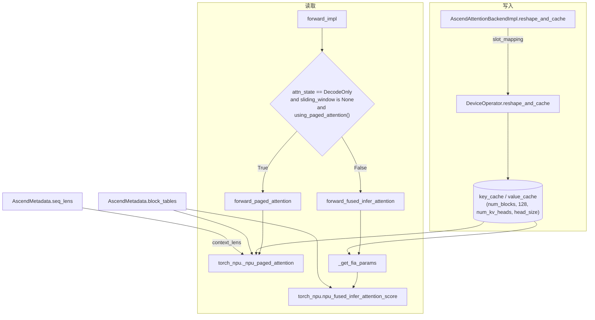

## 一句话

昇腾后端把每层的 K、V 各存成一个 `(num_blocks, 128, num_kv_heads, head_size)` 的大张量，一块固定装 128 个 token；decode 时算子拿着块表逐行跳读，不要求一条序列的 KV 在显存里连续。名字容易误导的一点是：这套**分块布局始终生效**，而叫 `_npu_paged_attention` 的那个**算子默认不启用**——默认走的是 FIA（`npu_fused_infer_attention_score`），它同样吃块表 [S21]。两版行为一致。

## 为什么需要它

不分块的做法是给每条序列预留一段连续显存，长度按 `max_model_len` 取。一条 5500 token 上限的 Qwen3-0.6B 请求，即使只生成 20 个 token，也得先占满 5500 个 token 的 KV 空间；并发一上来，显存全被没写过的空洞吃掉。分块把「预留」的粒度从「一条序列」降到「128 个 token」，只有写满了才要下一块，浪费上限从 `max_model_len - 实际长度` 降到不足一块。

代价是地址不再连续：第 300 个 token 在哪，得查表。这张表就是[块表](block-table.md)，算子每算一步都要顺着它取物理块号。所以「分块」这件事必须由 attention 算子本身支持——不能在算子外面先把 KV 拼成连续的再算，那样等于白分。

昇腾侧和上游 vLLM 的差别集中在两处。其一，上游 CUDA 后端的 `PagedAttention` 是这条路径上的唯一实现；昇腾这里有两个算子都能按块读——FIA 是默认，`_npu_paged_attention` 是备选，官方把后者定性为「FIA 在某些 batch 上表现不佳时的临时调优口子，将来 FIA 优化完就会移除」[S21]（<https://docs.vllm.ai/projects/ascend/en/latest/faqs.html>）。其二，块大小没有选择余地：后端只声明支持 128 [C1][C2]，而上游 CUDA 后端常用 16。

## 怎么工作

后端声明形状 `(2, num_blocks, block_size, num_kv_heads, head_size)`。前导的 2 不是张量的一个维度——model runner 拿到形状后取 `kv_cache_shape[1:]` 作为 K 的形状，V 同形，分别 `view` 成两个独立的 4 维张量。所以算子收到的永远是 `key_cache`、`value_cache` 两个入参，而不是一个 5 维张量。

写入侧按 slot 号散写，读取侧按块号跳读，两侧共用同一份分块布局：



**分派**：`forward_impl` 里只有一个 if，三个条件全真才走 PA——当前批次是纯 decode（`AscendAttentionState.DecodeOnly`）、这一层不是滑动窗口层、且 `using_paged_attention()` 返回真。任何一条不满足都落到 FIA。两版这段逐字相同。

**`using_paged_attention` 的门槛**依次是：`speculative_config` 非 None 直接假；设备是 A5 直接假；`head_size == 512`（Gemma4 大头维回退）直接真；`cudagraph_mode` 不是 `FULL_DECODE_ONLY` 假；最后才看当前 batch 的 token 数在不在 `pa_shape_list` 里 [C7]。默认 `pa_shape_list = []` [S22]，所以最后这一步默认恒假——**默认配置下 `_npu_paged_attention` 永远不执行**。

**块表怎么进算子**：`AscendMetadata.block_tables` 直接作为 `block_table=` 传给 `_npu_paged_attention`，`seq_lens` 作为 `context_lens=` 一起传，key/value cache 保持 4 维原样。走 FIA 时略有不同：`_get_fia_params` 先从 `key_cache.shape` 反推出 `block_size`，再把 K/V 压成三维 `(num_block, block_size, num_kv_heads*head_size)` 才交给算子，块表照样传。四种 `attn_state` 里只有 `PrefillNoCache` 不传块表（`block_table = None`），因为那一步的 K/V 就在手上，还没进缓存。

**图捕获下的差异**（这是两版唯一实质分叉）：捕获时 PA 走 `full_graph_pa`，把 query、K/V cache、块表、seq_lens 等打包存进 `graph_params.attn_params`，重放前再把新的块表和 seq_lens 换进去重新下发。v0.23.0 存的是裸 9 元组，重放侧靠 `using_paged_attention` 一次性判定整张图走 PA 还是走 FIA，两种算子不能混在同一张重放列表里；main 引入了带类型的 `PagedAttentionGraphParam`（额外带一个 `layer_name`）和 `update_paged_attention_graph_param`，重放时用 `isinstance` 逐个分流，于是同一个模型里 PA 层和 FIA 层可以共存 [!][C18]。

**KV 写入算子也换了** `[!]`：v0.23.0 调 `torch_npu._npu_reshape_and_cache(..., slot_indices=slot_mapping)`，main 改成 `torch_npu.npu_scatter_pa_kv_cache(..., slot_mapping=..., cache_mode="Norm")`。对使用者是透明的，但抓 profiling 时算子名字对不上。

## 拿真实数字走一遍

Qwen3-0.6B：28 层，`num_kv_heads = 8`，`head_size = 128`，bf16（2 字节）。设 `max_model_len = 5500`。

**一块有多大。** `get_kv_cache_shape(num_blocks, 128, 8, 128)` 返回 `(2, num_blocks, 128, 8, 128)`，落成两个 `(num_blocks, 128, 8, 128)` 的张量。

- 一块一层的 K：`128 × 8 × 128 × 2 B = 262144 B = 256 KiB`
- K + V：`512 KiB`
- 28 层合起来，一个逻辑块占：`512 KiB × 28 = 14 MiB` [D]
- 换算到每 token：`8 × 128 × 2 × 2 B = 4 KiB` 每层，28 层 `112 KiB` [D]

（这两条标 `[D]`：源码只给出单层张量形状，「乘 28 层」是把它推广到整模型，前提是 28 层同构、无 KV 共享层。）

**块表多宽。** `max_num_blocks_per_req = cdiv(5500, 128) = 43`。所以块表是 `(batch_size, 43)`，每行 43 个物理块号。

**一次 decode 的入参。** batch = 48、每条已积累 5000 token 时：

- `query`：`(48, 16, 128)`（`num_heads = 16`）
- `block_table`：`(48, 43)`，每行前 `cdiv(5000, 128) = 40` 个格子有效
- `context_lens`：`(48,)`，每个元素 5000
- 实际占用：`48 × 40 = 1920` 块 → `1920 × 14 MiB = 26.25 GiB` [D]

走 FIA 时同一份 `key_cache` 会先被 `view` 成 `(num_blocks, 128, 1024)`（`8 × 128 = 1024`）再传入。

**把 PA 真正打开的配置**（以官方 Qwen3 高吞吐示例为底本裁剪 [S23]）：

```bash
vllm serve /path/to/Qwen3-0.6B \
    --max-model-len 5500 \
    --block-size 128 \
    --no-enable-prefix-caching \
    --compilation-config '{"cudagraph_mode":"FULL_DECODE_ONLY","cudagraph_capture_sizes":[4,8,16,32,48,64,96,128]}' \
    --additional-config '{"pa_shape_list":[32,48,64,96,128]}'
```

每个值的来由：

- `--block-size 128`：后端只支持这一个值；不写也会被 `refresh_block_size` 补成 128，写出来是为了让配置自解释。
- `--no-enable-prefix-caching`：不是 PA 的前提，是为了让 `--block-size` 保持是你写的那个值——一旦开了 prefix caching 或 chunked prefill，`refresh_block_size` 会无条件把它改回 128 [C13]。
- `cudagraph_mode: FULL_DECODE_ONLY`：`using_paged_attention` 的硬门槛，其它模式下后面的 `pa_shape_list` 一律不看。
- `pa_shape_list`：**这里填的是 batch 的 token 数，不是块大小**。只有运行时 token 数正好等于列表里的某个值才切到 PA，所以官方示例干脆把 32–256 逐个列全。
- 不能出现 `--speculative-config`：见下。

## 事实表

| 项 | v0.23.0 | main | 意味着什么 |
|---|---|---|---|
| `get_kv_cache_shape` 返回 | `(2, num_blocks, block_size, num_kv_heads, head_size)` | 同 | 前导 2 在分配时被拆成两个独立的 4 维张量，算子拿到的是 `key_cache` 和 `value_cache` 两个入参 |
| `get_supported_kernel_block_sizes` | `[128]` | 同 | 块大小没得选；块表列数只能是 `cdiv(max_model_len, 128)` |
| `block_size` 实际取值 | 未指定→128；开 prefix caching 或 chunked prefill→强制 128 | 同 | 想试别的块大小，这两个开关都得关，否则你写的值会被静默改掉 |
| `pa_shape_list` 默认 | `[]` | `[]` | 正因为默认是空列表，`_npu_paged_attention` 默认永远不执行，实际跑的是 FIA |
| PA 生效的三个条件 | `attn_state == DecodeOnly` 且 `sliding_window is None` 且 `using_paged_attention()` | 同 | prefill、chunked prefill、滑窗层一律 FIA，同一次推理里两个算子可能都出现 |
| `using_paged_attention` 的早退 | `speculative_config` 非 None → 假；A5 → 假；`head_size == 512` → 真 | 同 | 开了任何投机解码，`pa_shape_list` 写了也没用 |
| `cudagraph_mode` 要求 | 必须 `FULL_DECODE_ONLY` | 同 | 默认图模式下 `pa_shape_list` 是死参数 |
| 一块的大小（Qwen3-0.6B，bf16） | K+V 每层 512 KiB，28 层共 14 MiB | 同 | 显存按 14 MiB 一格分配，估容量时用它除剩余显存 [D] |
| KV 写入算子 | `torch_npu._npu_reshape_and_cache`（`slot_indices=`） | `torch_npu.npu_scatter_pa_kv_cache`（`slot_mapping=`, `cache_mode="Norm"`） | 行为等价，但 profiling 里算子名对不上 `[!]` |
| 图重放列表里 PA 与 FIA 混存 | 不支持（存裸 9 元组） | 支持（`PagedAttentionGraphParam` 带 `layer_name`） | main 上混合注意力模型（如 512 头维层回退 PA）才能整图捕获 `[!]` |

## 常见误解

- **「昇腾后端默认在用 PagedAttention 算子」**——不是。分块布局一直在用，但 `_npu_paged_attention` 这个算子默认不执行：`pa_shape_list` 默认空，`using_paged_attention` 最后一句恒假。默认按块读 KV 的是 FIA。
- **「配了 `pa_shape_list` 就会生效」**——还得 `cudagraph_mode == FULL_DECODE_ONLY` 且没开投机解码。官方的 suffix 投机解码教程里同时给了 `--speculative-config` 和 `pa_shape_list`，而 `using_paged_attention` 第一句就在 `speculative_config` 非 None 时返回 False——那条命令里 PA 实际不会启用 [S24] `[!]`。
- **「`pa_shape_list` 填的是块大小或候选块大小」**——填的是 batch 的 token 数。它和 `--block-size` 无关，命中的是「这一步喂进去多少 token」。
