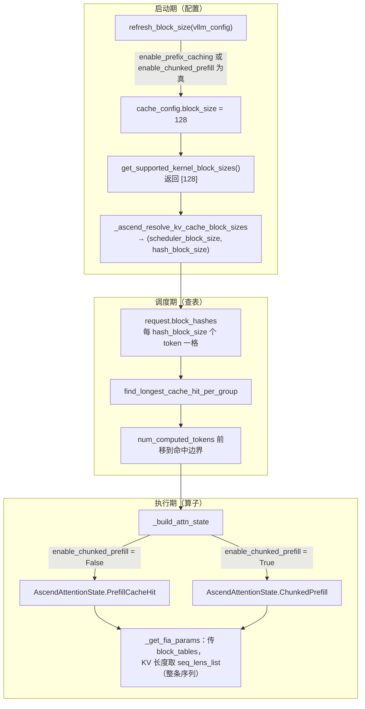

## 一句话

前缀缓存（Automatic Prefix Caching，APC）把已经算完的 KV 以**块**为单位算出哈希登记在表里；新请求进来时逐块比对哈希，相同的前缀直接把旧物理块挂到新请求的块表上，prefill 只需要计算未命中的那一段。vLLM V1 引擎下它**默认开启** [S13]。

## 为什么需要它

同一个服务里的请求往往共享很长的开头：一段几百到几千 token 的系统提示、一组 few-shot 示例、一份被反复追问的文档。没有前缀缓存时，每个请求都要把这段开头从头 prefill 一遍——同样的权重、同样的输入、同样的结果，算 N 次。prefill 的代价与 token 数成正比，共享前缀越长，浪费越大。官方调优表把它的适用场景直接写成「重复前缀（共享系统提示、few-shot 示例）」，并提醒收益完全取决于命中率 [S15]。

前缀缓存的做法是：既然 KV Cache 里存的 K、V 只由「这个 token 及它前面所有 token」唯一决定（形状与布局见 [KV Cache Spec](kv-cache-spec.md)），那么只要两条请求的前 n 个 token 完全一样，它们前 n 个位置的 KV 就是逐位相同的，没有理由算两次。于是把已经算好的 KV 块登记进一张哈希表，下次查得到就直接引用。

**这一整套机制的主体实现在上游 vLLM，不在 vllm-ascend。** 判断依据有三：其一，昇腾平台层 `platform.py` 里唯一读 `enable_prefix_caching` 的地方是 `update_block_size_for_backend`，它只用这个标志在 mamba align 路径上选分支，既没有开关也没有校验 [C10]；其二，块哈希的生成（`request.block_hashes`）与最长命中查找（`find_longest_cache_hit_per_group`）在昇腾自带调度器里都是直接调用上游对象的方法 [C7]；其三，官方支持矩阵开篇就写明本项目的特性支持原则是 "aligned with vLLM"，APC 一栏标为 🟢 Functional 并链到上游 issue [S12]。昇腾侧做的是适配与约束，下一节逐条列出。

块表怎么把旧块挂回新请求、物理块怎么被多条请求共享，见 [Block Table](block-table.md) 与 [PagedAttention](paged-attention.md)，这里不展开。

## 怎么工作

昇腾侧的介入点集中在三段：启动期把块大小钉死、调度期的哈希粒度、执行期的注意力状态。



图中 `_ascend_resolve_kv_cache_block_sizes` 只在「多个 KV cache group 且 DCP ≠ 1」这一支里自己算 `hash_block_size = gcd(各组 block_size)`；单组或 DCP = 1 时它把调用转回上游原函数 [C5]。

**启动期。** `refresh_block_size` 是昇腾侧唯一把「开了前缀缓存」翻译成硬件约束的地方：只要 `enable_prefix_caching` 或 `enable_chunked_prefill` 任一为真，`block_size` 就被改写成 128 并打一行 info 日志 [C1]。两个特性写在同一个 `or` 里，因为约束的来源是同一个——算子只认 128 这个块大小，`AscendAttentionBackend.get_supported_kernel_block_sizes()` 直接返回 `[128]` [C2]。注意这条规则有两处早退：`deepseek_v4` 模型走自己的 32/64/128 分支，混合（attention + mamba）模型直接返回，都够不到这个 `or`。

**调度期。** 哈希不是按 token 算的，是按块算的，而且是**链式**的：第 i 格的哈希把第 i−1 格的哈希当输入，因此「最后一格的细粒度哈希唯一标识整个更大的块」[C6]。这个性质是块粒度哈希能当前缀匹配用的关键——比中一格就等于比中了从序列开头到这一格结尾的全部内容，不需要再往回核对。查表的入口是 `request.block_hashes`（一个按块排列的哈希序列）与 `find_longest_cache_hit_per_group`，命中结果最终体现为 `num_computed_tokens` 往前移。

**执行期。** `num_computed_tokens` 一旦不为 0，`_build_attn_state` 就不会选 `PrefillNoCache`；分支往下走，若 chunked prefill 关着则落到 `PrefillCacheHit`，开着则落到 `ChunkedPrefill`。两个状态在算子入参上的差别看 `_get_fia_params`：`PrefillNoCache` 传 `block_table=None` 且把 KV 长度设成与 query 长度相同；`PrefillCacheHit` 改为传 `attn_metadata.block_tables` 并把 KV 长度取成 `seq_lens_list`（整条序列的长度），而 query 里只有未命中的那几个 token [C4]。**命中时跳过的就是这部分 query 上的全部计算**：QKV 投影、注意力、O 投影、MLP 全都不再跑，被跳过的 token 只以「KV 已经在块里」的身份参与后续 token 的注意力。这段描述以 GQA 后端的 FIA 路径为据，MLA、SFA 各有自己的元数据构造，未逐一核对。

## 拿真实数字走一遍

Qwen3-0.6B：H = 1024，n_q = 16，n_kv = 8，d_h = 128，28 层，bf16。`block_size` 被强制成 128。

**一块 KV 有多大。** 每 token 每层要存 K 和 V 各一份：

```
2 × n_kv × d_h × 2 B = 2 × 8 × 128 × 2 = 4096 B = 4 KiB
```

28 层合计 `28 × 4 KiB = 112 KiB` / token。一块 128 个 token，全 28 层就是 `128 × 112 KiB = 14 MiB`。[D]

**一次命中省了多少。** 设系统提示长 1000 token，第一个请求把它算完并登记。第二个请求 = 同样的 1000 token 系统提示 + 50 token 的问题，共 1050 token。

- 能哈希的整块数：`1000 ÷ 128 = 7` 块，覆盖 `7 × 128 = 896` token。
- 剩下的 `1000 − 896 = 104` token 凑不满一块，不参与哈希，只能重算。
- 命中 896 token，本次需要 prefill 的 token 数 = `1050 − 896 = 154`。

省下的 KV 写入：`896 × 112 KiB = 98 MiB`，与 `7 × 14 MiB = 98 MiB` 对得上。[D]

省下的投影计算（只数 q/k/v/o 四个线性层，每层按 `2 × in × out` 计，不含 MLP 与注意力打分）：

```
q_proj : 2 × 1024 × (16×128) = 4.19 MFLOP
k_proj : 2 × 1024 × ( 8×128) = 2.10 MFLOP
v_proj : 2 × 1024 × ( 8×128) = 2.10 MFLOP
o_proj : 2 × (16×128) × 1024 = 4.19 MFLOP
         ─────────────────────────────────
每 token 每层 12.58 MFLOP → 28 层 352.3 MFLOP/token
896 token → 896 × 352.3 MFLOP ≈ 316 GFLOP
```

[D]

**尾巴上的 104 个 token 是块大小的代价。** 如果块大小能设成 64，`1000 ÷ 64 = 15` 块可覆盖 960 token，多命中 64 个。但在昇腾上做不到——`--block-size 64` 会被 `refresh_block_size` 改回 128 [C1]。

一个可复制的起步配置：

```bash
vllm serve Qwen/Qwen3-0.6B \
  --max-model-len 4096 \
  --block-size 128
```

`--block-size 128` 写出来只是为了和被强制的值保持一致、避免日志里出现意外改写；APC 不需要写 `--enable-prefix-caching`，V1 下默认就是开的，要关用 `--no-enable-prefix-caching`。

## 事实表

| 项 | 值 | 来源 |
|---|---|---|
| 开关字段 | `cache_config.enable_prefix_caching` | `vllm_ascend/platform.py#L334-L335` |
| 命令行 | `--enable-prefix-caching` / `--no-enable-prefix-caching` | `docs/source/tutorials/models/Qwen3.8-27B.md#L464` |
| V1 引擎默认值 | 开启 | `docs/source/user_guide/release_notes.md#L71` |
| 官方支持状态 | 🟢 Functional | `docs/source/user_guide/support_matrix/supported_features.md#L12` |
| 开启后 `block_size` | 强制 128（deepseek_v4 与 hybrid 模型除外） | `vllm_ascend/utils.py#L1195-L1204` |
| 算子支持的块大小 | `[128]` | `vllm_ascend/attention/attention_v1.py#L151-L153` |
| 哈希粒度 | `hash_block_size`；多 group 且 DCP≠1 时 = `gcd(各组 block_size)` | `vllm_ascend/patch/platform/patch_kv_cache_utils.py#L77-L82` |
| 哈希形式 | 链式，末格哈希唯一标识整段前缀 | `..._pool/ascend_store/metadata.py#L684-L687` |
| 哈希序列字段 | `request.block_hashes` | `vllm_ascend/core/recompute_scheduler.py#L122-L125` |
| 命中状态枚举 | `AscendAttentionState.PrefillCacheHit = 1` | `vllm_ascend/attention/attention_v1.py#L156-L161` |
| MRv1 判「无命中」的条件 | `num_computed_tokens_cpu[:num_reqs] == 0` 全为真 | `vllm_ascend/worker/model_runner_v1.py#L1543-L1544` |
| MRv2 判「无命中」的条件 | `seq_lens_np[:num_reqs] == num_scheduled_tokens` | `vllm_ascend/worker/v2/attn_utils.py#L314-L315` |
| `PrefillCacheHit` 生效前提 | `enable_chunked_prefill` 为 False | `vllm_ascend/worker/model_runner_v1.py#L1559-L1562` |
| 命中时算子入参 | `block_table = block_tables[:batch_size]`，KV 长度 = `seq_lens_list` | `vllm_ascend/attention/attention_v1.py#L1313-L1323` |
| 未命中时算子入参 | `block_table = None`，KV 长度 = `actual_seq_lengths_q` | `vllm_ascend/attention/attention_v1.py#L1307-L1310` |
| 会被静默关闭的场景 | DSA attention layer 且后端为 `TRITON_MLA` / `FLASHINFER` | `vllm_ascend/models/layer/attention/layer.py#L122-L127` |
| 硬性不支持 | 310P + model runner v2 → `NotImplementedError` | `vllm_ascend/_310p/worker/v2/model_runner.py#L104-L106` |
| 逐请求旁路字段 | `request.skip_reading_prefix_cache` | `vllm_ascend/core/recompute_scheduler.py#L116-L118` |
| 历史互斥（v0.10.2rc1） | Ascend scheduler 下勿与 chunked prefill 同开 | `docs/source/user_guide/release_notes.md#L1600` |

官方文档在线地址：[Supported Features](https://docs.vllm.ai/projects/ascend/en/latest/user_guide/support_matrix/supported_features.html)、[Release Notes](https://docs.vllm.ai/projects/ascend/en/latest/user_guide/release_notes.html)。

## 常见误解

**「开了前缀缓存，命中的 prefill 就会走 `PrefillCacheHit` 状态。」** 不一定。`_build_attn_state` 的分支顺序里，`enable_chunked_prefill` 的判断排在前面，chunked prefill 开着时命中的 prefill 落进 `ChunkedPrefill` 而不是 `PrefillCacheHit` [C3]。V1 下 chunked prefill 通常是开的，所以 `PrefillCacheHit` 在实际服务里反而少见——它主要出现在显式关掉 chunked prefill 的配置里。

**「命中多少 token 就省多少 token。」** 不对。哈希以块为单位，尾部凑不满一整块的 token 不参与匹配。block_size = 128 时，1000 token 的共享前缀实际只能命中 896 个 [C6]。

**「`platform.py` 里有前缀缓存的开关或校验。」** 没有。该文件里唯一一处 `enable_prefix_caching` 在 `update_block_size_for_backend`，只用来在 mamba align 路径上选分支。真正会把这个标志悄悄改成 `False` 的是 DeepSeek-V4 DSA 的 attention layer 构造函数——它在特定后端下直接改写 `cache_config.enable_prefix_caching`，用户侧不会收到任何提示 [C8]。
