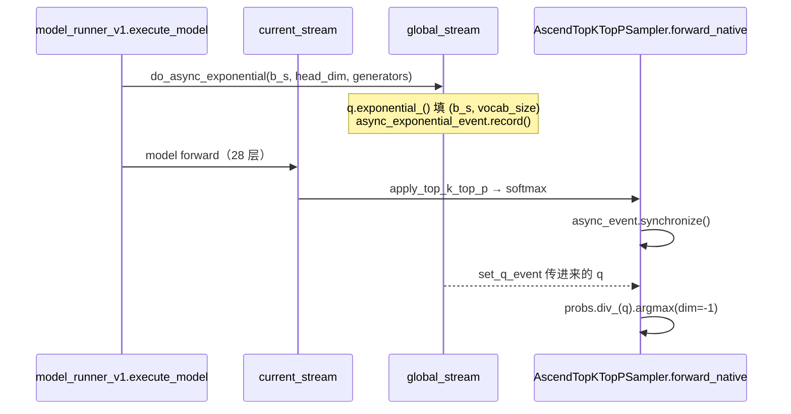

## 一句话

`enable_async_exponential` 把随机采样要用的那批指数分布随机数 `q ~ Exp(1)` 提前到 model forward **之前**、在副 stream `global_stream()` 上生成，让它与整层网络的前向计算重叠，采样时直接取用 [C2]。它与 softmax 无关——指数分布随机数是 softmax **之后**那一步用的。v0.23.0 上默认 `False` [C1]，并已被官方列入待废弃清单 [S8]；main（28bf3a2e）上参数、`do_async_exponential`、`set_q_event` 与事件对象已全部删除 [C11]，行为回到始终走同步路径 [!]。

## 事实表

| 项 | v0.23.0 | main | 意味着什么 |
|---|---|---|---|
| 默认值 | `False` | 参数不存在 | 在 main 上把它写进 `additional_config` 不会报错，只是完全没人读 |
| 类型与入口 | bool，`additional_config` | — | 只能在启动时定，不能按请求开关 |
| `VLLM_BATCH_INVARIANT=1` 时 | 静默置回 `False` [C1] | — | 两者互斥，且没有任何告警；以为开了其实没开 |
| 预生成的 `q` | `(logits_indices.shape[0], vocab_size)`，fp32 [C5] | — | 显存开销随 batch × 词表走，和模型多大无关 |
| Qwen3-0.6B、batch 32 时 `q` | 18.55 MiB / 步 [D] | — | 小模型大词表时这块比 hidden state 还大 |
| 取用前的同步方式 | `Event.synchronize()` | — | 阻塞的是 host 线程，比同步路径的 `wait_stream`（device 侧）代价更重 |
| 与 `enable_reduce_sample` 同开 | `q` 照生成，但分支不取用 | — | 白付一次分配和一次副流计算，零收益 |
| 采样公式 | `probs.div_(q).argmax(dim=-1)` | 同式 | 两条路径数学上同分布，开关本身不改采样语义 |
| 官方状态 | Ready to Deprecate | 已删除 | 新部署不要依赖它 |

## 为什么存在

采样的最后一步不是「按概率抽一个」的 `torch.multinomial`——那会触发 CPU-NPU 同步。vLLM 用的是指数分布竞赛（等价于 Gumbel-max）：给每个候选 token 抽一个独立的 `q_i ~ Exp(1)`，取 `argmax_i(p_i / q_i)`，结果的分布就等于按 `p` 抽样，全程留在设备上。

**这里的 exponential 不是 softmax 里的 `exp`。** softmax 在前一行已经算完了（`logits.softmax(dim=-1, dtype=torch.float32)`），`q.exponential_()` 是在它之后**另外**抽一批服从指数分布的随机数 [C3]。名字撞车是这个参数最容易被误解的地方。

问题在于 `q.exponential_()` 这个填充算子本身在 NPU 上不便宜——源码注释点明它可能落到 AI CPU 上执行 [C2]。同步路径里它夹在 softmax 和 argmax 之间，主流必须等它。本参数做的事就是把这段挪到前面去：



副流上那条 `q.exponential_()` 与主 stream 上整个 forward 并行跑；等采样真正要用 `q` 时它早已就绪。`global_stream()` 是进程级单例流，不是本特性独占的。

引入它的是 PR [#4501](https://github.com/vllm-project/vllm-ascend/pull/4501)。该 PR 描述里给的数据是 A3 上 Qwen2.5-32B 约 +7%、Qwen3-32B 约 +13.3% 吞吐，而 Qwen3-30B（MoE）反而变慢，所以默认值定成了 `False` [I]——这解释了为什么一个「纯赚」的重叠优化不默认开：MoE 模型的副流本来就忙。

精度方面：两条路径的采样公式完全一致，同一个 `generator` 按同样顺序逐行填充，带 seed 的请求拿到的随机数序列不变，所以**分布上没有精度影响**。真正的影响是可复现性口径——`VLLM_BATCH_INVARIANT` 要求逐 batch 位级一致，而本特性换掉了 `q` 的生成时机与分配来源，因此配置层直接把两者判成互斥。

## 开了的代价

**1. 与 batch invariant 静默互斥。** `enable_async_exponential` 只有在 `VLLM_BATCH_INVARIANT` 为假时才真正为真，而且不打日志。上游自己的 e2e 用例为此专门 `monkeypatch.setenv("VLLM_BATCH_INVARIANT", "0")` 并单建一个 `LLM` 实例，注释里写明「would silently disable async_exponential」[C9]。这是最容易踩的坑：开了没生效，profile 上却看不出区别。

可复制的写法（取自该用例）：

```python
llm = LLM(
    model="Qwen/Qwen3-0.6B",
    max_model_len=8192,
    dtype="bfloat16",
    max_num_seqs=32,
    tensor_parallel_size=1,
    additional_config={"enable_async_exponential": True},
)
# 同时确保 VLLM_BATCH_INVARIANT 未被设为 1，否则本项静默失效
```

**2. 每步多一块 batch × 词表的 fp32 显存。** `do_async_exponential` 用 `b_s=logits_indices.shape[0]`、`head_dim=vocab_size` 新建张量——注意 `head_dim` 这个形参名有误导性，它装的是词表大小，不是注意力头维度。Qwen3-0.6B 的 `vocab_size = 151936` [S13]，单行 `151936 × 4 B = 607,744 B ≈ 593.5 KiB`；`max_num_seqs=32` 满载时 `32 × 607,744 B = 19,447,808 B ≈ 18.55 MiB` [D]。同步路径的 `q = torch.empty_like(probs)` 其实一样大 [C4]，所以增量不是「多出一块」，而是「这块的生命周期被拉长到整个 forward」——峰值显存与 forward 的激活峰值撞在一起。

**3. 与 `enable_reduce_sample` 同开时纯亏。** `forward_native` 里取用 `self.q` 的代码在 `enable_reduce_sample` 的 `else` 分支上；走 reduce sample 时 `probs` 的宽度是各 rank 候选拼起来的，根本不是 `vocab_size`，那条分支照旧调 `random_sample` 重新抽一遍。而 `do_async_exponential` 的调用点不看 `enable_reduce_sample`，于是副流上的活白干。同理，若某一步全是 greedy 请求、`forward_native` 压根不被调用，这次分配也是浪费。

**4. 收尾是 host 侧阻塞。** 取用前那句 `self.async_event.synchronize()` 挡住的是调用它的 CPU 线程，而同步路径用的 `torch.npu.current_stream().wait_stream(global_stream())` 只在设备侧排序、不挡 host。在 async scheduling 场景下 host 线程本该提前去准备下一步，这里被拽回来等一下。注释只写了「Add synchronize to prevent synchronize error」，没说明为何不用 `wait_event`。

**5. 跨 stream 分配的张量没有 `record_stream`。** `q` 在 `global_stream()` 上分配、在默认流上被 `div_` 消费，v0.23.0 的 `do_async_exponential` 没有对它调 `record_stream`；而 main 在同步路径的 `random_sample` 里**补上**了 `q.record_stream(torch.npu.current_stream())` [C10]。缓存分配器只按分配流的完成情况回收显存，跨流消费不登记就可能提前复用——源码里没有针对异步路径的直接断言，这是按 main 那条补丁的意图反推出来的 [D]。

**6. main 上已经没有它了。** v0.23.0 的 release notes 就把 “Asynchronous exponential overlap” 写进了 Ready to Deprecate [S8]（[线上页](https://docs.vllm.ai/projects/ascend/en/v0.23.0/user_guide/release_notes.html)），main 上兑现了：`AscendSampler.__init__` 不再建 `async_exponential_event`，`set_q_event` / `do_async_exponential` 两个方法连同 `AscendTopKTopPSampler` 里的取用分支一并删除，`model_runner_v1` 的调用点删除，`additional_config` 文档表里也没有这一行 [!]。main 保留的是同步的 `random_sample`，并给它加了 `record_stream`。**升级到 main 时直接删掉这个配置项即可，没有替代参数需要迁移。** 同批待废弃的还有 layer sharding、FlashComm2 的 multistream-overlap gate、matmul all-reduce 与 weight prefetch 等。

## 版本谱系

> 本节由 `pnpm wiki:lineage` 从 git 历史算出，不由人或 agent 撰写。

| 版本 | 是否存在 |
| --- | --- |
| releases/v0.13.0 | 有（3 个文件） |
| releases/v0.18.0 | 有（3 个文件） |
| releases/v0.20.2rc | 有（3 个文件） |
| releases/v0.21.0rc | 有（3 个文件） |
| releases/v0.22.1rc | 有（3 个文件） |
| releases/v0.23.0 | 有（3 个文件） |
| releases/v0.24.0rc | 有（3 个文件） |
| releases/v0.25.1rc | 无 |
| releases/v0.26.0rc | 无 |
| releases/v0.27.1rc | 无 |
| main | 无 |

**移除**：2026-07-18，PR [#12306](https://github.com/vllm-project/vllm-ascend/pull/12306) —— [Refactor] asnc exponential optimization unset (#12306)

影响面（删除行数最多的几个文件）：

- `vllm_ascend/sample/sampler.py` −33
- `vllm_ascend/ascend_config.py` −9
- `vllm_ascend/worker/model_runner_v1.py` −7

**引入**：2025-12-20，PR [#4501](https://github.com/vllm-project/vllm-ascend/pull/4501) —— [Performance] Add async exponential while model executing (#4501)

