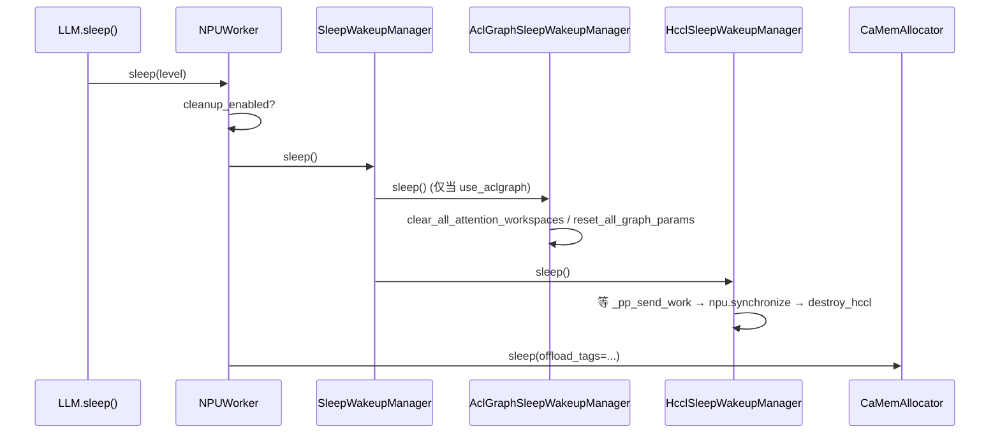

## 一句话

RL 后训练里推理引擎和训练进程抢同一张卡，`sleep()` 默认只退还 sleep-mode 分配器管的那部分显存；打开这个开关后，`sleep()` 还会销毁 HCCL 通信域、清空 ACL 图的 attention workspace 并作废已捕获的图，从而多还一块显存给训练侧 [S8]。代价是唤醒要重建通信域并重新 `capture_model()`，所以默认关闭 [S7]。

**两个版本的配置写法不同**：v0.23.0 是顶层键 `enable_sleep_mode_extra_cleanup`；main 上该键**已被移除**，功能搬到 `rl_config.sleep_mode_extra_cleanup`，且必须与 `rl_config.enabled: true` 同时给 [C10] [!]。行为本身两版一致——做清理的那份代码逐字未变。

## 事实表

| 项 | v0.23.0 | main | 意味着什么 |
|---|---|---|---|
| 配置键 | 顶层 `enable_sleep_mode_extra_cleanup` | `rl_config.sleep_mode_extra_cleanup` [C9] | 把 v0.23.0 的配置原样搬到 main，不是被忽略而是**启动即报错** [!] |
| 类型 / 默认值 | bool / `False` | bool / `false` | 不显式打开就永远不走这条路径 |
| 生效条件 | 本开关为真 | `rl_config.enabled` **与**本开关同时为真 [C11] | main 上只写子键、漏掉 `enabled: true`，等于没开 |
| 取值解析 | `additional_config.get` 取原值，字符串 `"false"` 也是真 | pydantic lax 强转，`"false"` → `False` | v0.23.0 上用字符串传 `"false"` 会**反向打开**开关 [D] |
| 前置开关 | 必须同时 `--enable-sleep-mode` | 同左 | 不开 sleep mode 时这段代码根本不被调用 |
| sleep 时释放 | HCCL 通信域 + ACL 图 workspace | 同左 | ACL 图那一半还要 `model_runner.use_aclgraph` 为真才执行 |
| wake_up 时补偿 | 重建 HCCL + 刷新 MoE 通信域 + `capture_model()` | 同左 | 唤醒延迟上升，量级取决于图捕获耗时 |
| 分标签唤醒 | 仅当 `tags` 为 `None` 或含 `"kv_cache"` 时重捕获图 | 同左 | `wake_up(tags=["weights"])` 不会触发重捕获 |
| 适用部署 | 文档未限定 | 明确限「同卡（same-device）模式」[S13] | 跨卡 RL 走 pause/resume + HCCL 权重传输，不用这个开关 |

官方参数表：[v0.23.0](https://docs.vllm.ai/projects/ascend/en/v0.23.0/user_guide/configuration/additional_config.html) / [latest](https://docs.vllm.ai/projects/ascend/en/latest/user_guide/configuration/additional_config.html)。

## 为什么存在

sleep mode 是给 RL 后训练（PPO / GRPO / DPO 这类在线算法）准备的：生成阶段用 vLLM 跑自回归，训练阶段要同一张 NPU 做前反向，两个阶段的并行策略还常常不同，所以生成一结束就得把显存让出来。`llm.sleep()` 做的就是这件事——level 1 把权重换出到 CPU、丢弃 KV cache，level 2 连权重一起丢。

但 `sleep()` 只管 `CaMemAllocator` 这个内存池里的东西 [C2]。池子之外还压着两块显存：HCCL 通信域自带的缓冲区，以及 ACL 图捕获时留下的 attention workspace。推理侧睡着了，这两块仍占着卡，训练侧就少了这么多可用显存——RL 场景里这往往正是 batch size 上不去的那一档。这个开关就是把这两块也一并退还。



清理发生在分配器换出**之前**，唤醒时顺序反过来：先 `CaMemAllocator.wake_up()` 恢复权重与 KV cache，再 `restore_hccl()` 重建通信域、`refresh_moe_hccl_groups()` 刷新 MoE dispatcher 手里的通信域句柄，最后视 `tags` 决定要不要 `capture_model()` [C5]。

main 上这个开关被收进 `rl_config` 这个「RL 一键模式」子配置：`rl_config.enabled` 为真时会连带强制 `weight_nz_mode=0`、设 `VLLM_SERVER_DEV_MODE=1`、从 `PYTORCH_NPU_ALLOC_CONF` 里摘掉 `expandable_segments`（它与 sleep-mode 内存池不兼容）[S17]。换句话说，搬家不只是改了个名字——旧写法要用户自己逐项配的那些 RL 前置项，现在由 `enabled: true` 一次给全。迁移逐字对照见官方迁移表。

## 开了的代价

**唤醒变慢，这是主要代价。** 睡前作废了已捕获的 ACL 图，唤醒就必须重新 `capture_model()` 把图全部重捕获一遍；HCCL 通信域也要逐个 `restore_hccl()` 重建。官方把这条取舍写得很直白：**当「唤醒快」比「睡时省显存」更重要时，保持这个开关关闭** [S8]。默认值 `False` 就是按这个判断定的。

几个容易踩的点：

- **main 上必须写两个键。** `rl_config.enabled and rl_config.sleep_mode_extra_cleanup` 是与关系，只给子键不给 `enabled: true` 静默无效——上游单测里就专门造了这个组合来验证不走清理路径 [C16]。
- **v0.23.0 上别用字符串传值。** 那一版直接 `additional_config.get(...)` 取原值再当布尔用，JSON 里写 `"false"`（带引号）在 Python 里是真值，结果是**想关反而开了**；main 有 pydantic lax 强转，不吃这个亏 [D]。
- **旧写法在 main 上是硬错误，不是无效配置。** 顶层未知键不在豁免名单里，会原样进入 `extra="forbid"` 的 `AscendConfig`，构造阶段就抛验证错误 [C12] [!]。这一条是好事——迁移漏改会立刻暴露，而不是跑起来才发现显存没省下来。
- **分标签唤醒时重捕获只发生一次。** level 2 的两段式唤醒 `wake_up(tags=["weights"])` → 外部灌新权重 → `wake_up(tags=["kv_cache"])`，图只在第二次捕获；顺序反过来会在权重还没就位时把图捕获掉。
- **ACL 图没开时只省下 HCCL 那一半。** ACL 图清理受 `model_runner.use_aclgraph` 门控 [C4]，eager 模式下打开这个开关只释放通信域内存，唤醒代价也相应只剩重建 HCCL。

完整可复制的启动命令（main，同卡模式）：

```bash
VLLM_WORKER_MULTIPROC_METHOD=spawn \
vllm serve Qwen/Qwen3-0.6B \
    --enable-sleep-mode \
    --additional-config '{"rl_config": {"enabled": true, "sleep_mode_extra_cleanup": true}}'
```

v0.23.0 上的等价写法是 `--additional-config '{"enable_sleep_mode_extra_cleanup": true}'`，其余不变。

## 版本谱系

> 本节由 `pnpm wiki:lineage` 从 git 历史算出。标识符的文本存在不等同于运行时功能可用；引入／移除均比较提交与父提交。

| 版本 | 是否存在 |
| --- | --- |
| main | 无 |
| releases/v0.23.0 | 有（2 个文件） |

- **引入**：2026-06-22 · 92eeab2fe9a73394d2118de3c8459d69cc9d8e62 · PR [#9585](https://github.com/vllm-project/vllm-ascend/pull/9585) —— [Feature] vllm-ascend sleep mode optimization for residual memory usage (#9585)
  包含该提交的 tag：v0.23.0、v0.23.0rc1、v0.24.0rc1、v0.25.1rc1、v0.26.0rc1；分支：main、origin/dependabot/github_actions/actions/labeler-7、origin/dependabot/github_actions/actions/setup-python-7.0.0、origin/main、origin/releases/v0.23.0、origin/releases/v0.24.0rc、origin/releases/v0.25.1rc、origin/releases/v0.26.0rc、origin/releases/v0.27.1rc、origin/revert-13905-releases/v0.23.0_bugbix_w8a8_mxfp8_for_rl、origin/revert-15210-glm52_v2_dspark、origin/rfc/community-contrib、origin/rfc/megakernel、origin/rfc/vllm_cann
  - `vllm_ascend/patch/worker/patch_distributed.py` +85 / −49（文本行变化）
  - `vllm_ascend/ascend_config.py` +2 / −0（文本行变化）
  - `vllm_ascend/compilation/acl_graph.py` +2 / −0（文本行变化）
  - `vllm_ascend/device_allocator/sleep_mem_optimized.py` +186 / −0（文本行变化）
  - `vllm_ascend/ops/fused_moe/token_dispatcher.py` +7 / −0（文本行变化）
- **移除**：2026-08-24 · 9cf7a0a23944b032d512040f4da542777042cc3e · PR [#13838](https://github.com/vllm-project/vllm-ascend/pull/13838) —— [Refactor][Config] Migrate AscendConfig to @config pydantic dataclass (#13838)
  包含该提交的 tag：未找到；分支：main、origin/dependabot/github_actions/actions/labeler-7、origin/dependabot/github_actions/actions/setup-python-7.0.0、origin/main、origin/releases/v0.27.1rc、origin/revert-15210-glm52_v2_dspark、origin/rfc/megakernel
  - `vllm_ascend/ascend_config.py` +674 / −748（文本行变化）
  - `vllm_ascend/utils.py` +17 / −25（文本行变化）
  - `vllm_ascend/compilation/graph_fusion_pass_manager.py` +7 / −5（文本行变化）
  - `vllm_ascend/model_loader/rfork/rfork_loader.py` +3 / −5（文本行变化）
  - `vllm_ascend/spec_decode/llm_base_proposer.py` +5 / −3（文本行变化）

当前含该标识符的 tag：v0.23.0、v0.23.0rc1、v0.24.0rc1、v0.25.1rc1、v0.26.0rc1

## 参数定义（自动生成）

> 此节由参数扫描结果生成；静态定义不保证运行时最终值。

| 项 | 静态记录 |
| --- | --- |
| 标识 | `additional_config["enable_sleep_mode_extra_cleanup"]` |
| 类型 | `unknown` |
| 默认表达式 | `False` |
| 定义 | `vllm_ascend/ascend_config.py:163` [C18] |
| 版本 | releases/v0.23.0 · 2c59ff1047573f40a471cf7535f01a8877344415 |

字段注释：

源码未提供字段注释。

约束线索（须结合 validator 的控制流核对，不作为独立运行时保证）：
