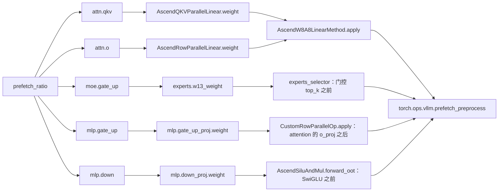

## 一句话

`prefetch_ratio` 是 `--additional-config` 里 [weight_prefetch_config](weight-prefetch-config.md) 下的嵌套 dict，按 `attn` / `moe` / `mlp` 三组、共五个权重分别声明"把这块权重的前百分之几提前搬进 L2"；v0.23.0 的默认值是 `{"attn": {"qkv": 1.0, "o": 1.0}, "moe": {"gate_up": 0.8}, "mlp": {"gate_up": 1.0, "down": 1.0}}` [S15]，main 上这个键连同整个 weight prefetch 特性已被移除 [C16]。

## 事实表

| 项 | v0.23.0 | main | 意味着什么 |
|---|---|---|---|
| 是否存在 | `weight_prefetch_config.prefetch_ratio` | 不存在，且未知键硬失败 | 旧启动脚本原样搬到 main 会在配置校验阶段直接报错，不是静默忽略 [D] |
| 类型 / 默认值 | dict，`{"attn":{"qkv":1.0,"o":1.0},"moe":{"gate_up":0.8},"mlp":{"gate_up":1.0,"down":1.0}}` | — | 顶层只要传了这个键就整个替换默认值，不做逐键合并 |
| 每项取值范围 | `0 ≤ r ≤ 1`，越界项被静默丢弃 | — | 写 `1.2` 不报错，但那一项等同于没配 |
| 某项缺失或越界时 | `.get(prefix, 0)` → 字节数 0 → `max_size <= 0` 被改写成全量 [C5] | — | 漏写一项不是"不预取"，而是 **100% 预取**，方向正好反了 [D] |
| 整组全为 0 | 该组 `enable` 置 False，完全不预取 | — | 这是关掉某一组的唯一正确写法 |
| 单次预取上限 | `mlp` 两项在 Python 侧截到 18 MiB [C6]；`attn`/`moe` 不截，由后端截 | — | 只要 `ratio × 单卡权重字节数 ≥ 18 MiB`，改比例看不出任何差别 [D] |
| `attn.qkv` / `attn.o` 生效条件 | 仅 `AscendW8A8LinearMethod.apply` 内的 QKV / RowParallel 线性层 | — | 非 W8A8 静态量化的模型改这两个值完全无效 |
| `moe.gate_up` 生效条件 | MoE 模型，且该次 forward 的 token 数 ≥ 96 | — | 小 batch decode 时这一项自动不生效 |
| `mlp.gate_up` / `mlp.down` 生效条件 | 稠密模型，且 `num_tokens < 500`；`down` 另需开序列并行 | — | MoE 模型改 `mlp.*` 无效，反之亦然 |
| 默认值的标定场景 | Qwen3-235B-A22B-W8A8 @ `--max-num-seqs 144`、Qwen3-32B-W8A8 @ `72` [S14] | — | 并发量与之相差很远时，默认值没有理由继续最优 |

## 为什么存在

权重预取的机制、触发条件与整体取舍在 [weight_prefetch_config](weight-prefetch-config.md) 那页。这里只管一件事：**搬多少**。搬得太少收益拿不满，搬得太多则与同一段 vector 计算抢 MTE 与 L2 带宽，反而更慢——所以上游加了 `prefetch_ratio`，让用户按具体负载调整这个尺寸 [S14]。

比例要按权重种类分开给，是因为五个权重各自被藏在长度完全不同的 vector 窗口后面，起点也不在同一个算子里：

`attn` 组用层的类名而不是权重名来路由：`AscendQKVParallelLinear` 对应 `qkv`，`AscendRowParallelLinear` 对应 `o`。`moe.gate_up` 打到的是融合 MoE 的 `w13_weight`——本卡全部局部专家的 gate 与 up 权重栈，不是单个专家。

**`moe` 的 0.8 从哪来。** 源码与官方文档都没有给出推导，文档只说这套默认值在 Qwen3-235B-A22B-W8A8、`--max-num-seqs 144` 下表现良好，所以它是一个标定出来的经验值 [I]。机制上说得通的解释是：`moe.gate_up` 的遮蔽窗口是门控 top_k 那一小段 vector 计算，比 SwiGLU、RMSNorm 都短，而要搬的 `w13_weight` 又比任何单个稠密矩阵大几个量级，留 20% 余量可以降低预取压满带宽的风险 [I]。

但把 18 MiB 上限代进去算一遍，这个解释就站不住了：只要 `0.8 × w13_weight 字节数 ≥ 18 MiB`，也就是权重超过 22.5 MiB，0.8 与 1.0 会被截到同一个值 [D]。取 `H = 4096`、`moe_intermediate = 1536`、W8A8（每元素 1 字节）[A]，单个专家的 w13 就是 `2 × 1536 × 4096 × 1 B = 12 MiB`，本卡只要有 2 个以上局部专家就已经越过 22.5 MiB。**在它自己的标定场景里，`moe.gate_up` 写 0.8 还是 1.0 很可能没有可观测差别** [D]。

## 开了的代价

**调大**：预取搬运与同一段 vector 计算争 MTE 与 L2，预取没能在 vector 算完之前结束就变成净开销，官方给的判据是抓 profiling，看那条单独流上的 CMO 操作是否落在对应 vector 算子的时间窗内、且不晚于它结束 [S14]。低延迟优先的场景上游直接建议不要开这个特性。

**调小**：收益拿不满；低并发下预取本来就没优势，文档建议调小或干脆关掉。

**超过 18 MiB 的部分白给**：判断口径是 `ratio × 该权重的单卡字节数` 与 18 MiB 比大小。`mlp` 两项在 Python 侧就被夹到 18 MiB，`attn` / `moe` 由后端夹。大模型的 MoE 专家栈、稠密模型的 `gate_up_proj` 通常远超这个数，比例在那里只是个饱和了的旋钮；而单卡切分后落在 18 MiB 以内的 QKV 投影，比例才真正线性起作用 [D]。

**三个容易踩空的写法**：

1. **漏写一项 = 把它开到 100%，不是关掉。** 传 `{"attn": {"qkv": 0.5}}` 时，`attn` 组非空所以不会回退默认值，`o` 取不到就按 0 算字节数，而 `maybe_npu_prefetch` 遇到 `max_size <= 0` 会改写成整块权重 [C7]。结果是你想收紧 attn，`o` 反而从 1.0 变成了全量。同理写 `{"mlp": {"gate_up": 1.0, "down": 0}}` 也不会关掉 `down`。
2. **想关掉一组，要把该组所有项都写成 0。** 全 0 时 `enable` 被置 False，这一组才真正不预取；写成空 dict 或整组不写，都会回退到该组的内建默认值。
3. **越界值不报错。** `1.2`、`-0.5` 会被静默丢出字典（上游单测锁死了这个行为），随后落进第 1 条的全量分支。

**main 上的去向**：v0.23.0 的发布说明已把 weight prefetch 整体列入待废弃清单，main 上 `WeightPrefetchConfig`、`prefetch_ratio`、`ops/weight_prefetch.py` 与 `prefetch_preprocess` 算子注册均已不存在，`AscendConfig` 自述的"全部受支持键"里也没有 `weight_prefetch_config`。因为 main 把未知键改成了 `extra="forbid"` 的硬失败 [C17]，旧脚本里残留的这段 JSON 会让服务起不来——main 仓库自己的 e2e 用例和 Qwen3 稠密模型教程里都还留着这样的启动参数，迁移时要按该特性整体移除来清理，没有等价的替代开关 [!]。

## 版本谱系

> 本节由 `pnpm wiki:lineage` 从 git 历史算出。标识符的文本存在不等同于运行时功能可用；引入／移除均比较提交与父提交。

| 版本 | 是否存在 |
| --- | --- |
| main | 无 |
| releases/v0.23.0 | 有（2 个文件） |

- **引入**：2025-10-09 · ff3757593614964f7ab91dab3da0c4aee568bec8 · PR [#3146](https://github.com/vllm-project/vllm-ascend/pull/3146) —— [1/N][Feat] Add weight prefetch feature for Attention layers (#3146)
  包含该提交的 tag：v0.11.0、v0.11.0rc1、v0.11.0rc2、v0.11.0rc3、v0.12.0rc1、v0.13.0、v0.13.0rc1、v0.13.0rc2、v0.13.0rc3、v0.14.0rc1、v0.15.0rc1、v0.16.0rc1、v0.17.0rc1、v0.18.0、v0.18.0rc1、v0.19.1rc1、v0.20.2rc1、v0.21.0rc1、v0.22.1rc1、v0.23.0、v0.23.0rc1、v0.24.0rc1、v0.25.1rc1、v0.26.0rc1；分支：main、origin/dependabot/github_actions/actions/labeler-7、origin/dependabot/github_actions/actions/setup-python-7.0.0、origin/main、origin/releases/v0.13.0、origin/releases/v0.18.0、origin/releases/v0.20.2rc、origin/releases/v0.21.0rc、origin/releases/v0.22.1rc、origin/releases/v0.23.0、origin/releases/v0.24.0rc、origin/releases/v0.25.1rc、origin/releases/v0.26.0rc、origin/releases/v0.27.1rc、origin/revert-13905-releases/v0.23.0_bugbix_w8a8_mxfp8_for_rl、origin/revert-15210-glm52_v2_dspark、origin/rfc/community-contrib、origin/rfc/megakernel、origin/rfc/vllm_cann、origin/v0.11.0-dev
  - `vllm_ascend/utils.py` +10 / −14（文本行变化）
  - `vllm_ascend/attention/mla_v1.py` +13 / −13（文本行变化）
  - `vllm_ascend/torchair/torchair_mla.py` +13 / −13（文本行变化）
  - `vllm_ascend/torchair/models/torchair_deepseek_v2.py` +5 / −4（文本行变化）
  - `vllm_ascend/ascend_forward_context.py` +11 / −2（文本行变化）
- **移除**：2026-07-16 · e77502ef715f612f2cc6f3c833174431f26cb765 · PR [#11949](https://github.com/vllm-project/vllm-ascend/pull/11949) —— [Refactor] Remove weight prefetch config (#11949)
  包含该提交的 tag：v0.24.0rc1、v0.25.1rc1、v0.26.0rc1；分支：main、origin/dependabot/github_actions/actions/labeler-7、origin/dependabot/github_actions/actions/setup-python-7.0.0、origin/main、origin/releases/v0.24.0rc、origin/releases/v0.25.1rc、origin/releases/v0.26.0rc、origin/releases/v0.27.1rc、origin/revert-15210-glm52_v2_dspark、origin/rfc/megakernel
  - `vllm_ascend/ops/weight_prefetch.py` +0 / −238（文本行变化）
  - `vllm_ascend/ops/register_custom_ops.py` +1 / −40（文本行变化）
  - `vllm_ascend/utils.py` +1 / −25（文本行变化）
  - `vllm_ascend/ascend_config.py` +0 / −22（文本行变化）
  - `vllm_ascend/quantization/methods/w8a8_static.py` +0 / −15（文本行变化）

当前含该标识符的 tag：v0.11.0、v0.11.0rc1、v0.11.0rc2、v0.11.0rc3、v0.12.0rc1、v0.13.0、v0.13.0rc1、v0.13.0rc2、v0.13.0rc3、v0.14.0rc1、v0.15.0rc1、v0.16.0rc1、v0.17.0rc1、v0.18.0、v0.18.0rc1、v0.19.1rc1、v0.20.2rc1、v0.21.0rc1、v0.22.1rc1、v0.23.0、v0.23.0rc1

## 参数定义（自动生成）

> 此节由参数扫描结果生成；静态定义不保证运行时最终值。

| 项 | 静态记录 |
| --- | --- |
| 标识 | `additional_config["prefetch_ratio"]` |
| 类型 | `dict` |
| 默认表达式 | `{'attn': {'qkv': 1.0, 'o': 1.0}, 'moe': {'gate_up': 0.8}, 'mlp': {'gate_up': 1.0, 'down': 1.0}}` |
| 定义 | `vllm_ascend/ascend_config.py:709` [C20] |
| 版本 | releases/v0.23.0 · 2c59ff1047573f40a471cf7535f01a8877344415 |

字段注释：

源码未提供字段注释。

约束线索（须结合 validator 的控制流核对，不作为独立运行时保证）：
